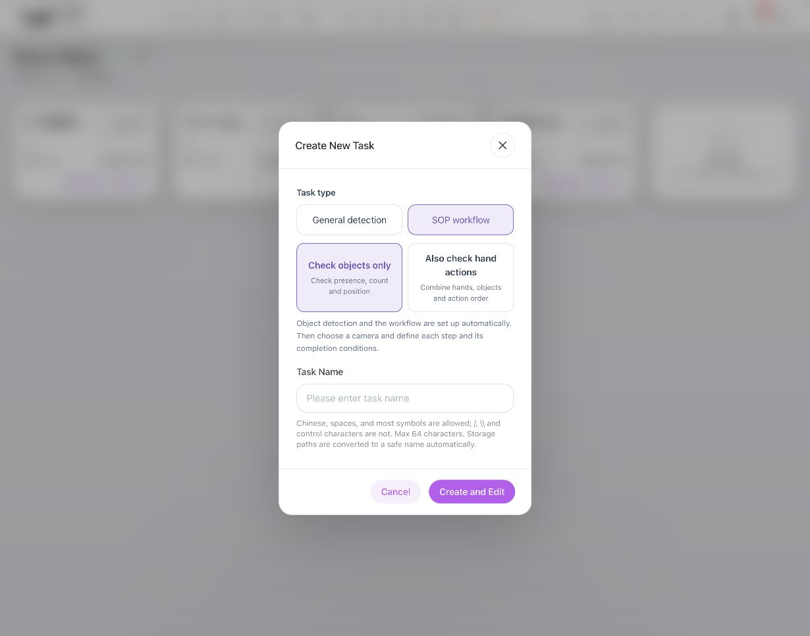
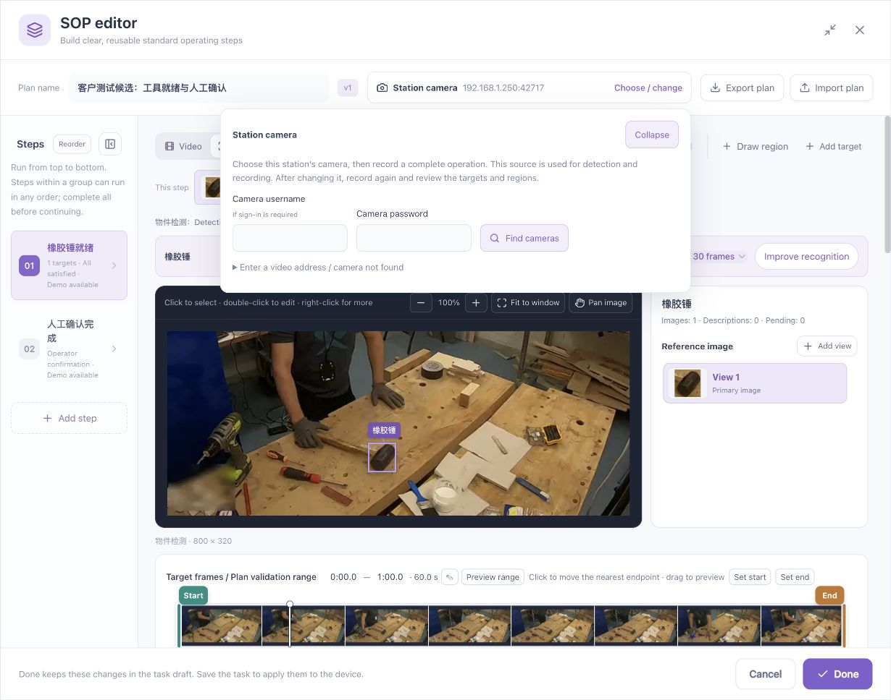
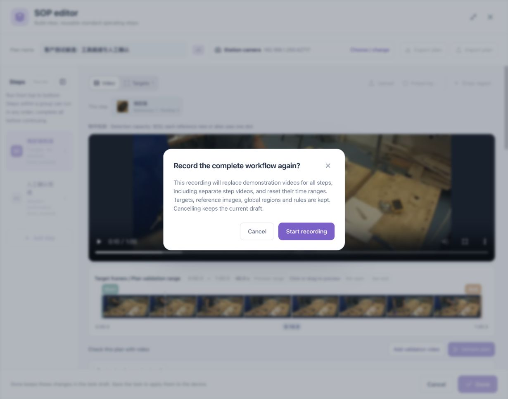
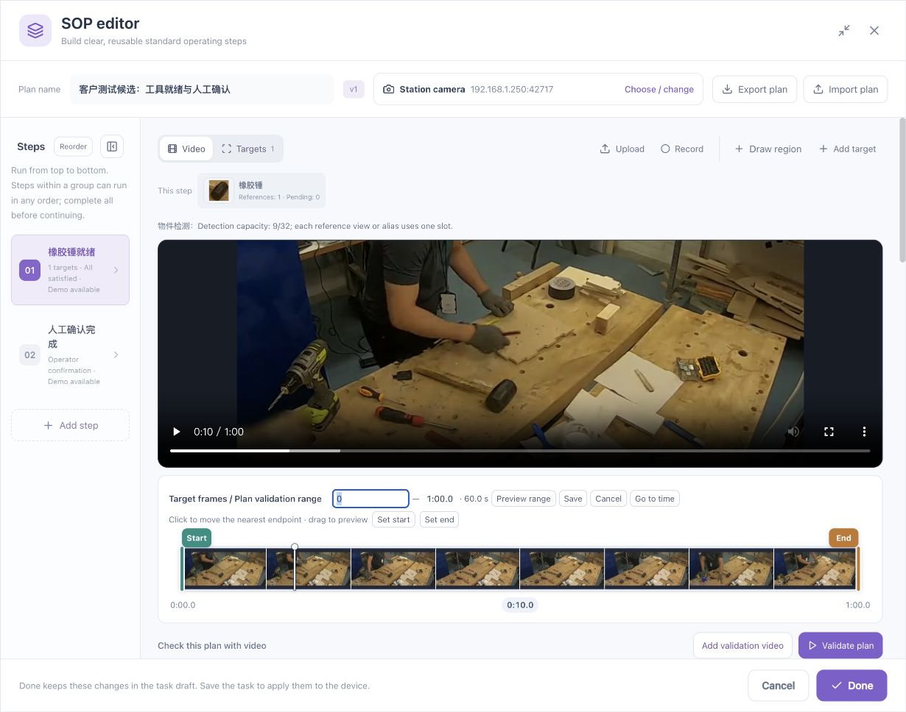
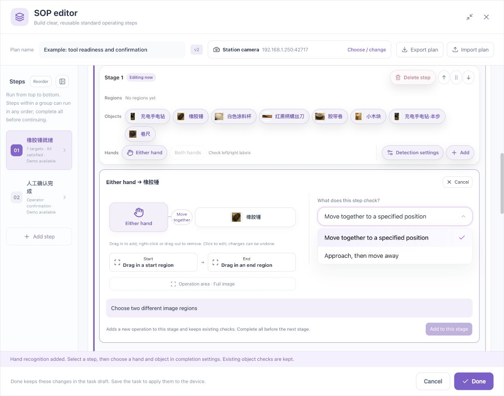
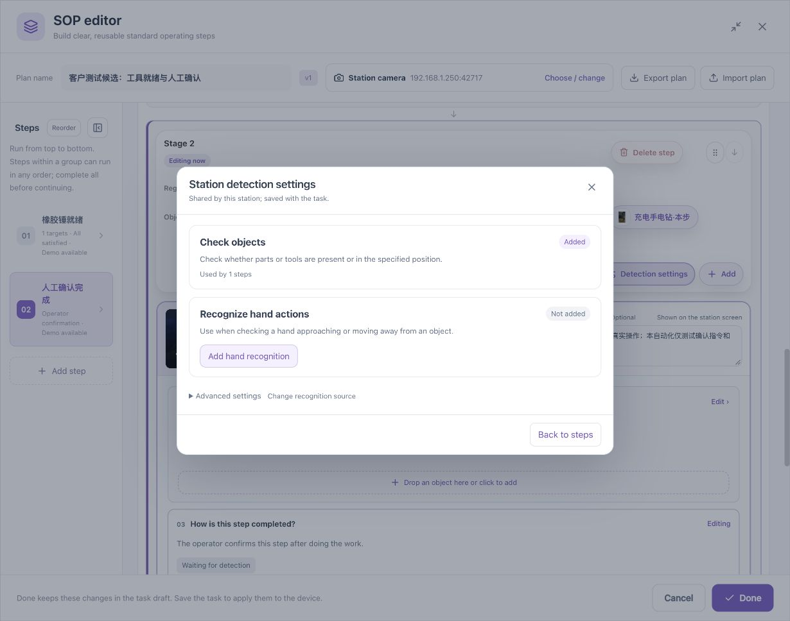
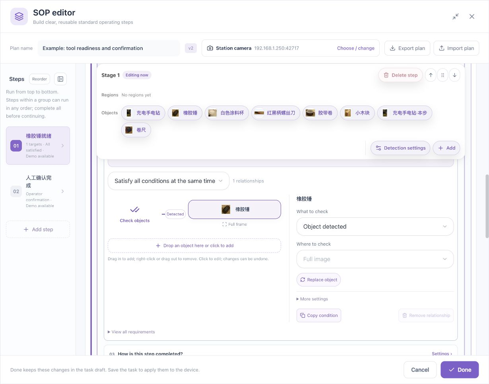
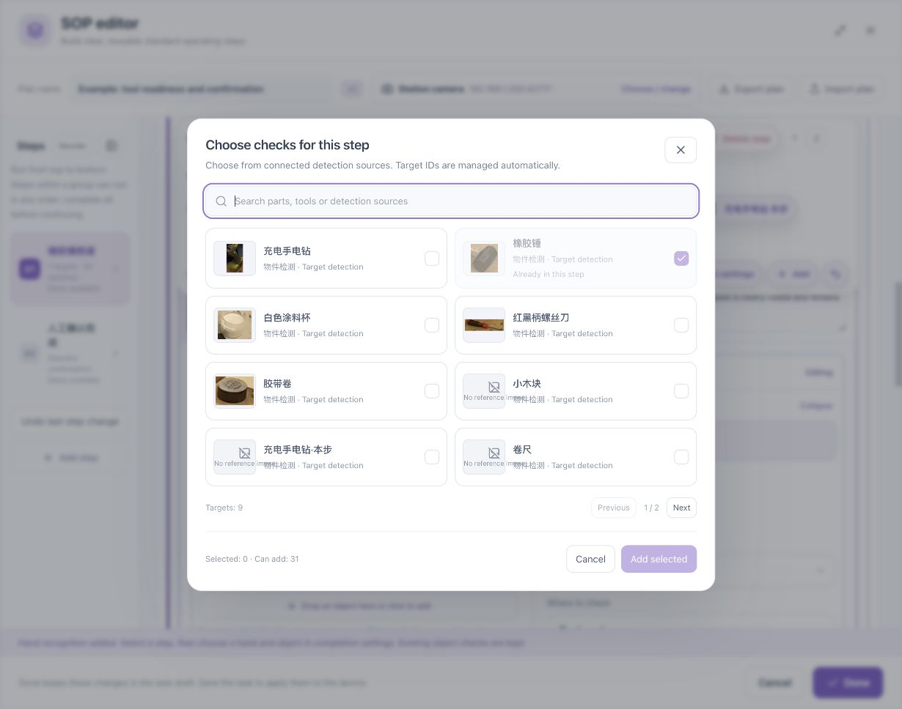
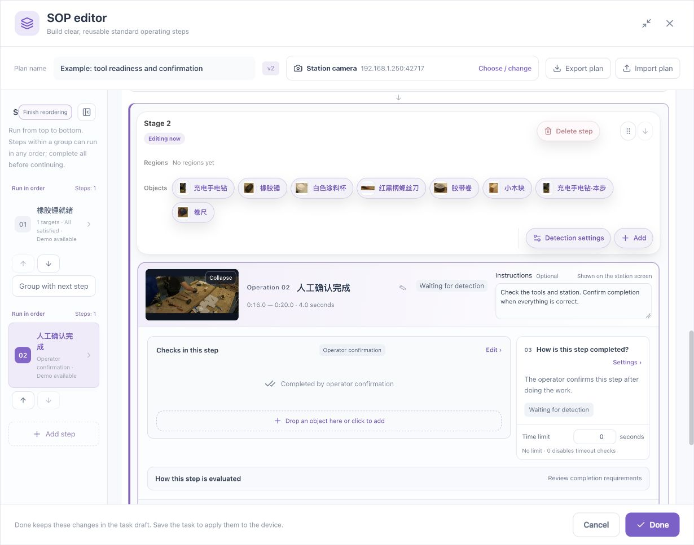

# Tool and Button Reference: Locations and Effects

[简体中文](../../zh/sop/control-reference.md) · [Manual home](index.md)

Use this chapter to identify a control while working. Each group provides an actual interface screenshot followed by location, purpose, availability, result, and verification. Click figures to enlarge. Controls depend on mode, selection, capability, and busy/read-only state. A missing control is not a reason to recreate the task.

## 1. Identify the window first

| Window | How to recognize it | Confirmation at this level |
|---|---|---|
| Task list | Device task cards | Select or create a task |
| Outer task editor | Graph of video, algorithm, and SOP nodes | Save the task; Run is a separate action |
| SOP node settings | Station name and Edit steps | Confirm the node |
| SOP editor | Plan bar, step list, video, and rules | Done returns edits to the draft |
| Child dialog or operation setup | Camera, detection settings, target picker, or hand setup | Confirm that selection or add the operation |

If a control cannot be found, close the uppermost child dialog and identify the current layer. Do not use the outer **Run** control to try to open configuration.

## 2. Create Task dialog

[{style="position:absolute;max-width:none;width:294.117647%;left:-97.058824%;top:-28.125000%;"}](../../assets/sop/en-02-create-task.jpg)

1
2
3
4

Figure C1 · Create an SOP task: choose a type, name it, then create. Numbers are manual location aids, not product buttons. Open the image for the unmodified capture; the following tables explain the controls.

| Marker | Location and control group |
|---|---|
| **1** | SOP workflow: right side of task type |
| **2** | Object/hand choices: two cards below the type |
| **3** | Task name: field in the lower half |
| **4** | Create and Edit / Cancel: dialog footer |

The upper area chooses task type, the middle selects object/hand capabilities, and the lower area contains the task name. Creation is at the lower right.

| Control | Purpose | Verify |
|---|---|---|
| General detection | Create an ordinary analysis graph | This is not the SOP-authoring path |
| SOP workflow | Create a task with a procedure workflow | Continue by selecting object or hand needs |
| Check objects only | Begin with objects, counts, and positions | Does not require hand checks in every step |
| Also check hand operations | Prepare hand/object capabilities | Specific hand conditions still need configuration |
| Task Name | A recognizable station task name | Resolve empty or invalid input using the displayed message |
| Create and Edit | Create and enter editing | Does not mean running or validated |
| Cancel / close | Leave creation | An incomplete creation is not a saved task |

## 3. Window and plan bar

1
2
3
4
5
6

Figure C2 · Editor overview: plan, navigation, targets, references, and completion. Numbers are manual location aids, not product buttons. Open the image for the unmodified capture; the following tables explain the controls.

| Marker | Location and control group |
|---|---|
| **1** | Plan bar: camera and import/export; window controls are above at right |
| **2** | Step list: reorder/collapse at top, step cards below |
| **3** | Workspace upper left: Video / Targets |
| **4** | Canvas upper right: zoom, fit, and pan |
| **5** | Right of picture: reference list and Add view |
| **6** | Editor footer right: Done returns to the task draft |

| Location/control | Effect | Verify |
|---|---|---|
| Top right: maximize/restore | Expand or restore editor space | View changes, not rules |
| Top right: close | Leave the editor | Resolve unsaved changes |
| Plan name | Rename the current plan | User data is not translated by locale changes |
| Version badge | Display version information | Not an editable process name |
| Camera: Choose / change | Open station-source selection | Address, credentials, and actual picture |
| Export plan | Download exportable plan content | Keep the file; do not assume every video is an independent backup |
| Import plan | Load a plan file | Read replacement/compatibility messages; inspect sources, targets, regions, and rules, then validate |
| Step-list collapse/expand | Change sidebar width | Numbered navigation remains |
| Add step / plus | Add a work unit | Configure its name, instructions, checks, and completion |

## 4. Camera picker

[{style="position:absolute;max-width:none;width:178.571429%;left:-42.857143%;top:-53.571429%;"}](../../assets/sop/en-05-camera.jpg)

1
2
3
4

Figure C3 · Camera controls: credentials, discovery, and an existing address. Numbers are manual location aids, not product buttons. Open the image for the unmodified capture; the following tables explain the controls.

| Marker | Location and control group |
|---|---|
| **1** | Camera credentials: middle of popover; both fields are empty |
| **2** | Find cameras: right of password |
| **3** | Existing address / camera not found: disclosure below fields |
| **4** | Collapse: popover upper right |

| Control | Location/use | Important detail |
|---|---|---|
| Video source | Upper selection when several inputs exist | Choose the correct station |
| Username | Search form | May differ from device Web login |
| Password | Search form | Camera authentication; not operator instructions |
| Search | After authentication fields | Wait while discovery is running |
| Use | Beside a discovered camera | Verify the source after returning |
| Existing-address entry | Collapsible area below discovery | Administrator checks address/network when discovery is unavailable |
| Use this address | After a valid address | Disabled for invalid input; repeated clicks do not correct its format |

## 5. Video and recording controls

1
2
3
4
5

Figure C4 · Teaching video: media tools, player, and the overall range. Numbers are manual location aids, not product buttons. Open the image for the unmodified capture; the following tables explain the controls.

| Marker | Location and control group |
|---|---|
| **1** | Workspace upper right: Upload, Record, Draw region, Add target |
| **2** | Player lower left: play/pause; volume and fullscreen are at right |
| **3** | Player bottom: playback seek bar |
| **4** | Below player: overall target-scan / plan-validation range |
| **5** | Below range at right: Add validation video and Validate plan |

| Control | Location | Purpose and result |
|---|---|---|
| Video | Upper-left workspace switch | Teaching playback, seeking, and drawing |
| Targets | Beside Video | Target/reference work; may be unavailable without a target/picture or while busy |
| Upload | Media toolbar | Select process footage; wait for processing and thumbnails |
| Record | Beside Upload | Prepare capture from the selected station |
| Play/Pause | Video controls | Viewing only; does not define completion rules |
| Video progress bar | Player bottom | Seek teaching footage, not a stage-range edit |
| Volume | Player controls | Playback sound; visual conditions do not prove events from audio |
| Full screen | Player's right side | Expand video, not the entire SOP editor |
| More | Player's right side | Browser-provided functions; contents depend on the browser |

### 5.1 Recording states

[{style="position:absolute;max-width:none;width:263.157895%;left:-81.578947%;top:-128.571429%;"}](../../assets/sop/en-07-record-warning.jpg)

1
2
3

Figure C5 · Re-recording: read the replacement scope before cancelling or starting. Numbers are manual location aids, not product buttons. Open the image for the unmodified capture; the following tables explain the controls.

| Marker | Location and control group |
|---|---|
| **1** | Dialog body: replacement scope, reset ranges, and retained data |
| **2** | Cancel: keep current editing and return |
| **3** | Start recording: use only when replacement is intended |

| Control | When used | Effect |
|---|---|---|
| Start/continue recording | Source ready and replacement intended | Begin new teaching capture |
| Stop and use | After capturing the complete action | Stop and wait for a usable asset |
| Cancel recording | Discard the new capture | Inspect the outcome and existing draft |
| Leave waiting / uncertain-state entry | Outcome not yet known | Reconcile the original action before another capture |
| Cancel in replacement dialog | Preserve existing material | Return without starting |
| Start in replacement dialog | After reading replacement scope | May replace whole-process and separate step demos and reset related ranges; check what references, regions, and rules remain |

For replay, use playback rather than Record.

## 6. Canvas toolbar and context menu

1
2
3

Figure C6 · Canvas: view controls and target box. Numbers are manual location aids, not product buttons. Open the image for the unmodified capture; the following tables explain the controls.

| Marker | Location and control group |
|---|---|
| **1** | Canvas top right: minus, scale, plus, fit, pan |
| **2** | Target box: select, double-click to edit, right-click for more |
| **3** | Canvas top left: interaction hint |

| Control | Location | Purpose |
|---|---|---|
| Minus | Above the picture | Zoom out until the display limit |
| Percentage | Between minus and plus | Viewing scale, not a detection score |
| Plus | Beside scale | Zoom in without adding source resolution |
| Fit window | Canvas toolbar | Restore suitable viewing scale |
| Pan image | Canvas toolbar | Toggle panning; check this mode before drawing |
| Click a box | Existing picture box | Select its target |
| Double-click a box | Existing picture box | Open its supported edit mode |
| Right-click a box | Existing picture box | Edit/remove menu; identify the subject first |
| Redraw | Polygon-edit tools | Restart the current outline, not the plan |
| Close polygon | After sufficient valid vertices | Complete the outline before naming/confirmation |
| Vertex handle | Polygon outline | Adjust that vertex, then inspect geometry |

Removing a box, deleting a region, and deleting a step affect different objects.

## 7. Targets and reference views

1
2
3
4
5

Figure C7 · Target references: view list, additional views, and recognition review. Numbers are manual location aids, not product buttons. Open the image for the unmodified capture; the following tables explain the controls.

| Marker | Location and control group |
|---|---|
| **1** | Current target card: name, reference count, and pending count |
| **2** | Reference panel header: selected target and image/pending counts |
| **3** | Add view: right of the Reference image title |
| **4** | View card: select and compare with the main picture |
| **5** | Improve recognition: right end of the target heading |

| Control | Location | Purpose and verification |
|---|---|---|
| Add target | Workspace toolbar | Seek a clear frame, draw, name, and choose a source if needed |
| Use current frame | Reference-frame confirmation | Use the paused image; verify its time |
| Target name | Drawing form | Logical object name, not a view name |
| Detection source | New-target form with several sources | Choose who detects this target |
| Add to this step | New-target confirmation | Add the target; then inspect count, region, and completion |
| Cancel drawing | Drawing form | Discard the unsubmitted box |
| Add view | Reference-list heading | Add another appearance of the same target |
| Save additional reference | Additional-view form | Save that view |
| Apply changes | Existing-target form | Apply edits and inspect affected steps |
| This step / all using steps | Shared-target edit scope | Read affected names first |
| View card | Reference list | Show and inspect that view |
| Remove additional view | Available on selected non-primary view | Remove the view, not the entire logical target |
| Reload image | Failed-image area | Retry image loading, not inference |
| Pending preview | Added-box reference area | Inspect unadopted improvements |
| Retry added-box previews | Failed preview state | Retry loading; do not duplicate the boxes |
| Adopt and recheck | Available pending reference area | Explicitly admit improvements and recheck; still validate stages/plan and save |

## 8. Timeline controls

1
2
3
4
5
6

Figure C8 · Timeline: exact times, preview, endpoints, and playhead. Numbers are manual location aids, not product buttons. Open the image for the unmodified capture; the following tables explain the controls.

| Marker | Location and control group |
|---|---|
| **1** | Start/end text: the start is being edited in this figure |
| **2** | Preview range, Save, Cancel, and Go to time after the fields |
| **3** | Set start / Set end: use the valid preview position |
| **4** | Green start handle: range beginning |
| **5** | Orange end handle: range end |
| **6** | White playhead: viewing position, not a range boundary |

| Control | Use | Verify |
|---|---|---|
| Start time | Click and enter seconds or minutes:seconds | Before End and within footage |
| End time | Click to edit | Intended duration |
| Pencil / Edit start and end | Beside times | Correct range, not every stage |
| Start handle | Drag selected range's beginning | Picture and start label |
| End handle | Drag selected range's end | Picture and end label |
| Playhead | Drag to preview a moment | Current time; avoid endpoints |
| Set start | Use current valid preview position | New start and range |
| Set end | Use current valid preview position | New end and range |
| Preview range | Play selection | Starts and stops at intended boundaries |
| Restore full recording | Overall-range area | Restore full overall interval |
| Validation range | Stage timeline | Stage validation interval, with demo synchronization as indicated |
| Operation demo | Beside stage-validation purpose | Optional separate operator demonstration |

Identically named controls affect their own timeline. Check its heading and stage after editing.

## 9. Scan controls

**Improve recognition** can reopen retained work or initiate a check for the selected range. Identify target and interval first. Wait for an explicit state rather than repeatedly starting.

| Control/function | Purpose | Verify |
|---|---|---|
| Frame sampling interval | Select result-image spacing | Smaller interval creates more samples; it does not change source frame rate |
| Improve recognition | Open target scan/review workspace | Target, range, and progress |
| Scan selected clip | Start the selected interval | Result timestamps match selection |
| Scan full recording | Check the full asset | Different from one-stage validation |
| Refresh scan pictures | Read current results | Does not imply a fresh inference of all footage |
| Load missing result pictures | Retrieve generated but unread pictures | Compare generated and loaded counts |
| Continue scan | Recover/reconcile existing startup | Do not create a duplicate request |
| Stop scan | Request termination | Wait for acknowledgement and cleanup; generated pictures may remain |
| Retry stop | Reconcile the same stop | Not a new scan |
| End previous scan | Recover interrupted work | End safely before restarting |
| Close this scan | Close a safely completed session | Not deletion of history |
| Collapse / return to target images | Return to references | Not stop or adoption |
| Analyze missed detections | Analyze retained results and saved reviews | Evidence/filter diagnosis, not a guarantee of repaired recognition |

Some specialized scan/review labels depend on the device's supported interface. Follow the matching purpose and the displayed status.

## 10. Per-frame review controls

These are beside the selected scan picture. Judge the original image first.

| Control/function | When to use | Meaning |
|---|---|---|
| Time thumbnail | Inspect a sample | Select time and verify target |
| Next unresolved picture | Continue review | Navigation, not automatic judgment |
| Target present / add boxes | Current target truly appears | Draw each physical instance separately |
| Draw another target | Another instance remains | Add, rather than resize an old box |
| Adjust box N | Correct an annotation | Edit that box |
| Delete box | Wrong or duplicate annotation | Remove one box, not the footage |
| Clear image, all instances boxed | Whole image and all same-class objects checked | Exhaustive human review, not autonomous algorithm recall |
| Clear image, definitely absent | Absence can genuinely be judged | Reliable negative; not occlusion or blur |
| Unclear | Presence cannot be judged reliably | Unknown evidence, not a positive or negative |
| Undo review | Withdraw human judgment | Recheck the frame |
| Confirm box deletion and relabel | Change an incompatible judgment | Removes conflicting boxes; inspect first |
| Keep boxes | Cancel that deletion | Retain annotations |
| Retry save | Human review did not save | Keep this page and retry |
| Read latest state | Another window changed the frame | Reconcile current content before saving |

### 10.1 Trial and candidate controls

| Control/function | Purpose | Verify |
|---|---|---|
| Recheck current image | Test this frame using temporary references/settings | Actual algorithm-box matches, not total box count alone |
| Trial details | Show the trial's settings and result | Separate from previous-scan evidence |
| Trial threshold | Filter this trial | Not automatically all references or steps |
| Previous scan results and gates | Inspect earlier evidence | Do not mix its scores with a new trial |
| Show candidate clues | Display possible locations | A clue is not retained detection |
| Hide candidate clues | Hide additional overlays | Does not delete evidence |
| Show corresponding candidate | Highlight one annotation's match | Same physical object |
| Inspect/change this reference gate | Edit the specified reference | Recheck positives and negatives afterward |
| Low-score candidates per query | Inspect individual source evidence | Do not add scores into an accuracy value |

## 11. Independent footage and suggestions

| Control/function | Prerequisite | Effect |
|---|---|---|
| Add independent recording | Complete current-footage review | Select another genuinely recorded operation |
| Replace independent recording | Replace a selected asset | Not a renamed copy of the same clip |
| Check this recording | Original session safely finished | Check the independent asset |
| Current / independent recording | Both sides available | Switch evidence without changing asset identity |
| Confirm separately recorded footage | Source independently verified | Explicit provenance confirmation, not a box to tick merely to unlock controls |
| Compare both recordings | Required evidence complete | Compare development and independent observations |
| Confirm suggested settings | Supported proposal reviewed | Change current target draft, then revalidate/save |
| Additional validation footage | Plan-validation area | Use another asset without replacing teaching demos |

If no proposal is available, read which evidence is missing. No proposal is not an implicit instruction to lower a threshold.

## 12. Stage toolbar and operation setup

[{style="position:absolute;max-width:none;width:129.870130%;left:-24.675325%;top:-20.547945%;"}](../../assets/sop/en-19-hand-actions.jpg)

1
2
3
4
5
6

Figure C9 · Hand-action setup: choose endpoints, action, areas, and add. Numbers are manual location aids, not product buttons. Open the image for the unmodified capture; the following tables explain the controls.

| Marker | Location and control group |
|---|---|
| **1** | Toolbar object row: choose the relevant object |
| **2** | Toolbar hand row: choose either, left, or right hand |
| **3** | Action selector at right: move together or approach/withdraw |
| **4** | Below the action diagram: start and end region slots |
| **5** | Below the slots: operation area covering the process |
| **6** | Panel lower right: Add to this stage; disabled until valid |

| Control | Location/purpose | Verify |
|---|---|---|
| Region card | Region row; select or drag | Receiving slot and final region text |
| Object card | Object row; select or drag | Addition, replacement, or operation setup |
| Either hand | Hand row | Next choose related object |
| Left / Right hand | Available handedness targets | Operator-relative labels verified |
| Both hands | May be shown unavailable | Unavailable is not enabled capability |
| Detection settings | Toolbar actions | Shared settings dialog |
| Add | Toolbar actions | Addition based on current selection |
| Undo icon | When a recent supported edit exists | Diagram and operation count restored |
| What to check | Operation setup | Readiness, position, approach/withdrawal, or supported transfer |
| Operation area | Diagram/setup | Entire relevant movement path |
| Origin / Destination | Transfer slots | Different meaningful positions |
| Operating hand / object | Select corresponding diagram node | Correct endpoints |
| View conditions | Setup's disclosure | Read generated requirements |
| Add to this stage | Setup bottom | Commit the new operation; inspect retained existing checks |
| Cancel in setup | Setup header | Discard unsubmitted operation |

## 13. Detection settings dialog

[{style="position:absolute;max-width:none;width:178.571429%;left:-39.285714%;top:-54.166667%;"}](../../assets/sop/en-16-detection-settings.jpg)

1
2
3
4
5

Figure C10 · Detection settings: objects, hands, and optional advanced sources. Numbers are manual location aids, not product buttons. Open the image for the unmodified capture; the following tables explain the controls.

| Marker | Location and control group |
|---|---|
| **1** | Upper card: object capability and affected-step count |
| **2** | Middle card: hand-recognition state and purpose |
| **3** | Add hand recognition: shown when not yet added |
| **4** | Advanced settings: manage shared recognition sources when needed |
| **5** | Back to steps: return to editing; does not save the task |

| Control | Purpose | Important detail |
|---|---|---|
| Object source | Select station object capability | Affects listed steps |
| Recognize hands / Add hand recognition | Add hand capability | Configure individual step requirements afterward |
| Do not distinguish left/right | Avoid handedness constraints | Prefer Either hand |
| Distinguish left/right | Expose directional targets | Still requires actual calibration |
| Swap left/right | Correct verified reversed labels | Recheck after camera changes |
| Advanced source settings | Manage shared sources | Inspect impact before applying |
| Apply to N steps | Apply chosen source to listed uses | Not necessarily only this step |
| Remove unused source | Remove unreferenced capability | Confirm no active references |
| Back to steps / close | Return to authoring | Changes remain in task draft until saved |

## 14. Checks and completion controls

[{style="position:absolute;max-width:none;width:133.333333%;left:-26.666667%;top:-100.000000%;"}](../../assets/sop/en-11-object-condition.jpg)

1
2
3
4
5
6

Figure C11 · Check configuration: combination, object, add slot, and details. Numbers are manual location aids, not product buttons. Open the image for the unmodified capture; the following tables explain the controls.

| Marker | Location and control group |
|---|---|
| **1** | Combination selector at left: All at the same time, etc. |
| **2** | Diagram object at left: select the condition |
| **3** | Dashed slot under the diagram: add a check object |
| **4** | What to check at right: condition type |
| **5** | Where to check: region; Replace object below changes the target |
| **6** | More settings: score and other less frequent parameters |

| Control/function | Use | Result |
|---|---|---|
| Checks in this step → Edit | Open rule editor | Current step unless shared data changes |
| Object detected | Require trustworthy presence | Target, region, and score all apply |
| Object not detected | Require no retained target | Does not establish physical departure |
| Count meets requirement | Set minimum and maximum | Equal values mean exact count |
| All together | Simultaneous requirements | One missing requirement affects the group |
| Any condition | Permitted alternatives | Not “all tools must be ready” |
| Ordered conditions | Require event sequence | Verify transitions and timeout |
| Diagram object | Select an endpoint | Open that requirement's settings |
| Region label/slot | Assign target coverage | A toolbar card alone is insufficient |
| Replace object / A / B | Replace selected endpoint | Recheck region, count, scores, other endpoint |
| Add related object | Open picker | Add a condition, not a reference |
| Add spatial relationship | Two-endpoint position check | Requires capability and valid sources |
| More settings | Expose infrequently used parameters | Revalidate edits |
| Copy condition | Copy supported requirement | Not a physical-object counter |
| Remove relationship | Delete selected requirement | Respect final-item restrictions |
| Collapse | Return to diagram/summary | Does not save the task |

[{style="position:absolute;max-width:none;width:133.333333%;left:-26.666667%;top:-87.755102%;"}](../../assets/sop/en-12-auto-completion.jpg)

1
2
3
4
5

Figure C12 · Completion: automatic/assisted/manual, hold duration, and advanced timing. Numbers are manual location aids, not product buttons. Open the image for the unmodified capture; the following tables explain the controls.

| Marker | Location and control group |
|---|---|
| **1** | Completion-method selector: system or operator confirmation |
| **2** | Confirmation hold slider: required stable duration |
| **3** | Seconds field: enter the duration directly |
| **4** | Advanced: brief input interruptions |
| **5** | Time limit near the bottom: step deadline; 0 disables timeout |

| Control/function | Purpose | Verify |
|---|---|---|
| How to complete → Settings | Configure completion | Automatic, assisted, or manual |
| Automatic after visual checks | Advance on visual conditions | Hold duration and negative cases |
| Visual checks + operator review | Require human confirmation after checks | Instructions state what to review |
| Operator confirmation | Operator determines completion | Pixels cannot impersonate a human confirmation |
| Hold slider / seconds | Stable satisfaction duration | Seconds, not frames or clip length |
| Advanced timing | Input-gap settings | Do not hide observed errors with long gaps |
| Completion deadline | Maximum step time | Zero disables deadline, not hold duration |
| How this step is judged | Show actual rule explanation | Read back with process owner |

## 15. Target picker

[{style="position:absolute;max-width:none;width:166.666667%;left:-33.333333%;top:-23.529412%;"}](../../assets/sop/en-25-target-picker.jpg)

1
2
3
4
5

Figure C13 · Target picker: search, cards, pages, selection count, and submit. Numbers are manual location aids, not product buttons. Open the image for the unmodified capture; the following tables explain the controls.

| Marker | Location and control group |
|---|---|
| **1** | Search at top: filter by name or source |
| **2** | Cards in the middle: select; a disabled card may already be in the step |
| **3** | List lower right: pages and previous/next |
| **4** | Dialog lower left: selected count and remaining allowance |
| **5** | Dialog lower right: Cancel / Add selected |

| Control | Purpose | Verify |
|---|---|---|
| Search | Filter existing target data | Does not create a target |
| Target card | Select an addition/replacement | Name, source, and reference |
| Previous / Next | Page through results | Selected count and current page |
| Selected count / limit | Selection size | Not required physical quantity |
| Add selected | Submit additions | New relationships after return |
| Replace | Submit one replacement | Subject changes; condition count may not |
| Cancel / close | Leave selection | Previously committed actions are separate |

## 16. Ordering controls

1
2
3
4

Figure C14 · Reordering: mode, movement, unordered groups, and stage controls. Numbers are manual location aids, not product buttons. Open the image for the unmodified capture; the following tables explain the controls.

| Marker | Location and control group |
|---|---|
| **1** | Step list top: Finish reordering exits ordering mode |
| **2** | Below each step card: move up/down |
| **3** | Below the first step: Group with next step for independent work |
| **4** | Stage toolbar upper right: delete, drag handle, movement controls |

| Control/function | Effect | Important detail |
|---|---|---|
| Reorder | Organize stages | Establish process dependencies first |
| Move up/down | Move identified stage or grouped step | One direction may be disabled at an edge |
| Drag handle | Pointer or documented arrow-key reordering | Do not drag a reference image to reorder |
| Group with next in any order | Combine independent work | Every grouped step remains mandatory |
| Join/merge group | Organize an unordered stage | Do not relax genuine dependencies |
| Separate/remove from group, when offered | Restore independent stage | Revalidate order |
| Delete this step | Remove identified operation | Read confirmation; back up important configuration |

## 17. Validation, records, and persistence

| Control/function | Location | Purpose |
|---|---|---|
| Validate stage N | Its stage timeline | Stage and selected interval only |
| Validate plan | Below overall range | Entire configured flow; cover participating stages |
| Step checks and reasons | Result details | Explain waiting, failure, or unknown evidence |
| Key-frame review, optional | Validation area | Inspect evidence; does not replace full-flow validation |
| Recognition review records | Authoring disclosure | Pending or retained review data |
| Pending reviews | Records area | Not yet submitted historical evidence |
| Validation and reviews | Records area | Read retained data matching the saved task |
| Refresh / Load more | History | Read records without rerunning inference |
| Validation records | Relevant history entry | Inspect whether sampling exists |
| Done | SOP editor lower right | Return to task draft |
| Node Confirm | Node dialog lower right | Return to outer editor |
| Save | Outer graph toolbar | Persist and wait for acknowledgement |
| Run | Outer graph toolbar | Start the saved task |
| Station operation | Task card | Operator view; a stopped task may have no active instance |

See [Operator station guide](operator-guide.md) for runtime commands and [Parameters](parameters.md) for units and bounds.

*Footage attribution: [Sample and screenshot credits](reference.md#7-sample-and-screenshot-credits).*
