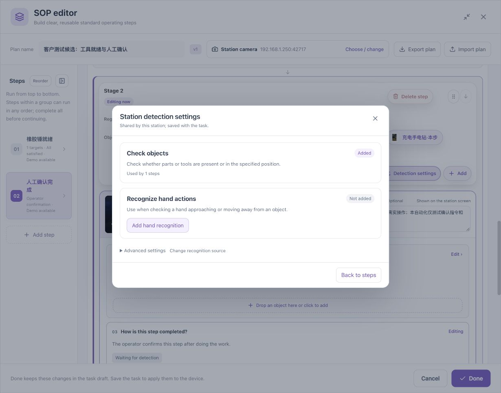
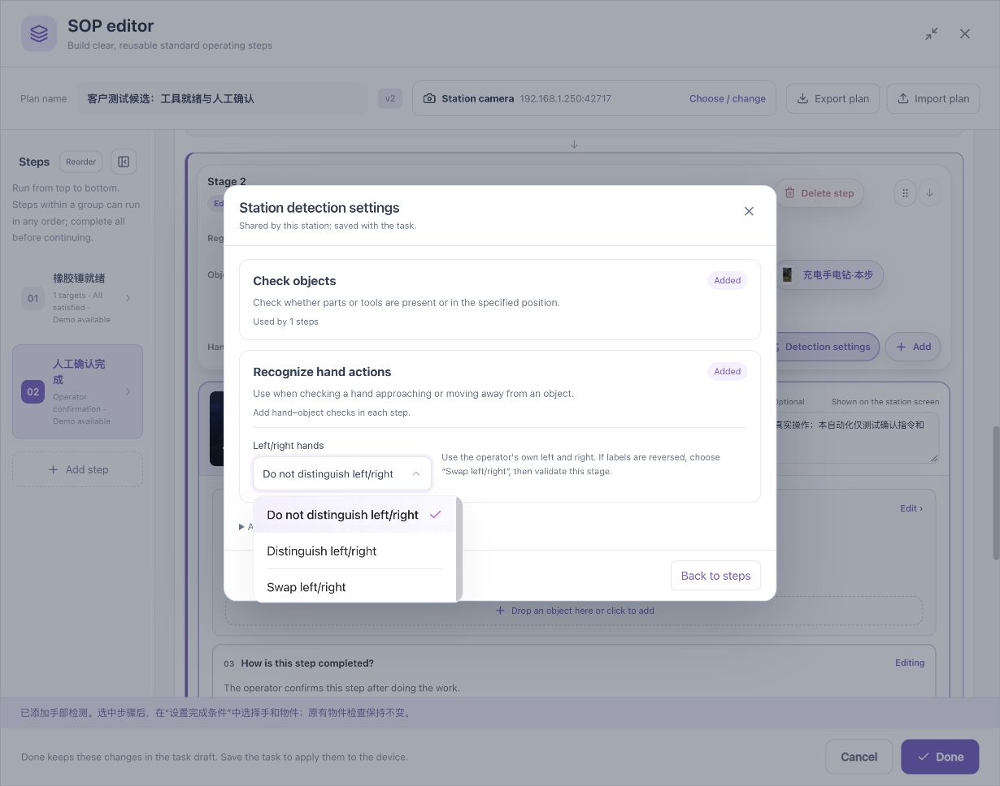
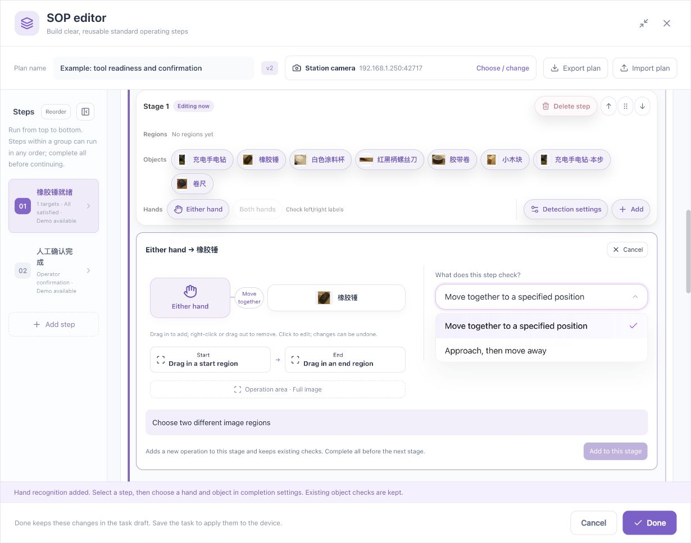
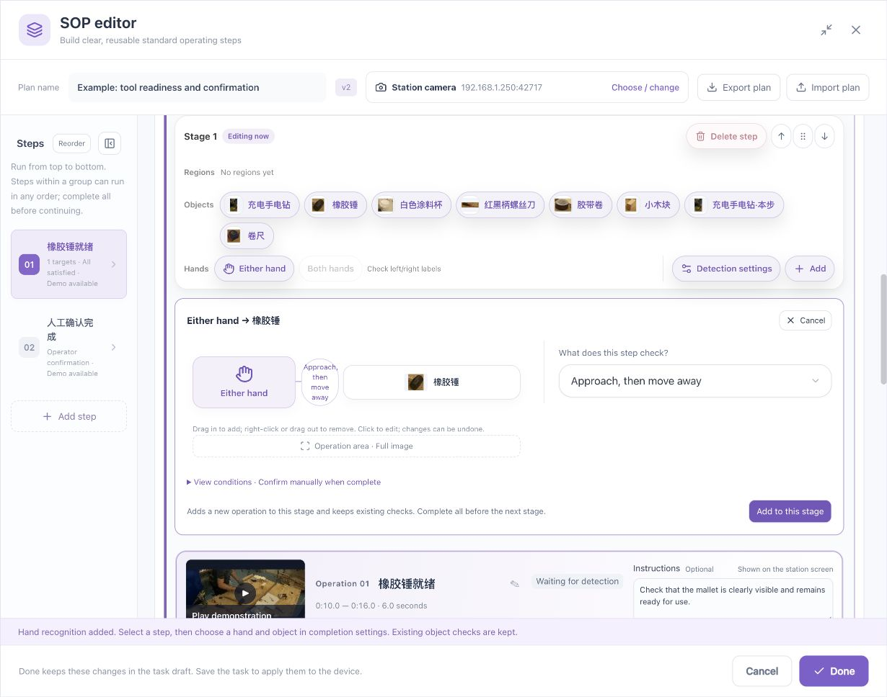

# Hand Operations: From Selecting a Hand to Validating a Process

[简体中文](../../zh/sop/hand-operations.md) · [Guide home](index.md)

Use this chapter when a process needs to check which hand is operating, whether a hand approaches or withdraws from a tool, or whether it accompanies an object during a transfer. Complete the single-object example first.

**Detecting a hand is an observation; checking how the hand and object cooperate is a process condition.** Hand landmarks do not directly establish grip strength, tightening torque, press-fit quality, contact pressure, or the internal state of a part.

## 1. Convert the requirement into visible conditions

| Process requirement | Observable conditions | Additional review |
|---|---|---|
| Reach toward the mallet | A visible hand is near the mallet | Whether the grasp is secure |
| Withdraw after operating | Approach, then move away while the tool remains visible | Whether the intended operation was completed |
| Transfer a part and release it at assembly | Start area → hand accompanies object → object arrives and remains → hand withdraws | Placement accuracy, fastening, or assembly quality |
| Use a specified hand | Select the operator's left or right hand after calibration | Whether the direction remains correct after camera changes |
| Coordinate two hands | Define the required hand conditions or use the supported two-hand feature | Whether they belong to the intended operator and remain distinguishable |
| Check only tool readiness | Object checks alone | No hand source is needed |

Do not enable hand checks simply because hands happen to appear in the recording. If the process only needs object readiness, object-only checks reduce configuration and review work.

## 2. Add hand recognition

1. Open **Detection settings** from the stage toolbar.
2. Find the hand-operation recognition card.
3. If it is absent, use the control to add hand recognition.
4. Return to the stage and check the available hand tools, such as either hand, left hand, and right hand.
5. Keep the correct object-detection source. A hand-object relationship needs evidence from both sources.

Detection settings are shared by the station and saved with the task. Adding a source does not automatically require hands in every step; configure the steps that need them.

If the entry is unavailable, check the device's plugins and capabilities rather than repeatedly creating additional hand sources.

## 3. Calibrate the operator's left and right hands

### 3.1 Whose left and right?

Use **the operator's own left and right**, not the left and right edges of the screen. An operator facing the camera may have their left hand on the right of the image. Camera mirroring, mounting, and image rotation can affect the labels.

### 3.2 Calibration procedure

1. Have the actual operator stand in the normal working position.
2. Open the hand-direction setting in **Detection settings**.
3. If the process does not distinguish hands, leave left/right distinction disabled and use either hand.
4. If it does, enable left/right distinction.
5. Have the operator separately show their left hand and right hand. Check labels in stage-validation footage.
6. If the labels are reversed, choose the swap option and validate again.
7. Use left/right constraints only after both sides have been checked.
8. Recalibrate after changes to camera position, mirroring, or orientation.

**Checkpoint:** Labels agree with the operator's own hands. Enabling distinction is a configuration action, not evidence that calibration has passed.

### 3.3 Either hand, a specified hand, and two hands

| Selection | Meaning | Use |
|---|---|---|
| Either hand | Does not specify left or right | Either hand is acceptable |
| Left hand | The operator's calibrated left hand | The process actually requires the left hand |
| Right hand | The operator's calibrated right hand | The process actually requires the right hand |
| Both hands / separately configured hands | Depends on the supported feature and explicit conditions | Two-hand work with reliable visibility and distinction |

A limit of two detected hands **does not prove that both belong to one person**. Review station isolation and regions when several people, crossing hands, or ambiguous targets are present. A disabled two-hand entry is not an enabled capability. Check the supported version, or use explicit left/right conditions with operator review as appropriate.

## 4. Use the toolbar to create a hand → object operation

1. Select the stage.
2. Select either hand, left hand, or right hand in its toolbar.
3. Select the object to operate, such as the mallet.
4. Check the displayed hand-to-object operation.
5. Choose the operation type.
6. Set the operation region, expand the condition summary, and add it to the stage.

The toolbar may offer complete templates such as approach-then-withdraw and transfer-to-position. If the interface says it adds a new operation while keeping existing checks, verify that a new step appears in the stage. Do not assume the existing object check is replaced.

A single near/away relationship can instead be configured in step checks. A complete operation template and one instantaneous relationship are different requirements.

## 5. Single condition: hand near object

Specify the hand, object, region, required hold time, and completion method.

The hand and object must have reliable observations in the same valid frame. The distance range describes a position relationship relative to the object; it is not a measurement in centimeters, contact force, or grasp strength.

**Useful for:** Checking that an operation occurs near the intended tool, together with object-position checks.

**Insufficient by itself for:** Proving the tool was picked up, a part was pressed firmly, a screw was tightened, or an assembly succeeded.

A hand that stays near a tool without operating it can satisfy proximity. To describe a complete process, add observable ordering, arrival, object retention, or operator review.

## 6. Single condition: visible hand away from object

“Away” needs valid visible evidence for the selected hand and object and a sufficient spatial separation.

Do not equate these situations with a confirmed withdrawal:

- A hand is hidden behind a body, tool, or another person.
- A hand leaves the camera image.
- Hand landmarks are unreliable.
- The object disappears or cannot be reliably detected.
- The stream is interrupted, observations are stale, or sources do not match.

“Hand not detected” is not the same as “visible hand away.” If the process requires leaving an area, choose an appropriate condition and test whether the footage distinguishes departure from occlusion.

## 7. Complete template: approach, then withdraw

### 7.1 When to use it

For example, an operator works near the mallet and then withdraws. The system checks the visible sequence; a person reviews process quality that the sequence cannot establish.

### 7.2 Configure the operation

1. Select the hand and the mallet.
2. Choose the approach-then-withdraw operation.
3. Choose an operation region covering both the hand and the tool at this station.
4. Expand the condition summary.
5. Check the order: approach first, then withdrawal, with valid evidence for both endpoints.
6. Review each hold time. Example defaults are not necessarily suitable for your cycle.
7. Keep or select operator review after completion for quality requirements that need a person.
8. Add the operation and review its generated name and conditions.

**Expected result:** Remaining near the tool does not complete the whole sequence. Starting far away must not skip the approach. A later phase requires a valid change after the preceding phase is complete.

### 7.3 Test meaningful negative cases

Test no reach, a hand that never withdraws, sudden occlusion, both hand and tool leaving the image, another person's hand entering, and two similar tools that cannot be uniquely associated.

The result should reflect the evidence—waiting, unmet, or uncertain where appropriate—rather than passing every case.

## 8. Complete template: accompany an object, then release it at its destination

### 8.1 Prepare regions

1. Draw the **start region** in the actual picture.
2. Draw the **destination region**.
3. Give the endpoints distinct process meanings; do not use the same region for both.
4. Choose an **operation region** covering the entire route, not just the endpoints.
5. Avoid boundaries that make start and destination simultaneously true without an observable transition.

### 8.2 Configure the operation

1. Select the hand and object.
2. Choose the transfer-to-position operation.
3. Place the start and destination regions into their corresponding slots, or click each slot and select the region.
4. Verify that the operation region includes the route.
5. Read the summary of start, in-transit requirements, arrival, and withdrawal.
6. Add the operation and inspect the conditions and times.

### 8.3 Requirements during movement

If the interface requires the hand to remain near the object during movement, two endpoint pictures are insufficient. The system also needs valid observations along the route. At the destination, the object must remain there until the hand withdraws. Loss of visibility, unmet intermediate conditions, or non-unique targets may reset progress.

This is not re-identification of the same physical object after full occlusion. Do not treat another similar tool appearing later as proof that the original tool completed a transfer.

## 9. Set hand regions and object relationships separately

| Requirement | Condition to express |
|---|---|
| Any hand appears in the assembly area | Hand presence restricted to that area |
| A hand is in the assembly area and near a cup | A hand-region constraint plus the hand-cup relationship |
| The cup is in the tool area and the hand in assembly | Review each endpoint's region separately |
| Ignore the adjacent station | Draw suitable station regions and inspect the scope of every hand/object check |

Regions constrain positions in the image; they do not establish operator identity. Review both ends of cross-region relationships rather than relying on the presence of a region chip.

## 10. Hold time, input gaps, and deadlines

| Setting | What it controls | Example |
|---|---|---|
| Sustained satisfaction | How long a condition must remain true | A brief stable hand-near observation |
| Input-gap tolerance | How long the system can wait for interrupted trusted observations | A short interruption in video or landmark input |
| Step/sequence deadline | Maximum allowed time to finish | A transfer must fit the process cycle |

An observed false condition differs from having no fresh trusted observation. Increasing gap tolerance should not hide a clearly observed error. Tracked sequences can impose a stricter gap limit; follow the actual control limits and explanations.

## 11. Validate hand operations in layers

1. Verify object recognition first.
2. Verify reliable hand observations and left/right labels.
3. Check single near/away conditions and regions.
4. Test the complete ordered operation and confirmation.
5. Use an independent recording with normal variations in posture, speed, and placement.
6. Include negative cases, not only the clearest successful example.

| Symptom | Check first | Avoid |
|---|---|---|
| No reliable hand result | Viewpoint, clarity, gloves, occlusion, source | Repeatedly lowering the object threshold |
| Reversed hand labels | Operator calibration, mirroring, orientation | Calling the image's left edge “left hand” |
| Proximity passes but work is incomplete | Whether the single condition is too broad | Declaring process quality complete |
| Withdrawal never passes | Visibility of both hand and object; distance scope | Treating disappearance as withdrawal |
| Sequence repeatedly resets | Uniqueness, occlusion, continuous observation, in-transit requirements | Removing every protection to force a pass |
| Several people trigger a check | Station regions, isolation, hand selection | Assuming two hands belong to the same person |

## 12. Handover checklist

- [ ] Only steps that need hand checks require them.
- [ ] Critical hand and object evidence is clearly visible from a fixed camera.
- [ ] Required left/right labels have been checked against the operator.
- [ ] Hand, object, and region selections are correct.
- [ ] Visible withdrawal is not confused with nondetection.
- [ ] Ordering, in-transit conditions, and timing match the process.
- [ ] Normal gloves, occlusion, additional people, and similar tools have been tested.
- [ ] Uncertainty is not treated as success.
- [ ] Quality requirements needing a person retain operator confirmation.
- [ ] Sources, direction, and rules remain correct after saving and reopening.

**Related: [Toolbar and drag-and-drop](toolbar-and-drag.md) · [Rules and regions](rules-and-regions.md) · [Validation and operation](validation-and-operation.md)**

*Example footage and reference views in the screenshots: [wooden-box assembly dataset and CC BY 4.0 credits](reference.md#7-sample-and-screenshot-credits).*
