# SOP System User Manual

[简体中文](../../zh/sop/index.md)

This guide is for process engineers, operators, deployment teams, and administrators using AIBox SOP for the first time. A fixed-camera workbench example takes you through **choosing a camera → preparing a video → selecting a target → improving recognition → defining steps → validating stages → validating the plan → saving → station operation**. You do not need to write code, rule expressions, or JSON.

**For your first plan, follow the chapters in order.** All chapters are on this page. Use the table of contents on the right or the links below to jump directly to a section.

| What do you need to do? | Chapter |
|---|---|
| Build your first understandable plan | [Quick start: tool readiness and operator confirmation](#quickstart) |
| Record, upload, play, or select a video range | [Video, targets, and recognition](#video-and-recognition) |
| Draw target boxes, add angles, review misses and duplicate boxes | [Video, targets, and recognition](#video-and-recognition) |
| Check only selected areas, counts, or object positions | [Rules, regions, and timing](#rules-and-regions) |
| Configure either hand, left/right hands, approach, withdrawal, or a transfer | [Hand operations](#hand-operations) |
| Drag objects, hands, and regions; understand highlighting, replacement, and undo | [Toolbar and drag-and-drop](#toolbar-and-drag) |
| Validate, confirm, save, operate, and review history | [Validation, saving, and station operation](#validation-and-operation) |
| Resolve missing pictures, unavailable buttons, or uncertain results | [Troubleshooting and maintenance](#troubleshooting) |
| Check a plan before handover or look up a term | [Checklists and glossary](#reference) |

!!! note "Applicable interface and illustrations"
    This guide is based on device Web interfaces captured in November 2026. The device application, algorithm plugins, device Web interface, and cloud Web interface must be compatible. Optional features depend on the controls available on your device. Addresses, names, times, and reference counts in the illustrations are examples.

    This English guide uses separate captures of the English interface. Names and instructions entered by users are project data: changing the interface language does not automatically translate them. In the example, 橡胶锤 means “rubber mallet,” 工具工作区 means “tool work area,” and 人工确认完成 means “operator confirmation.”

Click an illustration to view the original image. A screenshot showing “Awaiting detection” or “Not validated” illustrates that state; it does not certify a successful acceptance test.

## 1. Understanding SOP and Using This Manual {#overview}
### 1.1 Understand what the system checks {#overview--1-understand-what-the-system-checks}

SOP converts a process requirement into observable conditions:

- **Objects:** whether a mallet is visible, whether the count is correct, and whether it is in the tool work area.
- **Spatial relationships:** whether object A is inside, to the left or right of, or near object B; whether a visible hand is near or away from an object.
- **Timing:** how long a condition must remain satisfied and how much time a step may take.
- **Order:** which step comes first and which steps may be completed in either order.
- **Operator confirmation:** which requirements need a person to inspect and confirm.

The system uses camera observations and configured rules to guide and check a process. A hand being near a tool does not by itself prove a secure grasp, a correctly tightened screw, or a properly assembled part. Retain operator review for requirements that the image cannot reliably establish.

### 1.2 The example used throughout this guide {#overview--2-the-example-used-throughout-this-guide}

The example video shows a fixed-camera workbench with a rubber mallet, drill, paint cup, and other tools. The introductory workflow uses only the mallet, so you can learn one condition before combining several.

| Stage | Step | Requirement | Completion | Example range |
|---|---|---|---|---|
| 1 | Mallet ready | The mallet is clearly visible; optionally restrict it to the tool work area | Automatically after 0.8 seconds of satisfaction | Seconds 10–16 of the source video |
| 2 | Operator confirmation | The operator checks the tools and station | Operator confirms | Seconds 16–20 of the source video |

The full teaching video is approximately 60 seconds. These times explain range selection; choose times that match your own recording. After the two-step example, extend the plan to several tools, regions, hand operations, and unordered steps.

*Figure 1: Select a step on the left, inspect video and targets in the center, and manage references on the right. Plan and camera controls are above; authoring and validation continue below.*

### 1.3 Terms that should remain distinct {#overview--3-terms-that-should-remain-distinct}

| Term | Purpose | Does not mean |
|---|---|---|
| Teaching video | Shows the standard operation; used to select targets and clips and for operator playback | A video whose recognition accuracy has already been accepted |
| Target reference image | Describes the appearance of one target; several angles may belong to that target | The number of physical objects required in the scene |
| Manual box | Marks an object that should be present in this particular frame | An independently produced algorithm detection |
| Target frame scan | Samples the selected video range to inspect recognition | Every video frame has been manually reviewed |
| Stage validation range | Tests one stage using a selected recording segment | The complete plan has passed |
| Demonstration clip | Shows an operator how to perform one step | A command to change every other stage’s range |
| Plan validation range | Defines the recording range used to test the authored plan | The duration of a live production run |
| Save task | Applies the edited task configuration to the device | Automatically starts production |
| Station operation | Shows operators the current task, steps, and confirmation controls | The sampled-frame recognition review page |

A **stage** is an execution group. It can contain one step or an unordered group. Stages execute from top to bottom. Steps in an unordered group may finish in either order, and all must finish before the next stage. This differs from several conditions being true simultaneously; see [Rules, regions, and timing](#rules-and-regions).

### 1.4 Recommended learning path {#overview--4-recommended-learning-path}

1. Build “mallet ready → operator confirmation” using the [quick start](#quickstart).
2. Inspect recognition at different positions and angles and with hand occlusion using the [recognition chapter](#video-and-recognition).
3. Add the regions, counts, timing, and grouping your process requires.
4. If hands matter, complete [hand-direction calibration and hand-operation setup](#hand-operations).
5. Validate individual stages and then the plan. Review results before saving and entering [station operation](#validation-and-operation).
6. Use the [handover checklist](#reference) for normal operation, missing parts, wrong order, occlusion, stream loss, and recovery.

Avoid changing references, thresholds, regions, timing, and order together. Resolve one diagnosed issue, then recheck its effect so that you can tell which change helped.

### 1.5 Responsibilities {#overview--5-responsibilities}

| Role | Main responsibility |
|---|---|
| Process/configuration personnel | Prepare teaching footage, name targets and steps, define rules, inspect recognition, validate, and save |
| Station operators | Follow the station display, review requirements needing confirmation, and respond to guidance |
| Administrators/deployment personnel | Maintain cameras, detection sources, compatible versions, storage, networking, and runtime placement |

### 1.6 Manual structure and reading paths {#overview--6-manual-structure-and-reading-paths}

| Part | Chapters | Purpose |
|---|---|---|
| Getting started | [Preparation](#preparation), [Quick start](#quickstart) | Establish the process and complete a two-step workflow |
| Interface and controls | [Workspace](#workspace-reference), [Buttons](#control-reference), [Parameters](#parameters) | Find controls, availability, effects, and units |
| Recognition and rules | [Video/targets](#video-and-recognition), [Regions/timing](#rules-and-regions), [Hands](#hand-operations), [Dragging](#toolbar-and-drag) | Configure actual requirements |
| Complete labs | [Six scenarios](#scenario-labs) | Combine individual functions into testable work |
| Validation and operation | [Validate/save](#validation-and-operation), [Operator manual](#operator-guide) | Validate, persist, operate, and recover |
| Maintenance and handover | [Backup/migration](#maintenance), [Troubleshooting](#troubleshooting), [Reference](#reference) | Maintain and deliver the installation |

#### 1.6.1 By role {#overview--by-role}

- **First configuration:** preparation → quick start → targets → rules → validation.
- **Process owner:** requirements → parameter meanings → labs → acceptance.
- **Operator:** operator station manual, demonstrations, and recovery.
- **Installer/administrator:** controls → sources → migration → maintenance.
- **Finding a button:** use the [Tool and button reference](#control-reference) for the current window.

### 1.7 Reading conventions {#overview--7-reading-conventions}

| Term | Meaning |
|---|---|
| This step | Selected operation, not automatically its entire stage or plan |
| Current target | Selected logical object, possibly with several views |
| X → Y | Open X, then select Y |
| Expected result | Behavior to verify, not acceptance measured for your station |
| Disabled/unavailable | Prerequisite, capability, read-only, or busy restriction |
| Draft | Edited work that still needs the completion/confirmation/save sequence |
| Illustrated names/values | Teaching examples, not process standards |

Read critical actions as prerequisites → location → procedure → expected behavior → recovery. Input bounds describe the current interface; device capability and rule validation also apply.

### 1.8 Using the figures {#overview--8-using-the-figures}

Identify whether a figure shows configuration, references, an operation setup, or a persistence control. Use location tables to find the top, left, right, or footer control, and click figures to inspect original resolution.

Use your own station names and verify the real page afterward. Screenshot states are not your current state. Chinese and English chapters use their corresponding interface captures. Download the [sample footage](#quickstart--use-the-accompanying-sample-recording); see [credits](#reference--7-sample-and-screenshot-credits).

**Next: [Build the first two-step example →](#quickstart)**

*Example footage and reference views in the screenshots: [wooden-box assembly dataset and CC BY 4.0 credits](#reference--7-sample-and-screenshot-credits).*

## 2. Deployment Preparation and Process Requirements {#preparation}

Use this chapter before configuring a production workflow. Its outputs are a clear process worksheet, usable teaching footage, distinguishable targets, and an explicit list of quality checks that require an operator. Every subsequent editor action should implement a stated requirement.

### 2.1 Responsibilities {#preparation--1-responsibilities}

| Role | Before configuration | After configuration |
|---|---|---|
| Process owner | Correct sequence, permitted variations, and mandatory quality requirements | Confirm that the rules express the actual process and identify checks that remain manual |
| Configuration engineer | Camera, recordings, and meaningful target/region names | Check each requirement's subject, region, timing, combination, and completion method |
| Station operator | A normal operation and common incorrect operations | Confirm that instructions, demonstrations, messages, and confirmation controls are understandable |
| Administrator or installer | Connectivity, required capabilities, storage, backups, and operating permissions | Verify save/reopen, task operation, recovery, version identity, and traceable records |

One person may hold several roles. Keep the responsibilities explicit even then. An engineer understanding the editor does not establish that an operator understands the station instructions.

### 2.2 Checks before opening the editor {#preparation--2-checks-before-opening-the-editor}

#### 2.2.1 Device and browser {#preparation--21-device-and-browser}

1. Complete [Device Onboarding](../device-onboarding.md) and verify access from the station computer.
2. Sign in at the device address selected for the installation. Screenshot addresses are examples.
3. Verify a stable connected state before configuring a process.
4. Identify the task to edit. Avoid several indistinguishable task names.
5. Provide sufficient browser space. Maximize the SOP editor or collapse its step list when necessary.
6. Have the administrator handle any browser certificate warning under the site's device-security procedure.

**Expected result:** Device status and task controls load reliably. Starting a task is not required at this point.

#### 2.2.2 Camera {#preparation--22-camera}

| Item | Ready condition | Resolve first |
|---|---|---|
| Mounting | Fixed view of relevant tools and actions | Moving head-camera footage used with fixed work-area assumptions |
| Orientation | Matches normal station operation | Mirrored or flipped image with old handedness settings |
| Subject size | Important objects occupy useful image area | Tiny distant tools |
| Occlusion | Distinguishing features remain visible during ordinary handling | The operator's body persistently covers the target |
| Lighting | No persistent glare or very dark critical areas | Reflections obscure the target outline |
| Nearby activity | Current and neighboring stations are distinguishable | Several operators and similar tools occupy the same area |

Regions follow image coordinates. A region may still be drawn on screen after the camera moves while no longer representing the intended workplace.

#### 2.2.3 Capabilities {#preparation--23-capabilities}

Begin object-only workflows with object recognition. Add hand recognition when hand/object relationships are required. Check left and right using the actual installed orientation.

A plugin name alone does not establish that a complete operation is available. Check the editor's targets, conditions, and validation controls, then verify the actual recording.

### 2.3 Turn process language into a worksheet {#preparation--3-turn-process-language-into-a-worksheet}

Write the intended action first, then its observable evidence. “Pick up the mallet” may require approach, object movement, arrival, and operator review. Hand proximity alone does not establish a completed pickup.

Use one clearly completable work unit per row:

| Field | Specify | Example |
|---|---|---|
| Step name | An action or state the operator recognizes | Tools ready |
| Prerequisite | What must precede this step | A new workpiece is ready |
| Objects | Required objects or counts | Rubber mallet |
| Location | Relevant part of the station | Tool work area |
| Hands | No hand check, either hand, or a specified hand | No hand check for this step |
| Timing | Hold and deadline requirements | Ready continuously for 0.8 seconds; initially no deadline |
| Combination | Simultaneous, alternatives, sequence, or independent steps | One readiness requirement |
| Completion | Automatic, visual plus operator review, or manual | Complete after visual checks |
| Manual quality check | Requirements that images cannot establish | Review tools and station in the next step |
| Negative example | A situation that must not complete the step | Mallet missing or outside the area |

Do not replace an unobservable quality requirement with an easy position check. A drill near a screw does not establish torque; a cup inside a region does not establish liquid quantity.

### 2.4 Establish dependencies {#preparation--4-establish-dependencies}

Ask:

1. Must B begin only after A completes?
2. Can A and B complete in either order, while both remain mandatory?
3. Must A and B hold at the same time?

| Answer | Configuration | Critical validation |
|---|---|---|
| B follows A | Separate ordered stages | Reversed operation cannot count as the required order |
| Either order, both mandatory | An unordered stage | Both orders work; omitting one step cannot finish the group |
| Same time | All conditions together within one step | Separate appearances cannot be added together |
| Equivalent alternatives | Any condition within one step | Each option is a permitted substitute |

Overlapping video ranges do not make operations interchangeable. Non-overlapping video ranges do not by themselves establish a mandatory dependency. Use the process requirements.

### 2.5 Prepare teaching footage {#preparation--5-prepare-teaching-footage}

#### 2.5.1 What to include {#preparation--51-what-to-include}

Record a stable initial workplace, the operation, and its final state. Do not place critical events at the first or last frame or during camera movement.

1. Leave a stable view for selecting a clear reference.
2. Perform at normal speed rather than unnaturally slowly.
3. Preserve hand entry, object movement, and hand withdrawal.
4. Avoid cuts within critical actions.
5. Retain a clear final-position view.
6. Record another operation separately for independent validation.

#### 2.5.2 Check the uploaded recording {#preparation--52-check-the-uploaded-recording}

| Action | Expected observation | If not obtained |
|---|---|---|
| Play the beginning | Correct station and orientation | Check the selected file and source orientation |
| Seek to the middle | Picture changes with time | Allow loading, then inspect media messages |
| Seek to the end | Real final footage is available | Check source completeness |
| Inspect the timeline | Real thumbnails appear | A working reference image does not prove timeline readiness |
| Drag the playhead | Preview position changes | Distinguish the playhead from endpoint handles; see [Workspace reference](#workspace-reference) |
| Compare duration | Matches the uploaded or recorded material | Check for an older asset or another step's demonstration |

**Completion check:** Identify a clear target view, the action's beginning and end, and a view where the object is genuinely not ready or the operation is incomplete.

### 2.6 Prepare the target list {#preparation--6-prepare-the-target-list}

#### 2.6.1 Naming {#preparation--61-naming}

Use a practical appearance or purpose plus the object name, such as “Rubber mallet” or “White paint cup.” Several reference views may belong to one logical target. Do not accidentally make front and side views into two objects that must coexist.

For similar objects, specify the visible difference. A longer name does not solve a distinction that the image resolution cannot show.

#### 2.6.2 Reference planning {#preparation--62-reference-planning}

| Reference | Purpose | Also test |
|---|---|---|
| Clear ordinary resting view | Main appearance | Similar background shapes |
| Normal side or rotated view | Common orientations | Similar tools |
| Ordinary held appearance | Handling occlusion | Hand present without the tool |
| Normal near and far positions | Practical size variation | Tiny or blurred, unjudgeable views |

After adding a reference, check both improved recognition and new false or duplicate detections. More references do not automatically mean greater stability.

### 2.7 Prepare the region list {#preparation--7-prepare-the-region-list}

Use functional names such as Tool area, Parts area, and Assembly area. Have the process owner approve the boundaries.

- A station may have several regions.
- Regions may overlap; define what that means for each requirement.
- Origin and destination must express a real state change.
- A process area should include the route, not only its endpoints.
- After drawing shared regions, assign each requirement to its intended area.

[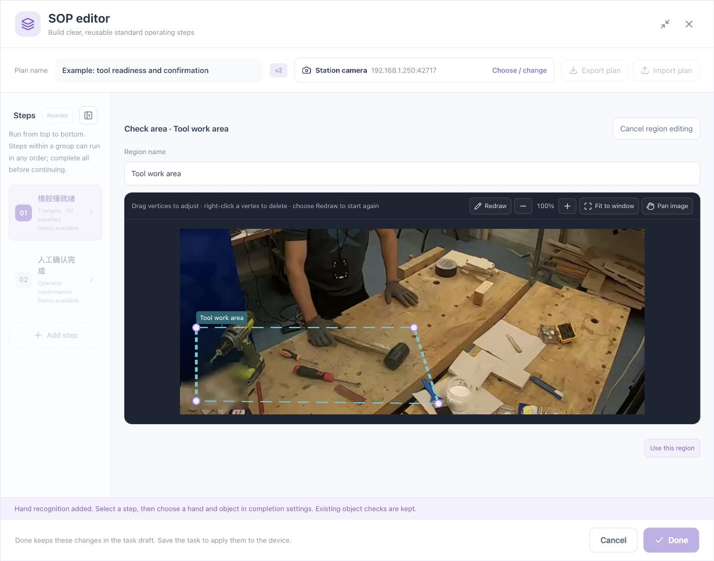](../../assets/sop/en-18-draw-region.jpg)

### 2.8 Prepare validation cases {#preparation--8-prepare-validation-cases}

| Class | Include | Principle |
|---|---|---|
| Normal | One clear complete operation | Correct work should complete |
| Missing object | Remove a required item | Other visible objects cannot substitute for it |
| Wrong location | Move the object outside its assigned area | Confirm that region binding takes effect |
| Wrong count | One too few or too many | Eliminate duplicate detections first |
| Wrong order | Reverse required events | Verify that order was not accidentally relaxed |
| Hand negatives | Approach without withdrawal, occlusion, multiple people | Missing detection cannot count as a completed action |
| Independent recording | A separate real operation | Check beyond the original teaching clip |
| Input fault | Stream interruption, frozen or unjudgeable image | Uncertainty cannot count as completion |

These specify a test design, not results already measured by this manual. Retain recordings, configuration versions, expected results, and observations.

### 2.9 Preparation checklist {#preparation--9-preparation-checklist}

- [ ] Correct task and station identified.
- [ ] Complete footage plays and seeks.
- [ ] Step names and completion requirements are explicit.
- [ ] Automatic checks and manual quality review have defined roles.
- [ ] Target references and region purposes are planned.
- [ ] Order, unordered work, simultaneity, and alternatives are distinguished.
- [ ] Hands and objects remain visible through critical events.
- [ ] Normal, negative, and independent footage is available.
- [ ] Review, saving, operation, and maintenance responsibilities are assigned.

**Continue: [Workspace reference](#workspace-reference) → [First complete example](#quickstart).**

*Footage attribution: [Sample and screenshot credits](#reference--7-sample-and-screenshot-credits).*

## 3. Quick Start: Tool Readiness → Operator Confirmation {#quickstart}

This chapter builds one understandable two-step workflow. First check a rubber mallet, then ask the operator to confirm. **Verify recognition before proceeding to stage and plan validation.** Add hands and multiple targets after the basic workflow is clear.

### 3.1 Prepare the station and recording {#quickstart--1-prepare-the-station-and-recording}

1. Fix the camera in place and give the work area a substantial part of the image.
2. Check that the mallet is clearly visible in its normal position. Avoid persistent occlusion by hands, reflections, or other tools.
3. Prepare a short recording of the complete operation, including the initial station, the operation, and the completed state.
4. Preferably record a second, independent video to check that the configuration works beyond the teaching recording.
5. Keep camera position, orientation, and lighting consistent. If the camera moves, recheck regions and references.

| Example setting | Starting value | Reason |
|---|---|---|
| Target | Rubber mallet only | Learn one target before combining several |
| Hand checks | Not enabled initially | Separate object-recognition issues from hand issues |
| Stage order | Tool ready, then operator confirmation | The second step depends on the first |
| Readiness hold | 0.8 seconds, as an example | Avoid completing the step from a single brief observation |
| Deadline | 0, initially unlimited | Establish the normal path before adding timeouts |

**Checkpoint:** You can point out the mallet, the part of the video where it is clearly visible, and the point where the operator should confirm.

#### 3.1.1 Use the accompanying sample recording {#quickstart--use-the-accompanying-sample-recording}

[Download the 60-second workbench sample (MP4, approximately 9.5 MB)](../../assets/sop/workbench-60s.mp4). If it opens in the browser, save it through the video menu, then upload it as described in this chapter. Upload the video, rather than a screenshot.

The sample uses the same workbench as the illustrations, making it easier to find the mallet and compare times. It is a fixed 800 × 320 crop from the original recording's first 60 seconds. For your own station, use your own fixed-camera footage rather than copying the example's coordinates. See [Sample and screenshot credits](#reference--7-sample-and-screenshot-credits) for authors, source, license, and adaptations.

### 3.2 Sign in and create an SOP task {#quickstart--2-sign-in-and-create-an-sop-task}

1. Open the device management address in your browser and sign in.
2. Wait for a connected device state. For initial setup, complete [Device Onboarding](../device-onboarding.md).
3. Click **Add Task** in the header.
4. Choose **SOP workflow** as the task type.
5. Choose **Check objects only** for the introductory example.
6. Enter a recognizable task name, such as “Tool readiness and confirmation.”
7. Click **Create and Edit**, then enter the task's **Edit steps** workflow.

[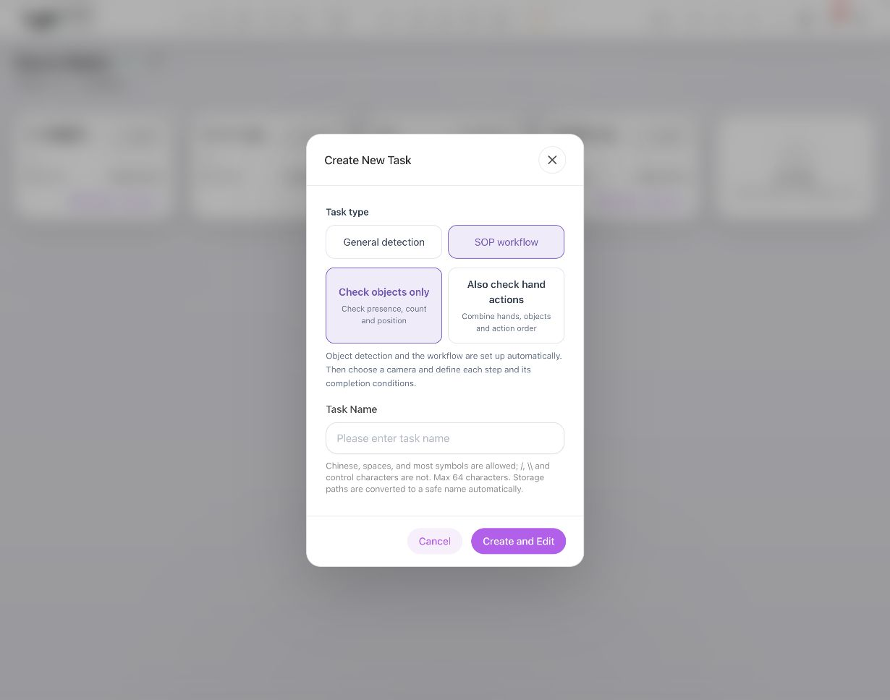](../../assets/sop/en-02-create-task.jpg)

*Figure 2: Begin with object checks. Use the hand-operation chapter when the process requires approach, withdrawal, or a transfer.*

The task name, plan name, and station name can differ. The task name identifies the managed task, the plan name identifies the process, and the station name identifies the operator's workplace. Use meaningful, consistent names rather than several indistinguishable “Test” plans.

### 3.3 Find the main editor controls {#quickstart--3-find-the-main-editor-controls}

| Area | Purpose |
|---|---|
| Plan bar | Name the plan, choose a camera, import or export |
| Step list on the left | Select, reorder, group, or add steps |
| Video / Targets switch | Play and locate video, or inspect targets and references |
| Upper timeline | Set the target-scan and plan-validation range |
| Step card | Edit the name, demonstration, instructions, checks, and completion |
| Timeline below a stage | Set that stage's own validation or demonstration range |
| Done at the bottom | Return changes to the task draft; save the task afterward |

Collapse the step list or maximize the editor when you need space. Numbered navigation remains available when the list is collapsed. Use ordinary scrolling to move through the page. Use the displayed modifier key or the plus/minus controls to zoom the image.

### 3.4 Choose the station camera {#quickstart--4-choose-the-station-camera}

1. Click **Choose / change** in the plan bar.
2. Prefer a camera already configured for this station.
3. If camera discovery requires authentication, enter the **camera's credentials**, which may differ from your device Web account.
4. If you have a video address but discovery finds no camera, expand the existing-address entry and have the administrator verify the address and network.
5. Check that the plan bar shows the intended camera.

**Expected result:** Recording uses the intended station source.

After changing the camera, record or check the teaching video, target references, regions, hand directions, and validation footage again. Regions drawn for a previous viewpoint should not be assumed correct for a new viewpoint.

### 3.5 Upload or record the complete process {#quickstart--5-upload-or-record-the-complete-process}

#### 3.5.1 Use an existing recording {#quickstart--51-use-an-existing-recording}

1. Click **Upload**.
2. Select a video format supported by the device interface.
3. Wait for upload, processing, and picture loading to finish.
4. Play the beginning, middle, and end and check that the timeline contains real thumbnails.
5. Pause on a clear view of the mallet.

#### 3.5.2 Record the station {#quickstart--52-record-the-station}

1. Select the camera.
2. Click **Record**.
3. If a teaching video already exists, read the replacement confirmation.
4. Start only if you intend to replace it, perform the complete operation, then stop.
5. Wait for the recording to become ready and play it back.

[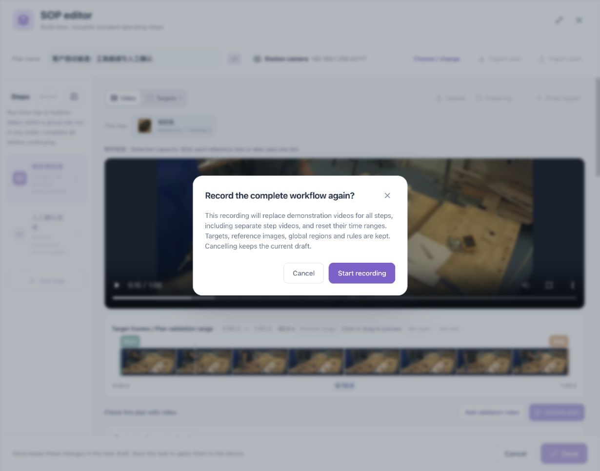](../../assets/sop/en-07-record-warning.jpg)

Recording the complete process again replaces the plan's demonstration material, including separately assigned step material, and resets step time ranges. Existing targets, references, global regions, and rules are retained as described by the confirmation. Canceling keeps the current draft. Use playback, rather than re-recording, when you only want to look at a picture again.

**Checkpoint:** The source video plays, you can locate a clear mallet frame, and the camera and recording are correct.

### 3.6 Create the mallet target {#quickstart--6-create-the-mallet-target}

1. Pause the **Video** view on a clear frame.
2. Click **Add target**.
3. Draw a box around the mallet. Keep the object as the main content rather than including a hand, a large area of tabletop, or an adjacent tool.
4. Name the target and confirm.
5. Switch to **Targets** and check that the reference actually depicts the mallet.
6. If normal operation includes a different appearance, use **Add angle** on another frame of the same target. Do not create a separate logical object for each angle.

[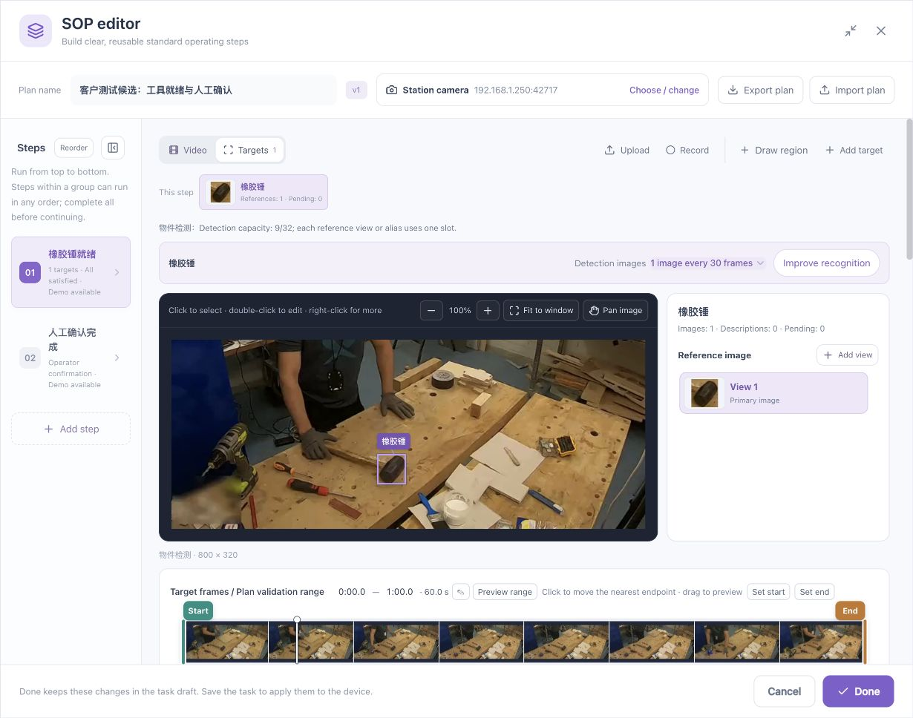](../../assets/sop/en-10-target-reference.jpg)

One mallet can have several reference images and still be one physical object. References may consume detection capacity. Keep representative views rather than many near-identical pictures.

### 3.7 Check recognition before authoring further {#quickstart--7-check-recognition-before-authoring-further}

1. Select the recording range in the upper timeline.
2. Choose the sampling interval. A smaller interval produces more pictures and requires more processing and review.
3. Click **Improve recognition**. After a range change, the entry may ask you to check the selected range again.
4. Inspect frames where the mallet is present and absent. Look for misses, false detections, and duplicate boxes on the same mallet.
5. Review misses and add manual boxes, then complete trial detection, adoption, and rechecking as described in the [recognition chapter](#video-and-recognition).
6. Include different angles, motion, hands near the tool, occlusion, and an empty work area. One successful first frame is insufficient.

**Proceed when:** Recognition is reliable in normal clear views, and misses, false detections, and duplicates have been examined. Do not loosen step requirements to hide an unresolved recognition problem.

### 3.8 Configure “Mallet ready” {#quickstart--8-configure-mallet-ready}

1. Select the first step and give it a meaningful name.
2. Enter a short instruction such as “Check that the mallet is clearly visible in the tool work area and remains ready.”
3. Open **Step checks → Edit**.
4. Add the mallet and select the requirement that the object is detected.
5. Choose the full frame, all recognition regions, or a named region, as appropriate.
6. Open the completion settings and select visual detection followed by automatic completion.
7. Set the example hold time to **0.8 seconds**. Choose the real value according to your process.
8. Check the relationship diagram, completion method, and region.

[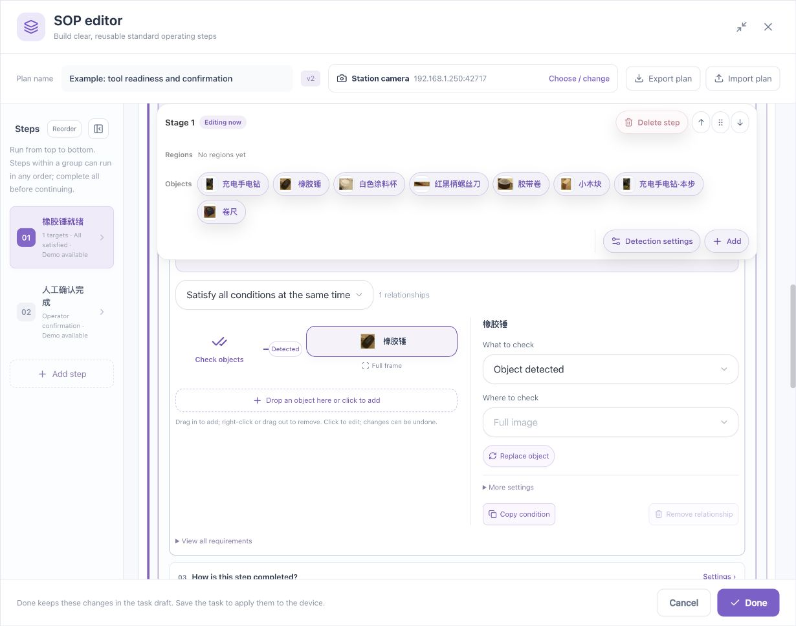](../../assets/sop/en-11-object-condition.jpg)

[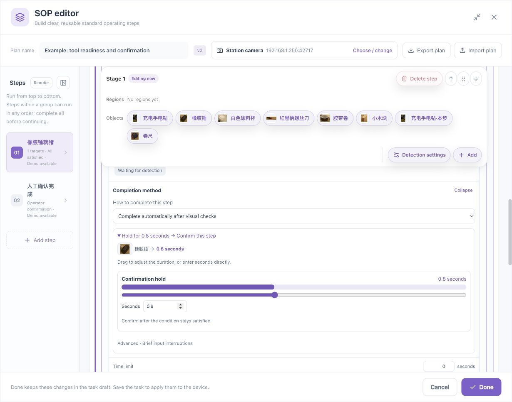](../../assets/sop/en-12-auto-completion.jpg)

Choose visual detection plus operator review when a person must inspect the result after the visual conditions are met. This differs from a step based entirely on operator confirmation.

### 3.9 Configure “Operator confirmation” {#quickstart--9-configure-operator-confirmation}

1. Add a second step after the first.
2. Name it “Operator confirmation.”
3. Enter an instruction such as “Check the station and tool positions, then confirm when correct.”
4. Choose operator confirmation as its completion method.
5. Keep these two steps sequential. They should not be in an unordered group because the second depends on the first.

[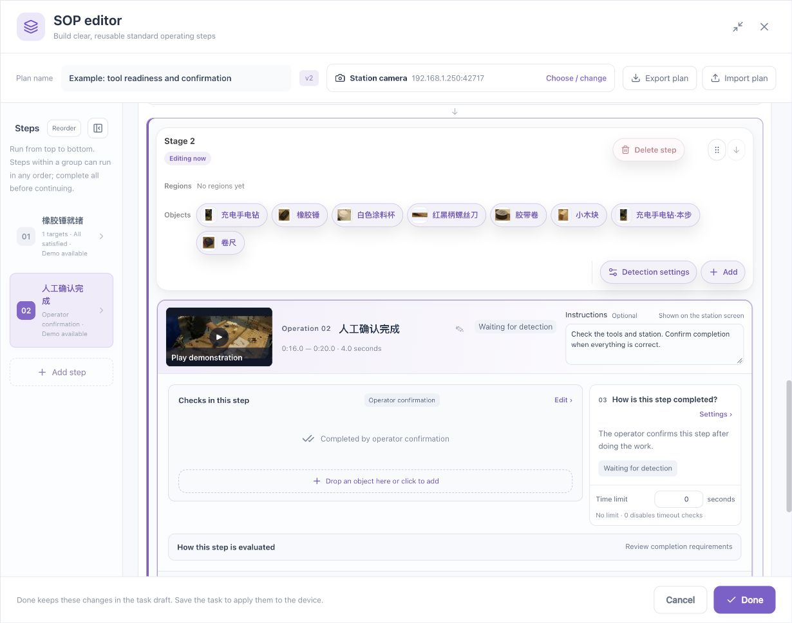](../../assets/sop/en-13-manual-completion.jpg)

**Expected result:** The confirmation step becomes current after the readiness stage finishes. An old confirmation control should not be used to skip a pending step or override an uncertain state.

### 3.10 Assign a separate range to each stage {#quickstart--10-assign-a-separate-range-to-each-stage}

1. Find **Validation range** below the stage.
2. For the first stage, select a clear view of the mallet—seconds **10–16** in this example.
3. For the second, choose its corresponding segment—seconds **16–20**.
4. Click a displayed endpoint to enter seconds or minutes:seconds, then save, cancel, or locate the picture.
5. You can also drag an endpoint. Verify the displayed times afterward.
6. Open **Play demonstration** and verify that it uses the intended step segment.

[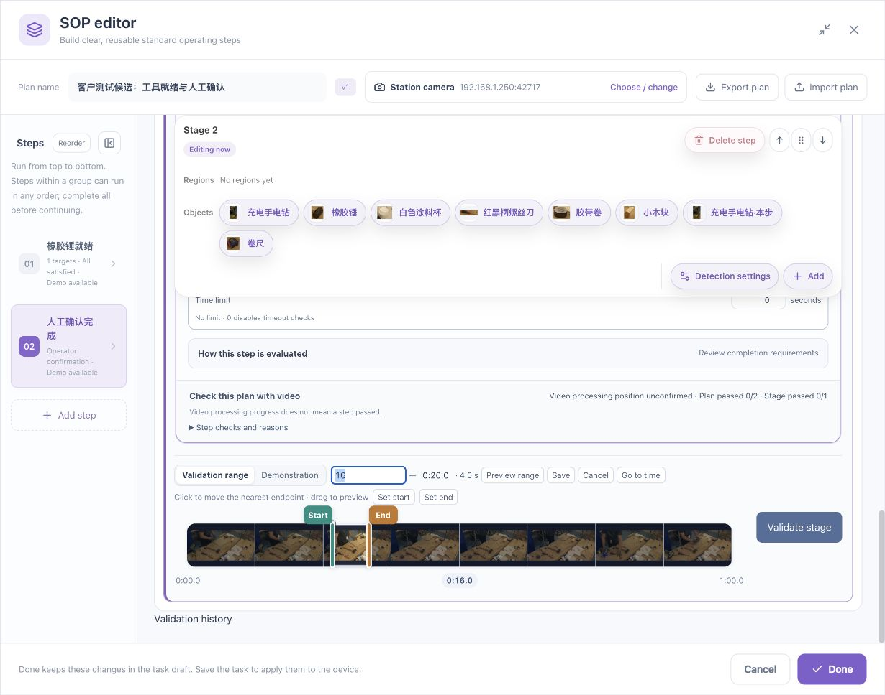](../../assets/sop/en-14-stage-range.jpg)

[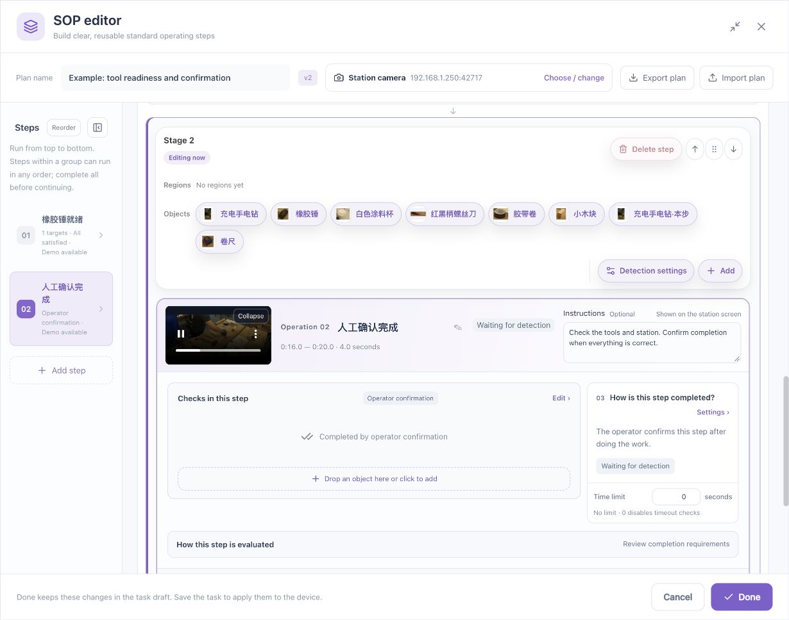](../../assets/sop/en-15-demo-player.jpg)

Stage ranges are independent and may overlap. When validating a plan against the same source recording, the overall validation range must cover the stages being tested. If narrowing it creates a conflict, resolve the indicated stages rather than assuming the application silently clips every stage.

### 3.11 Validate stages, then the plan {#quickstart--11-validate-stages-then-the-plan}

1. Use **Validate stage 1** and inspect the observed condition and completion result.
2. If it is wrong, expand the step's checks and reasons and correct the relevant target, region, or timing.
3. After stage 1 is correct, check the second stage's operator-confirmation behavior and its position in the sequence.
4. Use **Validate plan** to inspect the complete authored workflow and its final state.
5. Add an independently recorded video to check normal variation.

A stage result applies to that stage and segment; it does not automatically validate the entire plan. Reaching the end of a video or processing a number of frames is not a step pass rate. See [Validation and operation](#validation-and-operation) for result interpretation.

### 3.12 Finish, save, and reopen {#quickstart--12-finish-save-and-reopen}

1. Click **Done** in the SOP editor to return the changes to the task draft.
2. If the node configuration window is still open, confirm it to return the node settings to the task editor.
3. Click **Save** in the outer task editor.
4. Wait for the result. Do not repeatedly click because the network is slow.
5. Reopen the task and verify names, targets, regions, ranges, completion methods, and demonstrations.
6. Only after saving successfully, start the task according to your site procedure and enter **Station operation**.

[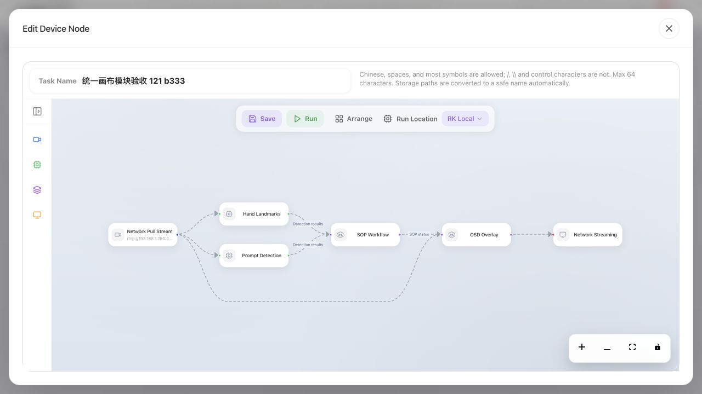](../../assets/sop/en-23-save-task.jpg)

**Done** returns changes to the draft; **Save** persists the task on the device; **Run** is separate. Follow the prompt when closing or canceling unsaved edits. Browser draft data is not automatically a saved production configuration.

### 3.13 End-of-chapter checklist {#quickstart--13-end-of-chapter-checklist}

- [ ] The full recording and both demonstration clips play.
- [ ] The mallet is one logical target; reference angles are not confused with physical count.
- [ ] Misses, false detections, duplicates, and normal occlusion have been checked.
- [ ] Step 1 has the correct visual requirement; step 2 explicitly requires operator confirmation.
- [ ] The steps execute in order.
- [ ] Stage ranges are compatible with the plan's validation range.
- [ ] Stage and plan results have been reviewed without treating progress as a pass rate.
- [ ] Saved settings and video remain correct after reopening.

**Next: [Video, targets, and recognition →](#video-and-recognition)**

*Example footage and reference views in the screenshots: [wooden-box assembly dataset and CC BY 4.0 credits](#reference--7-sample-and-screenshot-credits).*

## 4. Editor Workspace and Control Reference {#workspace-reference}

This chapter explains where an action is performed, what it affects, and where to verify its result. Video, targets, steps, and validation form one connected workspace.

### 4.1 Workspace overview {#workspace-reference--1-workspace-overview}

| Area | Contents | Verify after use |
|---|---|---|
| Title bar | Maximize, restore, close | Whether unsaved changes remain |
| Plan bar | Plan name, version, camera, import/export | Correct task and station |
| Step list | Numbers, names, summaries, ordering | Which step is selected |
| Video / Targets switch | Teaching footage or target information | Correct mode for the action |
| Video workspace | Playback, seeking, region and target drawing | Time, orientation, and real picture |
| Target workspace | Reference views, pending adoption, capacity | Logical target and selected reference |
| Overall timeline | Target scan and plan-validation range | Selected endpoints |
| Stage toolbar | Objects, regions, hands, additions | Destination stage for an addition |
| Operation card | Name, demo, instructions, status | What the operator will see |
| Check and completion cards | Conditions, regions, combinations, timing | Actual process meaning |
| Stage timeline | Stage-specific validation/demo range | Other stages were not accidentally changed |
| Footer | Messages, Cancel, Done | Task still needs saving afterward |

### 4.2 Plan name, version, and camera {#workspace-reference--2-plan-name-version-and-camera}

#### 4.2.1 Name {#workspace-reference--21-name}

Edit the plan-name field. Use a recognizable station or product plus the purpose, such as “Assembly A: Tool preparation.” Do not use a version number as the only identity. Check the actual version displayed by the system.

Names are business data. Changing the interface language does not translate them automatically.

#### 4.2.2 Camera selection {#workspace-reference--22-camera-selection}

1. Click **Choose / change**.
2. Choose the current station's camera.
3. Supply that camera's credentials when required.
4. Verify the source in the plan bar.
5. Check footage, references, regions, and handedness against the new view.

Device Web credentials and camera credentials may differ. If connection fails, resolve source and network details before repeatedly changing the same source inside several steps.

### 4.3 Step list {#workspace-reference--3-step-list}

| Action | Method | Meaning |
|---|---|---|
| Select a step | Click its number or card | Locate that step in the workspace |
| Collapse | Use the list's collapse control | Provide more editing space while keeping numbered navigation |
| Expand | Use the collapsed list's expand control | Restore names and summaries |
| Add | Add step or plus control | Create a work unit, then configure its name and rules |
| Reorder | Reorder, move buttons, or drag handle | Change stage or grouped-step placement |
| Undo | Explicit available undo control | Revert a supported recent change and inspect it |

Numbers identify positions; names express actions. Moving a card does not by itself edit a condition's internal event sequence.

### 4.4 Video and Targets modes {#workspace-reference--4-video-and-targets-modes}

#### 4.4.1 Video {#workspace-reference--41-video}

Play teaching footage, choose reference times, draw shared regions, and add targets. Seek to a clear picture before drawing.

#### 4.4.2 Targets {#workspace-reference--42-targets}

Inspect references and improve recognition. Check the selected name, reference count, and pending-adoption count first.

Seeing an object in the recording does not establish a configured target. Creating a target does not add it to every step.

#### 4.4.3 Reference views {#workspace-reference--43-reference-views}

After selecting a reference card, compare it with the main picture. An additional view represents another appearance of the same logical object; it does not mean two physical objects must coexist.

Pending adoption identifies improvements not yet admitted as plan references. Follow [Recognition improvement](#video-and-recognition) through trial, adoption, and video recheck.

### 4.5 Scrolling, zooming, panning, and drawing {#workspace-reference--5-scrolling-zooming-panning-and-drawing}

| Purpose | Control | What it does not change automatically |
|---|---|---|
| Browse the editor | Normal wheel/page scrolling | Does not edit boxes or rules |
| Examine detail | Plus/minus or the displayed modifier key | Does not improve source-image resolution |
| Fit the view | Fit window | Does not alter original target coordinates |
| Inspect another part of a zoomed view | Pan image | Does not move the real object |
| Add a target box | Add target or manual-box mode | Should not move an old box |
| Adjust an existing box | Select it and use explicit edit mode | Is not a new target |

Check the current mode before drawing, especially when the starting point is inside an existing box.

In narrow windows, maximize the editor, collapse the step list, or close unneeded settings. Do not rely on making all browser text extremely small.

### 4.6 The three timeline controls {#workspace-reference--6-the-three-timeline-controls}

1. **Playhead:** current viewing position.
2. **Start handle:** beginning of the selected range.
3. **End handle:** end of the selected range.

[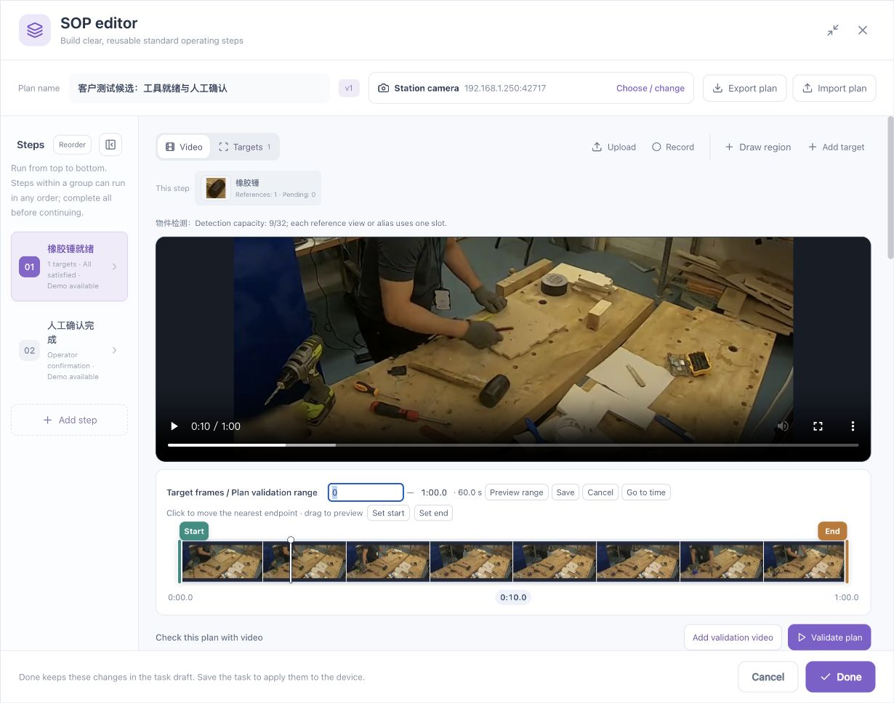](../../assets/sop/en-08-plan-range.jpg)

#### 4.6.1 Preview a time {#workspace-reference--61-preview-a-time}

Drag the playhead or follow the displayed seek instructions. Verify the main picture and current time, rather than only the thumbnail strip. Avoid grabbing an endpoint by mistake.

#### 4.6.2 Change a range {#workspace-reference--62-change-a-range}

1. Identify whether this is the overall or a stage-specific timeline.
2. Drag its endpoint, or click the displayed start/end time.
3. Check both endpoints and the duration.
4. Use **Preview range** to verify actual playback boundaries.
5. Rescan for target review or revalidate the relevant stage as appropriate.

**Click to move the nearest endpoint** means clicking may edit the range. For viewing only, prefer drag-to-preview and explicit playback controls.

#### 4.6.3 Set start and Set end {#workspace-reference--63-set-start-and-set-end}

Seek to the intended picture first, then use the appropriate control. When disabled, establish a valid loaded video position first. A disabled control is not evidence of a successful edit.

#### 4.6.4 Independent stage ranges {#workspace-reference--64-independent-stage-ranges}

Each stage retains its own range, which may overlap another stage's range. **Validation range** and **Operation demo** have different purposes. Check the displayed values after switching purposes.

### 4.7 Stage toolbar {#workspace-reference--7-stage-toolbar}

#### 4.7.1 Scope {#workspace-reference--71-scope}

The toolbar lists available objects, regions, and hands. Selecting one does not always immediately change a rule: an operation setup may still require **Add to this stage**.

#### 4.7.2 Selection order {#workspace-reference--72-selection-order}

- Hand/object operation: select the hand, then the object.
- Object readiness or position: select the object, then the offered operation type.
- Region assignment: drop the region into its compatible slot or click the slot.
- Existing requirement: select its diagram object or relationship control.

#### 4.7.3 Shared settings versus step rules {#workspace-reference--73-shared-settings-versus-step-rules}

**Detection settings** manages station-wide capability and handedness. A step's checks and completion controls define its business requirements. Adding a hand source does not make every step a hand operation.

[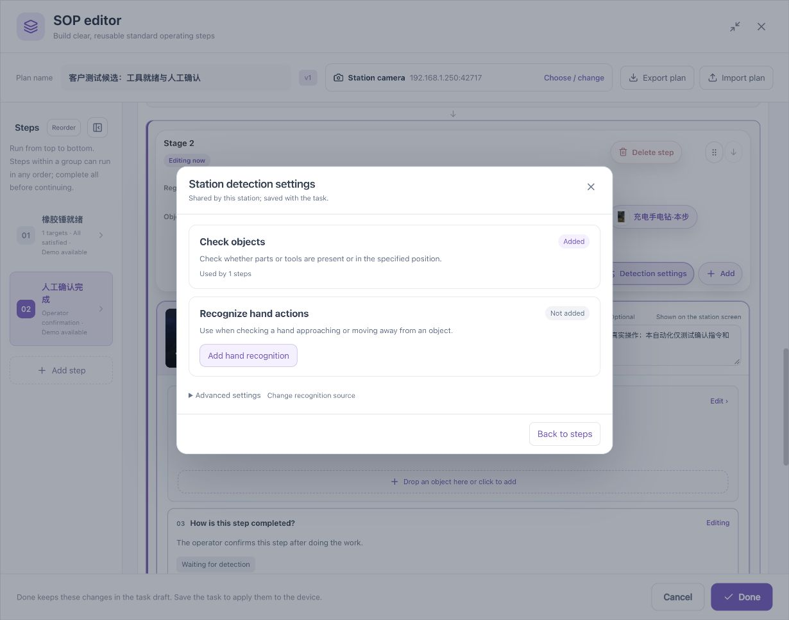](../../assets/sop/en-16-detection-settings.jpg)

See [Toolbar and drag operations](#toolbar-and-drag) for addition, replacement, removal, and undo.

### 4.8 Operation card {#workspace-reference--8-operation-card}

#### 4.8.1 Name {#workspace-reference--81-name}

Use actionable names such as “Prepare tools,” “Review parts,” or “Confirm completion.” The adjacent name-edit control does not configure visual rules.

#### 4.8.2 Demonstration {#workspace-reference--82-demonstration}

Click the video thumbnail's playback entry. Compare its time label with actual playback boundaries. The demo teaches the operator; its thumbnail is not a recognition reference.

#### 4.8.3 Operator instructions {#workspace-reference--83-operator-instructions}

Enter material, position, action, and quality-review instructions directly. Prefer short practical sentences: “Place the cup in the parts area. Check that it is undamaged before confirming.”

Do not put development logs or threshold experiments in operator instructions. When the interface states that instructions appear on the station screen, review them as the operator will read them.

#### 4.8.4 Status {#workspace-reference--84-status}

Waiting, not validated, and review-required indicators describe state; they are not editable fields. Inspect the relevant reason rather than renaming the step to hide a state.

### 4.9 Relationship diagram and settings {#workspace-reference--9-relationship-diagram-and-settings}

1. Open **Checks in this step → Edit**.
2. Select the relevant relationship or object.
3. Check its subject, condition type, region, and parameters.
4. Read the resulting requirements back from the diagram.
5. Verify combinations and any internal sequence.
6. Configure completion and hold duration.

The small region label under a diagram object is operational information. It is not equivalent to merely having a region card in the toolbar.

### 4.10 Done, Cancel, Close, and Save {#workspace-reference--10-done-cancel-close-and-save}

| Action | Effect | Next action |
|---|---|---|
| Done | Returns SOP edits to the task draft | Confirm the node if still open, then save the task |
| Cancel | Exits the current edit; follow any change prompt | Decide whether to discard current edits |
| Close | Closes the current window | Check unsaved work first |
| Node confirmation | Returns configuration to the outer task editor | Save the task |
| Task Save | Persists the task | Wait for acknowledgement, then reopen |
| Task Run | Runs the saved task | Open station operation and check the active step |

An editor draft, a saved task, and a running task are different states. Closing a window alone does not prove deployment.

#### 4.10.1 Reading the example connections {#workspace-reference--flow-routing}

[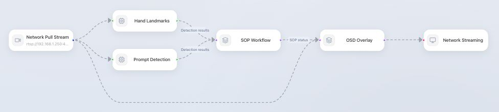](../../assets/sop/en-32-flow-routing.jpg)

*Figure 4-1: A close-up captured directly from the live canvas. Hand and object detection occupy separate rows; the original video follows the lower bypass. No nodes or connections were redrawn.*

| Connection | What it carries |
|---|---|
| Network Pull Stream → Hand Landmarks | Camera images for visible-hand detection |
| Network Pull Stream → Prompt Detection | The same images for object detection |
| Hand Landmarks and Prompt Detection → SOP Workflow | Detection results used to evaluate step conditions |
| Network Pull Stream → OSD Overlay | Original video used as the overlay background |
| SOP Workflow → OSD Overlay | Current SOP status |
| OSD Overlay → Network Streaming | Output video with overlaid guidance |

The two detection branches are parallel data sources. Their positions do not mean “operate the hand first, then the object”; order comes from the steps and conditions inside SOP. An object-only plan does not need a hand-detection branch.

In other layouts, paths may cross on the canvas. A crossing by itself does not join the signals: follow the arrows to their actual nodes and ports. Use **Arrange** to organize the display, then check the connections. Do not add or remove connections just to reproduce a picture's appearance.

### 4.11 Change-impact reference {#workspace-reference--11-change-impact-reference}

| Change | Recheck at least |
|---|---|
| Camera or image orientation | References, regions, handedness, affected steps |
| Reference or detection threshold | Every use of that target, normal and negative cases |
| Shared region | Every referencing step |
| Handedness | Every left/right-specific operation |
| Step condition, timing, completion | That step and dependent workflow |
| Stage grouping or order | Complete workflow |
| Video range | Corresponding scan/validation and demonstration boundaries |
| Instructions only | Station-screen readability and demonstration consistency |

**Continue: [Parameters and states](#parameters) · [Complete scenario labs](#scenario-labs).**

*Footage attribution: [Sample and screenshot credits](#reference--7-sample-and-screenshot-credits).*

## 5. Tool and Button Reference: Locations and Effects {#control-reference}

Use this chapter to identify a control while working. Each group provides an actual interface screenshot followed by location, purpose, availability, result, and verification. Click figures to enlarge. Controls depend on mode, selection, capability, and busy/read-only state. A missing control is not a reason to recreate the task.

### 5.1 Identify the window first {#control-reference--1-identify-the-window-first}

| Window | How to recognize it | Confirmation at this level |
|---|---|---|
| Task list | Device task cards | Select or create a task |
| Outer task editor | Graph of video, algorithm, and SOP nodes | Save the task; Run is a separate action |
| SOP node settings | Station name and Edit steps | Confirm the node |
| SOP editor | Plan bar, step list, video, and rules | Done returns edits to the draft |
| Child dialog or operation setup | Camera, detection settings, target picker, or hand setup | Confirm that selection or add the operation |

If a control cannot be found, close the uppermost child dialog and identify the current layer. Do not use the outer **Run** control to try to open configuration.

### 5.2 Create Task dialog {#control-reference--2-create-task-dialog}

[{style="position:absolute;max-width:none;width:294.117647%;left:-97.058824%;top:-28.125000%;"}](../../assets/sop/en-02-create-task.jpg)

1
2
3
4

Figure C1 · Create an SOP task: choose a type, name it, then create. Numbers are manual location aids, not product buttons. Open the image for the unmodified capture; the following tables explain the controls.

| Marker | Location and control group |
|---|---|
| **1** | SOP workflow: right side of task type |
| **2** | Object/hand choices: two cards below the type |
| **3** | Task name: field in the lower half |
| **4** | Create and Edit / Cancel: dialog footer |

The upper area chooses task type, the middle selects object/hand capabilities, and the lower area contains the task name. Creation is at the lower right.

| Control | Purpose | Verify |
|---|---|---|
| General detection | Create an ordinary analysis graph | This is not the SOP-authoring path |
| SOP workflow | Create a task with a procedure workflow | Continue by selecting object or hand needs |
| Check objects only | Begin with objects, counts, and positions | Does not require hand checks in every step |
| Also check hand operations | Prepare hand/object capabilities | Specific hand conditions still need configuration |
| Task Name | A recognizable station task name | Resolve empty or invalid input using the displayed message |
| Create and Edit | Create and enter editing | Does not mean running or validated |
| Cancel / close | Leave creation | An incomplete creation is not a saved task |

### 5.3 Window and plan bar {#control-reference--3-window-and-plan-bar}

1
2
3
4
5
6

Figure C2 · Editor overview: plan, navigation, targets, references, and completion. Numbers are manual location aids, not product buttons. Open the image for the unmodified capture; the following tables explain the controls.

| Marker | Location and control group |
|---|---|
| **1** | Plan bar: camera and import/export; window controls are above at right |
| **2** | Step list: reorder/collapse at top, step cards below |
| **3** | Workspace upper left: Video / Targets |
| **4** | Canvas upper right: zoom, fit, and pan |
| **5** | Right of picture: reference list and Add view |
| **6** | Editor footer right: Done returns to the task draft |

| Location/control | Effect | Verify |
|---|---|---|
| Top right: maximize/restore | Expand or restore editor space | View changes, not rules |
| Top right: close | Leave the editor | Resolve unsaved changes |
| Plan name | Rename the current plan | User data is not translated by locale changes |
| Version badge | Display version information | Not an editable process name |
| Camera: Choose / change | Open station-source selection | Address, credentials, and actual picture |
| Export plan | Download exportable plan content | Keep the file; do not assume every video is an independent backup |
| Import plan | Load a plan file | Read replacement/compatibility messages; inspect sources, targets, regions, and rules, then validate |
| Step-list collapse/expand | Change sidebar width | Numbered navigation remains |
| Add step / plus | Add a work unit | Configure its name, instructions, checks, and completion |

### 5.4 Camera picker {#control-reference--4-camera-picker}

[{style="position:absolute;max-width:none;width:178.571429%;left:-42.857143%;top:-53.571429%;"}](../../assets/sop/en-05-camera.jpg)

1
2
3
4

Figure C3 · Camera controls: credentials, discovery, and an existing address. Numbers are manual location aids, not product buttons. Open the image for the unmodified capture; the following tables explain the controls.

| Marker | Location and control group |
|---|---|
| **1** | Camera credentials: middle of popover; both fields are empty |
| **2** | Find cameras: right of password |
| **3** | Existing address / camera not found: disclosure below fields |
| **4** | Collapse: popover upper right |

| Control | Location/use | Important detail |
|---|---|---|
| Video source | Upper selection when several inputs exist | Choose the correct station |
| Username | Search form | May differ from device Web login |
| Password | Search form | Camera authentication; not operator instructions |
| Search | After authentication fields | Wait while discovery is running |
| Use | Beside a discovered camera | Verify the source after returning |
| Existing-address entry | Collapsible area below discovery | Administrator checks address/network when discovery is unavailable |
| Use this address | After a valid address | Disabled for invalid input; repeated clicks do not correct its format |

### 5.5 Video and recording controls {#control-reference--5-video-and-recording-controls}

1
2
3
4
5

Figure C4 · Teaching video: media tools, player, and the overall range. Numbers are manual location aids, not product buttons. Open the image for the unmodified capture; the following tables explain the controls.

| Marker | Location and control group |
|---|---|
| **1** | Workspace upper right: Upload, Record, Draw region, Add target |
| **2** | Player lower left: play/pause; volume and fullscreen are at right |
| **3** | Player bottom: playback seek bar |
| **4** | Below player: overall target-scan / plan-validation range |
| **5** | Below range at right: Add validation video and Validate plan |

| Control | Location | Purpose and result |
|---|---|---|
| Video | Upper-left workspace switch | Teaching playback, seeking, and drawing |
| Targets | Beside Video | Target/reference work; may be unavailable without a target/picture or while busy |
| Upload | Media toolbar | Select process footage; wait for processing and thumbnails |
| Record | Beside Upload | Prepare capture from the selected station |
| Play/Pause | Video controls | Viewing only; does not define completion rules |
| Video progress bar | Player bottom | Seek teaching footage, not a stage-range edit |
| Volume | Player controls | Playback sound; visual conditions do not prove events from audio |
| Full screen | Player's right side | Expand video, not the entire SOP editor |
| More | Player's right side | Browser-provided functions; contents depend on the browser |

#### 5.5.1 Recording states {#control-reference--51-recording-states}

[{style="position:absolute;max-width:none;width:263.157895%;left:-81.578947%;top:-128.571429%;"}](../../assets/sop/en-07-record-warning.jpg)

1
2
3

Figure C5 · Re-recording: read the replacement scope before cancelling or starting. Numbers are manual location aids, not product buttons. Open the image for the unmodified capture; the following tables explain the controls.

| Marker | Location and control group |
|---|---|
| **1** | Dialog body: replacement scope, reset ranges, and retained data |
| **2** | Cancel: keep current editing and return |
| **3** | Start recording: use only when replacement is intended |

| Control | When used | Effect |
|---|---|---|
| Start/continue recording | Source ready and replacement intended | Begin new teaching capture |
| Stop and use | After capturing the complete action | Stop and wait for a usable asset |
| Cancel recording | Discard the new capture | Inspect the outcome and existing draft |
| Leave waiting / uncertain-state entry | Outcome not yet known | Reconcile the original action before another capture |
| Cancel in replacement dialog | Preserve existing material | Return without starting |
| Start in replacement dialog | After reading replacement scope | May replace whole-process and separate step demos and reset related ranges; check what references, regions, and rules remain |

For replay, use playback rather than Record.

### 5.6 Canvas toolbar and context menu {#control-reference--6-canvas-toolbar-and-context-menu}

1
2
3

Figure C6 · Canvas: view controls and target box. Numbers are manual location aids, not product buttons. Open the image for the unmodified capture; the following tables explain the controls.

| Marker | Location and control group |
|---|---|
| **1** | Canvas top right: minus, scale, plus, fit, pan |
| **2** | Target box: select, double-click to edit, right-click for more |
| **3** | Canvas top left: interaction hint |

| Control | Location | Purpose |
|---|---|---|
| Minus | Above the picture | Zoom out until the display limit |
| Percentage | Between minus and plus | Viewing scale, not a detection score |
| Plus | Beside scale | Zoom in without adding source resolution |
| Fit window | Canvas toolbar | Restore suitable viewing scale |
| Pan image | Canvas toolbar | Toggle panning; check this mode before drawing |
| Click a box | Existing picture box | Select its target |
| Double-click a box | Existing picture box | Open its supported edit mode |
| Right-click a box | Existing picture box | Edit/remove menu; identify the subject first |
| Redraw | Polygon-edit tools | Restart the current outline, not the plan |
| Close polygon | After sufficient valid vertices | Complete the outline before naming/confirmation |
| Vertex handle | Polygon outline | Adjust that vertex, then inspect geometry |

Removing a box, deleting a region, and deleting a step affect different objects.

### 5.7 Targets and reference views {#control-reference--7-targets-and-reference-views}

1
2
3
4
5

Figure C7 · Target references: view list, additional views, and recognition review. Numbers are manual location aids, not product buttons. Open the image for the unmodified capture; the following tables explain the controls.

| Marker | Location and control group |
|---|---|
| **1** | Current target card: name, reference count, and pending count |
| **2** | Reference panel header: selected target and image/pending counts |
| **3** | Add view: right of the Reference image title |
| **4** | View card: select and compare with the main picture |
| **5** | Improve recognition: right end of the target heading |

| Control | Location | Purpose and verification |
|---|---|---|
| Add target | Workspace toolbar | Seek a clear frame, draw, name, and choose a source if needed |
| Use current frame | Reference-frame confirmation | Use the paused image; verify its time |
| Target name | Drawing form | Logical object name, not a view name |
| Detection source | New-target form with several sources | Choose who detects this target |
| Add to this step | New-target confirmation | Add the target; then inspect count, region, and completion |
| Cancel drawing | Drawing form | Discard the unsubmitted box |
| Add view | Reference-list heading | Add another appearance of the same target |
| Save additional reference | Additional-view form | Save that view |
| Apply changes | Existing-target form | Apply edits and inspect affected steps |
| This step / all using steps | Shared-target edit scope | Read affected names first |
| View card | Reference list | Show and inspect that view |
| Remove additional view | Available on selected non-primary view | Remove the view, not the entire logical target |
| Reload image | Failed-image area | Retry image loading, not inference |
| Pending preview | Added-box reference area | Inspect unadopted improvements |
| Retry added-box previews | Failed preview state | Retry loading; do not duplicate the boxes |
| Adopt and recheck | Available pending reference area | Explicitly admit improvements and recheck; still validate stages/plan and save |

### 5.8 Timeline controls {#control-reference--8-timeline-controls}

1
2
3
4
5
6

Figure C8 · Timeline: exact times, preview, endpoints, and playhead. Numbers are manual location aids, not product buttons. Open the image for the unmodified capture; the following tables explain the controls.

| Marker | Location and control group |
|---|---|
| **1** | Start/end text: the start is being edited in this figure |
| **2** | Preview range, Save, Cancel, and Go to time after the fields |
| **3** | Set start / Set end: use the valid preview position |
| **4** | Green start handle: range beginning |
| **5** | Orange end handle: range end |
| **6** | White playhead: viewing position, not a range boundary |

| Control | Use | Verify |
|---|---|---|
| Start time | Click and enter seconds or minutes:seconds | Before End and within footage |
| End time | Click to edit | Intended duration |
| Pencil / Edit start and end | Beside times | Correct range, not every stage |
| Start handle | Drag selected range's beginning | Picture and start label |
| End handle | Drag selected range's end | Picture and end label |
| Playhead | Drag to preview a moment | Current time; avoid endpoints |
| Set start | Use current valid preview position | New start and range |
| Set end | Use current valid preview position | New end and range |
| Preview range | Play selection | Starts and stops at intended boundaries |
| Restore full recording | Overall-range area | Restore full overall interval |
| Validation range | Stage timeline | Stage validation interval, with demo synchronization as indicated |
| Operation demo | Beside stage-validation purpose | Optional separate operator demonstration |

Identically named controls affect their own timeline. Check its heading and stage after editing.

### 5.9 Scan controls {#control-reference--9-scan-controls}

**Improve recognition** can reopen retained work or initiate a check for the selected range. Identify target and interval first. Wait for an explicit state rather than repeatedly starting.

| Control/function | Purpose | Verify |
|---|---|---|
| Frame sampling interval | Select result-image spacing | Smaller interval creates more samples; it does not change source frame rate |
| Improve recognition | Open target scan/review workspace | Target, range, and progress |
| Scan selected clip | Start the selected interval | Result timestamps match selection |
| Scan full recording | Check the full asset | Different from one-stage validation |
| Refresh scan pictures | Read current results | Does not imply a fresh inference of all footage |
| Load missing result pictures | Retrieve generated but unread pictures | Compare generated and loaded counts |
| Continue scan | Recover/reconcile existing startup | Do not create a duplicate request |
| Stop scan | Request termination | Wait for acknowledgement and cleanup; generated pictures may remain |
| Retry stop | Reconcile the same stop | Not a new scan |
| End previous scan | Recover interrupted work | End safely before restarting |
| Close this scan | Close a safely completed session | Not deletion of history |
| Collapse / return to target images | Return to references | Not stop or adoption |
| Analyze missed detections | Analyze retained results and saved reviews | Evidence/filter diagnosis, not a guarantee of repaired recognition |

Some specialized scan/review labels depend on the device's supported interface. Follow the matching purpose and the displayed status.

### 5.10 Per-frame review controls {#control-reference--10-per-frame-review-controls}

These are beside the selected scan picture. Judge the original image first.

| Control/function | When to use | Meaning |
|---|---|---|
| Time thumbnail | Inspect a sample | Select time and verify target |
| Next unresolved picture | Continue review | Navigation, not automatic judgment |
| Target present / add boxes | Current target truly appears | Draw each physical instance separately |
| Draw another target | Another instance remains | Add, rather than resize an old box |
| Adjust box N | Correct an annotation | Edit that box |
| Delete box | Wrong or duplicate annotation | Remove one box, not the footage |
| Clear image, all instances boxed | Whole image and all same-class objects checked | Exhaustive human review, not autonomous algorithm recall |
| Clear image, definitely absent | Absence can genuinely be judged | Reliable negative; not occlusion or blur |
| Unclear | Presence cannot be judged reliably | Unknown evidence, not a positive or negative |
| Undo review | Withdraw human judgment | Recheck the frame |
| Confirm box deletion and relabel | Change an incompatible judgment | Removes conflicting boxes; inspect first |
| Keep boxes | Cancel that deletion | Retain annotations |
| Retry save | Human review did not save | Keep this page and retry |
| Read latest state | Another window changed the frame | Reconcile current content before saving |

#### 5.10.1 Trial and candidate controls {#control-reference--101-trial-and-candidate-controls}

| Control/function | Purpose | Verify |
|---|---|---|
| Recheck current image | Test this frame using temporary references/settings | Actual algorithm-box matches, not total box count alone |
| Trial details | Show the trial's settings and result | Separate from previous-scan evidence |
| Trial threshold | Filter this trial | Not automatically all references or steps |
| Previous scan results and gates | Inspect earlier evidence | Do not mix its scores with a new trial |
| Show candidate clues | Display possible locations | A clue is not retained detection |
| Hide candidate clues | Hide additional overlays | Does not delete evidence |
| Show corresponding candidate | Highlight one annotation's match | Same physical object |
| Inspect/change this reference gate | Edit the specified reference | Recheck positives and negatives afterward |
| Low-score candidates per query | Inspect individual source evidence | Do not add scores into an accuracy value |

### 5.11 Independent footage and suggestions {#control-reference--11-independent-footage-and-suggestions}

| Control/function | Prerequisite | Effect |
|---|---|---|
| Add independent recording | Complete current-footage review | Select another genuinely recorded operation |
| Replace independent recording | Replace a selected asset | Not a renamed copy of the same clip |
| Check this recording | Original session safely finished | Check the independent asset |
| Current / independent recording | Both sides available | Switch evidence without changing asset identity |
| Confirm separately recorded footage | Source independently verified | Explicit provenance confirmation, not a box to tick merely to unlock controls |
| Compare both recordings | Required evidence complete | Compare development and independent observations |
| Confirm suggested settings | Supported proposal reviewed | Change current target draft, then revalidate/save |
| Additional validation footage | Plan-validation area | Use another asset without replacing teaching demos |

If no proposal is available, read which evidence is missing. No proposal is not an implicit instruction to lower a threshold.

### 5.12 Stage toolbar and operation setup {#control-reference--12-stage-toolbar-and-operation-setup}

[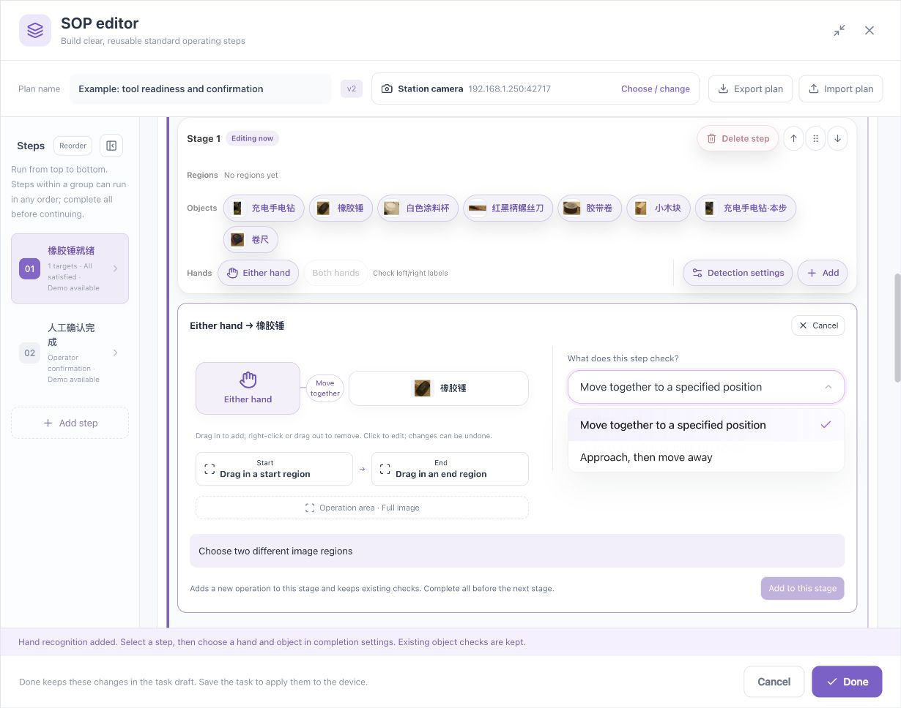{style="position:absolute;max-width:none;width:129.870130%;left:-24.675325%;top:-20.547945%;"}](../../assets/sop/en-19-hand-actions.jpg)

1
2
3
4
5
6

Figure C9 · Hand-action setup: choose endpoints, action, areas, and add. Numbers are manual location aids, not product buttons. Open the image for the unmodified capture; the following tables explain the controls.

| Marker | Location and control group |
|---|---|
| **1** | Toolbar object row: choose the relevant object |
| **2** | Toolbar hand row: choose either, left, or right hand |
| **3** | Action selector at right: move together or approach/withdraw |
| **4** | Below the action diagram: start and end region slots |
| **5** | Below the slots: operation area covering the process |
| **6** | Panel lower right: Add to this stage; disabled until valid |

| Control | Location/purpose | Verify |
|---|---|---|
| Region card | Region row; select or drag | Receiving slot and final region text |
| Object card | Object row; select or drag | Addition, replacement, or operation setup |
| Either hand | Hand row | Next choose related object |
| Left / Right hand | Available handedness targets | Operator-relative labels verified |
| Both hands | May be shown unavailable | Unavailable is not enabled capability |
| Detection settings | Toolbar actions | Shared settings dialog |
| Add | Toolbar actions | Addition based on current selection |
| Undo icon | When a recent supported edit exists | Diagram and operation count restored |
| What to check | Operation setup | Readiness, position, approach/withdrawal, or supported transfer |
| Operation area | Diagram/setup | Entire relevant movement path |
| Origin / Destination | Transfer slots | Different meaningful positions |
| Operating hand / object | Select corresponding diagram node | Correct endpoints |
| View conditions | Setup's disclosure | Read generated requirements |
| Add to this stage | Setup bottom | Commit the new operation; inspect retained existing checks |
| Cancel in setup | Setup header | Discard unsubmitted operation |

### 5.13 Detection settings dialog {#control-reference--13-detection-settings-dialog}

[{style="position:absolute;max-width:none;width:178.571429%;left:-39.285714%;top:-54.166667%;"}](../../assets/sop/en-16-detection-settings.jpg)

1
2
3
4
5

Figure C10 · Detection settings: objects, hands, and optional advanced sources. Numbers are manual location aids, not product buttons. Open the image for the unmodified capture; the following tables explain the controls.

| Marker | Location and control group |
|---|---|
| **1** | Upper card: object capability and affected-step count |
| **2** | Middle card: hand-recognition state and purpose |
| **3** | Add hand recognition: shown when not yet added |
| **4** | Advanced settings: manage shared recognition sources when needed |
| **5** | Back to steps: return to editing; does not save the task |

| Control | Purpose | Important detail |
|---|---|---|
| Object source | Select station object capability | Affects listed steps |
| Recognize hands / Add hand recognition | Add hand capability | Configure individual step requirements afterward |
| Do not distinguish left/right | Avoid handedness constraints | Prefer Either hand |
| Distinguish left/right | Expose directional targets | Still requires actual calibration |
| Swap left/right | Correct verified reversed labels | Recheck after camera changes |
| Advanced source settings | Manage shared sources | Inspect impact before applying |
| Apply to N steps | Apply chosen source to listed uses | Not necessarily only this step |
| Remove unused source | Remove unreferenced capability | Confirm no active references |
| Back to steps / close | Return to authoring | Changes remain in task draft until saved |

### 5.14 Checks and completion controls {#control-reference--14-checks-and-completion-controls}

[{style="position:absolute;max-width:none;width:133.333333%;left:-26.666667%;top:-100.000000%;"}](../../assets/sop/en-11-object-condition.jpg)

1
2
3
4
5
6

Figure C11 · Check configuration: combination, object, add slot, and details. Numbers are manual location aids, not product buttons. Open the image for the unmodified capture; the following tables explain the controls.

| Marker | Location and control group |
|---|---|
| **1** | Combination selector at left: All at the same time, etc. |
| **2** | Diagram object at left: select the condition |
| **3** | Dashed slot under the diagram: add a check object |
| **4** | What to check at right: condition type |
| **5** | Where to check: region; Replace object below changes the target |
| **6** | More settings: score and other less frequent parameters |

| Control/function | Use | Result |
|---|---|---|
| Checks in this step → Edit | Open rule editor | Current step unless shared data changes |
| Object detected | Require trustworthy presence | Target, region, and score all apply |
| Object not detected | Require no retained target | Does not establish physical departure |
| Count meets requirement | Set minimum and maximum | Equal values mean exact count |
| All together | Simultaneous requirements | One missing requirement affects the group |
| Any condition | Permitted alternatives | Not “all tools must be ready” |
| Ordered conditions | Require event sequence | Verify transitions and timeout |
| Diagram object | Select an endpoint | Open that requirement's settings |
| Region label/slot | Assign target coverage | A toolbar card alone is insufficient |
| Replace object / A / B | Replace selected endpoint | Recheck region, count, scores, other endpoint |
| Add related object | Open picker | Add a condition, not a reference |
| Add spatial relationship | Two-endpoint position check | Requires capability and valid sources |
| More settings | Expose infrequently used parameters | Revalidate edits |
| Copy condition | Copy supported requirement | Not a physical-object counter |
| Remove relationship | Delete selected requirement | Respect final-item restrictions |
| Collapse | Return to diagram/summary | Does not save the task |

[{style="position:absolute;max-width:none;width:133.333333%;left:-26.666667%;top:-87.755102%;"}](../../assets/sop/en-12-auto-completion.jpg)

1
2
3
4
5

Figure C12 · Completion: automatic/assisted/manual, hold duration, and advanced timing. Numbers are manual location aids, not product buttons. Open the image for the unmodified capture; the following tables explain the controls.

| Marker | Location and control group |
|---|---|
| **1** | Completion-method selector: system or operator confirmation |
| **2** | Confirmation hold slider: required stable duration |
| **3** | Seconds field: enter the duration directly |
| **4** | Advanced: brief input interruptions |
| **5** | Time limit near the bottom: step deadline; 0 disables timeout |

| Control/function | Purpose | Verify |
|---|---|---|
| How to complete → Settings | Configure completion | Automatic, assisted, or manual |
| Automatic after visual checks | Advance on visual conditions | Hold duration and negative cases |
| Visual checks + operator review | Require human confirmation after checks | Instructions state what to review |
| Operator confirmation | Operator determines completion | Pixels cannot impersonate a human confirmation |
| Hold slider / seconds | Stable satisfaction duration | Seconds, not frames or clip length |
| Advanced timing | Input-gap settings | Do not hide observed errors with long gaps |
| Completion deadline | Maximum step time | Zero disables deadline, not hold duration |
| How this step is judged | Show actual rule explanation | Read back with process owner |

### 5.15 Target picker {#control-reference--15-target-picker}

[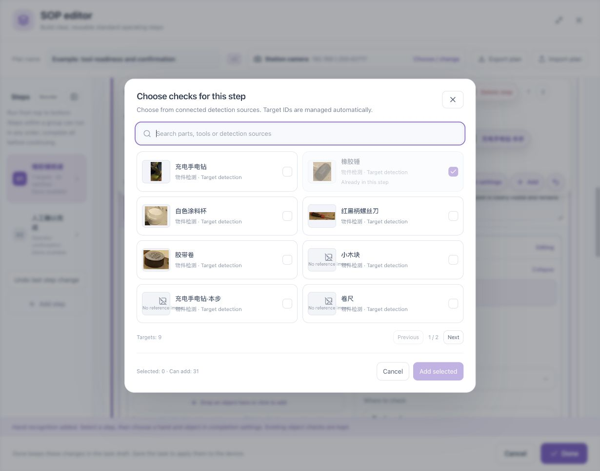{style="position:absolute;max-width:none;width:166.666667%;left:-33.333333%;top:-23.529412%;"}](../../assets/sop/en-25-target-picker.jpg)

1
2
3
4
5

Figure C13 · Target picker: search, cards, pages, selection count, and submit. Numbers are manual location aids, not product buttons. Open the image for the unmodified capture; the following tables explain the controls.

| Marker | Location and control group |
|---|---|
| **1** | Search at top: filter by name or source |
| **2** | Cards in the middle: select; a disabled card may already be in the step |
| **3** | List lower right: pages and previous/next |
| **4** | Dialog lower left: selected count and remaining allowance |
| **5** | Dialog lower right: Cancel / Add selected |

| Control | Purpose | Verify |
|---|---|---|
| Search | Filter existing target data | Does not create a target |
| Target card | Select an addition/replacement | Name, source, and reference |
| Previous / Next | Page through results | Selected count and current page |
| Selected count / limit | Selection size | Not required physical quantity |
| Add selected | Submit additions | New relationships after return |
| Replace | Submit one replacement | Subject changes; condition count may not |
| Cancel / close | Leave selection | Previously committed actions are separate |

### 5.16 Ordering controls {#control-reference--16-ordering-controls}

[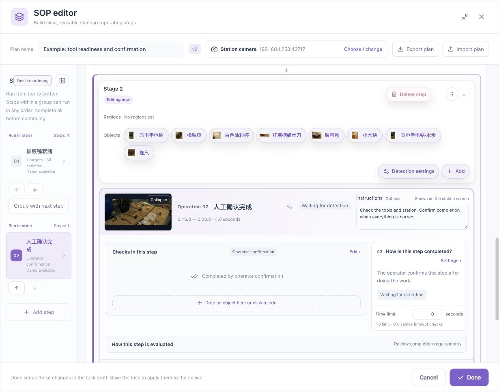](../../assets/sop/en-17-ordering.jpg)

1
2
3
4

Figure C14 · Reordering: mode, movement, unordered groups, and stage controls. Numbers are manual location aids, not product buttons. Open the image for the unmodified capture; the following tables explain the controls.

| Marker | Location and control group |
|---|---|
| **1** | Step list top: Finish reordering exits ordering mode |
| **2** | Below each step card: move up/down |
| **3** | Below the first step: Group with next step for independent work |
| **4** | Stage toolbar upper right: delete, drag handle, movement controls |

| Control/function | Effect | Important detail |
|---|---|---|
| Reorder | Organize stages | Establish process dependencies first |
| Move up/down | Move identified stage or grouped step | One direction may be disabled at an edge |
| Drag handle | Pointer or documented arrow-key reordering | Do not drag a reference image to reorder |
| Group with next in any order | Combine independent work | Every grouped step remains mandatory |
| Join/merge group | Organize an unordered stage | Do not relax genuine dependencies |
| Separate/remove from group, when offered | Restore independent stage | Revalidate order |
| Delete this step | Remove identified operation | Read confirmation; back up important configuration |

### 5.17 Validation, records, and persistence {#control-reference--17-validation-records-and-persistence}

| Control/function | Location | Purpose |
|---|---|---|
| Validate stage N | Its stage timeline | Stage and selected interval only |
| Validate plan | Below overall range | Entire configured flow; cover participating stages |
| Step checks and reasons | Result details | Explain waiting, failure, or unknown evidence |
| Key-frame review, optional | Validation area | Inspect evidence; does not replace full-flow validation |
| Recognition review records | Authoring disclosure | Pending or retained review data |
| Pending reviews | Records area | Not yet submitted historical evidence |
| Validation and reviews | Records area | Read retained data matching the saved task |
| Refresh / Load more | History | Read records without rerunning inference |
| Validation records | Relevant history entry | Inspect whether sampling exists |
| Done | SOP editor lower right | Return to task draft |
| Node Confirm | Node dialog lower right | Return to outer editor |
| Save | Outer graph toolbar | Persist and wait for acknowledgement |
| Run | Outer graph toolbar | Start the saved task |
| Station operation | Task card | Operator view; a stopped task may have no active instance |

See [Operator station guide](#operator-guide) for runtime commands and [Parameters](#parameters) for units and bounds.

*Footage attribution: [Sample and screenshot credits](#reference--7-sample-and-screenshot-credits).*

## 6. Parameters, Units, Defaults, and States {#parameters}

Use this chapter to determine what a value controls, how changing it affects behavior, and what must be revalidated. Do not adjust settings repeatedly until the screen turns green. Identify the recognition, geometry, timing, or workflow issue first.

### 6.1 Parameter categories {#parameters--1-parameter-categories}

| Category | Question | Typical fields |
|---|---|---|
| Recognition | Which candidate is accepted? | References, detector threshold, condition minimum score |
| Count and geometry | How many, where, and relative to what? | Minimum/maximum, region, relationship, distance |
| Timing | How long must it hold or wait? | Hold, input-gap tolerance, deadline |
| Workflow | How are requirements combined? | All, any, sequence, stage grouping |
| Evidence scope | Which footage is checked? | Overall/stage/demo ranges, sampling interval |

Input limits are permitted interface bounds, not recommended process settings. The device also validates capability and combinations. Values such as 0.8 seconds are examples, not universal standards.

### 6.2 Targets and references {#parameters--2-targets-and-references}

| Field | Meaning | Guidance |
|---|---|---|
| Target name | Logical business object | Different views can remain one target |
| Primary reference | Main appearance | Clear ordinary picture with little background |
| Additional view | Another common appearance | Check improvements and new false detections |
| Detection capacity | Occupied query positions | One logical object can use several reference/alias positions |
| Pending adoption | Unadopted improvement data | Distinct from admitted references |
| Edit scope | This step or all uses | Read affected steps first |

Two views of one mallet do not require two physical mallets.

### 6.3 Distinguish three thresholds {#parameters--3-distinguish-three-thresholds}

#### 6.3.1 Source detection threshold {#parameters--31-source-detection-threshold}

Found in target/reference recognition settings; controls retained candidates from the detector. The corresponding percentage input currently permits 1–95. Different references may have their own gates.

#### 6.3.2 Condition minimum confidence {#parameters--32-condition-minimum-confidence}

Found under the relationship's additional recognition settings. A and B can have separate requirements, displayed as 0–100%.

This filters results available to the condition. Lowering it cannot recover a candidate already removed by a higher detector gate. Inspect both layers when a conflict is reported.

#### 6.3.3 Current-image trial threshold {#parameters--33-current-image-trial-threshold}

Controls the current trial. A successful frame trial does not establish success across all footage or steps. The trial percentage input permits 1–95.

| Value | Means | Does not mean |
|---|---|---|
| Highest candidate score | Evidence for a reference in a picture | Target accuracy |
| Reference gate | That reference's acceptance setting | A shared conclusion for every reference |
| Manual-box hits 1/2 | One of two annotated instances matched | Complete frame or video correctness |
| One algorithm box | One retained result | A match at the intended annotation |
| Pictures generated 100% | Planned result images generated | SOP passed 100% |

After edits, check true targets, similar objects, empty backgrounds, and duplicates. Improve footage or references when reliable distinction is unavailable.

### 6.4 Quantity {#parameters--4-quantity}

| Requirement | Minimum | Maximum | Meaning |
|---|---:|---:|---|
| Exactly one | 1 | 1 | Too few and too many fail the requirement |
| Exactly two | 2 | 2 | Both instances must be distinguishable |
| Between one and three | 1 | 3 | An allowed range |
| No retained detection | 0 | 0 | Different from physical departure; consider operator review |

The current input upper bound is 10000, not a guarantee of reliable counting at that density. Use nonnegative integers with minimum no greater than maximum. Built-in hand targets may not offer object-count mode.

Duplicates, overlap, boundary ambiguity, and uncertain physical identity affect count reliability. Relaxing the count does not repair those problems.

### 6.5 Regions {#parameters--5-regions}

| Choice | Meaning | Verify |
|---|---|---|
| Full frame | Whole-image judgment | Neighboring activity |
| All recognition regions | Configured coverage | Includes all and only intended areas |
| Named region | This requirement uses that region | Correct diagram label |
| A region | Subject endpoint coverage | Does not automatically bind B |
| B region | Reference endpoint coverage | Configure both sides when needed |
| Operation area | Whole action path | Not just endpoints |
| Origin/destination | Sequence positions | A genuine state change |

[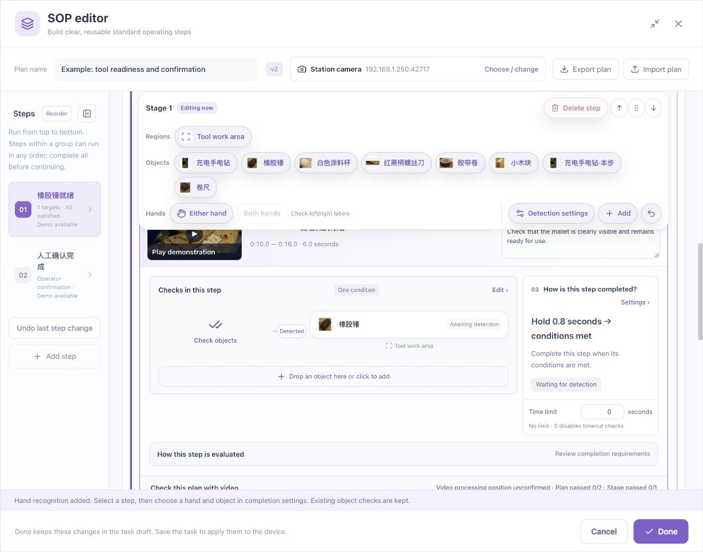](../../assets/sop/en-26-object-region.jpg)

Region constraints are not synonymous with running the detector only on cropped pixels. They may constrain filtering or rule evaluation.

### 6.6 Spatial relationships and distance {#parameters--6-spatial-relationships-and-distance}

#### 6.6.1 Direction {#parameters--61-direction}

A left of B differs from B left of A. After replacement, verify subjects, relation, and both regions. Revalidate after mirroring or orientation changes.

#### 6.6.2 Hand/object distance {#parameters--62-handobject-distance}

Distance is normalized with object size. The current intuitive slider spans 10%–100%, in 5% steps. This is not detection confidence, centimeters, force, or contact pressure.

A wider range can accept a nearby non-operating hand; a narrow range can reject normal variation. Test both the intended action and a hand merely passing nearby.

#### 6.6.3 Advanced geometry {#parameters--63-advanced-geometry}

The advanced relationship-threshold input spans 0–16; boundary tolerance spans 0.001–1. Meaning depends on relationship type. Normally retain generated settings and verify the visual relationship first. Do not apply one value universally or accept ambiguous boundaries as satisfied.

### 6.7 Hold duration {#parameters--7-hold-duration}

Hold specifies stable satisfaction before the requirement completes.

- Numeric input supports 0.001–3600 seconds.
- A 0.8-second hold is not a 0.8-second footage selection.
- Use the slider for coarse adjustment and the number field for precision.
- Slider positions do not all represent equal increments of time; read the displayed value.
- Clearly failing observations must not be accumulated as continuous success.

With All together, the combination must hold, rather than each object appearing once at unrelated times.

### 6.8 Input-gap tolerance {#parameters--8-input-gap-tolerance}

Controls a temporary lack of trustworthy observations, not an observed incorrect action. A common generated value is 0.5 seconds; use the loaded value and specific template. The general input permits 0.001–60 seconds, while continuous-observation templates can impose tighter bounds.

Do not enlarge a gap until repeatedly missed hands appear to complete a sequence. That neither establishes continuous visibility nor repairs recognition.

Determine whether the interval contains no new trustworthy input or clear evidence that a requirement fails.

### 6.9 Deadlines and sequence time {#parameters--9-deadlines-and-sequence-time}

| Field | Purpose | Current input bounds | Zero |
|---|---|---|---|
| Step deadline | Maximum time for the step | 0–86400 seconds | Disables step timeout |
| Sequence maximum time | Maximum time for ordered conditions | 0.001–3600 seconds | Not the unlimited setting |
| Hold | Stable satisfaction | 0.001–3600 seconds | Not a valid ordinary hold |
| Input gap | Missing-input wait limit | 0.001–60 seconds, template-dependent | Not an unlimited deadline |

For a tool held ready for 0.8 seconds within a 20-second step, set hold and deadline separately.

### 6.10 Ranges and sampling {#parameters--10-ranges-and-sampling}

1. Endpoints must be inside their asset and Start before End.
2. Overall scope controls target scanning/plan validation; stage scope belongs to that stage.
3. Stage intervals may overlap.
4. Overall validation should cover participating stage intervals.
5. Old results do not become proof for a newly edited interval.
6. Sampling is stated in frames, not seconds; elapsed time depends on frame rate.

For illustration, every 30 frames is approximately two seconds at 15 fps or one second at 30 fps. Verify actual result timestamps rather than relying on conversion alone.

### 6.11 Completion methods {#parameters--11-completion-methods}

| Method | System responsibility | Operator responsibility |
|---|---|---|
| Automatic after visual checks | Visual rules, timing, workflow | Handle exceptions under station procedure |
| Visual plus operator review | Reach review-ready state | Inspect the work and confirm the current step |
| Manual confirmation | Provide instructions and confirmation control | Determine and confirm completion |

Review is for requirements that images cannot establish, not an arbitrary bypass for failed visual checks.

### 6.12 States are not parameters {#parameters--12-states-are-not-parameters}

| State/message | Meaning | Next action |
|---|---|---|
| Unreviewed | No explicit human judgment | Inspect and label present/absent/unclear |
| Saved, not adopted | Review persistence and reference admission differ | Adopt explicitly, then recheck |
| Results from earlier settings | Configuration and evidence differ | Revalidate |
| Awaiting operator review | Human action remains | Check work and selected step |
| Count/identity uncertain | Instances are not reliably established | Separate items, improve view, inspect evidence |
| Boundary ambiguous | Region membership uncertain | Adjust placement/region and revalidate |
| State not synchronized | Current device state untrusted | Reconnect and read back before confirmation |
| No samples in record | That run lacks annotation pictures | Does not prove recognition review |

### 6.13 Controlled parameter change {#parameters--13-controlled-parameter-change}

1. Record the specific issue and original setting.
2. Classify it and avoid changing several categories together.
3. Retain a reproducible recording and original result.
4. Change one justified setting.
5. Recheck normal, incorrect, and independent footage.
6. Record reason, scope, version, and outcome.
7. Save, reopen, verify, then apply under station procedure.

**Related: [Scenario labs](#scenario-labs) · [Button reference](#control-reference) · [Troubleshooting](#troubleshooting).**

*Footage attribution: [Sample and screenshot credits](#reference--7-sample-and-screenshot-credits).*

## 7. Video, Targets, and Recognition {#video-and-recognition}

Establish reliable object recognition before using it to judge a process. A reference, a manual annotation, a single-image trial, adoption, and a video recheck are separate actions.

### 7.1 Check the teaching recording {#video-and-recognition--1-check-the-teaching-recording}

Use a fixed camera, stable lighting, and clearly visible objects. Start with one object in a short recording before adding hands and multiple requirements.

1. Confirm that the camera belongs to the intended station.
2. Play the beginning, middle, and end. Check for a black picture, frozen frames, incorrect orientation, and missing footage.
3. Wait for timeline thumbnails and check that seeking updates the main picture.
4. Locate examples where the object is clearly present and clearly absent.
5. Distinguish normal views from severe occlusion, blur, or glare.

*A visible reference image does not establish that the video timeline has finished loading.*

Recording the complete process again replaces demonstration material and resets relevant ranges. Read the replacement prompt. Use playback or seeking when you only want to inspect an existing picture.

### 7.2 Understand the three ranges {#video-and-recognition--2-understand-the-three-ranges}

| Range | Purpose | What to check |
|---|---|---|
| Target frames / Plan validation range | Sample the recording for recognition and validate the plan over the selection | Endpoints in the upper timeline |
| Stage validation range | Validate the selected stage separately | The timeline below that stage |
| Demonstration | Show the operator the action for that step | Actual start and stop positions in Play demonstration |

#### 7.2.1 Adjusting a range {#video-and-recognition--adjusting-a-range}

- Drag either endpoint, release it, and check the displayed time.
- Click a displayed time and enter seconds or minutes:seconds. Save and locate the frame if needed.
- Use **Set start** or **Set end** to use the current preview position. If disabled, first locate a valid video frame.
- Use **Preview range** to play the selection.
- Use **Restore full recording** to restore the overall selection.

Seeking does not mean every stage range changes. Each stage has its own range, and stages may overlap. See [Rules and regions](#rules-and-regions) for the relationship with the overall selection.

After changing the overall range, follow the prompt to scan again. Existing pictures may belong to the previous selection. Check the result's times, range, and target.

### 7.3 Create one logical target {#video-and-recognition--3-create-one-logical-target}

1. Pause a clear frame in **Video**.
2. Click **Add target**.
3. Draw around the visible object, avoiding large amounts of tabletop, a hand, or a neighboring tool.
4. Give it a recognizable name such as “Rubber mallet.”
5. Confirm, then inspect the reference in **Targets**.

#### 7.3.1 References are not physical quantity {#video-and-recognition--references-are-not-physical-quantity}

| Intended meaning | Configuration |
|---|---|
| One mallet in different orientations | Additional angles under one target |
| Two mallets must be present | Actual quantity requirement, verified against two instances |
| Similar tools with different roles | Distinguishable targets and representative references |
| Two boxes on one object | Investigate duplicate detection; do not count two objects |

Angles and aliases can consume detection capacity. Follow the displayed capacity, and keep useful representative references rather than many nearly identical images.

A good reference keeps the object clear and dominant, covers realistic orientation and scale, and does not merge adjacent objects or hide their distinguishing features. Check similar tools for false detections.

### 7.4 Improve recognition {#video-and-recognition--4-improve-recognition}

1. Select the target.
2. Set the overall scan range and sampling interval.
3. Click **Improve recognition** and wait for an explicit finished state.
4. Review frames in time order and compare the boxes with the actual objects.
5. Address misses, false detections, and duplicates in normal clear views first.
6. Then inspect rotation, occlusion, edge positions, and scale changes.

A smaller sampling interval creates more pictures and requires more processing and review. Review a representative segment first, then the complete recording. A successful segment does not establish that the whole video is reliable.

### 7.5 Complete the manual-box workflow {#video-and-recognition--5-complete-the-manual-box-workflow}

#### 7.5.1 Confirm the object in the original image {#video-and-recognition--confirm-the-object-in-the-original-image}

Judge the original image rather than relying solely on a low-score candidate. If it is too unclear to identify, record an unclear view instead of drawing an unsupported box.

#### 7.5.2 Draw and save the annotation {#video-and-recognition--draw-and-save-the-annotation}

Use the corresponding present-object annotation entry and draw a separate box for each missed instance. Keep the box close to the visible object.

If the start point lies inside an existing box, check that the editor is in new-box mode rather than selecting, moving, or resizing the existing box. Check the cursor and instruction. If drawing still fails, keep the existing annotation and follow [Troubleshooting](#troubleshooting).

#### 7.5.3 Detect the current image again {#video-and-recognition--detect-the-current-image-again}

Annotations on that frame can serve as temporary references for the trial. Verify that the algorithm detects the annotated location. The manual purple box is not itself a successful algorithm detection.

Check the number of annotations, detections, and matched annotations. For unmatched boxes, inspect position, size, candidate score, and filtering requirements.

**“One algorithm detection” is different from “one of one manual boxes matched.”** The detection may be elsewhere in the image.

#### 7.5.4 Adopt the annotation {#video-and-recognition--adopt-the-annotation}

A saved-but-not-adopted annotation is not yet part of the plan's reference library. Use the adoption control, then check pending references, reference count, and capacity.

Do not draw the same box repeatedly because the capacity did not change. Check adoption state, duplicate-reference handling, and the actual result of the operation.

#### 7.5.5 Recheck the video {#video-and-recognition--recheck-the-video}

Scan the selected range again after adoption. Inspect neighboring frames and an independently recorded video. A successful single-image trial does not establish stable video recognition or that a running task uses the saved update.

### 7.6 Interpret scores and thresholds {#video-and-recognition--6-interpret-scores-and-thresholds}

A candidate score is a recognition clue, not the accuracy of the SOP. Check each reference and its own threshold. Do not apply one reference's maximum score indiscriminately to another.

Before adjusting a threshold, check:

1. Whether the candidate actually depicts the correct object.
2. False detections on similar objects.
3. Any stricter score, quantity, or region requirement in the step.
4. Other steps using the target.
5. Positive and negative examples after the change.

Do not keep lowering thresholds until every frame is green. Background, hands, and nearby tools may start matching. Persistent misses in clear views call for better references, capture conditions, or a recognition capability review.

### 7.7 Recognition review cases {#video-and-recognition--7-recognition-review-cases}

| Case | Expected observation |
|---|---|
| Object clearly present | Correct location and physical quantity |
| Object completely removed | No continued detection on background or similar tools |
| Several references for one target | No duplicate counting of the same instance |
| Two physical objects | Neither merging them nor missing one |
| Hand passing the tool | No match based only on a hand or sleeve |
| Brief ordinary occlusion | Behavior consistent with configured timing |
| Moved camera or changed lighting | Recheck references and regions |

Continue with [Rules, regions, and timing](#rules-and-regions), or the dedicated [Hand operations](#hand-operations) chapter.

*Example footage and reference views in the screenshots: [wooden-box assembly dataset and CC BY 4.0 credits](#reference--7-sample-and-screenshot-credits).*

## 8. Checks, Global Regions, and Timing {#rules-and-regions}

Describe completion in ordinary workplace language first. Then separate it into objects, regions, quantity, timing, and completion method.

### 8.1 Steps, stages, and conditions {#rules-and-regions--1-steps-stages-and-conditions}

A step describes an action with a purpose, such as tool readiness. A stage can contain one step or several steps that may finish in any order. Stages run from top to bottom, and all steps in a group must finish before the next stage.

Within one step, several detection conditions can be combined. **Steps finishing in any order is different from conditions being satisfied simultaneously.**

| Workplace requirement | Configuration |
|---|---|
| Mallet, screwdriver, and cup must all be ready | All conditions simultaneously |
| Either of two approved tools is acceptable | Any one condition |
| Approach, then withdraw | Ordered checks inside a step |
| Tool preparation and label inspection are independent, but both required | Unordered steps in one stage |
| The next action must wait for the previous action | Separate sequential stages |

[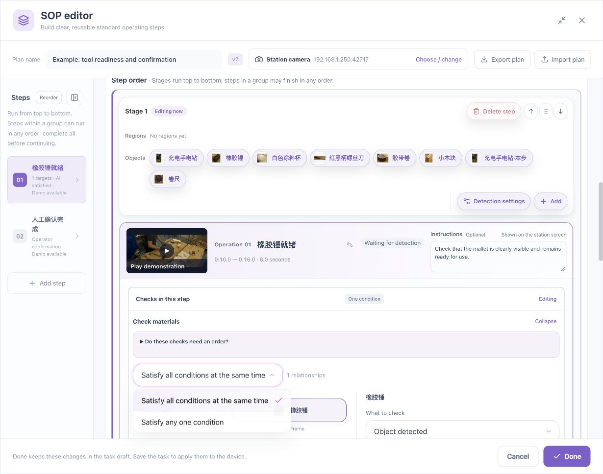](../../assets/sop/en-29-combination.jpg)

### 8.2 Configure an object check {#rules-and-regions--2-configure-an-object-check}

1. Open **Step checks → Edit**.
2. Select an object.
3. Choose the requirement, such as detection, quantity, or an available spatial relationship.
4. Check the object's region.
5. Add other conditions if needed and check the combination mode.
6. Read each requirement from the preview diagram and compare it with the real process.

References tell recognition what the object looks like. Conditions define what the step requires. Adding a reference does not automatically create a process requirement.

Quantity counts detected instances meeting the target, score, region, and other applicable requirements. Test the correct and incorrect physical quantities. Duplicate boxes and confusion between similar objects must be addressed before relying on counts.

### 8.3 Check selected regions {#rules-and-regions--3-check-selected-regions}

#### 8.3.1 Draw a global region {#rules-and-regions--draw-a-global-region}

1. Locate a clear, correctly oriented frame.
2. Click **Draw region** and place vertices around the work area.
3. Close the polygon and inspect its coverage.
4. Give it a meaningful name, such as “Tool area” or “Preparation area.”
5. Confirm and check its position.

Use names describing the workplace rather than several indistinguishable numbered regions. Avoid placing boundaries exactly at the normal limits of object movement.

#### 8.3.2 Bind the check to the region {#rules-and-regions--bind-the-check-to-the-region}

Select the named region under the relevant object. Alternatively, drag the toolbar region to a compatible region position; see [Toolbar and drag operations](#toolbar-and-drag).

| Selection | Meaning |
|---|---|
| Full frame | Evaluate against the full image |
| All recognition regions | Use the configured recognition-region coverage; check that it is complete |
| A named region | Evaluate this requirement against that region |

Drawing a region does not automatically bind every requirement to it. Read the region shown beneath each relationship in the diagram. A global region is a reusable definition, not a requirement that every step use every region.

After editing a shared region, review and revalidate every step that uses it.

#### 8.3.3 Region tests {#rules-and-regions--region-tests}

Test the object inside, outside, crossing the boundary, near an edge, and partly occluded. With several objects, place some inside and others outside. Overlapping regions are not automatically mutually exclusive.

Recheck regions after a camera position, mirroring, or resolution change. Failing a region requirement does not necessarily mean the object was not detected, or that recognition stopped processing the rest of the picture.

### 8.4 Spatial relationships {#rules-and-regions--4-spatial-relationships}

Spatial checks evaluate the visible positions of two targets. Uses include placement relative to a region or object, left/right relationships, and proximity. Available options depend on the current interface and device capability.

Check the subject, reference object or region, compatible video sources, camera orientation, and the intended boundary or tolerance.

A hand near a cup establishes a visible position relationship. It does not directly prove grasping, contact, force, or a completed physical operation. Both endpoints need reliable observations. An undetected hand must not be interpreted as a visible hand far away.

If capability is unavailable or still being checked, retain the configuration and follow the message. A disabled or read-only control is not evidence that the rule is active.

### 8.5 Simultaneous, alternative, and ordered checks {#rules-and-regions--5-simultaneous-alternative-and-ordered-checks}

**All simultaneously:** Use when conditions must hold together. A configured hold time applies to the combined requirement; separate appearances several seconds apart cannot simply be added.

**Any one:** Use for genuine alternatives, such as either approved container. Do not use it to replace several mandatory checks.

**In order:** Use for approach → withdrawal or origin → destination. Check each phase's targets, regions, duration, and order. A later condition already true at the start does not establish that the required process occurred after the preceding phase.

See [Hand operations](#hand-operations) for ordered templates. Validate step order and within-step order separately before combining them.

### 8.6 Completion and timing {#rules-and-regions--6-completion-and-timing}

| Method | Typical use | Check |
|---|---|---|
| Automatic after visual conditions | A clearly observable ready state | Conditions, hold time, false detections |
| Visual conditions then operator review | Vision provides evidence, but a person checks quality | Conditions first, confirmation afterward |
| Operator confirmation | The action requires human judgment | Clear instructions and the current step |

A hold time filters brief observations; it is not the length of the demonstration clip. A completion deadline limits the time allowed for a step; 0 means no timeout check where indicated. Sequence deadlines and allowed gaps constrain the process and are separate settings. Missing reliable input is not successful completion.

Establish the normal path before adding deadlines so that visual and timing problems remain distinguishable.

### 8.7 Stage ranges and the overall range {#rules-and-regions--7-stage-ranges-and-the-overall-range}

Each stage retains its own range. Ranges may overlap because real operations and preparation can overlap in time. They need not form consecutive non-overlapping pieces.

For plan validation using the same source recording, the overall selection should cover the participating stage ranges. If narrowing it produces a conflict, enlarge it, adjust the affected stages, or explicitly validate only the relevant stages. Do not assume silent clipping establishes complete validation.

Demonstrations train the operator; validation ranges define the evidence to check. When editing a stage's validation range, check the synchronization message and demonstration player. Use the demonstration mode for an independent teaching selection. Changing one stage must not be assumed to update the others.

### 8.8 Grouping and order {#rules-and-regions--8-grouping-and-order}

Use **Reorder** in the step list to organize the actual dependencies. Steps in an unordered stage can finish in any order, but all are required before advancing.

Keep dependent steps in sequential stages. After changes, review names, grouping, ranges, and validation results.

**Next: [Toolbar, drag operations, and undo →](#toolbar-and-drag)**

*Example footage and reference views in the screenshots: [wooden-box assembly dataset and CC BY 4.0 credits](#reference--7-sample-and-screenshot-credits).*

## 9. Hand Operations: From Selecting a Hand to Validating a Process {#hand-operations}

Use this chapter when a process needs to check which hand is operating, whether a hand approaches or withdraws from a tool, or whether it accompanies an object during a transfer. Complete the single-object example first.

**Detecting a hand is an observation; checking how the hand and object cooperate is a process condition.** Hand landmarks do not directly establish grip strength, tightening torque, press-fit quality, contact pressure, or the internal state of a part.

### 9.1 Convert the requirement into visible conditions {#hand-operations--1-convert-the-requirement-into-visible-conditions}

| Process requirement | Observable conditions | Additional review |
|---|---|---|
| Reach toward the mallet | A visible hand is near the mallet | Whether the grasp is secure |
| Withdraw after operating | Approach, then move away while the tool remains visible | Whether the intended operation was completed |
| Transfer a part and release it at assembly | Start area → hand accompanies object → object arrives and remains → hand withdraws | Placement accuracy, fastening, or assembly quality |
| Use a specified hand | Select the operator's left or right hand after calibration | Whether the direction remains correct after camera changes |
| Coordinate two hands | Define the required hand conditions or use the supported two-hand feature | Whether they belong to the intended operator and remain distinguishable |
| Check only tool readiness | Object checks alone | No hand source is needed |

Do not enable hand checks simply because hands happen to appear in the recording. If the process only needs object readiness, object-only checks reduce configuration and review work.

### 9.2 Add hand recognition {#hand-operations--2-add-hand-recognition}

1. Open **Detection settings** from the stage toolbar.
2. Find the hand-operation recognition card.
3. If it is absent, use the control to add hand recognition.
4. Return to the stage and check the available hand tools, such as either hand, left hand, and right hand.
5. Keep the correct object-detection source. A hand-object relationship needs evidence from both sources.

Detection settings are shared by the station and saved with the task. Adding a source does not automatically require hands in every step; configure the steps that need them.

If the entry is unavailable, check the device's plugins and capabilities rather than repeatedly creating additional hand sources.

### 9.3 Calibrate the operator's left and right hands {#hand-operations--3-calibrate-the-operators-left-and-right-hands}

#### 9.3.1 Whose left and right? {#hand-operations--31-whose-left-and-right}

Use **the operator's own left and right**, not the left and right edges of the screen. An operator facing the camera may have their left hand on the right of the image. Camera mirroring, mounting, and image rotation can affect the labels.

#### 9.3.2 Calibration procedure {#hand-operations--32-calibration-procedure}

1. Have the actual operator stand in the normal working position.
2. Open the hand-direction setting in **Detection settings**.
3. If the process does not distinguish hands, leave left/right distinction disabled and use either hand.
4. If it does, enable left/right distinction.
5. Have the operator separately show their left hand and right hand. Check labels in stage-validation footage.
6. If the labels are reversed, choose the swap option and validate again.
7. Use left/right constraints only after both sides have been checked.
8. Recalibrate after changes to camera position, mirroring, or orientation.

[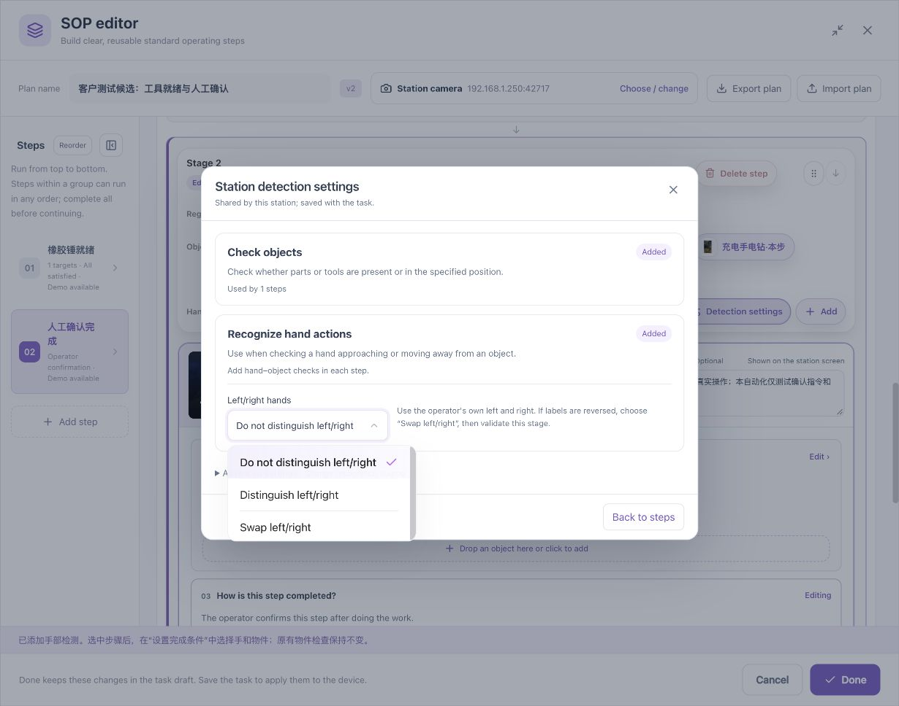](../../assets/sop/en-20-hand-direction.jpg)

**Checkpoint:** Labels agree with the operator's own hands. Enabling distinction is a configuration action, not evidence that calibration has passed.

#### 9.3.3 Either hand, a specified hand, and two hands {#hand-operations--33-either-hand-a-specified-hand-and-two-hands}

| Selection | Meaning | Use |
|---|---|---|
| Either hand | Does not specify left or right | Either hand is acceptable |
| Left hand | The operator's calibrated left hand | The process actually requires the left hand |
| Right hand | The operator's calibrated right hand | The process actually requires the right hand |
| Both hands / separately configured hands | Depends on the supported feature and explicit conditions | Two-hand work with reliable visibility and distinction |

A limit of two detected hands **does not prove that both belong to one person**. Review station isolation and regions when several people, crossing hands, or ambiguous targets are present. A disabled two-hand entry is not an enabled capability. Check the supported version, or use explicit left/right conditions with operator review as appropriate.

### 9.4 Use the toolbar to create a hand → object operation {#hand-operations--4-use-the-toolbar-to-create-a-hand--object-operation}

1. Select the stage.
2. Select either hand, left hand, or right hand in its toolbar.
3. Select the object to operate, such as the mallet.
4. Check the displayed hand-to-object operation.
5. Choose the operation type.
6. Set the operation region, expand the condition summary, and add it to the stage.

The toolbar may offer complete templates such as approach-then-withdraw and transfer-to-position. If the interface says it adds a new operation while keeping existing checks, verify that a new step appears in the stage. Do not assume the existing object check is replaced.

A single near/away relationship can instead be configured in step checks. A complete operation template and one instantaneous relationship are different requirements.

### 9.5 Single condition: hand near object {#hand-operations--5-single-condition-hand-near-object}

Specify the hand, object, region, required hold time, and completion method.

The hand and object must have reliable observations in the same valid frame. The distance range describes a position relationship relative to the object; it is not a measurement in centimeters, contact force, or grasp strength.

**Useful for:** Checking that an operation occurs near the intended tool, together with object-position checks.

**Insufficient by itself for:** Proving the tool was picked up, a part was pressed firmly, a screw was tightened, or an assembly succeeded.

A hand that stays near a tool without operating it can satisfy proximity. To describe a complete process, add observable ordering, arrival, object retention, or operator review.

### 9.6 Single condition: visible hand away from object {#hand-operations--6-single-condition-visible-hand-away-from-object}

“Away” needs valid visible evidence for the selected hand and object and a sufficient spatial separation.

Do not equate these situations with a confirmed withdrawal:

- A hand is hidden behind a body, tool, or another person.
- A hand leaves the camera image.
- Hand landmarks are unreliable.
- The object disappears or cannot be reliably detected.
- The stream is interrupted, observations are stale, or sources do not match.

“Hand not detected” is not the same as “visible hand away.” If the process requires leaving an area, choose an appropriate condition and test whether the footage distinguishes departure from occlusion.

### 9.7 Complete template: approach, then withdraw {#hand-operations--7-complete-template-approach-then-withdraw}

#### 9.7.1 When to use it {#hand-operations--71-when-to-use-it}

For example, an operator works near the mallet and then withdraws. The system checks the visible sequence; a person reviews process quality that the sequence cannot establish.

#### 9.7.2 Configure the operation {#hand-operations--72-configure-the-operation}

1. Select the hand and the mallet.
2. Choose the approach-then-withdraw operation.
3. Choose an operation region covering both the hand and the tool at this station.
4. Expand the condition summary.
5. Check the order: approach first, then withdrawal, with valid evidence for both endpoints.
6. Review each hold time. Example defaults are not necessarily suitable for your cycle.
7. Keep or select operator review after completion for quality requirements that need a person.
8. Add the operation and review its generated name and conditions.

[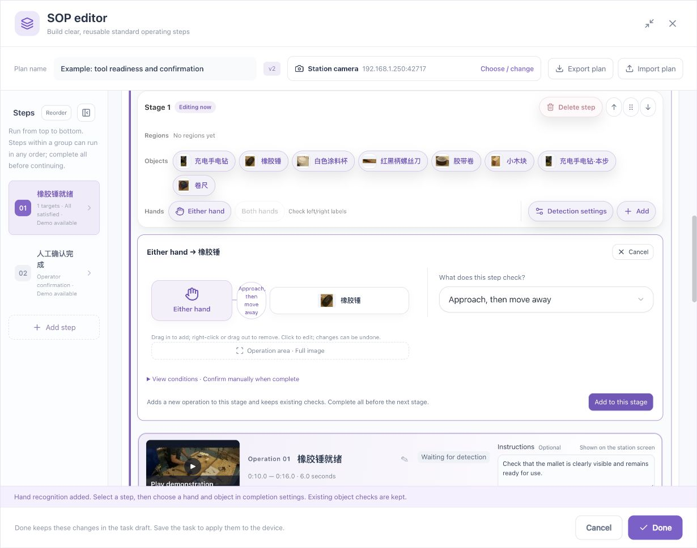](../../assets/sop/en-31-hand-visit.jpg)

**Expected result:** Remaining near the tool does not complete the whole sequence. Starting far away must not skip the approach. A later phase requires a valid change after the preceding phase is complete.

#### 9.7.3 Test meaningful negative cases {#hand-operations--73-test-meaningful-negative-cases}

Test no reach, a hand that never withdraws, sudden occlusion, both hand and tool leaving the image, another person's hand entering, and two similar tools that cannot be uniquely associated.

The result should reflect the evidence—waiting, unmet, or uncertain where appropriate—rather than passing every case.

### 9.8 Complete template: accompany an object, then release it at its destination {#hand-operations--8-complete-template-accompany-an-object-then-release-it-at-its-destination}

#### 9.8.1 Prepare regions {#hand-operations--81-prepare-regions}

1. Draw the **start region** in the actual picture.
2. Draw the **destination region**.
3. Give the endpoints distinct process meanings; do not use the same region for both.
4. Choose an **operation region** covering the entire route, not just the endpoints.
5. Avoid boundaries that make start and destination simultaneously true without an observable transition.

#### 9.8.2 Configure the operation {#hand-operations--82-configure-the-operation}

1. Select the hand and object.
2. Choose the transfer-to-position operation.
3. Place the start and destination regions into their corresponding slots, or click each slot and select the region.
4. Verify that the operation region includes the route.
5. Read the summary of start, in-transit requirements, arrival, and withdrawal.
6. Add the operation and inspect the conditions and times.

#### 9.8.3 Requirements during movement {#hand-operations--83-requirements-during-movement}

If the interface requires the hand to remain near the object during movement, two endpoint pictures are insufficient. The system also needs valid observations along the route. At the destination, the object must remain there until the hand withdraws. Loss of visibility, unmet intermediate conditions, or non-unique targets may reset progress.

This is not re-identification of the same physical object after full occlusion. Do not treat another similar tool appearing later as proof that the original tool completed a transfer.

### 9.9 Set hand regions and object relationships separately {#hand-operations--9-set-hand-regions-and-object-relationships-separately}

| Requirement | Condition to express |
|---|---|
| Any hand appears in the assembly area | Hand presence restricted to that area |
| A hand is in the assembly area and near a cup | A hand-region constraint plus the hand-cup relationship |
| The cup is in the tool area and the hand in assembly | Review each endpoint's region separately |
| Ignore the adjacent station | Draw suitable station regions and inspect the scope of every hand/object check |

Regions constrain positions in the image; they do not establish operator identity. Review both ends of cross-region relationships rather than relying on the presence of a region chip.

### 9.10 Hold time, input gaps, and deadlines {#hand-operations--10-hold-time-input-gaps-and-deadlines}

| Setting | What it controls | Example |
|---|---|---|
| Sustained satisfaction | How long a condition must remain true | A brief stable hand-near observation |
| Input-gap tolerance | How long the system can wait for interrupted trusted observations | A short interruption in video or landmark input |
| Step/sequence deadline | Maximum allowed time to finish | A transfer must fit the process cycle |

An observed false condition differs from having no fresh trusted observation. Increasing gap tolerance should not hide a clearly observed error. Tracked sequences can impose a stricter gap limit; follow the actual control limits and explanations.

### 9.11 Validate hand operations in layers {#hand-operations--11-validate-hand-operations-in-layers}

1. Verify object recognition first.
2. Verify reliable hand observations and left/right labels.
3. Check single near/away conditions and regions.
4. Test the complete ordered operation and confirmation.
5. Use an independent recording with normal variations in posture, speed, and placement.
6. Include negative cases, not only the clearest successful example.

| Symptom | Check first | Avoid |
|---|---|---|
| No reliable hand result | Viewpoint, clarity, gloves, occlusion, source | Repeatedly lowering the object threshold |
| Reversed hand labels | Operator calibration, mirroring, orientation | Calling the image's left edge “left hand” |
| Proximity passes but work is incomplete | Whether the single condition is too broad | Declaring process quality complete |
| Withdrawal never passes | Visibility of both hand and object; distance scope | Treating disappearance as withdrawal |
| Sequence repeatedly resets | Uniqueness, occlusion, continuous observation, in-transit requirements | Removing every protection to force a pass |
| Several people trigger a check | Station regions, isolation, hand selection | Assuming two hands belong to the same person |

### 9.12 Handover checklist {#hand-operations--12-handover-checklist}

- [ ] Only steps that need hand checks require them.
- [ ] Critical hand and object evidence is clearly visible from a fixed camera.
- [ ] Required left/right labels have been checked against the operator.
- [ ] Hand, object, and region selections are correct.
- [ ] Visible withdrawal is not confused with nondetection.
- [ ] Ordering, in-transit conditions, and timing match the process.
- [ ] Normal gloves, occlusion, additional people, and similar tools have been tested.
- [ ] Uncertainty is not treated as success.
- [ ] Quality requirements needing a person retain operator confirmation.
- [ ] Sources, direction, and rules remain correct after saving and reopening.

**Related: [Toolbar and drag-and-drop](#toolbar-and-drag) · [Rules and regions](#rules-and-regions) · [Validation and operation](#validation-and-operation)**

*Example footage and reference views in the screenshots: [wooden-box assembly dataset and CC BY 4.0 credits](#reference--7-sample-and-screenshot-credits).*

## 10. Toolbar, Drag Operations, and Undo {#toolbar-and-drag}

The stage toolbar contains regions, objects, and hands. Read the drop hint, then verify the actual result after release. Highlighting identifies a compatible position; it does not prove that a condition was added.

### 10.1 Toolbar controls {#toolbar-and-drag--1-toolbar-controls}

| Control | Click | Drag |
|---|---|---|
| Region | Inspect or edit a shared region | Assign it to a compatible region position |
| Object | Select an object or open an authoring entry | Add a check or replace a compatible target |
| Either hand, Left hand, Right hand | Choose a hand and related object | Add or change compatible hand requirements as indicated |
| Detection settings | Open shared station settings | Not a draggable target |
| Add | Open stage additions | Follow the actual drop feedback |
| Undo | Undo the latest supported change | Not a draggable target |

If hands are unavailable, add the capability in **Detection settings**, then verify handedness. Object and region names are user data and are not rewritten when the interface language changes.

### 10.2 Make a drag operation {#toolbar-and-drag--2-make-a-drag-operation}

1. Find the object or region in the current stage's toolbar.
2. Hold the card and move it.
3. Observe highlighted receiving positions and the action hint.
4. Move onto the intended position and read whether the operation adds, replaces, or assigns a region.
5. Release.
6. Inspect the diagram, condition count, target names, and region labels.
7. If incorrect, undo and use the click-based control.

*Click-based addition provides an alternative when a drag does not create the expected requirement.*

Do not rely only on the operating system's cursor. Use page highlighting, the action hint, and the final condition. Do not force a drop onto a position without a receiving indication.

### 10.3 Add an object requirement {#toolbar-and-drag--3-add-an-object-requirement}

Drag the toolbar object onto **Drop an object here or click to add** at the bottom of the relationship diagram. After release, check that a separate requirement appears and existing checks remain.

For the click-based path:

1. Click the same addition entry. If the checks are in collapsed preview mode, the first click opens the editor.
2. In the expanded editor, click **Add related object** or its addition position to open the target picker.
3. Select the required object and confirm.
4. Check the new requirement and combination mode.

Adding another required tool is different from replacing a target. Adding a reference view belongs in target references. Requiring two physical objects belongs in quantity settings, rather than duplicated identical conditions.

Already-used targets, unsupported capability, or a capacity limit can disable a choice. Read the message rather than repeatedly dragging the same object.

### 10.4 Replace a target {#toolbar-and-drag--4-replace-a-target}

Drag a new object onto a compatible existing target and read the replacement hint. Replacement changes the subject of that requirement; it is not an additional condition.

After release, check the name, thumbnail, requirement type, region, score or quantity settings, and the other endpoint of any relationship.

Alternatively, select the diagram target and use the explicit replacement control. Revalidate affected steps after changing the target.

### 10.5 Assign a region {#toolbar-and-drag--5-assign-a-region}

1. Choose a named region from the toolbar.
2. Drag it to the region position under the relevant object or hand.
3. Release only when that position indicates a compatible drop.
4. Check that its region label changes.
5. Test inside, outside, and boundary views.

Assigning a region changes the check's coverage, not the polygon's shape. Edit the global region to change its geometry.

When one actor is linked to several objects, editing its shared area may update several relationships. Read the message and inspect every related object.

### 10.6 Hands and action templates {#toolbar-and-drag--6-hands-and-action-templates}

Hands and objects support visible relationships and action templates. Dropping a hand on an object does not by itself establish a physical action such as gripping or tightening.

The explicit click path is:

1. Choose **Either hand**, or a calibrated left or right hand.
2. Choose the related object.
3. Choose **Approach then withdraw** or an available transfer template.
4. Set its operation area and required origin/destination.
5. Expand and read the generated checks.
6. Click **Add to this stage**.
7. Inspect the added operation and retained checks.
8. Validate the stage and compare labels with the operator's own hands.

An added operation in the same stage can form an unordered group with existing operations. If the business requires a dependency, reorganize the stages. The sequence inside the template does not establish order between separate operations.

### 10.7 Remove and undo {#toolbar-and-drag--7-remove-and-undo}

Removing a relationship is different from deleting target reference data from the entire plan.

Before using a context menu or delete control, read whether it removes one relationship, an actor group, or a step. Some diagrams support dragging out to remove; release only after an explicit removal indication.

Use **Undo** after an accidental supported change and inspect the result. Undo is not an unlimited version history. Do not assume it remains available after saving, closing the editor, or other changes.

### 10.8 Different kinds of dragging {#toolbar-and-drag--8-different-kinds-of-dragging}

| Action | Drag location | Effect |
|---|---|---|
| Reorder stages | Handle beside stage heading | Changes stage order |
| Reorder grouped steps | Handle beside step heading | Changes display order within the group, not its completion semantics |
| Add an object | Object card in the toolbar | Adds or changes a requirement |
| Change a video range | Start/end handles | Changes selected footage |
| Pan the picture | Pan image mode | Changes the view, not target or region coordinates |

Move buttons and documented arrow-key controls provide alternatives for reordering.

### 10.9 If dragging has no effect {#toolbar-and-drag--9-if-dragging-has-no-effect}

Check for an actual new condition, current stage, read-only state, capability, duplicates, and capacity. Cancel any unsubmitted template or dialog, then use the equivalent click-based addition or replacement entry.

If that works, retain the configuration and report the source object, receiving position, and visible hint to the administrator. Do not repeatedly drag, re-record the video, or clear the task to resolve a drag issue.

**Next: [Validation, saving, and station operation →](#validation-and-operation)**

*Example footage and reference views in the screenshots: [wooden-box assembly dataset and CC BY 4.0 credits](#reference--7-sample-and-screenshot-credits).*

## 11. Complete Configuration Labs for Six Common Scenarios {#scenario-labs}

Complete Lab A first, then select labs that match the process. Expected-result tables are instructions for validation, not claims that your station has already passed.

[Download the sample footage](../../assets/sop/workbench-60s.mp4). It supports the introductory readiness example. Count changes, transfers, and alternative orders require suitable separately recorded footage. Rules cannot manufacture actions missing from a recording.

### 11.1 Lab A: Mallet ready → Operator confirmation {#scenario-labs--lab-a-mallet-ready--operator-confirmation}

#### 11.1.1 A1. Objective {#scenario-labs--a1-objective}

| Stage | Operation | Requirement | Completion |
|---|---|---|---|
| 1 | Mallet ready | Correct object visible in tool area for 0.8 seconds | Automatic after visual checks |
| 2 | Review station and confirm | Operator reviews tools and workplace | Manual |

Illustrative ranges are 10–16 and 16–20 seconds. Check actual footage rather than treating these as fixed process times.

#### 11.1.2 A2. Prepare footage {#scenario-labs--a2-prepare-footage}

1. Create an object-only SOP task.
2. Select the station camera.
3. Upload the sample or record your workplace.
4. Play the beginning, middle, and end.
5. Verify real timeline thumbnails.

#### 11.1.3 A3. Establish one target {#scenario-labs--a3-establish-one-target}

1. Pause on a clear mallet view.
2. Add a target; box its visible body with little background.
3. Name it Rubber mallet and confirm.
4. Inspect its reference in Targets mode.
5. Add views for normal variations rather than another duplicate logical target.
6. Review recognition at ordinary positions, near other tools, and where no mallet exists.

**Exit criterion:** Clear normal views correspond to the correct object. Resolve material misses or duplicates before changing workflow order.

#### 11.1.4 A4. Configure readiness {#scenario-labs--a4-configure-readiness}

1. Name the operation Mallet ready.
2. Write instructions to place the mallet in the tool area.
3. Edit the step's checks and select the mallet.
4. Require Object detected.
5. If needed, draw Tool area and bind this requirement.
6. Choose automatic completion after visual checks.
7. Set a 0.8-second hold; initially leave deadline at zero.
8. Read the diagram back and remove accidental unrelated requirements.

#### 11.1.5 A5. Configure confirmation {#scenario-labs--a5-configure-confirmation}

1. Add a separate next step, outside the first stage's unordered group.
2. Name it Review station and confirm.
3. Choose manual confirmation.
4. State the physical inspection, such as complete tools and no leftover material.
5. Select its demonstration.
6. Verify readiness precedes confirmation.

#### 11.1.6 A6. Ranges and validation {#scenario-labs--a6-ranges-and-validation}

1. Use the appropriate readiness interval, illustratively 10–16 seconds.
2. Use the review interval, illustratively 16–20 seconds.
3. Make the overall range cover both.
4. Validate readiness and its hold.
5. Validate the whole stage organization.
6. Verify actual human confirmation in runtime interaction.

| Test | Expected behavior |
|---|---|
| Correct stable mallet | Readiness can complete |
| Missing/outside-area mallet | Background cannot substitute |
| No operator confirmation yet | The next step cannot impersonate confirmation |
| Operator reviews current piece and confirms | Correct subject and advancement |

#### 11.1.7 A7. Save and reopen {#scenario-labs--a7-save-and-reopen}

Done → node confirmation if still open → task Save. Reopen and inspect order, target, region, hold, and ranges. Test runtime confirmation using the [Operator guide](#operator-guide).

### 11.2 Lab B: Three tools must be ready together {#scenario-labs--lab-b-three-tools-must-be-ready-together}

#### 11.2.1 B1. Requirement {#scenario-labs--b1-requirement}

Mallet, drill, and paint cup must coexist. This is one step with several simultaneous requirements, not interchangeable alternatives.

#### 11.2.2 B2. Configuration {#scenario-labs--b2-configuration}

| Field | Setting |
|---|---|
| Name | Three tools ready |
| Conditions | Mallet detected; drill detected; cup detected |
| Combination | All together |
| Regions | Appropriate area for each tool |
| Completion | Illustrative 0.8-second hold, automatic or operator review |
| Instructions | Explicit item names and placement |

#### 11.2.3 B3. Procedure {#scenario-labs--b3-procedure}

1. Create and verify each target separately.
2. Edit the step's checks.
3. Open Add related object; expand preview first if needed.
4. Select the three objects.
5. Choose All together.
6. Inspect each region and minimum confidence.
7. Configure hold and completion.
8. Read all three requirements from the diagram.
9. Validate coexistence and a separate missing-item recording.

| Test | Expected behavior |
|---|---|
| All three clearly visible together | Combination may satisfy |
| Only two | Not satisfied |
| Separate appearances without coexistence | Cannot accumulate into simultaneous readiness |
| Duplicate boxes on one drill | Cannot establish additional tools |

### 11.3 Lab C: Count only the tool area {#scenario-labs--lab-c-count-only-the-tool-area}

#### 11.3.1 C1. Requirement {#scenario-labs--c1-requirement}

Similar tools may appear on a neighboring table. Only the current station's tool area should contribute.

#### 11.3.2 C2. Procedure {#scenario-labs--c2-procedure}

1. Draw Tool work area on the correct fixed view.
2. Close/name it and exclude the neighboring table.
3. Open the tool requirement.
4. Select Tool work area as its coverage.
5. Verify the region label in the diagram.
6. Assign other tools or hands separately as needed.
7. Validate inside, outside, and boundary views.

#### 11.3.3 C3. Boundary tests {#scenario-labs--c3-boundary-tests}

| Placement | Verify |
|---|---|
| Fully inside | Correct object, position, count |
| Fully outside | Does not satisfy this area |
| Crossing boundary | Ambiguity is not stable readiness |
| One inside, one outside | Count uses correct coverage |
| Overlapping regions | Actual rule meaning; no assumed exclusivity |

Drawing a region does not bind every step. An outside detection box is not necessarily wrong; check whether it incorrectly affects this requirement.

### 11.4 Lab D: Approach the tool, then withdraw {#scenario-labs--lab-d-approach-the-tool-then-withdraw}

#### 11.4.1 D1. Prerequisites {#scenario-labs--d1-prerequisites}

Object recognition works, hands remain visible, and any directional requirement has been checked against the operator.

#### 11.4.2 D2. Procedure {#scenario-labs--d2-procedure}

1. Add hand recognition in Detection settings.
2. Use Either hand unless direction is required.
3. Select hand, then mallet.
4. Choose Approach then withdraw.
5. Cover the full action with the operation area.
6. Inspect generated approach and visible-withdrawal requirements.
7. Check hold and allowed process time.
8. Retain operator review for workmanship.
9. Add to the stage; inspect whether a new operation was created.
10. If it forms an unordered group, verify that the process permits that grouping.
11. Validate real complete-action footage.

| Footage | Expected behavior |
|---|---|
| Valid approach followed by visible withdrawal | Ordered evidence |
| Always distant | Cannot skip approach |
| Approach and remain | Withdrawal has not occurred |
| Hand occluded or out of view | Not visible withdrawal |
| Neighboring person reaches in | Not automatically the intended operator |

This does not establish strike count, force, or assembly quality.

### 11.5 Lab E: Either order, both preparations mandatory {#scenario-labs--lab-e-either-order-both-preparations-mandatory}

#### 11.5.1 E1. Requirement {#scenario-labs--e1-requirement}

Tool readiness and label review may occur in either order. Final confirmation follows both.

#### 11.5.2 E2. Structure {#scenario-labs--e2-structure}

| Stage | Contents | Rule |
|---|---|---|
| 1 | Tools ready, Label review | Unordered, all mandatory |
| 2 | Final confirmation | After stage 1 |

#### 11.5.3 E3. Procedure {#scenario-labs--e3-procedure}

1. Create two separate preparation steps.
2. Configure each independently; do not use Any condition to replace their conjunction.
3. Group them into one unordered stage through Reorder.
4. Keep final confirmation in the next stage.
5. Set each demonstration and validation interval.
6. Permit overlapping intervals; cover them in the overall scope.
7. Test both orders, omitted work, and early final confirmation.

| Order | Expected behavior |
|---|---|
| Tools → label → final | May complete |
| Label → tools → final | May also complete |
| Tools only → final | Group incomplete |
| Preparations completed at separate times | Permitted; not simultaneous conditions |

If the process truly requires label work first, use separate ordered stages.

### 11.6 Lab F: Transfer an object, place it, and withdraw {#scenario-labs--lab-f-transfer-an-object-place-it-and-withdraw}

#### 11.6.1 F1. Prerequisites {#scenario-labs--f1-prerequisites}

The device offers the corresponding continuous-observation template. A physical object remains distinguishable along the route; hand, object, and destination are visible. Two endpoint photos do not establish continuous transfer.

#### 11.6.2 F2. Areas {#scenario-labs--f2-areas}

Define origin, destination, and an operation area covering the route. Avoid an initial placement satisfying both endpoints without a meaningful transition.

#### 11.6.3 F3. Procedure {#scenario-labs--f3-procedure}

1. Verify one object, hands, and handedness.
2. Draw distinct origin and destination areas.
3. Choose the operating hand, then the object.
4. Select the supported accompanied-transfer template.
5. Assign origin and destination slots.
6. Set the full process area.
7. Read origin, movement, arrival, and withdrawal requirements.
8. Check continuous proximity and destination-retention requirements.
9. Set realistic time limits without using excessive gaps to hide occlusion.
10. Add and inspect actual generated rules.
11. Test normal transfer, intermediate release, wrong destination, occlusion, and multiple similar items.

#### 11.6.4 F4. Validation matrix {#scenario-labs--f4-validation-matrix}

| Case | Verify |
|---|---|
| Continuous normal transfer and placement | Origin, path, arrival, withdrawal |
| Recording begins at destination | Cannot infer a prior transfer |
| Object left midway; hand reaches destination | Hand arrival alone cannot finish |
| Original disappears, similar object arrives | No unsupported physical identity |
| Object leaves after arrival | Retention requirement |
| Overlapping endpoint regions | No false transfer without change |
| Gloves or temporary occlusion | Actual capability and uncertainty, not automatic success |

### 11.7 Close every lab consistently {#scenario-labs--7-close-every-lab-consistently}

1. Read back target, region, order, timing, and completion.
2. Test another real recording.
3. Save, close, and reopen.
4. Test active operation, demo, confirmation, and next piece.
5. Preserve normal and negative outcomes, not only successful screenshots.
6. Record unresolved gaps; do not declare untested capability production-qualified.

**Related: [Parameters](#parameters) · [Hand operations](#hand-operations) · [Maintenance](#maintenance).**

*Footage attribution: [Sample and screenshot credits](#reference--7-sample-and-screenshot-credits).*

## 12. Validation, Saving, and Station Operation {#validation-and-operation}

Validate recognition, one stage, the complete plan, an independent recording, and saved station operation in that order. Establish each layer before proceeding.

### 12.1 Pre-validation checks {#validation-and-operation--1-pre-validation-checks}

Confirm playable footage, seeking, correct targets and references, appropriate sources, regions, combination rules, timing, and completion methods. Overall and stage ranges must agree. Resolve configuration errors and unavailable targets. Verify camera orientation and operator-relative handedness when applicable.

### 12.2 Validate recognition and then a stage {#validation-and-operation--2-validate-recognition-and-then-a-stage}

If the original picture contains the mallet but the detector misses it, address recognition first. Changing stage order does not solve that problem.

Click the stage validation control and inspect:

1. Stage, recording, and range used.
2. Observed objects or actions.
3. The specific unmet requirement.
4. Hold time or later action still required.
5. Visual conditions met but operator review pending.
6. Missing input or ambiguous observations.

Video pixels alone cannot establish that a person performed an operator-confirmation action. Check the actual confirmation control, timing, and following stage in the interactive workflow.

### 12.3 Validate the plan {#validation-and-operation--3-validate-the-plan}

Use **Validate plan** to check stage order, all steps within groups, and the final state. Separate stage success does not establish correct integration if dependencies, grouping, or required steps are wrong.

| Information | Meaning | Does not establish |
|---|---|---|
| Processed frames / video position | Processing progress | The same percentage of steps passed |
| Step conditions met | Current detection requirement holds | The whole plan completed |
| Waiting for operator review | A human action is still required | The system is frozen |
| Stage passed | This stage completed using this evidence | Other stages or independent footage passed |
| Plan completed | This execution reached its final state | Acceptance for every camera or shift |
| Missing input / insufficient picture evidence | Reliable observations are unavailable | Absence, withdrawal, or successful completion |

Read checks and reasons alongside timestamps and overlays. One green box is not acceptance evidence for the complete plan.

### 12.4 Exercise failure paths {#validation-and-operation--4-exercise-failure-paths}

Include missing objects, wrong regions, too few or too many objects, a hand that never approaches or never withdraws, reversed order, exceeded deadlines, blur, occlusion, stream interruption, missing frames, and an unfinished step within an unordered group.

Expected failures should produce understandable waiting, unmet, exception, or review states rather than automatic completion. Use site quality requirements to decide whether operation may continue.

### 12.5 Use independent footage {#validation-and-operation--5-use-independent-footage}

Add another validation recording through the corresponding control. Record a different execution at the same station, then cover normal variation in position, speed, lighting, and operators.

Teaching footage establishes references; independent footage checks behavior beyond the original recording. Reusing the same segment is not independent validation.

Retain plan version, footage, range, and result for each run. After changing recognition or rules, check whether revalidation is required.

### 12.6 Three save levels {#validation-and-operation--6-three-save-levels}

1. **Done** in the SOP editor returns changes to the task draft.
2. **Confirm** in node settings, if still open, returns node configuration to the outer editor.
3. **Save** in the task editor persists the task. Wait for an explicit result.

Running is separate. A browser draft is not proof that a production task uses the change.

Reopen the task and check targets, references, region geometry and assignments, sources, hands, completion, timing, order, grouping, independent stage ranges, demonstrations, instructions, and version.

Do not submit repeatedly during a slow save. Retain the window and error message, check connectivity, and follow the recovery prompt.

### 12.7 Station operation {#validation-and-operation--7-station-operation}

After saving and starting the task, enter **Station operation** from its task card.

Read the current step and instructions. Demonstration playback should show that step's clip. Inspect unmet requirements rather than repeatedly confirming to skip them. When review is required, inspect the physical work before confirming the current step.

Follow site procedures for exceptions, stopping, and restarting a cycle. A previous cycle's completion must not be treated as completion of the current product. Changes to a running configuration require saving, checking, and revalidation.

### 12.8 History and storage {#validation-and-operation--8-history-and-storage}

Scan results and plan-validation records are retained for review and traceability. Follow storage warnings and the explicit cleanup workflow. Clearing tasks, deleting videos, or re-recording is not a routine refresh mechanism.

Before cleanup, identify task, version, and retention needs, and back up according to site policy. Do not combine old-plan, current-plan, and different-recording results into one unexplained statistic.

### 12.9 Handover evidence {#validation-and-operation--9-handover-evidence}

| Item | Record |
|---|---|
| Station | Camera, fixed view, lighting, valid work areas |
| Plan | Name, version, order, operator confirmation |
| Recognition | References and representative variation |
| Validation | Positive/negative cases, independent footage, ranges, results |
| Usability | An operator can follow the guide without verbal assistance |
| Maintenance | Changes requiring revalidation and exception ownership |

Configuration completeness is not production acceptance. Acceptance requires trustworthy observations and appropriate validation.

**Next: [Troubleshooting →](#troubleshooting)**

*Example footage and reference views in the screenshots: [wooden-box assembly dataset and CC BY 4.0 credits](#reference--7-sample-and-screenshot-credits).*

## 13. Operator Station Manual {#operator-guide}

For operators and supervisors. Configuration and validation should be completed first. Operators work with the current step of a saved, started task. Starting the task and beginning an individual workpiece are separate actions.

### 13.1 At the start of a shift {#operator-guide--1-at-the-start-of-a-shift}

1. Identify station, product, task, and approved plan.
2. Check that camera direction and visibility remain correct.
3. Remove confusing extra similar tools without removing required materials.
4. Verify moving video and synchronized state.
5. Read the work instructions; ask the process owner to clarify ambiguous names.
6. Identify who decides recovery, rework, and abortion.
7. Report camera, tool, or process changes for revalidation.

### 13.2 Enter station operation {#operator-guide--2-enter-station-operation}

This figure shows the configuration entry before operation, not a passing production result.

1. Configuration personnel finish authoring, confirm the node, and save.
2. Start the intended task through its task controls.
3. Open **Station operation** on that task card.
4. Select the actual station if several exist.
5. Read station name, current state, operation, and verified-step count.

A stopped task may have no active instance. Repeated confirmation does not start the background task.

### 13.3 Read the screen {#operator-guide--3-read-the-screen}

| Area | Location/content | Check |
|---|---|---|
| Station heading | Panel top | Correct workplace |
| Video status | Connection area | Live, connecting, stalled, or error |
| Synchronization | Beside video status | Current state is trustworthy |
| Workpiece state | Upper summary | Ready, running, paused, held, ended |
| Verified count | Summary | Completed steps, not video progress |
| Current operation | Main panel | Name, instructions, completion |
| Demonstration | Current operation entry | Standard action for this step |
| Detection checks | Below current operation | Missing object, region, quantity, or unknown reason |
| Procedure list | Progress area | Current and unfinished grouped steps |
| Workpiece details | Disclosure | Reason and run identifier |
| Commands | Visible when allowed | Begin, confirm, pause, and recovery |
| Incidents/evidence | Related lower area | Alarm delivery and recording availability separately |

Playable video and synchronized process state are distinct. Neither a last known picture nor a stale state justifies a current confirmation.

### 13.4 Begin a workpiece {#operator-guide--4-begin-a-workpiece}

**Prerequisites:** Task running, station available, previous work clearly ended/aborted or waiting for a workpiece, synchronized state.

1. Distinguish the previous and current pieces.
2. Position the current work under station procedure.
3. Click **Begin workpiece**.
4. Wait for Running.
5. Read and perform the first active operation.

The current piece has its own execution state. Previous green steps do not establish current completion.

If disabled, inspect connection, synchronization, service health, and pending commands. Do not repeatedly click or try another station.

### 13.5 Automatic visual steps {#operator-guide--5-automatic-visual-steps}

For “Mallet ready”:

1. Read the active operation.
2. Place the correct tool in its assigned area.
3. Keep ordinary working conditions without waving the object to trigger detection.
4. Inspect the requirement and hold status.
5. Observe verified completion and advancement.

If it waits, inspect the reason: not detected, outside region, low confidence, wrong count, or unknown evidence.

### 13.6 Visual checks followed by operator review {#operator-guide--6-visual-checks-followed-by-operator-review}

1. Wait for stable conditions and review-ready status.
2. Inspect the actual work against the instructions.
3. Ensure a visible position has not substituted for required workmanship.
4. Recheck selected station, piece, and step.
5. Use the control to **Review the station and confirm this step**.
6. Wait for the acknowledged result.

A disabled confirmation is not a visual-check bypass.

### 13.7 Manual confirmation {#operator-guide--7-manual-confirmation}

The figure illustrates configuration. During operation, use the runtime control for the active step.

1. Perform the instructed action.
2. Inspect materials and quality.
3. Verify the selected station, piece, and step.
4. Confirm completion.
5. Observe verification or the next step.

Availability of a button does not justify confirming incomplete work.

### 13.8 Unordered groups {#operator-guide--8-unordered-groups}

All grouped steps remain mandatory, although order is flexible.

1. Read the unordered-group completion count.
2. Select a step to read its instructions.
3. Perform and confirm that operation.
4. Continue other unfinished group members.
5. Check advancement after all required members finish.

Selecting a step changes focus, not completion. A completed selected step can remain visible. Use **View active step** when offered to return to pending work. Read the selected name before confirming.

### 13.9 Demonstration playback {#operator-guide--9-demonstration-playback}

| Control | Purpose | Important detail |
|---|---|---|
| View step demo | Load this operation's teaching clip | Correct name and interval |
| Play/Pause | Review standard action | Does not complete real work |
| Progress bar | Inspect a moment | Does not edit the process rule |
| Full screen/restore | Viewing size | Recheck current state on return |

If the demo fails to load, preserve the workpiece and ask the administrator to inspect media, network, and task version. Do not re-record over the configuration.

### 13.10 Pause and reviewed recovery {#operator-guide--10-pause-and-reviewed-recovery}

Use **Pause** when the procedure requires a temporary stop and wait for its acknowledgement. Software pause does not replace machine shutdown or the site's mechanical safety procedure.

Before recovery:

1. Check physical placement and unfinished work.
2. Verify camera, detection sources, and configuration.
3. Read the recovery prompt.
4. Resume only when physical and process state agree.
5. Inspect the resumed current operation.

If source/configuration changes are pending, follow the instruction to restore the original configuration or abort and begin again under the new one.

### 13.11 Rework {#operator-guide--11-rework}

Rework returns to a specified step; it does not silently erase the incident.

1. Have the authorized person choose the rework start.
2. Select **Rework**.
3. Choose the actual step to repeat.
4. Enter a factual reason.
5. Confirm.
6. Inspect steps and dependent work that must be repeated.
7. Follow the new current state rather than invalidated old completion.

The current reason field permits up to 300 characters, subject to interface validation. Prefer a factual explanation over “test” or “error.”

### 13.12 Abort {#operator-guide--12-abort}

1. Identify the current station and piece.
2. Select **Abort workpiece**.
3. Enter the reason.
4. Confirm and wait for the result.
5. Handle the piece and records under site procedure.
6. Verify a new-piece state before restarting.

Abort differs from pause. Do not assume the old execution can resume at the same position.

### 13.13 Finish {#operator-guide--13-finish}

When required steps are complete, inspect the final result and use **Finish workpiece** if offered.

- Verify all mandatory steps and reviews.
- Resolve outstanding incidents.
- Wait for an explicit terminal state.
- Distinguish ended from compliant completion.
- Record the required outcome before the next piece.

### 13.14 Commands and availability {#operator-guide--14-commands-and-availability}

| Function | Typically available when | Typical restriction |
|---|---|---|
| Begin workpiece | Ready or previous work ended/aborted | Unsynchronized, pending, unhealthy |
| Confirm manual step | Current running step permits confirmation | Wrong step or unresolved previous confirmation |
| Review and confirm | Visual conditions review-ready | Checks not yet stable |
| Pause | Running | Untrusted state or pending command |
| Reviewed resume | Paused/recovery required | Unresolved source/configuration change |
| Rework | Recoverable active piece | Binding change or service fault |
| Abort | Work not already ended | Pending or untrusted state |
| Finish | Steps complete and explicit finish required | Unfinished requirements |
| View active step | Current focus is not pending work | No active step |
| Recheck state | Previous confirmation outcome unknown | Disconnected or reconciliation underway |
| Retry previous confirmation | Read-back permits retry of the same request | Step changed, still unknown, or request pending |

Runtime labels may depend on interface localization. Use the stated function and actual current-state prompt.

### 13.15 Slow network or unknown confirmation {#operator-guide--15-slow-network-or-unknown-confirmation}

1. Keep the page and do not double-confirm.
2. Read whether the original request is retained.
3. Use **Recheck state**.
4. If the step changed, follow current state without sending the old confirmation.
5. Use **Retry previous confirmation** only when explicitly enabled and still appropriate.
6. Ask the administrator to inspect device records if uncertainty remains.

Do not bypass uncertainty by refreshing and issuing a new confirmation. Recheck identity after switching stations or pieces.

### 13.16 State reference {#operator-guide--16-state-reference}

| State | Action |
|---|---|
| Waiting for workpiece | Identify station and begin under procedure |
| Running | Perform current operation |
| Paused | Review before resuming |
| Incident held | Inspect reason; authorized resolution |
| Recovery review required | Reconcile physical and process state |
| Evidence verification | Wait for trustworthy evidence |
| Ended | Read actual outcome and prepare next work |
| Aborted | Follow exception handling |
| Not synchronized | Restore connection; no duplicate commands |
| Video stalled/error | Last frame is not current observation |

### 13.17 Alarms and recording evidence {#operator-guide--17-alarms-and-recording-evidence}

An alarm submitted to another capability does not guarantee a complete usable recording. Inspect delivery, recording, and evidence-readability states separately.

Preserve event, station, time, and run identity for partial evidence, recorder failure, or unknown outcome. Do not delete history to remove a warning.

### 13.18 Shift handover {#operator-guide--18-shift-handover}

Record unfinished and exceptional work. Closing the browser does not necessarily stop the task. Retain required evidence, report camera/tool/process changes, and avoid replacing references, media, or shared regions during production.

**Related: [Validation and saving](#validation-and-operation) · [Maintenance and handover](#maintenance) · [Button reference](#control-reference).**

*Footage attribution: [Sample and screenshot credits](#reference--7-sample-and-screenshot-credits).*

## 14. Backup, Migration, Maintenance, and Handover {#maintenance}

For process owners, installers, and administrators. A reusable deployment needs traceable changes and recoverable faults, beyond a demonstration in one browser.

### 14.1 Keep a station record {#maintenance--1-keep-a-station-record}

| Item | Record |
|---|---|
| Station | Name, location, camera view |
| Task | Distinguishable name and device |
| Plan | Name, saved version, stage structure |
| Media | Teaching source, independent footage, demo ranges |
| Targets | Names, reference purposes, confusable items |
| Regions | Functional purpose and physical boundaries |
| Completion | Automatic/manual, hands, timing, order |
| Validation | Expected/actual behavior, issues, scope |
| Responsibility | Approval, configuration, operation, maintenance |
| Backup | Bundle, recordings, date, matching version |

A name alone does not identify applicable evidence. Check version, footage, and viewpoint.

### 14.2 Before saving {#maintenance--2-before-saving}

Verify completed drawings, understandable instructions, adoption state, actual region bindings, handedness, combinations, timing, ranges, and change impact. Distinguish passed, failed, untested, and unknown.

Export success, closing a window, or scan completion is not task-save acknowledgement.

### 14.3 Save and reopen {#maintenance--3-save-and-reopen}

1. Select Done in the SOP editor.
2. Confirm the node if its dialog remains.
3. Save in the outer task editor.
4. Wait for acknowledgement; retain the window on failure.
5. Reopen the same task.
6. Inspect every changed setting, not just its name.
7. Inspect shared and dependent steps.
8. Revalidate before operation where required.

#### 14.3.1 Reopen checklist {#maintenance--reopen-checklist}

- [ ] Target names and reference counts.
- [ ] Pending adoption handled as intended.
- [ ] Region geometry and every binding.
- [ ] Hand capability and direction.
- [ ] Conditions, combination, completion.
- [ ] Units, deadlines, stage order.
- [ ] Independent validation/demo ranges.
- [ ] Readable instructions and playable demos.
- [ ] Version and validation status.

### 14.4 Export a plan {#maintenance--4-export-a-plan}

#### 14.4.1 Procedure {#maintenance--41-procedure}

1. Open the intended plan.
2. Verify that the current draft is the intended backup.
3. Select Export plan.
4. Wait for download and retain the original file.
5. Record task, plan, date, and matching version.
6. Do not manually edit package internals to bypass validation.

#### 14.4.2 Contents {#maintenance--42-contents}

The current **.sopbundle** format uses a checked manifest. Depending on the plan, it contains its definition, portable plugin graph, bindings, detector reference images, and assets referenced by instructions/regions.

It is not a whole-device backup. Camera addresses, credentials, runtime state, scan/validation history, and unrelated unreferenced media must not be assumed preserved by that bundle.

#### 14.4.3 Limits {#maintenance--43-limits}

Current bundle material is limited to 64 MiB total, 32 MiB for an individual plan asset, and 8 MiB for a reference image, with additional item-count limits. These are bundle transfer limits, not universal limits for every recording/upload entry.

Resolve explicit size messages by reducing unnecessary content, shortening demonstrations, or dividing stations. Do not remove referenced material blindly. Retain important original recordings separately.

### 14.5 Import at another station {#maintenance--5-import-at-another-station}

#### 14.5.1 Prerequisites {#maintenance--51-prerequisites}

Back up the destination plan. Check required object, hand, spatial, and sequence capabilities. Prepare local camera/network credentials and arrange a controlled validation period.

#### 14.5.2 Procedure {#maintenance--52-procedure}

1. Open the destination SOP editor.
2. Import the original supported bundle/ZIP.
3. Wait for integrity and capability checks.
4. Read replacement scope. A full import can replace draft steps and plugin combinations; inspect local-camera preservation.
5. Confirm explicitly and wait for assets.
6. Bind local sources in Detection settings when required.
7. Inspect all references, regions, handedness, and rules.
8. Validate at the destination.
9. Save and reopen.
10. Test operator interaction under controlled conditions.

#### 14.5.3 Different models or capabilities {#maintenance--53-different-models-or-capabilities}

If explicit local adaptation is offered, read what remains and which numerical thresholds need reevaluation. Old validation and recommendations do not establish the adapted plan's performance.

When capability is unavailable, unknown, or incompatible and no valid adaptation is offered, retain the file for an installer rather than bypassing the check.

### 14.6 Revalidation triggers {#maintenance--6-revalidation-triggers}

| Change | Revalidate at least |
|---|---|
| Camera movement, mirroring, rotation | Regions, direction, hands, dependencies |
| Object appearance or packaging | Target positives/negatives and all uses |
| Similar new tool | Confusion, duplicates, count |
| Gloves, posture, operator position | Hand visibility, handedness, coverage |
| References or gates | Misses, false detections, duplicates, independent footage |
| Shared region | All referencing steps |
| Hold/gap/deadline | Speed variation, pauses, mistakes, interruptions |
| Group/order | Both permitted orders, omissions, reversed dependencies |
| Software/model/device update | Capability consistency, persistence, representative cases, recovery |
| Text only | Operator understanding and demo consistency |

Playable old footage does not waive business revalidation.

### 14.7 History retention {#maintenance--7-history-retention}

Scan and plan-validation records are retained for review. Each belongs to its own task, version, asset, and range.

1. Identify saved task/version.
2. Open review or validation records.
3. Select by validation time.
4. Check sampling, submitted reviews, and available clips.
5. Distinguish absent samples, incomplete work, unreviewed, and reviewed evidence.
6. Preserve errors and dates; an empty directory does not mean everything passed.

Refresh and Load more read data. They do not rerun recognition or restore missing files automatically.

### 14.8 Low storage {#maintenance--8-low-storage}

1. Avoid adding more large assets; preserve draft and message.
2. Identify whether upload, recording, scan, validation, or evidence failed.
3. Have the administrator inspect space and retention needs.
4. Back up before using explicit supported cleanup controls.
5. Do not directly remove referenced media or images.
6. Reconcile the original operation before starting a duplicate.
7. Verify alarm delivery and usable recording separately.

Deleting all tasks is not routine storage maintenance.

### 14.9 Report a fault effectively {#maintenance--9-report-a-fault-effectively}

| Information | Include |
|---|---|
| Time/station | Actual occurrence |
| Task/plan | Names and version |
| Step | Stage and operation |
| Path | Entry button and click/drag action |
| Expected | Intended addition, replacement, save, or advancement |
| Actual | Exact visible message and state |
| Picture | Screenshot with surrounding context |
| Evidence | Asset and endpoints; whether separately recorded |
| Recovery attempted | Refresh, retry, undo, reopen |
| Impact | Production work, unknown confirmation, missing evidence |

Keep passwords out of instructions. Apply your organization's rules to account, personal, and production information before sending support material.

### 14.10 Station acceptance procedure {#maintenance--10-station-acceptance-procedure}

#### 14.10.1 Basic usability {#maintenance--basic-usability}

Connection, playback, seeking, thumbnails, drawing, regions, scrolling, buttons, and narrow-window layout.

#### 14.10.2 Recognition {#maintenance--recognition}

Document real behavior for targets, views, missing items, confusers, duplicates, counts, gloves, and occlusion before process logic.

#### 14.10.3 Rules {#maintenance--rules}

Check conditions, timing, geometry, dependencies, unordered groups, and correct confirmation identity using normal and negative cases.

#### 14.10.4 Persistence and recovery {#maintenance--persistence-and-recovery}

Save/reopen consistency, bundle limits, slow network, unknown outcome, interruption, low storage, and exception recovery.

#### 14.10.5 Independent operator use {#maintenance--independent-operator-use}

Have the actual operator complete a real workflow using only the manual and interface. Record obstacles and ambiguous words. The engineer performing it instead does not establish operator usability.

#### 14.10.6 Handover {#maintenance--handover}

Retain version, sources, cases, expected/actual outcomes, issues, backups, and ownership. Complete configuration screens alone do not establish acceptance.

### 14.11 Acceptance worksheet {#maintenance--11-acceptance-worksheet}

| Item | Expected | Actual | Result/issue | Owner |
|---|---|---|---|---|
| Footage | Beginning/middle/end and thumbnails work |  |  |  |
| Object recognition | Correct position/count; negatives rejected |  |  |  |
| Regions | Inside/outside/boundary appropriate |  |  |  |
| Hands | Correct operator direction; no false action from occlusion |  |  |  |
| Sequence/group | Correct, reversed, omitted cases |  |  |  |
| Confirmation | Correct piece, step, acknowledgement |  |  |  |
| Persistence | Saved/reopened settings match |  |  |  |
| Fault/recovery | Configuration preserved, no false pass, traceable |  |  |  |
| Operator independence | No additional verbal guidance |  |  |  |
| Backup/handover | Files, version, responsibilities clear |  |  |  |

**Related: [Operator guide](#operator-guide) · [Troubleshooting](#troubleshooting) · [Button reference](#control-reference).**

*Footage attribution: [Sample and screenshot credits](#reference--7-sample-and-screenshot-credits).*

## 15. Troubleshooting and Recovery {#troubleshooting}

Retain the current configuration. Investigate connection/video, recognition, regions/conditions, stages/plan, and saving/runtime in that order. Deleting tasks or repeatedly recording again is not a recovery procedure.

### 15.1 Video and timeline {#troubleshooting--1-video-and-timeline}

| Symptom | Check and action |
|---|---|
| Black or unplayable video | Check connection, processing status, and camera availability; retain the error |
| Reference image visible but no timeline pictures | References and video thumbnails are separate; verify playback and wait for the timeline |
| Dragging does not preview | Check for valid video and finish drawing or another active edit mode |
| Start and end unexpectedly close | Edit the endpoint times directly and check units and duration |
| Disabled buttons | Read the message about video, source, capability, or configuration readiness |
| Old clips changed after recording again | Check whether complete-process replacement was confirmed |

#### 15.1.1 Stage selection and demonstration differ {#troubleshooting--stage-selection-and-demonstration-differ}

Check whether you edited validation or demonstration mode, whether the step uses separate material, and the actual player endpoints. Close and reopen the player and check persistence.

If inconsistent, retain the stage name, both ranges, and screenshots. Do not change other stages merely to make displays agree. Stage ranges are independent and may overlap.

### 15.2 Manual boxes and recognition {#troubleshooting--2-manual-boxes-and-recognition}

**Capacity did not increase:** A saved annotation is not necessarily adopted. Check pending state, adoption result, duplicate references, and capacity.

**Annotated object still missed:** The manual box describes the expected location, not algorithm output. Check matched annotations and positions, object scale, background, reference quality, score gates, and filtering.

**High score without completion:** Check the correct object and location, region, count, step-specific score requirement, hold time, other mandatory conditions, and pending operator review.

**Two boxes on one object:** Investigate duplicate detections and references. Do not treat two boxes as two physical objects or increase the required count to conceal the duplication.

**Cannot start a new box inside an old box:** Check new-box versus select/move mode. Cancel the old selection and use the explicit addition entry. If still blocked, retain correct annotations and report the start position and visible hint rather than deleting a valid box.

### 15.3 Regions and rules {#troubleshooting--3-regions-and-rules}

| Problem | Check |
|---|---|
| Outside objects affect the step despite a drawn region | The requirement's actual region assignment |
| An inside object does not satisfy the step | Detection box, score, count, boundary, and selected region |
| Several objects appear but the combination fails | Simultaneous observations, occlusion, combination mode, and timing |
| Grouped steps run in a different order | An unordered group allows this; use sequential stages for dependencies |
| Later condition already true but sequence incomplete | A valid change after the previous phase may be required |
| Read-only or unavailable capability | Retain configuration and inspect capability; disabled controls do not establish activation |

### 15.4 Hands and spatial actions {#troubleshooting--4-hands-and-spatial-actions}

**Reversed hand labels:** Verify the operator's own hands, camera mirroring, and orientation. Adjust handedness in detection settings and validate actual pictures. Renaming a step does not calibrate hands.

**An undetected hand is not considered far away:** Missing observation can result from occlusion, blur, leaving the view, or a detection miss. Far-away requires a reliable visible relationship. Improve the view or use appropriate operator review.

**Approach succeeded but step did not complete:** Approach is only one condition. Withdrawal, arrival at a destination, other phases, and completion method may remain.

**Gloves or several people:** Validate actual gloves, pose, light, and speed. A hand-count limit does not prove two hands belong to one person. Adjust the viewpoint or workflow if identity cannot be established reliably.

### 15.5 Dragging, scrolling, and editing {#troubleshooting--5-dragging-scrolling-and-editing}

A highlighted drop without an added condition should be checked using the equivalent click entry, read-only state, duplicates, and capacity. Read whether a drop replaces or adds, and undo an unintended replacement.

For scrolling over video, release zoom modifiers and exit a drag/pan state. Ordinary scrolling browses the page; plus/minus controls can zoom the picture. Scroll long reference lists within their panel.

On narrow screens, collapse the step list and maximize the editor. After text editing, check which step is current before proceeding.

### 15.6 Validation and saving {#troubleshooting--6-validation-and-saving}

**Processing reached 100%:** This is processing progress, not a pass rate. Inspect unmet steps, confirmation requirements, and input problems.

**Can an old result validate a change?** Check version, recording, range, sources, and parameters. A result marked for revalidation cannot establish that the current change passed.

**Done did not update the device:** Check node confirmation and outer task saving. Done, Save, and Run are separate. Reopen the saved configuration before starting.

**Connection lost during save:** Retain the window and error, wait for recovery, and inspect submission state. Do not repeatedly save or recreate a same-name task before establishing what persisted.

**Low storage:** Avoid unnecessary repeated scans, identify retained records, back up according to site policy, and clean an explicit scope rather than all customer data.

### 15.7 Information for support {#troubleshooting--7-information-for-support}

Provide device/software/browser versions, task and plan names, plan version, exact entry and action, recording duration and selected range, problem timestamp, expected versus actual result, screenshots, minimal reproduction, save/run state, and recent camera or source changes.

Do not include passwords or full camera credentials in screenshots or reports.

*Example footage and reference views in the screenshots: [wooden-box assembly dataset and CC BY 4.0 credits](#reference--7-sample-and-screenshot-credits).*

## 16. Controls, Glossary, and Acceptance Checklist {#reference}

Use this page as a quick reference. For a first setup, follow the [introductory workflow](#quickstart).

### 16.1 Control reference {#reference--1-control-reference}

| Control | Purpose | Check afterward |
|---|---|---|
| Add Task → SOP workflow | Create a process task | Correct object or hand mode |
| Choose / change | Select station camera | Correct source and station |
| Upload / Record | Provide teaching footage | Playback and thumbnails ready |
| Add target | Create a logical object and reference | Correct box and name |
| Add view | Add an appearance of the same target | No unintended separate object |
| Improve recognition | Sample and review recognition | Range, misses, false detections |
| Detect current image again | Test the current frame | Algorithm boxes match annotations |
| Adopt annotations | Add references to the plan | Pending count, references, capacity |
| Draw region | Define a reusable work area | Correct shape and position |
| Step checks → Edit | Configure objects and actions | Endpoints, regions, combination |
| Completion → Settings | Choose automatic/manual completion | Hold time and review timing |
| Stage validation range | Set that stage's clip | Endpoints and demonstration |
| Validate stage / Validate plan | Review the selected level | Reasons and final state |
| Detection settings | Shared sources and handedness | Affected steps |
| Reorder | Change stage and group relationships | Dependencies and unordered groups |
| Undo | Revert the latest supported change | Actual requirements restored |
| Done | Return changes to task draft | Continue confirmation and saving |
| Save | Persist the task | Success and reopening |
| Run / Station operation | Start saved configuration and operator view | Current version and step |

### 16.2 Glossary {#reference--2-glossary}

| Term | Meaning |
|---|---|
| Target | A kind of object to recognize, such as a mallet |
| Reference image | An example of its appearance |
| Reference view | Another normal appearance of the same target |
| Manual annotation | A person's expected object location in a frame |
| Candidate | A possible detection requiring interpretation |
| Confidence / score | A recognition value, not plan accuracy |
| Threshold | A gate for accepting a candidate |
| Global region | A work-area definition reusable by steps |
| Condition | One requirement within a step |
| All simultaneously | All requirements hold at the same time |
| Any one | At least one genuine alternative holds |
| In order | Conditions occur in the configured order |
| Unordered group | All grouped steps are required, in any order |
| Hold time | How long a condition must remain satisfied |
| Deadline | Maximum permitted time for completion |
| Operator review | Visual conditions first, human inspection afterward |
| Operator confirmation | Human confirmation provides completion evidence |
| Teaching recording | Footage used to establish references and process |
| Independent validation footage | Another recording checking behavior beyond the original |
| Draft | Editable configuration, not necessarily saved or running |

### 16.3 Choose a hand workflow {#reference--3-choose-a-hand-workflow}

| Requirement | Starting configuration | Validation focus |
|---|---|---|
| Tool readiness only | Object detection | Misses, duplicates, area, count |
| Hand visible | Hand detection | Occlusion, handedness, multiple people |
| Hand near object | Hand/object proximity | Both visible and reliable |
| Approach then withdraw | Ordered template | Real withdrawal after approach, not lost detection |
| Move between positions | Supported transfer template | Origin, process, destination, physical instance |
| Quality cannot be judged visually | Visual review or manual confirmation | Clear instructions and correct confirmation |

### 16.4 Interface language and user data {#reference--4-interface-language-and-user-data}

The interface provides Chinese, English, Vietnamese, Khmer, and Lao language entries. Task, plan, target, and region names and user-written instructions are not automatically translated. Use names understood by the site team.

The Chinese and English guides use their corresponding interface language. Updates may move controls; follow their purpose and current hints. Report fixed interface text that does not match the selected language rather than changing business data to imitate a button translation.

### 16.5 Pre-operation checklist {#reference--5-pre-operation-checklist}

#### 16.5.1 Station and media {#reference--station-and-media}

- [ ] Fixed camera, appropriate orientation, lighting, and picture quality.
- [ ] Playable, seekable recording and correct demonstration clips.
- [ ] Regions match the physical workplace.
- [ ] Ownership of revalidation after camera/media changes is clear.

#### 16.5.2 Recognition and requirements {#reference--recognition-and-requirements}

- [ ] Representative references for every target.
- [ ] Misses, false detections, and duplicates reviewed in normal clear views.
- [ ] Quantity, regions, and handedness checked.
- [ ] Spatial relationships are not treated as proof of grasp, contact, or quality.
- [ ] Simultaneous, alternative, ordered, and grouped requirements match the process.
- [ ] Hold times, deadlines, and human confirmation are appropriate.

#### 16.5.3 Validation and operation {#reference--validation-and-operation}

- [ ] Target, stage, and complete plan reviewed progressively.
- [ ] Wrong-action cases and independent footage included.
- [ ] Missing input, occlusion, and stream loss cannot masquerade as completion.
- [ ] Results match the current version and range.
- [ ] Reopened configuration checked after Done, Confirm, and Save.
- [ ] Operator can complete the process using instructions and demonstrations.
- [ ] History, storage cleanup, and exception ownership are defined.

### 16.6 Learning path {#reference--6-learning-path}

[Quick start](#quickstart) → [Video and recognition](#video-and-recognition) → [Regions and checks](#rules-and-regions) → [Hand operations](#hand-operations) → [Toolbar and dragging](#toolbar-and-drag) → [Validation and operation](#validation-and-operation).

Use [Troubleshooting](#troubleshooting) without rebuilding the task from scratch.

### 16.7 Sample and screenshot credits {#reference--7-sample-and-screenshot-credits}

The original workbench footage is from **Jiayun Zhang, Petr Byvshev, and Yu Xiao (2020), _A video dataset for wooden box assembly_, v2, Zenodo**, DOI: [10.5281/zenodo.4047982](https://zenodo.org/records/4047982), distributed under [Creative Commons Attribution 4.0 International (CC BY 4.0)](https://creativecommons.org/licenses/by/4.0/).

The accompanying sample derives from **03_noglove_cam2_720.mp4**: the first 60 seconds, a fixed 800 × 320 work-area crop, converted to 15 fps H.264, with audio omitted. Documentation screenshots were captured through actual AIBox Web interactions and include footage excerpts, references, and interface overlays. Screenshot files have no rewritten interface text or detection results. Example names, regions, and rules were configured for the explanation. The dataset authors do not endorse this product or its example configuration.

The [original release](https://zenodo.org/records/4047982) provides the full recordings; the excerpt is available in the [quick start](#quickstart--use-the-accompanying-sample-recording). The footage and screenshots illustrate operation and do not certify recognition accuracy or production quality.
