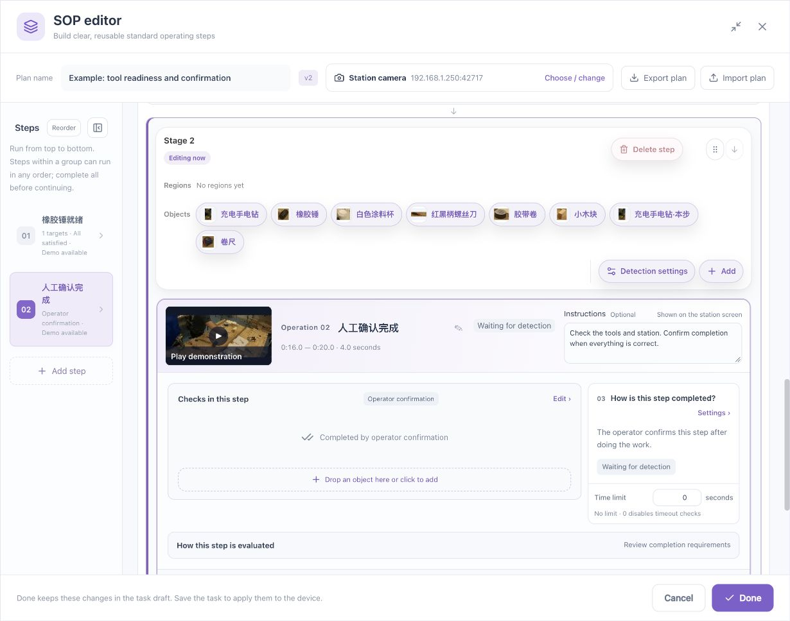

# Operator Station Manual

[简体中文](../../zh/sop/operator-guide.md) · [Manual home](index.md)

For operators and supervisors. Configuration and validation should be completed first. Operators work with the current step of a saved, started task. Starting the task and beginning an individual workpiece are separate actions.

## 1. At the start of a shift

1. Identify station, product, task, and approved plan.
2. Check that camera direction and visibility remain correct.
3. Remove confusing extra similar tools without removing required materials.
4. Verify moving video and synchronized state.
5. Read the work instructions; ask the process owner to clarify ambiguous names.
6. Identify who decides recovery, rework, and abortion.
7. Report camera, tool, or process changes for revalidation.

## 2. Enter station operation

This figure shows the configuration entry before operation, not a passing production result.

1. Configuration personnel finish authoring, confirm the node, and save.
2. Start the intended task through its task controls.
3. Open **Station operation** on that task card.
4. Select the actual station if several exist.
5. Read station name, current state, operation, and verified-step count.

A stopped task may have no active instance. Repeated confirmation does not start the background task.

## 3. Read the screen

| Area | Location/content | Check |
|---|---|---|
| Station heading | Panel top | Correct workplace |
| Video status | Connection area | Live, connecting, stalled, or error |
| Synchronization | Beside video status | Current state is trustworthy |
| Workpiece state | Upper summary | Ready, running, paused, held, ended |
| Verified count | Summary | Completed steps, not video progress |
| Current operation | Main panel | Name, instructions, completion |
| Demonstration | Current operation entry | Standard action for this step |
| Detection checks | Below current operation | Missing object, region, quantity, or unknown reason |
| Procedure list | Progress area | Current and unfinished grouped steps |
| Workpiece details | Disclosure | Reason and run identifier |
| Commands | Visible when allowed | Begin, confirm, pause, and recovery |
| Incidents/evidence | Related lower area | Alarm delivery and recording availability separately |

Playable video and synchronized process state are distinct. Neither a last known picture nor a stale state justifies a current confirmation.

## 4. Begin a workpiece

**Prerequisites:** Task running, station available, previous work clearly ended/aborted or waiting for a workpiece, synchronized state.

1. Distinguish the previous and current pieces.
2. Position the current work under station procedure.
3. Click **Begin workpiece**.
4. Wait for Running.
5. Read and perform the first active operation.

The current piece has its own execution state. Previous green steps do not establish current completion.

If disabled, inspect connection, synchronization, service health, and pending commands. Do not repeatedly click or try another station.

## 5. Automatic visual steps

For “Mallet ready”:

1. Read the active operation.
2. Place the correct tool in its assigned area.
3. Keep ordinary working conditions without waving the object to trigger detection.
4. Inspect the requirement and hold status.
5. Observe verified completion and advancement.

If it waits, inspect the reason: not detected, outside region, low confidence, wrong count, or unknown evidence.

## 6. Visual checks followed by operator review

1. Wait for stable conditions and review-ready status.
2. Inspect the actual work against the instructions.
3. Ensure a visible position has not substituted for required workmanship.
4. Recheck selected station, piece, and step.
5. Use the control to **Review the station and confirm this step**.
6. Wait for the acknowledged result.

A disabled confirmation is not a visual-check bypass.

## 7. Manual confirmation

The figure illustrates configuration. During operation, use the runtime control for the active step.

1. Perform the instructed action.
2. Inspect materials and quality.
3. Verify the selected station, piece, and step.
4. Confirm completion.
5. Observe verification or the next step.

Availability of a button does not justify confirming incomplete work.

## 8. Unordered groups

All grouped steps remain mandatory, although order is flexible.

1. Read the unordered-group completion count.
2. Select a step to read its instructions.
3. Perform and confirm that operation.
4. Continue other unfinished group members.
5. Check advancement after all required members finish.

Selecting a step changes focus, not completion. A completed selected step can remain visible. Use **View active step** when offered to return to pending work. Read the selected name before confirming.

## 9. Demonstration playback

| Control | Purpose | Important detail |
|---|---|---|
| View step demo | Load this operation's teaching clip | Correct name and interval |
| Play/Pause | Review standard action | Does not complete real work |
| Progress bar | Inspect a moment | Does not edit the process rule |
| Full screen/restore | Viewing size | Recheck current state on return |

If the demo fails to load, preserve the workpiece and ask the administrator to inspect media, network, and task version. Do not re-record over the configuration.

## 10. Pause and reviewed recovery

Use **Pause** when the procedure requires a temporary stop and wait for its acknowledgement. Software pause does not replace machine shutdown or the site's mechanical safety procedure.

Before recovery:

1. Check physical placement and unfinished work.
2. Verify camera, detection sources, and configuration.
3. Read the recovery prompt.
4. Resume only when physical and process state agree.
5. Inspect the resumed current operation.

If source/configuration changes are pending, follow the instruction to restore the original configuration or abort and begin again under the new one.

## 11. Rework

Rework returns to a specified step; it does not silently erase the incident.

1. Have the authorized person choose the rework start.
2. Select **Rework**.
3. Choose the actual step to repeat.
4. Enter a factual reason.
5. Confirm.
6. Inspect steps and dependent work that must be repeated.
7. Follow the new current state rather than invalidated old completion.

The current reason field permits up to 300 characters, subject to interface validation. Prefer a factual explanation over “test” or “error.”

## 12. Abort

1. Identify the current station and piece.
2. Select **Abort workpiece**.
3. Enter the reason.
4. Confirm and wait for the result.
5. Handle the piece and records under site procedure.
6. Verify a new-piece state before restarting.

Abort differs from pause. Do not assume the old execution can resume at the same position.

## 13. Finish

When required steps are complete, inspect the final result and use **Finish workpiece** if offered.

- Verify all mandatory steps and reviews.
- Resolve outstanding incidents.
- Wait for an explicit terminal state.
- Distinguish ended from compliant completion.
- Record the required outcome before the next piece.

## 14. Commands and availability

| Function | Typically available when | Typical restriction |
|---|---|---|
| Begin workpiece | Ready or previous work ended/aborted | Unsynchronized, pending, unhealthy |
| Confirm manual step | Current running step permits confirmation | Wrong step or unresolved previous confirmation |
| Review and confirm | Visual conditions review-ready | Checks not yet stable |
| Pause | Running | Untrusted state or pending command |
| Reviewed resume | Paused/recovery required | Unresolved source/configuration change |
| Rework | Recoverable active piece | Binding change or service fault |
| Abort | Work not already ended | Pending or untrusted state |
| Finish | Steps complete and explicit finish required | Unfinished requirements |
| View active step | Current focus is not pending work | No active step |
| Recheck state | Previous confirmation outcome unknown | Disconnected or reconciliation underway |
| Retry previous confirmation | Read-back permits retry of the same request | Step changed, still unknown, or request pending |

Runtime labels may depend on interface localization. Use the stated function and actual current-state prompt.

## 15. Slow network or unknown confirmation

1. Keep the page and do not double-confirm.
2. Read whether the original request is retained.
3. Use **Recheck state**.
4. If the step changed, follow current state without sending the old confirmation.
5. Use **Retry previous confirmation** only when explicitly enabled and still appropriate.
6. Ask the administrator to inspect device records if uncertainty remains.

Do not bypass uncertainty by refreshing and issuing a new confirmation. Recheck identity after switching stations or pieces.

## 16. State reference

| State | Action |
|---|---|
| Waiting for workpiece | Identify station and begin under procedure |
| Running | Perform current operation |
| Paused | Review before resuming |
| Incident held | Inspect reason; authorized resolution |
| Recovery review required | Reconcile physical and process state |
| Evidence verification | Wait for trustworthy evidence |
| Ended | Read actual outcome and prepare next work |
| Aborted | Follow exception handling |
| Not synchronized | Restore connection; no duplicate commands |
| Video stalled/error | Last frame is not current observation |

## 17. Alarms and recording evidence

An alarm submitted to another capability does not guarantee a complete usable recording. Inspect delivery, recording, and evidence-readability states separately.

Preserve event, station, time, and run identity for partial evidence, recorder failure, or unknown outcome. Do not delete history to remove a warning.

## 18. Shift handover

Record unfinished and exceptional work. Closing the browser does not necessarily stop the task. Retain required evidence, report camera/tool/process changes, and avoid replacing references, media, or shared regions during production.

**Related: [Validation and saving](validation-and-operation.md) · [Maintenance and handover](maintenance.md) · [Button reference](control-reference.md).**

*Footage attribution: [Sample and screenshot credits](reference.md#7-sample-and-screenshot-credits).*
