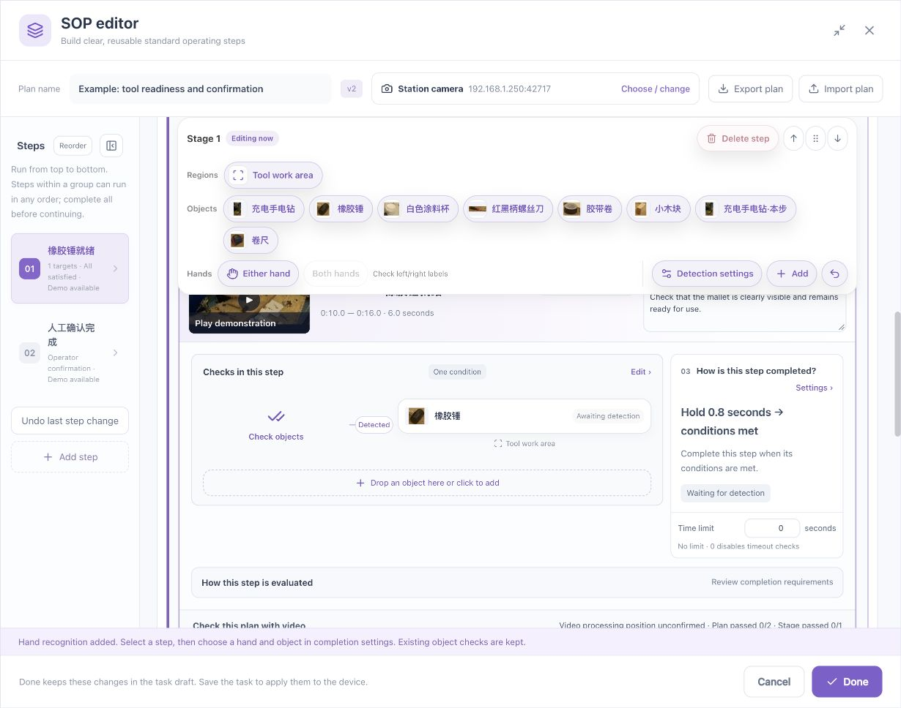

# Parameters, Units, Defaults, and States

[简体中文](../../zh/sop/parameters.md) · [Manual home](index.md)

Use this chapter to determine what a value controls, how changing it affects behavior, and what must be revalidated. Do not adjust settings repeatedly until the screen turns green. Identify the recognition, geometry, timing, or workflow issue first.

## 1. Parameter categories

| Category | Question | Typical fields |
|---|---|---|
| Recognition | Which candidate is accepted? | References, detector threshold, condition minimum score |
| Count and geometry | How many, where, and relative to what? | Minimum/maximum, region, relationship, distance |
| Timing | How long must it hold or wait? | Hold, input-gap tolerance, deadline |
| Workflow | How are requirements combined? | All, any, sequence, stage grouping |
| Evidence scope | Which footage is checked? | Overall/stage/demo ranges, sampling interval |

Input limits are permitted interface bounds, not recommended process settings. The device also validates capability and combinations. Values such as 0.8 seconds are examples, not universal standards.

## 2. Targets and references

| Field | Meaning | Guidance |
|---|---|---|
| Target name | Logical business object | Different views can remain one target |
| Primary reference | Main appearance | Clear ordinary picture with little background |
| Additional view | Another common appearance | Check improvements and new false detections |
| Detection capacity | Occupied query positions | One logical object can use several reference/alias positions |
| Pending adoption | Unadopted improvement data | Distinct from admitted references |
| Edit scope | This step or all uses | Read affected steps first |

Two views of one mallet do not require two physical mallets.

## 3. Distinguish three thresholds

### 3.1 Source detection threshold

Found in target/reference recognition settings; controls retained candidates from the detector. The corresponding percentage input currently permits 1–95. Different references may have their own gates.

### 3.2 Condition minimum confidence

Found under the relationship's additional recognition settings. A and B can have separate requirements, displayed as 0–100%.

This filters results available to the condition. Lowering it cannot recover a candidate already removed by a higher detector gate. Inspect both layers when a conflict is reported.

### 3.3 Current-image trial threshold

Controls the current trial. A successful frame trial does not establish success across all footage or steps. The trial percentage input permits 1–95.

| Value | Means | Does not mean |
|---|---|---|
| Highest candidate score | Evidence for a reference in a picture | Target accuracy |
| Reference gate | That reference's acceptance setting | A shared conclusion for every reference |
| Manual-box hits 1/2 | One of two annotated instances matched | Complete frame or video correctness |
| One algorithm box | One retained result | A match at the intended annotation |
| Pictures generated 100% | Planned result images generated | SOP passed 100% |

After edits, check true targets, similar objects, empty backgrounds, and duplicates. Improve footage or references when reliable distinction is unavailable.

## 4. Quantity

| Requirement | Minimum | Maximum | Meaning |
|---|---:|---:|---|
| Exactly one | 1 | 1 | Too few and too many fail the requirement |
| Exactly two | 2 | 2 | Both instances must be distinguishable |
| Between one and three | 1 | 3 | An allowed range |
| No retained detection | 0 | 0 | Different from physical departure; consider operator review |

The current input upper bound is 10000, not a guarantee of reliable counting at that density. Use nonnegative integers with minimum no greater than maximum. Built-in hand targets may not offer object-count mode.

Duplicates, overlap, boundary ambiguity, and uncertain physical identity affect count reliability. Relaxing the count does not repair those problems.

## 5. Regions

| Choice | Meaning | Verify |
|---|---|---|
| Full frame | Whole-image judgment | Neighboring activity |
| All recognition regions | Configured coverage | Includes all and only intended areas |
| Named region | This requirement uses that region | Correct diagram label |
| A region | Subject endpoint coverage | Does not automatically bind B |
| B region | Reference endpoint coverage | Configure both sides when needed |
| Operation area | Whole action path | Not just endpoints |
| Origin/destination | Sequence positions | A genuine state change |

Region constraints are not synonymous with running the detector only on cropped pixels. They may constrain filtering or rule evaluation.

## 6. Spatial relationships and distance

### 6.1 Direction

A left of B differs from B left of A. After replacement, verify subjects, relation, and both regions. Revalidate after mirroring or orientation changes.

### 6.2 Hand/object distance

Distance is normalized with object size. The current intuitive slider spans 10%–100%, in 5% steps. This is not detection confidence, centimeters, force, or contact pressure.

A wider range can accept a nearby non-operating hand; a narrow range can reject normal variation. Test both the intended action and a hand merely passing nearby.

### 6.3 Advanced geometry

The advanced relationship-threshold input spans 0–16; boundary tolerance spans 0.001–1. Meaning depends on relationship type. Normally retain generated settings and verify the visual relationship first. Do not apply one value universally or accept ambiguous boundaries as satisfied.

## 7. Hold duration

Hold specifies stable satisfaction before the requirement completes.

- Numeric input supports 0.001–3600 seconds.
- A 0.8-second hold is not a 0.8-second footage selection.
- Use the slider for coarse adjustment and the number field for precision.
- Slider positions do not all represent equal increments of time; read the displayed value.
- Clearly failing observations must not be accumulated as continuous success.

With All together, the combination must hold, rather than each object appearing once at unrelated times.

## 8. Input-gap tolerance

Controls a temporary lack of trustworthy observations, not an observed incorrect action. A common generated value is 0.5 seconds; use the loaded value and specific template. The general input permits 0.001–60 seconds, while continuous-observation templates can impose tighter bounds.

Do not enlarge a gap until repeatedly missed hands appear to complete a sequence. That neither establishes continuous visibility nor repairs recognition.

Determine whether the interval contains no new trustworthy input or clear evidence that a requirement fails.

## 9. Deadlines and sequence time

| Field | Purpose | Current input bounds | Zero |
|---|---|---|---|
| Step deadline | Maximum time for the step | 0–86400 seconds | Disables step timeout |
| Sequence maximum time | Maximum time for ordered conditions | 0.001–3600 seconds | Not the unlimited setting |
| Hold | Stable satisfaction | 0.001–3600 seconds | Not a valid ordinary hold |
| Input gap | Missing-input wait limit | 0.001–60 seconds, template-dependent | Not an unlimited deadline |

For a tool held ready for 0.8 seconds within a 20-second step, set hold and deadline separately.

## 10. Ranges and sampling

1. Endpoints must be inside their asset and Start before End.
2. Overall scope controls target scanning/plan validation; stage scope belongs to that stage.
3. Stage intervals may overlap.
4. Overall validation should cover participating stage intervals.
5. Old results do not become proof for a newly edited interval.
6. Sampling is stated in frames, not seconds; elapsed time depends on frame rate.

For illustration, every 30 frames is approximately two seconds at 15 fps or one second at 30 fps. Verify actual result timestamps rather than relying on conversion alone.

## 11. Completion methods

| Method | System responsibility | Operator responsibility |
|---|---|---|
| Automatic after visual checks | Visual rules, timing, workflow | Handle exceptions under station procedure |
| Visual plus operator review | Reach review-ready state | Inspect the work and confirm the current step |
| Manual confirmation | Provide instructions and confirmation control | Determine and confirm completion |

Review is for requirements that images cannot establish, not an arbitrary bypass for failed visual checks.

## 12. States are not parameters

| State/message | Meaning | Next action |
|---|---|---|
| Unreviewed | No explicit human judgment | Inspect and label present/absent/unclear |
| Saved, not adopted | Review persistence and reference admission differ | Adopt explicitly, then recheck |
| Results from earlier settings | Configuration and evidence differ | Revalidate |
| Awaiting operator review | Human action remains | Check work and selected step |
| Count/identity uncertain | Instances are not reliably established | Separate items, improve view, inspect evidence |
| Boundary ambiguous | Region membership uncertain | Adjust placement/region and revalidate |
| State not synchronized | Current device state untrusted | Reconnect and read back before confirmation |
| No samples in record | That run lacks annotation pictures | Does not prove recognition review |

## 13. Controlled parameter change

1. Record the specific issue and original setting.
2. Classify it and avoid changing several categories together.
3. Retain a reproducible recording and original result.
4. Change one justified setting.
5. Recheck normal, incorrect, and independent footage.
6. Record reason, scope, version, and outcome.
7. Save, reopen, verify, then apply under station procedure.

**Related: [Scenario labs](scenario-labs.md) · [Button reference](control-reference.md) · [Troubleshooting](troubleshooting.md).**

*Footage attribution: [Sample and screenshot credits](reference.md#7-sample-and-screenshot-credits).*
