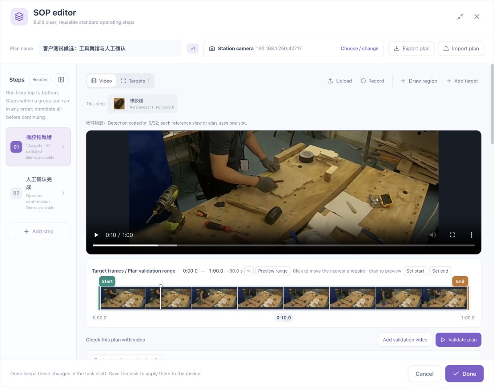
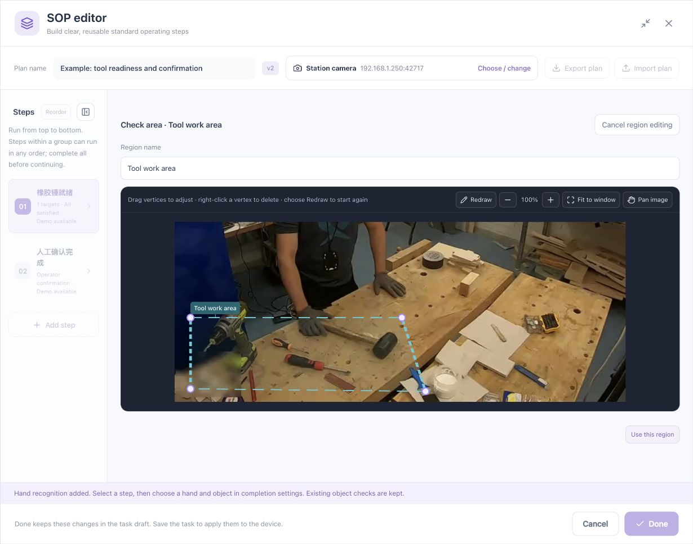

# Deployment Preparation and Process Requirements

[简体中文](../../zh/sop/preparation.md) · [Manual home](index.md)

Use this chapter before configuring a production workflow. Its outputs are a clear process worksheet, usable teaching footage, distinguishable targets, and an explicit list of quality checks that require an operator. Every subsequent editor action should implement a stated requirement.

## 1. Responsibilities

| Role | Before configuration | After configuration |
|---|---|---|
| Process owner | Correct sequence, permitted variations, and mandatory quality requirements | Confirm that the rules express the actual process and identify checks that remain manual |
| Configuration engineer | Camera, recordings, and meaningful target/region names | Check each requirement's subject, region, timing, combination, and completion method |
| Station operator | A normal operation and common incorrect operations | Confirm that instructions, demonstrations, messages, and confirmation controls are understandable |
| Administrator or installer | Connectivity, required capabilities, storage, backups, and operating permissions | Verify save/reopen, task operation, recovery, version identity, and traceable records |

One person may hold several roles. Keep the responsibilities explicit even then. An engineer understanding the editor does not establish that an operator understands the station instructions.

## 2. Checks before opening the editor

### 2.1 Device and browser

1. Complete [Device Onboarding](../device-onboarding.md) and verify access from the station computer.
2. Sign in at the device address selected for the installation. Screenshot addresses are examples.
3. Verify a stable connected state before configuring a process.
4. Identify the task to edit. Avoid several indistinguishable task names.
5. Provide sufficient browser space. Maximize the SOP editor or collapse its step list when necessary.
6. Have the administrator handle any browser certificate warning under the site's device-security procedure.

**Expected result:** Device status and task controls load reliably. Starting a task is not required at this point.

### 2.2 Camera

| Item | Ready condition | Resolve first |
|---|---|---|
| Mounting | Fixed view of relevant tools and actions | Moving head-camera footage used with fixed work-area assumptions |
| Orientation | Matches normal station operation | Mirrored or flipped image with old handedness settings |
| Subject size | Important objects occupy useful image area | Tiny distant tools |
| Occlusion | Distinguishing features remain visible during ordinary handling | The operator's body persistently covers the target |
| Lighting | No persistent glare or very dark critical areas | Reflections obscure the target outline |
| Nearby activity | Current and neighboring stations are distinguishable | Several operators and similar tools occupy the same area |

Regions follow image coordinates. A region may still be drawn on screen after the camera moves while no longer representing the intended workplace.

### 2.3 Capabilities

Begin object-only workflows with object recognition. Add hand recognition when hand/object relationships are required. Check left and right using the actual installed orientation.

A plugin name alone does not establish that a complete operation is available. Check the editor's targets, conditions, and validation controls, then verify the actual recording.

## 3. Turn process language into a worksheet

Write the intended action first, then its observable evidence. “Pick up the mallet” may require approach, object movement, arrival, and operator review. Hand proximity alone does not establish a completed pickup.

Use one clearly completable work unit per row:

| Field | Specify | Example |
|---|---|---|
| Step name | An action or state the operator recognizes | Tools ready |
| Prerequisite | What must precede this step | A new workpiece is ready |
| Objects | Required objects or counts | Rubber mallet |
| Location | Relevant part of the station | Tool work area |
| Hands | No hand check, either hand, or a specified hand | No hand check for this step |
| Timing | Hold and deadline requirements | Ready continuously for 0.8 seconds; initially no deadline |
| Combination | Simultaneous, alternatives, sequence, or independent steps | One readiness requirement |
| Completion | Automatic, visual plus operator review, or manual | Complete after visual checks |
| Manual quality check | Requirements that images cannot establish | Review tools and station in the next step |
| Negative example | A situation that must not complete the step | Mallet missing or outside the area |

Do not replace an unobservable quality requirement with an easy position check. A drill near a screw does not establish torque; a cup inside a region does not establish liquid quantity.

## 4. Establish dependencies

Ask:

1. Must B begin only after A completes?
2. Can A and B complete in either order, while both remain mandatory?
3. Must A and B hold at the same time?

| Answer | Configuration | Critical validation |
|---|---|---|
| B follows A | Separate ordered stages | Reversed operation cannot count as the required order |
| Either order, both mandatory | An unordered stage | Both orders work; omitting one step cannot finish the group |
| Same time | All conditions together within one step | Separate appearances cannot be added together |
| Equivalent alternatives | Any condition within one step | Each option is a permitted substitute |

Overlapping video ranges do not make operations interchangeable. Non-overlapping video ranges do not by themselves establish a mandatory dependency. Use the process requirements.

## 5. Prepare teaching footage

### 5.1 What to include

Record a stable initial workplace, the operation, and its final state. Do not place critical events at the first or last frame or during camera movement.

1. Leave a stable view for selecting a clear reference.
2. Perform at normal speed rather than unnaturally slowly.
3. Preserve hand entry, object movement, and hand withdrawal.
4. Avoid cuts within critical actions.
5. Retain a clear final-position view.
6. Record another operation separately for independent validation.

### 5.2 Check the uploaded recording

| Action | Expected observation | If not obtained |
|---|---|---|
| Play the beginning | Correct station and orientation | Check the selected file and source orientation |
| Seek to the middle | Picture changes with time | Allow loading, then inspect media messages |
| Seek to the end | Real final footage is available | Check source completeness |
| Inspect the timeline | Real thumbnails appear | A working reference image does not prove timeline readiness |
| Drag the playhead | Preview position changes | Distinguish the playhead from endpoint handles; see [Workspace reference](workspace-reference.md) |
| Compare duration | Matches the uploaded or recorded material | Check for an older asset or another step's demonstration |

**Completion check:** Identify a clear target view, the action's beginning and end, and a view where the object is genuinely not ready or the operation is incomplete.

## 6. Prepare the target list

### 6.1 Naming

Use a practical appearance or purpose plus the object name, such as “Rubber mallet” or “White paint cup.” Several reference views may belong to one logical target. Do not accidentally make front and side views into two objects that must coexist.

For similar objects, specify the visible difference. A longer name does not solve a distinction that the image resolution cannot show.

### 6.2 Reference planning

| Reference | Purpose | Also test |
|---|---|---|
| Clear ordinary resting view | Main appearance | Similar background shapes |
| Normal side or rotated view | Common orientations | Similar tools |
| Ordinary held appearance | Handling occlusion | Hand present without the tool |
| Normal near and far positions | Practical size variation | Tiny or blurred, unjudgeable views |

After adding a reference, check both improved recognition and new false or duplicate detections. More references do not automatically mean greater stability.

## 7. Prepare the region list

Use functional names such as Tool area, Parts area, and Assembly area. Have the process owner approve the boundaries.

- A station may have several regions.
- Regions may overlap; define what that means for each requirement.
- Origin and destination must express a real state change.
- A process area should include the route, not only its endpoints.
- After drawing shared regions, assign each requirement to its intended area.

## 8. Prepare validation cases

| Class | Include | Principle |
|---|---|---|
| Normal | One clear complete operation | Correct work should complete |
| Missing object | Remove a required item | Other visible objects cannot substitute for it |
| Wrong location | Move the object outside its assigned area | Confirm that region binding takes effect |
| Wrong count | One too few or too many | Eliminate duplicate detections first |
| Wrong order | Reverse required events | Verify that order was not accidentally relaxed |
| Hand negatives | Approach without withdrawal, occlusion, multiple people | Missing detection cannot count as a completed action |
| Independent recording | A separate real operation | Check beyond the original teaching clip |
| Input fault | Stream interruption, frozen or unjudgeable image | Uncertainty cannot count as completion |

These specify a test design, not results already measured by this manual. Retain recordings, configuration versions, expected results, and observations.

## 9. Preparation checklist

- [ ] Correct task and station identified.
- [ ] Complete footage plays and seeks.
- [ ] Step names and completion requirements are explicit.
- [ ] Automatic checks and manual quality review have defined roles.
- [ ] Target references and region purposes are planned.
- [ ] Order, unordered work, simultaneity, and alternatives are distinguished.
- [ ] Hands and objects remain visible through critical events.
- [ ] Normal, negative, and independent footage is available.
- [ ] Review, saving, operation, and maintenance responsibilities are assigned.

**Continue: [Workspace reference](workspace-reference.md) → [First complete example](quickstart.md).**

*Footage attribution: [Sample and screenshot credits](reference.md#7-sample-and-screenshot-credits).*
