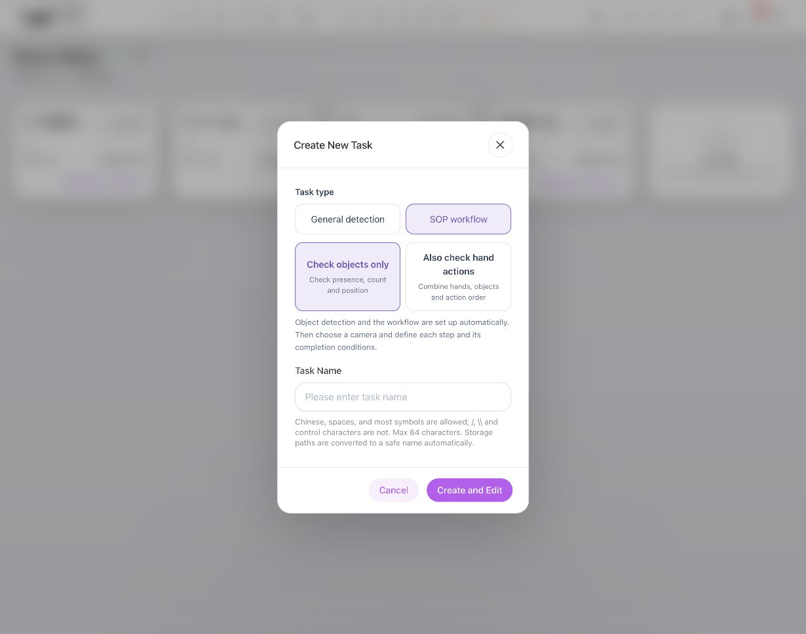
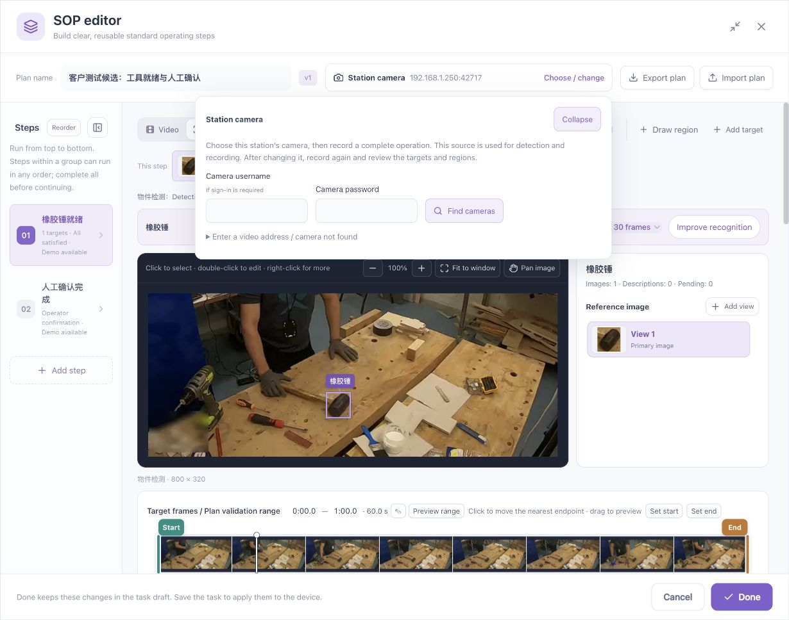
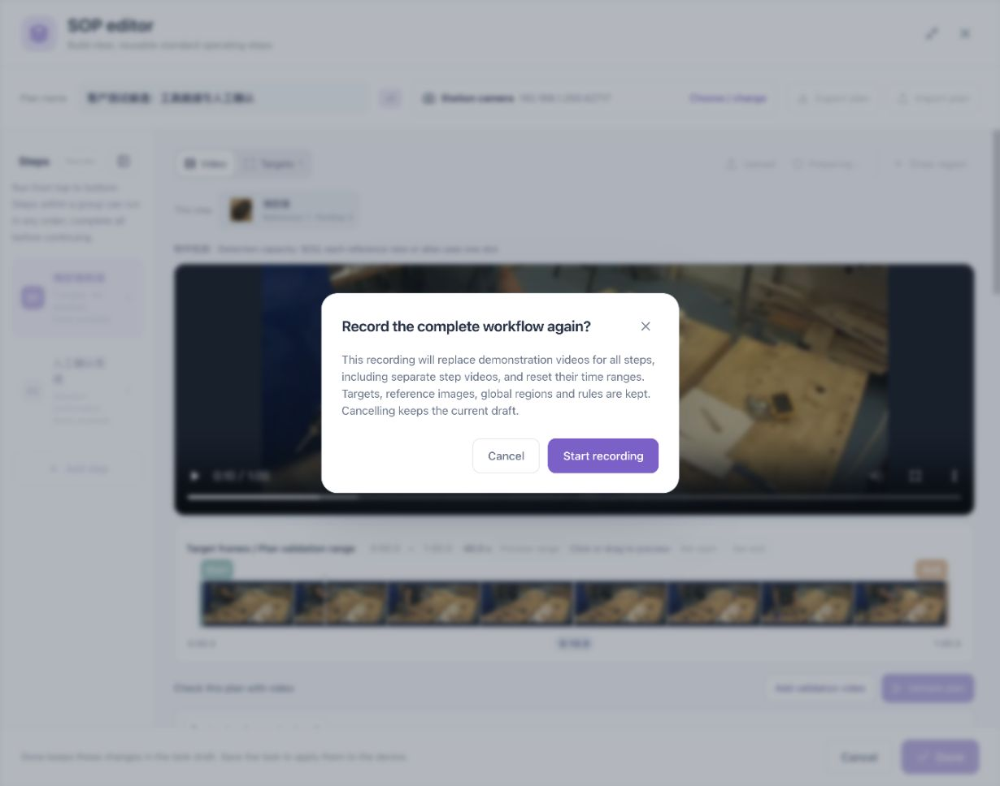
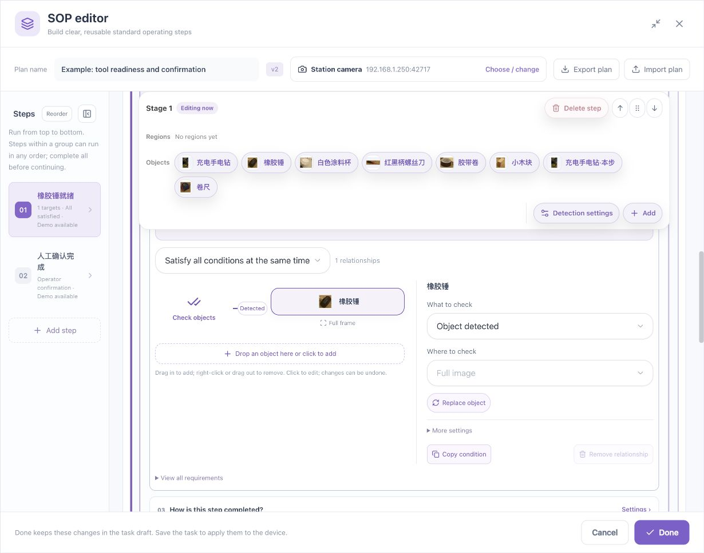
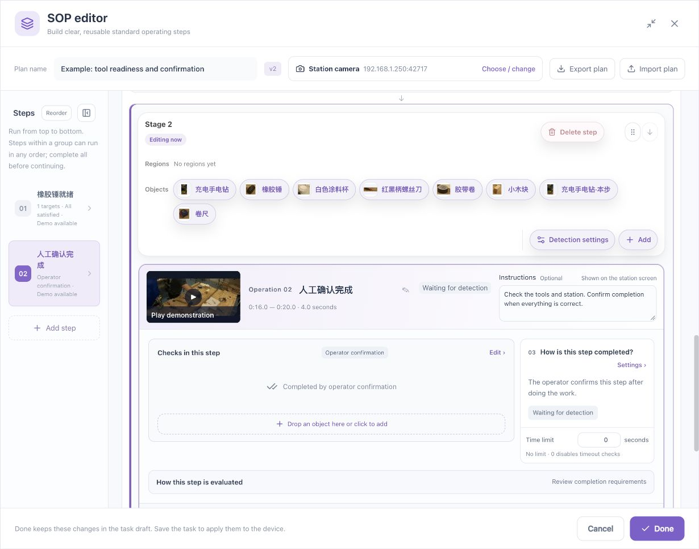
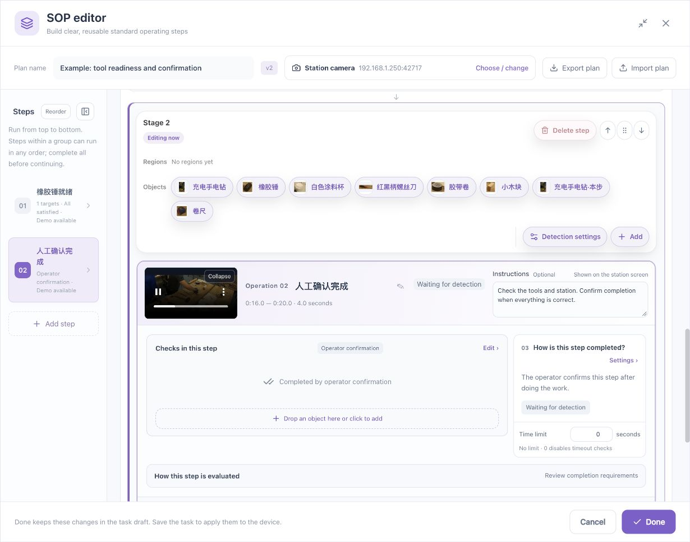

# Quick Start: Tool Readiness → Operator Confirmation

[简体中文](../../zh/sop/quickstart.md) · [Guide home](index.md)

This chapter builds one understandable two-step workflow. First check a rubber mallet, then ask the operator to confirm. **Verify recognition before proceeding to stage and plan validation.** Add hands and multiple targets after the basic workflow is clear.

## 1. Prepare the station and recording

1. Fix the camera in place and give the work area a substantial part of the image.
2. Check that the mallet is clearly visible in its normal position. Avoid persistent occlusion by hands, reflections, or other tools.
3. Prepare a short recording of the complete operation, including the initial station, the operation, and the completed state.
4. Preferably record a second, independent video to check that the configuration works beyond the teaching recording.
5. Keep camera position, orientation, and lighting consistent. If the camera moves, recheck regions and references.

| Example setting | Starting value | Reason |
|---|---|---|
| Target | Rubber mallet only | Learn one target before combining several |
| Hand checks | Not enabled initially | Separate object-recognition issues from hand issues |
| Stage order | Tool ready, then operator confirmation | The second step depends on the first |
| Readiness hold | 0.8 seconds, as an example | Avoid completing the step from a single brief observation |
| Deadline | 0, initially unlimited | Establish the normal path before adding timeouts |

**Checkpoint:** You can point out the mallet, the part of the video where it is clearly visible, and the point where the operator should confirm.

### Use the accompanying sample recording

[Download the 60-second workbench sample (MP4, approximately 9.5 MB)](../../assets/sop/workbench-60s.mp4). If it opens in the browser, save it through the video menu, then upload it as described in this chapter. Upload the video, rather than a screenshot.

The sample uses the same workbench as the illustrations, making it easier to find the mallet and compare times. It is a fixed 800 × 320 crop from the original recording's first 60 seconds. For your own station, use your own fixed-camera footage rather than copying the example's coordinates. See [Sample and screenshot credits](reference.md#7-sample-and-screenshot-credits) for authors, source, license, and adaptations.

## 2. Sign in and create an SOP task

1. Open the device management address in your browser and sign in.
2. Wait for a connected device state. For initial setup, complete [Device Onboarding](../device-onboarding.md).
3. Click **Add Task** in the header.
4. Choose **SOP workflow** as the task type.
5. Choose **Check objects only** for the introductory example.
6. Enter a recognizable task name, such as “Tool readiness and confirmation.”
7. Click **Create and Edit**, then enter the task's **Edit steps** workflow.

*Figure 2: Begin with object checks. Use the hand-operation chapter when the process requires approach, withdrawal, or a transfer.*

The task name, plan name, and station name can differ. The task name identifies the managed task, the plan name identifies the process, and the station name identifies the operator's workplace. Use meaningful, consistent names rather than several indistinguishable “Test” plans.

## 3. Find the main editor controls

| Area | Purpose |
|---|---|
| Plan bar | Name the plan, choose a camera, import or export |
| Step list on the left | Select, reorder, group, or add steps |
| Video / Targets switch | Play and locate video, or inspect targets and references |
| Upper timeline | Set the target-scan and plan-validation range |
| Step card | Edit the name, demonstration, instructions, checks, and completion |
| Timeline below a stage | Set that stage's own validation or demonstration range |
| Done at the bottom | Return changes to the task draft; save the task afterward |

Collapse the step list or maximize the editor when you need space. Numbered navigation remains available when the list is collapsed. Use ordinary scrolling to move through the page. Use the displayed modifier key or the plus/minus controls to zoom the image.

## 4. Choose the station camera

1. Click **Choose / change** in the plan bar.
2. Prefer a camera already configured for this station.
3. If camera discovery requires authentication, enter the **camera's credentials**, which may differ from your device Web account.
4. If you have a video address but discovery finds no camera, expand the existing-address entry and have the administrator verify the address and network.
5. Check that the plan bar shows the intended camera.

**Expected result:** Recording uses the intended station source.

After changing the camera, record or check the teaching video, target references, regions, hand directions, and validation footage again. Regions drawn for a previous viewpoint should not be assumed correct for a new viewpoint.

## 5. Upload or record the complete process

### 5.1 Use an existing recording

1. Click **Upload**.
2. Select a video format supported by the device interface.
3. Wait for upload, processing, and picture loading to finish.
4. Play the beginning, middle, and end and check that the timeline contains real thumbnails.
5. Pause on a clear view of the mallet.

### 5.2 Record the station

1. Select the camera.
2. Click **Record**.
3. If a teaching video already exists, read the replacement confirmation.
4. Start only if you intend to replace it, perform the complete operation, then stop.
5. Wait for the recording to become ready and play it back.

Recording the complete process again replaces the plan's demonstration material, including separately assigned step material, and resets step time ranges. Existing targets, references, global regions, and rules are retained as described by the confirmation. Canceling keeps the current draft. Use playback, rather than re-recording, when you only want to look at a picture again.

**Checkpoint:** The source video plays, you can locate a clear mallet frame, and the camera and recording are correct.

## 6. Create the mallet target

1. Pause the **Video** view on a clear frame.
2. Click **Add target**.
3. Draw a box around the mallet. Keep the object as the main content rather than including a hand, a large area of tabletop, or an adjacent tool.
4. Name the target and confirm.
5. Switch to **Targets** and check that the reference actually depicts the mallet.
6. If normal operation includes a different appearance, use **Add angle** on another frame of the same target. Do not create a separate logical object for each angle.

One mallet can have several reference images and still be one physical object. References may consume detection capacity. Keep representative views rather than many near-identical pictures.

## 7. Check recognition before authoring further

1. Select the recording range in the upper timeline.
2. Choose the sampling interval. A smaller interval produces more pictures and requires more processing and review.
3. Click **Improve recognition**. After a range change, the entry may ask you to check the selected range again.
4. Inspect frames where the mallet is present and absent. Look for misses, false detections, and duplicate boxes on the same mallet.
5. Review misses and add manual boxes, then complete trial detection, adoption, and rechecking as described in the [recognition chapter](video-and-recognition.md).
6. Include different angles, motion, hands near the tool, occlusion, and an empty work area. One successful first frame is insufficient.

**Proceed when:** Recognition is reliable in normal clear views, and misses, false detections, and duplicates have been examined. Do not loosen step requirements to hide an unresolved recognition problem.

## 8. Configure “Mallet ready”

1. Select the first step and give it a meaningful name.
2. Enter a short instruction such as “Check that the mallet is clearly visible in the tool work area and remains ready.”
3. Open **Step checks → Edit**.
4. Add the mallet and select the requirement that the object is detected.
5. Choose the full frame, all recognition regions, or a named region, as appropriate.
6. Open the completion settings and select visual detection followed by automatic completion.
7. Set the example hold time to **0.8 seconds**. Choose the real value according to your process.
8. Check the relationship diagram, completion method, and region.

Choose visual detection plus operator review when a person must inspect the result after the visual conditions are met. This differs from a step based entirely on operator confirmation.

## 9. Configure “Operator confirmation”

1. Add a second step after the first.
2. Name it “Operator confirmation.”
3. Enter an instruction such as “Check the station and tool positions, then confirm when correct.”
4. Choose operator confirmation as its completion method.
5. Keep these two steps sequential. They should not be in an unordered group because the second depends on the first.

**Expected result:** The confirmation step becomes current after the readiness stage finishes. An old confirmation control should not be used to skip a pending step or override an uncertain state.

## 10. Assign a separate range to each stage

1. Find **Validation range** below the stage.
2. For the first stage, select a clear view of the mallet—seconds **10–16** in this example.
3. For the second, choose its corresponding segment—seconds **16–20**.
4. Click a displayed endpoint to enter seconds or minutes:seconds, then save, cancel, or locate the picture.
5. You can also drag an endpoint. Verify the displayed times afterward.
6. Open **Play demonstration** and verify that it uses the intended step segment.

Stage ranges are independent and may overlap. When validating a plan against the same source recording, the overall validation range must cover the stages being tested. If narrowing it creates a conflict, resolve the indicated stages rather than assuming the application silently clips every stage.

## 11. Validate stages, then the plan

1. Use **Validate stage 1** and inspect the observed condition and completion result.
2. If it is wrong, expand the step's checks and reasons and correct the relevant target, region, or timing.
3. After stage 1 is correct, check the second stage's operator-confirmation behavior and its position in the sequence.
4. Use **Validate plan** to inspect the complete authored workflow and its final state.
5. Add an independently recorded video to check normal variation.

A stage result applies to that stage and segment; it does not automatically validate the entire plan. Reaching the end of a video or processing a number of frames is not a step pass rate. See [Validation and operation](validation-and-operation.md) for result interpretation.

## 12. Finish, save, and reopen

1. Click **Done** in the SOP editor to return the changes to the task draft.
2. If the node configuration window is still open, confirm it to return the node settings to the task editor.
3. Click **Save** in the outer task editor.
4. Wait for the result. Do not repeatedly click because the network is slow.
5. Reopen the task and verify names, targets, regions, ranges, completion methods, and demonstrations.
6. Only after saving successfully, start the task according to your site procedure and enter **Station operation**.

**Done** returns changes to the draft; **Save** persists the task on the device; **Run** is separate. Follow the prompt when closing or canceling unsaved edits. Browser draft data is not automatically a saved production configuration.

## 13. End-of-chapter checklist

- [ ] The full recording and both demonstration clips play.
- [ ] The mallet is one logical target; reference angles are not confused with physical count.
- [ ] Misses, false detections, duplicates, and normal occlusion have been checked.
- [ ] Step 1 has the correct visual requirement; step 2 explicitly requires operator confirmation.
- [ ] The steps execute in order.
- [ ] Stage ranges are compatible with the plan's validation range.
- [ ] Stage and plan results have been reviewed without treating progress as a pass rate.
- [ ] Saved settings and video remain correct after reopening.

**Next: [Video, targets, and recognition →](video-and-recognition.md)**

*Example footage and reference views in the screenshots: [wooden-box assembly dataset and CC BY 4.0 credits](reference.md#7-sample-and-screenshot-credits).*
