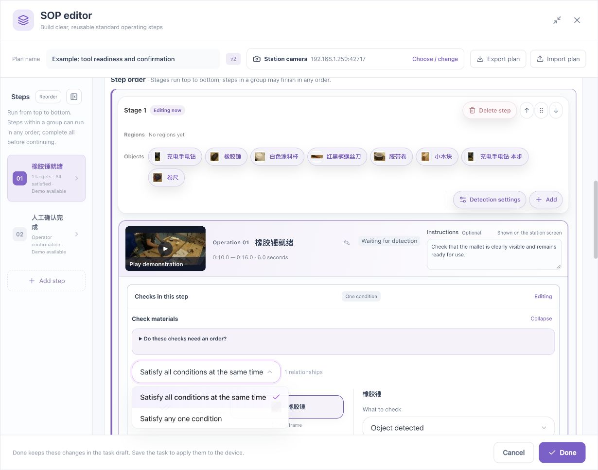
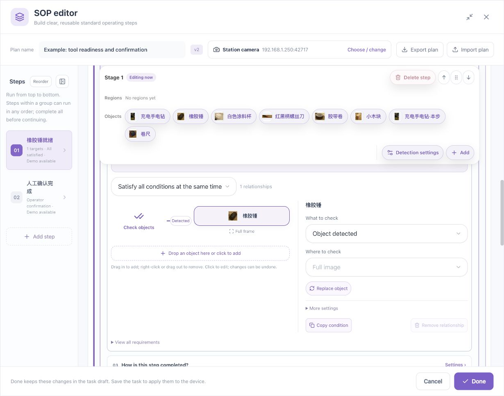
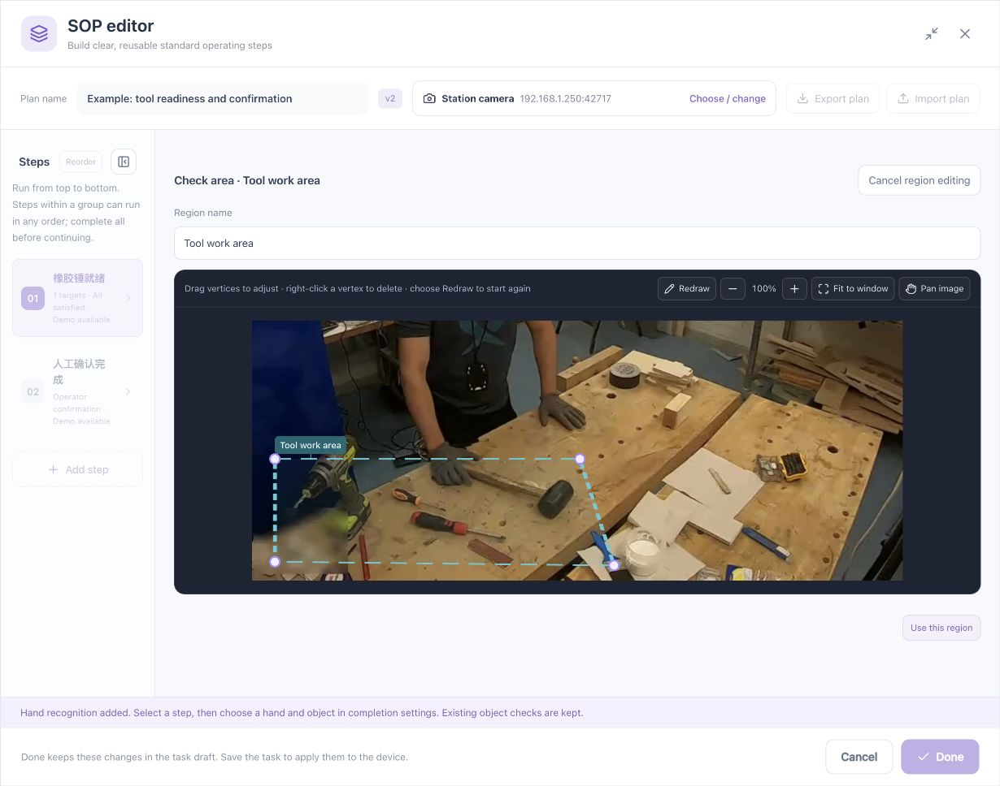
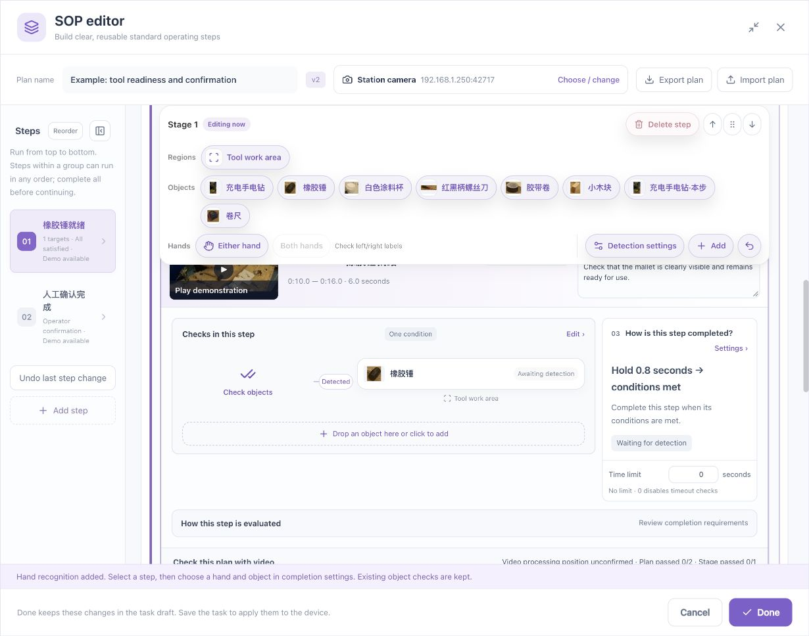
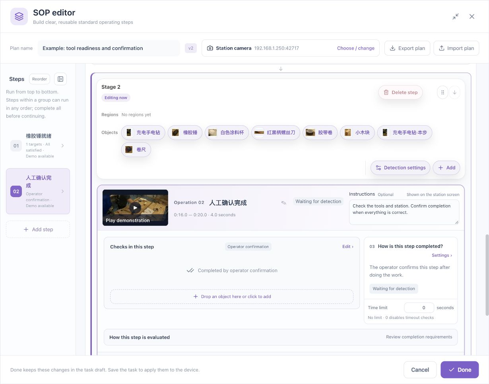
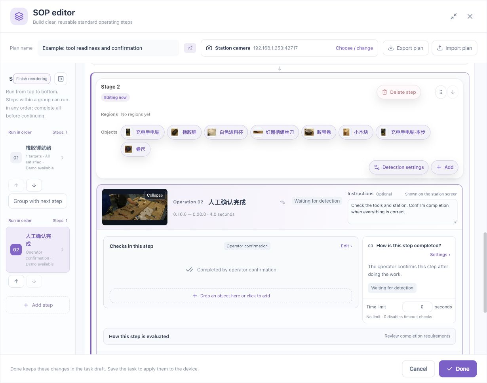

# Checks, Global Regions, and Timing

[简体中文](../../zh/sop/rules-and-regions.md) · [Guide home](index.md)

Describe completion in ordinary workplace language first. Then separate it into objects, regions, quantity, timing, and completion method.

## 1. Steps, stages, and conditions

A step describes an action with a purpose, such as tool readiness. A stage can contain one step or several steps that may finish in any order. Stages run from top to bottom, and all steps in a group must finish before the next stage.

Within one step, several detection conditions can be combined. **Steps finishing in any order is different from conditions being satisfied simultaneously.**

| Workplace requirement | Configuration |
|---|---|
| Mallet, screwdriver, and cup must all be ready | All conditions simultaneously |
| Either of two approved tools is acceptable | Any one condition |
| Approach, then withdraw | Ordered checks inside a step |
| Tool preparation and label inspection are independent, but both required | Unordered steps in one stage |
| The next action must wait for the previous action | Separate sequential stages |

## 2. Configure an object check

1. Open **Step checks → Edit**.
2. Select an object.
3. Choose the requirement, such as detection, quantity, or an available spatial relationship.
4. Check the object's region.
5. Add other conditions if needed and check the combination mode.
6. Read each requirement from the preview diagram and compare it with the real process.

References tell recognition what the object looks like. Conditions define what the step requires. Adding a reference does not automatically create a process requirement.

Quantity counts detected instances meeting the target, score, region, and other applicable requirements. Test the correct and incorrect physical quantities. Duplicate boxes and confusion between similar objects must be addressed before relying on counts.

## 3. Check selected regions

### Draw a global region

1. Locate a clear, correctly oriented frame.
2. Click **Draw region** and place vertices around the work area.
3. Close the polygon and inspect its coverage.
4. Give it a meaningful name, such as “Tool area” or “Preparation area.”
5. Confirm and check its position.

Use names describing the workplace rather than several indistinguishable numbered regions. Avoid placing boundaries exactly at the normal limits of object movement.

### Bind the check to the region

Select the named region under the relevant object. Alternatively, drag the toolbar region to a compatible region position; see [Toolbar and drag operations](toolbar-and-drag.md).

| Selection | Meaning |
|---|---|
| Full frame | Evaluate against the full image |
| All recognition regions | Use the configured recognition-region coverage; check that it is complete |
| A named region | Evaluate this requirement against that region |

Drawing a region does not automatically bind every requirement to it. Read the region shown beneath each relationship in the diagram. A global region is a reusable definition, not a requirement that every step use every region.

After editing a shared region, review and revalidate every step that uses it.

### Region tests

Test the object inside, outside, crossing the boundary, near an edge, and partly occluded. With several objects, place some inside and others outside. Overlapping regions are not automatically mutually exclusive.

Recheck regions after a camera position, mirroring, or resolution change. Failing a region requirement does not necessarily mean the object was not detected, or that recognition stopped processing the rest of the picture.

## 4. Spatial relationships

Spatial checks evaluate the visible positions of two targets. Uses include placement relative to a region or object, left/right relationships, and proximity. Available options depend on the current interface and device capability.

Check the subject, reference object or region, compatible video sources, camera orientation, and the intended boundary or tolerance.

A hand near a cup establishes a visible position relationship. It does not directly prove grasping, contact, force, or a completed physical operation. Both endpoints need reliable observations. An undetected hand must not be interpreted as a visible hand far away.

If capability is unavailable or still being checked, retain the configuration and follow the message. A disabled or read-only control is not evidence that the rule is active.

## 5. Simultaneous, alternative, and ordered checks

**All simultaneously:** Use when conditions must hold together. A configured hold time applies to the combined requirement; separate appearances several seconds apart cannot simply be added.

**Any one:** Use for genuine alternatives, such as either approved container. Do not use it to replace several mandatory checks.

**In order:** Use for approach → withdrawal or origin → destination. Check each phase's targets, regions, duration, and order. A later condition already true at the start does not establish that the required process occurred after the preceding phase.

See [Hand operations](hand-operations.md) for ordered templates. Validate step order and within-step order separately before combining them.

## 6. Completion and timing

| Method | Typical use | Check |
|---|---|---|
| Automatic after visual conditions | A clearly observable ready state | Conditions, hold time, false detections |
| Visual conditions then operator review | Vision provides evidence, but a person checks quality | Conditions first, confirmation afterward |
| Operator confirmation | The action requires human judgment | Clear instructions and the current step |

A hold time filters brief observations; it is not the length of the demonstration clip. A completion deadline limits the time allowed for a step; 0 means no timeout check where indicated. Sequence deadlines and allowed gaps constrain the process and are separate settings. Missing reliable input is not successful completion.

Establish the normal path before adding deadlines so that visual and timing problems remain distinguishable.

## 7. Stage ranges and the overall range

Each stage retains its own range. Ranges may overlap because real operations and preparation can overlap in time. They need not form consecutive non-overlapping pieces.

For plan validation using the same source recording, the overall selection should cover the participating stage ranges. If narrowing it produces a conflict, enlarge it, adjust the affected stages, or explicitly validate only the relevant stages. Do not assume silent clipping establishes complete validation.

Demonstrations train the operator; validation ranges define the evidence to check. When editing a stage's validation range, check the synchronization message and demonstration player. Use the demonstration mode for an independent teaching selection. Changing one stage must not be assumed to update the others.

## 8. Grouping and order

Use **Reorder** in the step list to organize the actual dependencies. Steps in an unordered stage can finish in any order, but all are required before advancing.

Keep dependent steps in sequential stages. After changes, review names, grouping, ranges, and validation results.

**Next: [Toolbar, drag operations, and undo →](toolbar-and-drag.md)**
