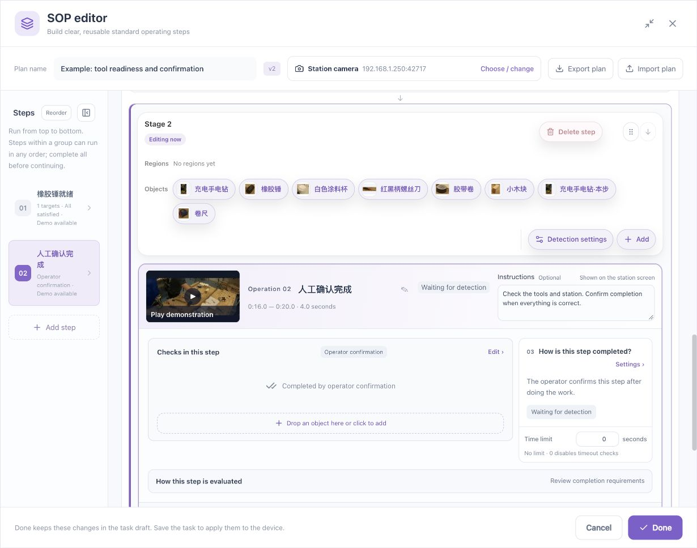
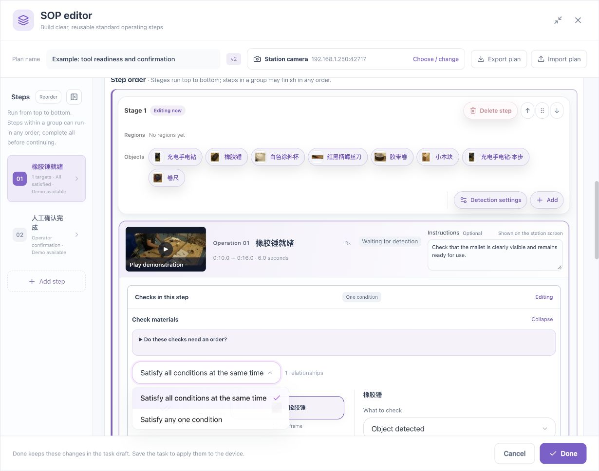
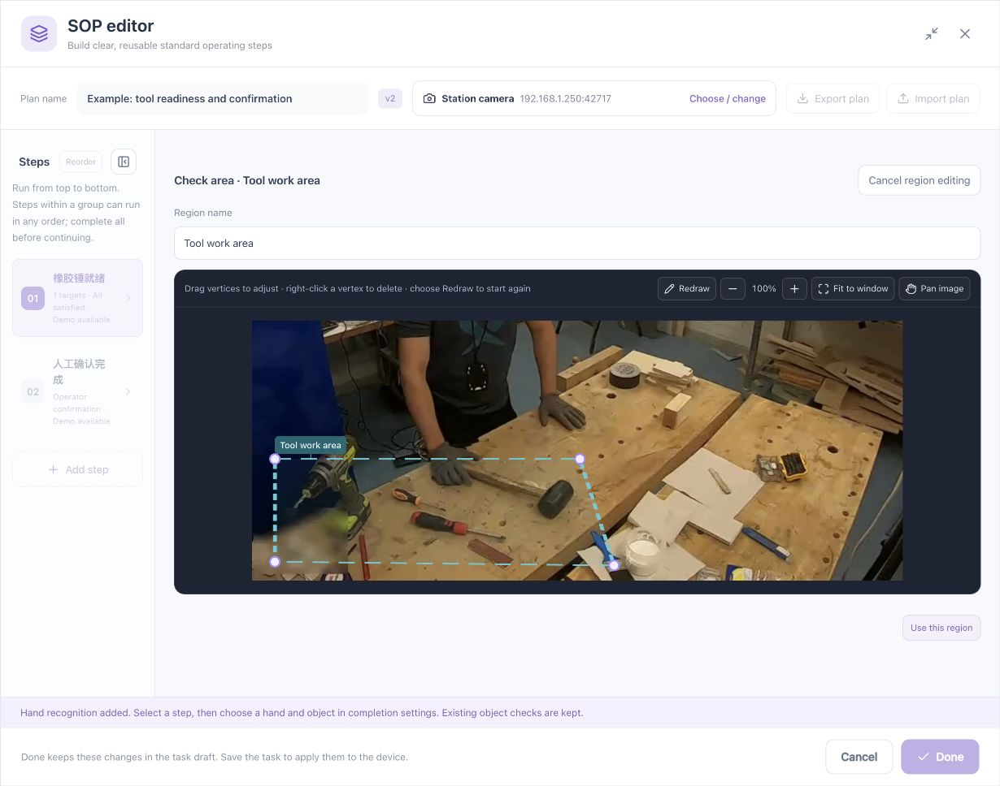
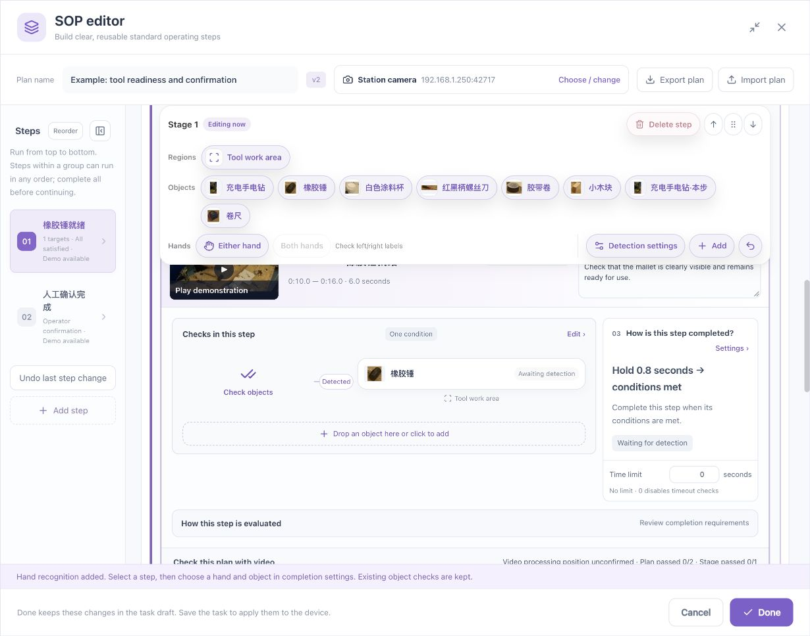
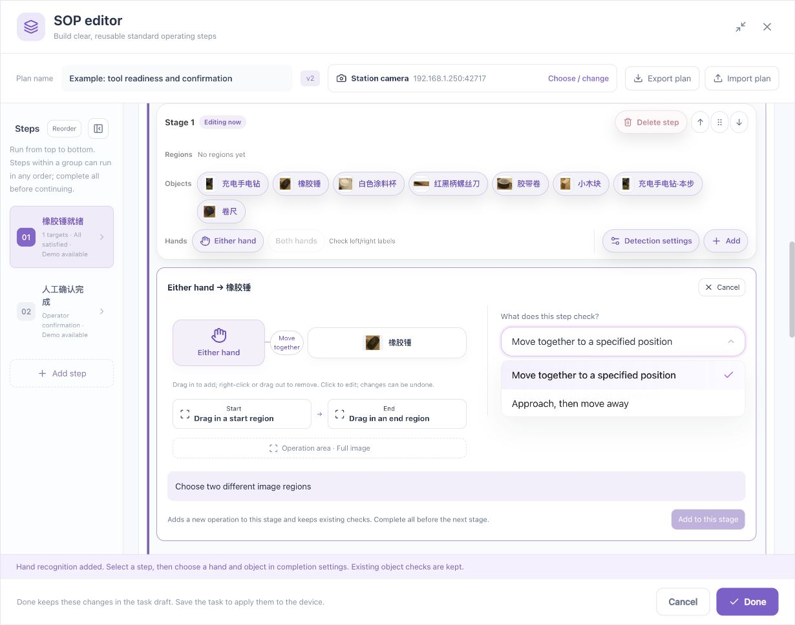
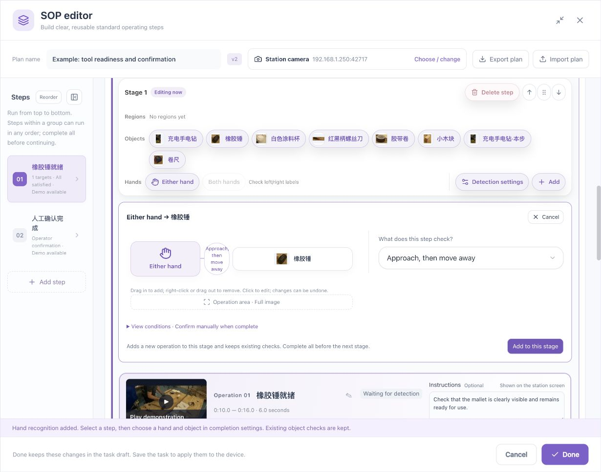
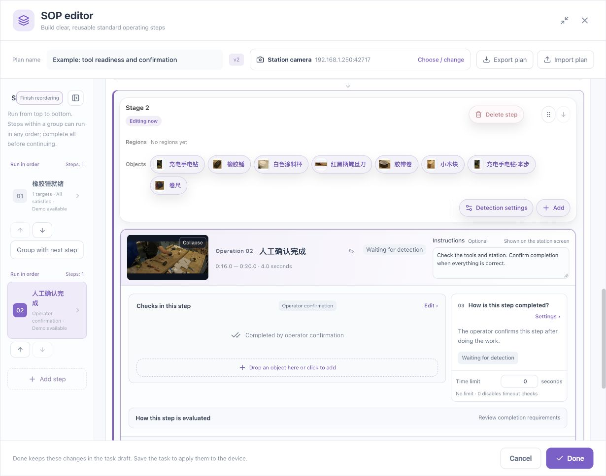

# Complete Configuration Labs for Six Common Scenarios

[简体中文](../../zh/sop/scenario-labs.md) · [Manual home](index.md)

Complete Lab A first, then select labs that match the process. Expected-result tables are instructions for validation, not claims that your station has already passed.

[Download the sample footage](../../assets/sop/workbench-60s.mp4). It supports the introductory readiness example. Count changes, transfers, and alternative orders require suitable separately recorded footage. Rules cannot manufacture actions missing from a recording.

## Lab A: Mallet ready → Operator confirmation

### A1. Objective

| Stage | Operation | Requirement | Completion |
|---|---|---|---|
| 1 | Mallet ready | Correct object visible in tool area for 0.8 seconds | Automatic after visual checks |
| 2 | Review station and confirm | Operator reviews tools and workplace | Manual |

Illustrative ranges are 10–16 and 16–20 seconds. Check actual footage rather than treating these as fixed process times.

### A2. Prepare footage

1. Create an object-only SOP task.
2. Select the station camera.
3. Upload the sample or record your workplace.
4. Play the beginning, middle, and end.
5. Verify real timeline thumbnails.

### A3. Establish one target

1. Pause on a clear mallet view.
2. Add a target; box its visible body with little background.
3. Name it Rubber mallet and confirm.
4. Inspect its reference in Targets mode.
5. Add views for normal variations rather than another duplicate logical target.
6. Review recognition at ordinary positions, near other tools, and where no mallet exists.

**Exit criterion:** Clear normal views correspond to the correct object. Resolve material misses or duplicates before changing workflow order.

### A4. Configure readiness

1. Name the operation Mallet ready.
2. Write instructions to place the mallet in the tool area.
3. Edit the step's checks and select the mallet.
4. Require Object detected.
5. If needed, draw Tool area and bind this requirement.
6. Choose automatic completion after visual checks.
7. Set a 0.8-second hold; initially leave deadline at zero.
8. Read the diagram back and remove accidental unrelated requirements.

### A5. Configure confirmation

1. Add a separate next step, outside the first stage's unordered group.
2. Name it Review station and confirm.
3. Choose manual confirmation.
4. State the physical inspection, such as complete tools and no leftover material.
5. Select its demonstration.
6. Verify readiness precedes confirmation.

### A6. Ranges and validation

1. Use the appropriate readiness interval, illustratively 10–16 seconds.
2. Use the review interval, illustratively 16–20 seconds.
3. Make the overall range cover both.
4. Validate readiness and its hold.
5. Validate the whole stage organization.
6. Verify actual human confirmation in runtime interaction.

| Test | Expected behavior |
|---|---|
| Correct stable mallet | Readiness can complete |
| Missing/outside-area mallet | Background cannot substitute |
| No operator confirmation yet | The next step cannot impersonate confirmation |
| Operator reviews current piece and confirms | Correct subject and advancement |

### A7. Save and reopen

Done → node confirmation if still open → task Save. Reopen and inspect order, target, region, hold, and ranges. Test runtime confirmation using the [Operator guide](operator-guide.md).

## Lab B: Three tools must be ready together

### B1. Requirement

Mallet, drill, and paint cup must coexist. This is one step with several simultaneous requirements, not interchangeable alternatives.

### B2. Configuration

| Field | Setting |
|---|---|
| Name | Three tools ready |
| Conditions | Mallet detected; drill detected; cup detected |
| Combination | All together |
| Regions | Appropriate area for each tool |
| Completion | Illustrative 0.8-second hold, automatic or operator review |
| Instructions | Explicit item names and placement |

### B3. Procedure

1. Create and verify each target separately.
2. Edit the step's checks.
3. Open Add related object; expand preview first if needed.
4. Select the three objects.
5. Choose All together.
6. Inspect each region and minimum confidence.
7. Configure hold and completion.
8. Read all three requirements from the diagram.
9. Validate coexistence and a separate missing-item recording.

| Test | Expected behavior |
|---|---|
| All three clearly visible together | Combination may satisfy |
| Only two | Not satisfied |
| Separate appearances without coexistence | Cannot accumulate into simultaneous readiness |
| Duplicate boxes on one drill | Cannot establish additional tools |

## Lab C: Count only the tool area

### C1. Requirement

Similar tools may appear on a neighboring table. Only the current station's tool area should contribute.

### C2. Procedure

1. Draw Tool work area on the correct fixed view.
2. Close/name it and exclude the neighboring table.
3. Open the tool requirement.
4. Select Tool work area as its coverage.
5. Verify the region label in the diagram.
6. Assign other tools or hands separately as needed.
7. Validate inside, outside, and boundary views.

### C3. Boundary tests

| Placement | Verify |
|---|---|
| Fully inside | Correct object, position, count |
| Fully outside | Does not satisfy this area |
| Crossing boundary | Ambiguity is not stable readiness |
| One inside, one outside | Count uses correct coverage |
| Overlapping regions | Actual rule meaning; no assumed exclusivity |

Drawing a region does not bind every step. An outside detection box is not necessarily wrong; check whether it incorrectly affects this requirement.

## Lab D: Approach the tool, then withdraw

### D1. Prerequisites

Object recognition works, hands remain visible, and any directional requirement has been checked against the operator.

### D2. Procedure

1. Add hand recognition in Detection settings.
2. Use Either hand unless direction is required.
3. Select hand, then mallet.
4. Choose Approach then withdraw.
5. Cover the full action with the operation area.
6. Inspect generated approach and visible-withdrawal requirements.
7. Check hold and allowed process time.
8. Retain operator review for workmanship.
9. Add to the stage; inspect whether a new operation was created.
10. If it forms an unordered group, verify that the process permits that grouping.
11. Validate real complete-action footage.

| Footage | Expected behavior |
|---|---|
| Valid approach followed by visible withdrawal | Ordered evidence |
| Always distant | Cannot skip approach |
| Approach and remain | Withdrawal has not occurred |
| Hand occluded or out of view | Not visible withdrawal |
| Neighboring person reaches in | Not automatically the intended operator |

This does not establish strike count, force, or assembly quality.

## Lab E: Either order, both preparations mandatory

### E1. Requirement

Tool readiness and label review may occur in either order. Final confirmation follows both.

### E2. Structure

| Stage | Contents | Rule |
|---|---|---|
| 1 | Tools ready, Label review | Unordered, all mandatory |
| 2 | Final confirmation | After stage 1 |

### E3. Procedure

1. Create two separate preparation steps.
2. Configure each independently; do not use Any condition to replace their conjunction.
3. Group them into one unordered stage through Reorder.
4. Keep final confirmation in the next stage.
5. Set each demonstration and validation interval.
6. Permit overlapping intervals; cover them in the overall scope.
7. Test both orders, omitted work, and early final confirmation.

| Order | Expected behavior |
|---|---|
| Tools → label → final | May complete |
| Label → tools → final | May also complete |
| Tools only → final | Group incomplete |
| Preparations completed at separate times | Permitted; not simultaneous conditions |

If the process truly requires label work first, use separate ordered stages.

## Lab F: Transfer an object, place it, and withdraw

### F1. Prerequisites

The device offers the corresponding continuous-observation template. A physical object remains distinguishable along the route; hand, object, and destination are visible. Two endpoint photos do not establish continuous transfer.

### F2. Areas

Define origin, destination, and an operation area covering the route. Avoid an initial placement satisfying both endpoints without a meaningful transition.

### F3. Procedure

1. Verify one object, hands, and handedness.
2. Draw distinct origin and destination areas.
3. Choose the operating hand, then the object.
4. Select the supported accompanied-transfer template.
5. Assign origin and destination slots.
6. Set the full process area.
7. Read origin, movement, arrival, and withdrawal requirements.
8. Check continuous proximity and destination-retention requirements.
9. Set realistic time limits without using excessive gaps to hide occlusion.
10. Add and inspect actual generated rules.
11. Test normal transfer, intermediate release, wrong destination, occlusion, and multiple similar items.

### F4. Validation matrix

| Case | Verify |
|---|---|
| Continuous normal transfer and placement | Origin, path, arrival, withdrawal |
| Recording begins at destination | Cannot infer a prior transfer |
| Object left midway; hand reaches destination | Hand arrival alone cannot finish |
| Original disappears, similar object arrives | No unsupported physical identity |
| Object leaves after arrival | Retention requirement |
| Overlapping endpoint regions | No false transfer without change |
| Gloves or temporary occlusion | Actual capability and uncertainty, not automatic success |

## 7. Close every lab consistently

1. Read back target, region, order, timing, and completion.
2. Test another real recording.
3. Save, close, and reopen.
4. Test active operation, demo, confirmation, and next piece.
5. Preserve normal and negative outcomes, not only successful screenshots.
6. Record unresolved gaps; do not declare untested capability production-qualified.

**Related: [Parameters](parameters.md) · [Hand operations](hand-operations.md) · [Maintenance](maintenance.md).**

*Footage attribution: [Sample and screenshot credits](reference.md#7-sample-and-screenshot-credits).*
