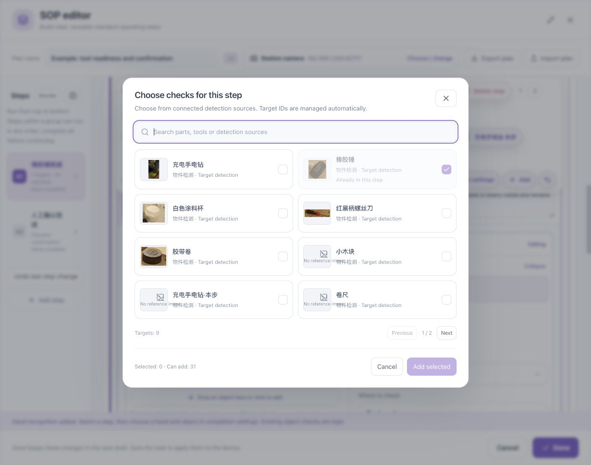
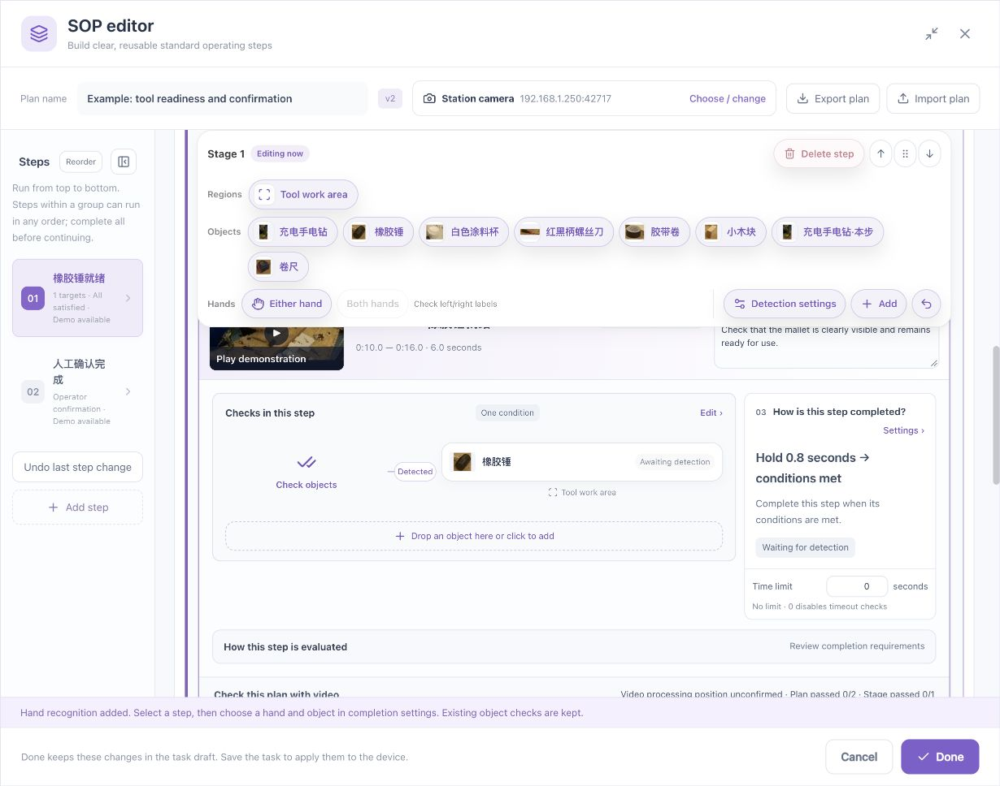
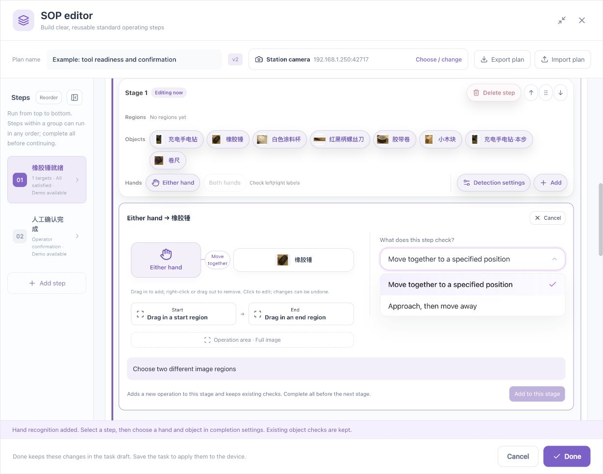
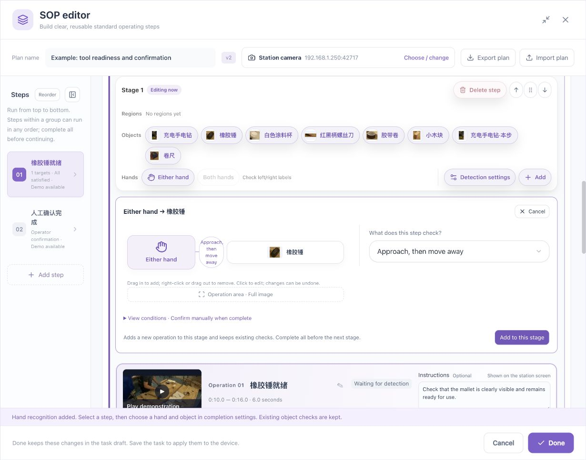

# Toolbar, Drag Operations, and Undo

[简体中文](../../zh/sop/toolbar-and-drag.md) · [Guide home](index.md)

The stage toolbar contains regions, objects, and hands. Read the drop hint, then verify the actual result after release. Highlighting identifies a compatible position; it does not prove that a condition was added.

## 1. Toolbar controls

| Control | Click | Drag |
|---|---|---|
| Region | Inspect or edit a shared region | Assign it to a compatible region position |
| Object | Select an object or open an authoring entry | Add a check or replace a compatible target |
| Either hand, Left hand, Right hand | Choose a hand and related object | Add or change compatible hand requirements as indicated |
| Detection settings | Open shared station settings | Not a draggable target |
| Add | Open stage additions | Follow the actual drop feedback |
| Undo | Undo the latest supported change | Not a draggable target |

If hands are unavailable, add the capability in **Detection settings**, then verify handedness. Object and region names are user data and are not rewritten when the interface language changes.

## 2. Make a drag operation

1. Find the object or region in the current stage's toolbar.
2. Hold the card and move it.
3. Observe highlighted receiving positions and the action hint.
4. Move onto the intended position and read whether the operation adds, replaces, or assigns a region.
5. Release.
6. Inspect the diagram, condition count, target names, and region labels.
7. If incorrect, undo and use the click-based control.

*Click-based addition provides an alternative when a drag does not create the expected requirement.*

Do not rely only on the operating system's cursor. Use page highlighting, the action hint, and the final condition. Do not force a drop onto a position without a receiving indication.

## 3. Add an object requirement

Drag the toolbar object onto **Drop an object here or click to add** at the bottom of the relationship diagram. After release, check that a separate requirement appears and existing checks remain.

For the click-based path:

1. Click the same addition entry. If the checks are in collapsed preview mode, the first click opens the editor.
2. In the expanded editor, click **Add related object** or its addition position to open the target picker.
3. Select the required object and confirm.
4. Check the new requirement and combination mode.

Adding another required tool is different from replacing a target. Adding a reference view belongs in target references. Requiring two physical objects belongs in quantity settings, rather than duplicated identical conditions.

Already-used targets, unsupported capability, or a capacity limit can disable a choice. Read the message rather than repeatedly dragging the same object.

## 4. Replace a target

Drag a new object onto a compatible existing target and read the replacement hint. Replacement changes the subject of that requirement; it is not an additional condition.

After release, check the name, thumbnail, requirement type, region, score or quantity settings, and the other endpoint of any relationship.

Alternatively, select the diagram target and use the explicit replacement control. Revalidate affected steps after changing the target.

## 5. Assign a region

1. Choose a named region from the toolbar.
2. Drag it to the region position under the relevant object or hand.
3. Release only when that position indicates a compatible drop.
4. Check that its region label changes.
5. Test inside, outside, and boundary views.

Assigning a region changes the check's coverage, not the polygon's shape. Edit the global region to change its geometry.

When one actor is linked to several objects, editing its shared area may update several relationships. Read the message and inspect every related object.

## 6. Hands and action templates

Hands and objects support visible relationships and action templates. Dropping a hand on an object does not by itself establish a physical action such as gripping or tightening.

The explicit click path is:

1. Choose **Either hand**, or a calibrated left or right hand.
2. Choose the related object.
3. Choose **Approach then withdraw** or an available transfer template.
4. Set its operation area and required origin/destination.
5. Expand and read the generated checks.
6. Click **Add to this stage**.
7. Inspect the added operation and retained checks.
8. Validate the stage and compare labels with the operator's own hands.

An added operation in the same stage can form an unordered group with existing operations. If the business requires a dependency, reorganize the stages. The sequence inside the template does not establish order between separate operations.

## 7. Remove and undo

Removing a relationship is different from deleting target reference data from the entire plan.

Before using a context menu or delete control, read whether it removes one relationship, an actor group, or a step. Some diagrams support dragging out to remove; release only after an explicit removal indication.

Use **Undo** after an accidental supported change and inspect the result. Undo is not an unlimited version history. Do not assume it remains available after saving, closing the editor, or other changes.

## 8. Different kinds of dragging

| Action | Drag location | Effect |
|---|---|---|
| Reorder stages | Handle beside stage heading | Changes stage order |
| Reorder grouped steps | Handle beside step heading | Changes display order within the group, not its completion semantics |
| Add an object | Object card in the toolbar | Adds or changes a requirement |
| Change a video range | Start/end handles | Changes selected footage |
| Pan the picture | Pan image mode | Changes the view, not target or region coordinates |

Move buttons and documented arrow-key controls provide alternatives for reordering.

## 9. If dragging has no effect

Check for an actual new condition, current stage, read-only state, capability, duplicates, and capacity. Cancel any unsubmitted template or dialog, then use the equivalent click-based addition or replacement entry.

If that works, retain the configuration and report the source object, receiving position, and visible hint to the administrator. Do not repeatedly drag, re-record the video, or clear the task to resolve a drag issue.

**Next: [Validation, saving, and station operation →](validation-and-operation.md)**

*Example footage and reference views in the screenshots: [wooden-box assembly dataset and CC BY 4.0 credits](reference.md#7-sample-and-screenshot-credits).*
