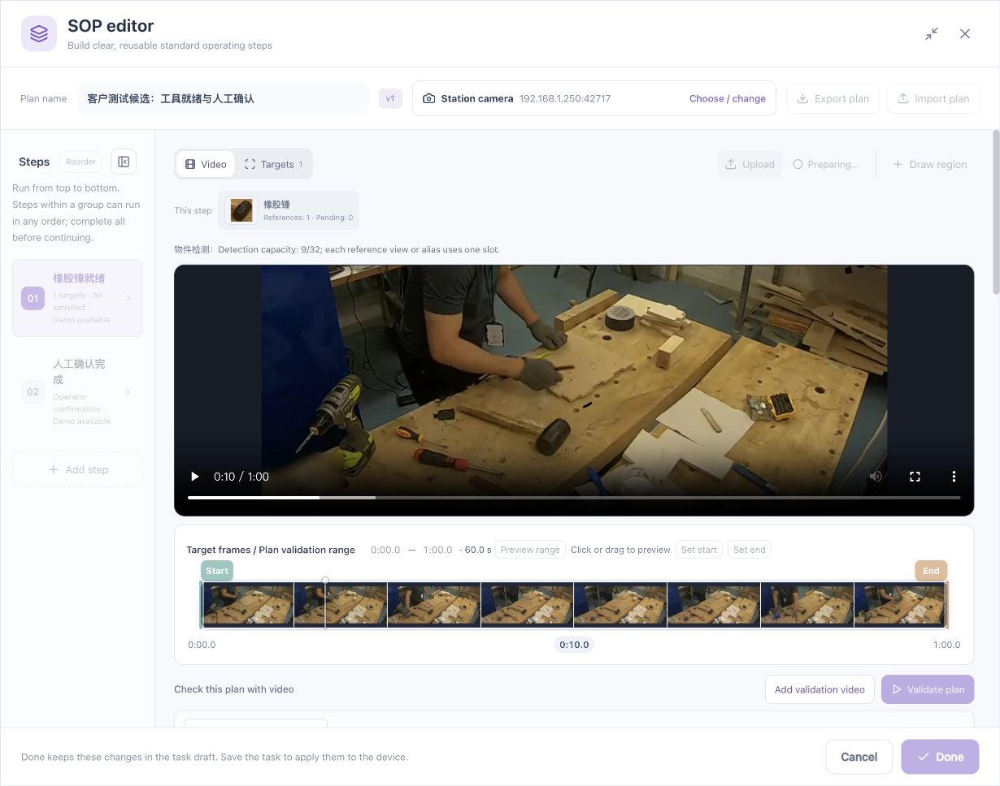
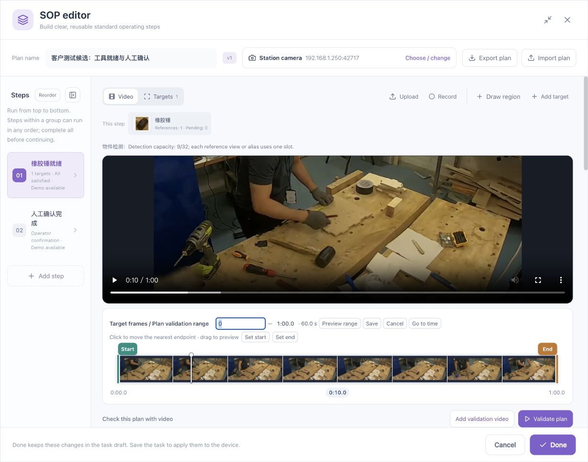

# Video, Targets, and Recognition

[简体中文](../../zh/sop/video-and-recognition.md) · [Guide home](index.md)

Establish reliable object recognition before using it to judge a process. A reference, a manual annotation, a single-image trial, adoption, and a video recheck are separate actions.

## 1. Check the teaching recording

Use a fixed camera, stable lighting, and clearly visible objects. Start with one object in a short recording before adding hands and multiple requirements.

1. Confirm that the camera belongs to the intended station.
2. Play the beginning, middle, and end. Check for a black picture, frozen frames, incorrect orientation, and missing footage.
3. Wait for timeline thumbnails and check that seeking updates the main picture.
4. Locate examples where the object is clearly present and clearly absent.
5. Distinguish normal views from severe occlusion, blur, or glare.

*A visible reference image does not establish that the video timeline has finished loading.*

Recording the complete process again replaces demonstration material and resets relevant ranges. Read the replacement prompt. Use playback or seeking when you only want to inspect an existing picture.

## 2. Understand the three ranges

| Range | Purpose | What to check |
|---|---|---|
| Target frames / Plan validation range | Sample the recording for recognition and validate the plan over the selection | Endpoints in the upper timeline |
| Stage validation range | Validate the selected stage separately | The timeline below that stage |
| Demonstration | Show the operator the action for that step | Actual start and stop positions in Play demonstration |

### Adjusting a range

- Drag either endpoint, release it, and check the displayed time.
- Click a displayed time and enter seconds or minutes:seconds. Save and locate the frame if needed.
- Use **Set start** or **Set end** to use the current preview position. If disabled, first locate a valid video frame.
- Use **Preview range** to play the selection.
- Use **Restore full recording** to restore the overall selection.

Seeking does not mean every stage range changes. Each stage has its own range, and stages may overlap. See [Rules and regions](rules-and-regions.md) for the relationship with the overall selection.

After changing the overall range, follow the prompt to scan again. Existing pictures may belong to the previous selection. Check the result's times, range, and target.

## 3. Create one logical target

1. Pause a clear frame in **Video**.
2. Click **Add target**.
3. Draw around the visible object, avoiding large amounts of tabletop, a hand, or a neighboring tool.
4. Give it a recognizable name such as “Rubber mallet.”
5. Confirm, then inspect the reference in **Targets**.

### References are not physical quantity

| Intended meaning | Configuration |
|---|---|
| One mallet in different orientations | Additional angles under one target |
| Two mallets must be present | Actual quantity requirement, verified against two instances |
| Similar tools with different roles | Distinguishable targets and representative references |
| Two boxes on one object | Investigate duplicate detection; do not count two objects |

Angles and aliases can consume detection capacity. Follow the displayed capacity, and keep useful representative references rather than many nearly identical images.

A good reference keeps the object clear and dominant, covers realistic orientation and scale, and does not merge adjacent objects or hide their distinguishing features. Check similar tools for false detections.

## 4. Improve recognition

1. Select the target.
2. Set the overall scan range and sampling interval.
3. Click **Improve recognition** and wait for an explicit finished state.
4. Review frames in time order and compare the boxes with the actual objects.
5. Address misses, false detections, and duplicates in normal clear views first.
6. Then inspect rotation, occlusion, edge positions, and scale changes.

A smaller sampling interval creates more pictures and requires more processing and review. Review a representative segment first, then the complete recording. A successful segment does not establish that the whole video is reliable.

## 5. Complete the manual-box workflow

### Confirm the object in the original image

Judge the original image rather than relying solely on a low-score candidate. If it is too unclear to identify, record an unclear view instead of drawing an unsupported box.

### Draw and save the annotation

Use the corresponding present-object annotation entry and draw a separate box for each missed instance. Keep the box close to the visible object.

If the start point lies inside an existing box, check that the editor is in new-box mode rather than selecting, moving, or resizing the existing box. Check the cursor and instruction. If drawing still fails, keep the existing annotation and follow [Troubleshooting](troubleshooting.md).

### Detect the current image again

Annotations on that frame can serve as temporary references for the trial. Verify that the algorithm detects the annotated location. The manual purple box is not itself a successful algorithm detection.

Check the number of annotations, detections, and matched annotations. For unmatched boxes, inspect position, size, candidate score, and filtering requirements.

**“One algorithm detection” is different from “one of one manual boxes matched.”** The detection may be elsewhere in the image.

### Adopt the annotation

A saved-but-not-adopted annotation is not yet part of the plan's reference library. Use the adoption control, then check pending references, reference count, and capacity.

Do not draw the same box repeatedly because the capacity did not change. Check adoption state, duplicate-reference handling, and the actual result of the operation.

### Recheck the video

Scan the selected range again after adoption. Inspect neighboring frames and an independently recorded video. A successful single-image trial does not establish stable video recognition or that a running task uses the saved update.

## 6. Interpret scores and thresholds

A candidate score is a recognition clue, not the accuracy of the SOP. Check each reference and its own threshold. Do not apply one reference's maximum score indiscriminately to another.

Before adjusting a threshold, check:

1. Whether the candidate actually depicts the correct object.
2. False detections on similar objects.
3. Any stricter score, quantity, or region requirement in the step.
4. Other steps using the target.
5. Positive and negative examples after the change.

Do not keep lowering thresholds until every frame is green. Background, hands, and nearby tools may start matching. Persistent misses in clear views call for better references, capture conditions, or a recognition capability review.

## 7. Recognition review cases

| Case | Expected observation |
|---|---|
| Object clearly present | Correct location and physical quantity |
| Object completely removed | No continued detection on background or similar tools |
| Several references for one target | No duplicate counting of the same instance |
| Two physical objects | Neither merging them nor missing one |
| Hand passing the tool | No match based only on a hand or sleeve |
| Brief ordinary occlusion | Behavior consistent with configured timing |
| Moved camera or changed lighting | Recheck references and regions |

Continue with [Rules, regions, and timing](rules-and-regions.md), or the dedicated [Hand operations](hand-operations.md) chapter.
