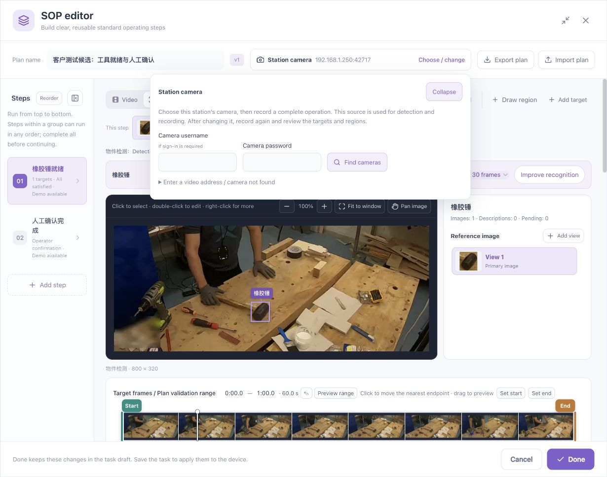
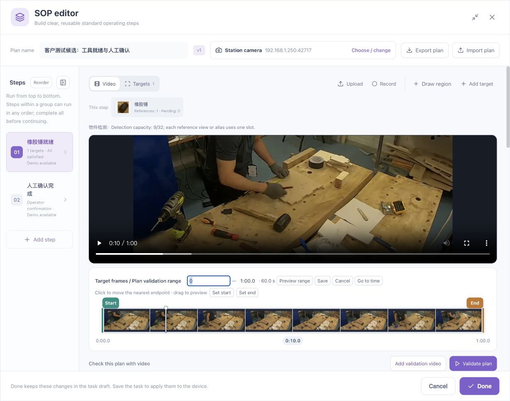
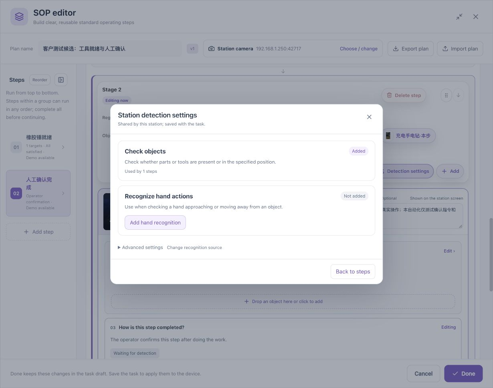
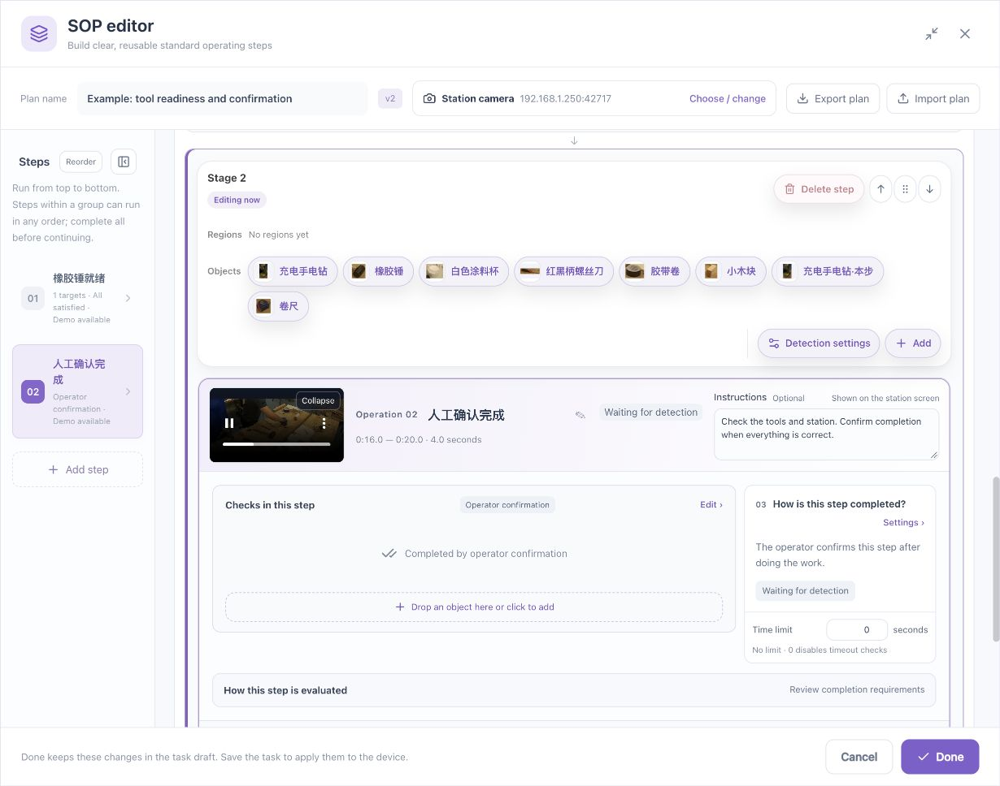

# Editor Workspace and Control Reference

[简体中文](../../zh/sop/workspace-reference.md) · [Manual home](index.md)

This chapter explains where an action is performed, what it affects, and where to verify its result. Video, targets, steps, and validation form one connected workspace.

## 1. Workspace overview

| Area | Contents | Verify after use |
|---|---|---|
| Title bar | Maximize, restore, close | Whether unsaved changes remain |
| Plan bar | Plan name, version, camera, import/export | Correct task and station |
| Step list | Numbers, names, summaries, ordering | Which step is selected |
| Video / Targets switch | Teaching footage or target information | Correct mode for the action |
| Video workspace | Playback, seeking, region and target drawing | Time, orientation, and real picture |
| Target workspace | Reference views, pending adoption, capacity | Logical target and selected reference |
| Overall timeline | Target scan and plan-validation range | Selected endpoints |
| Stage toolbar | Objects, regions, hands, additions | Destination stage for an addition |
| Operation card | Name, demo, instructions, status | What the operator will see |
| Check and completion cards | Conditions, regions, combinations, timing | Actual process meaning |
| Stage timeline | Stage-specific validation/demo range | Other stages were not accidentally changed |
| Footer | Messages, Cancel, Done | Task still needs saving afterward |

## 2. Plan name, version, and camera

### 2.1 Name

Edit the plan-name field. Use a recognizable station or product plus the purpose, such as “Assembly A: Tool preparation.” Do not use a version number as the only identity. Check the actual version displayed by the system.

Names are business data. Changing the interface language does not translate them automatically.

### 2.2 Camera selection

1. Click **Choose / change**.
2. Choose the current station's camera.
3. Supply that camera's credentials when required.
4. Verify the source in the plan bar.
5. Check footage, references, regions, and handedness against the new view.

Device Web credentials and camera credentials may differ. If connection fails, resolve source and network details before repeatedly changing the same source inside several steps.

## 3. Step list

| Action | Method | Meaning |
|---|---|---|
| Select a step | Click its number or card | Locate that step in the workspace |
| Collapse | Use the list's collapse control | Provide more editing space while keeping numbered navigation |
| Expand | Use the collapsed list's expand control | Restore names and summaries |
| Add | Add step or plus control | Create a work unit, then configure its name and rules |
| Reorder | Reorder, move buttons, or drag handle | Change stage or grouped-step placement |
| Undo | Explicit available undo control | Revert a supported recent change and inspect it |

Numbers identify positions; names express actions. Moving a card does not by itself edit a condition's internal event sequence.

## 4. Video and Targets modes

### 4.1 Video

Play teaching footage, choose reference times, draw shared regions, and add targets. Seek to a clear picture before drawing.

### 4.2 Targets

Inspect references and improve recognition. Check the selected name, reference count, and pending-adoption count first.

Seeing an object in the recording does not establish a configured target. Creating a target does not add it to every step.

### 4.3 Reference views

After selecting a reference card, compare it with the main picture. An additional view represents another appearance of the same logical object; it does not mean two physical objects must coexist.

Pending adoption identifies improvements not yet admitted as plan references. Follow [Recognition improvement](video-and-recognition.md) through trial, adoption, and video recheck.

## 5. Scrolling, zooming, panning, and drawing

| Purpose | Control | What it does not change automatically |
|---|---|---|
| Browse the editor | Normal wheel/page scrolling | Does not edit boxes or rules |
| Examine detail | Plus/minus or the displayed modifier key | Does not improve source-image resolution |
| Fit the view | Fit window | Does not alter original target coordinates |
| Inspect another part of a zoomed view | Pan image | Does not move the real object |
| Add a target box | Add target or manual-box mode | Should not move an old box |
| Adjust an existing box | Select it and use explicit edit mode | Is not a new target |

Check the current mode before drawing, especially when the starting point is inside an existing box.

In narrow windows, maximize the editor, collapse the step list, or close unneeded settings. Do not rely on making all browser text extremely small.

## 6. The three timeline controls

1. **Playhead:** current viewing position.
2. **Start handle:** beginning of the selected range.
3. **End handle:** end of the selected range.

### 6.1 Preview a time

Drag the playhead or follow the displayed seek instructions. Verify the main picture and current time, rather than only the thumbnail strip. Avoid grabbing an endpoint by mistake.

### 6.2 Change a range

1. Identify whether this is the overall or a stage-specific timeline.
2. Drag its endpoint, or click the displayed start/end time.
3. Check both endpoints and the duration.
4. Use **Preview range** to verify actual playback boundaries.
5. Rescan for target review or revalidate the relevant stage as appropriate.

**Click to move the nearest endpoint** means clicking may edit the range. For viewing only, prefer drag-to-preview and explicit playback controls.

### 6.3 Set start and Set end

Seek to the intended picture first, then use the appropriate control. When disabled, establish a valid loaded video position first. A disabled control is not evidence of a successful edit.

### 6.4 Independent stage ranges

Each stage retains its own range, which may overlap another stage's range. **Validation range** and **Operation demo** have different purposes. Check the displayed values after switching purposes.

## 7. Stage toolbar

### 7.1 Scope

The toolbar lists available objects, regions, and hands. Selecting one does not always immediately change a rule: an operation setup may still require **Add to this stage**.

### 7.2 Selection order

- Hand/object operation: select the hand, then the object.
- Object readiness or position: select the object, then the offered operation type.
- Region assignment: drop the region into its compatible slot or click the slot.
- Existing requirement: select its diagram object or relationship control.

### 7.3 Shared settings versus step rules

**Detection settings** manages station-wide capability and handedness. A step's checks and completion controls define its business requirements. Adding a hand source does not make every step a hand operation.

See [Toolbar and drag operations](toolbar-and-drag.md) for addition, replacement, removal, and undo.

## 8. Operation card

### 8.1 Name

Use actionable names such as “Prepare tools,” “Review parts,” or “Confirm completion.” The adjacent name-edit control does not configure visual rules.

### 8.2 Demonstration

Click the video thumbnail's playback entry. Compare its time label with actual playback boundaries. The demo teaches the operator; its thumbnail is not a recognition reference.

### 8.3 Operator instructions

Enter material, position, action, and quality-review instructions directly. Prefer short practical sentences: “Place the cup in the parts area. Check that it is undamaged before confirming.”

Do not put development logs or threshold experiments in operator instructions. When the interface states that instructions appear on the station screen, review them as the operator will read them.

### 8.4 Status

Waiting, not validated, and review-required indicators describe state; they are not editable fields. Inspect the relevant reason rather than renaming the step to hide a state.

## 9. Relationship diagram and settings

1. Open **Checks in this step → Edit**.
2. Select the relevant relationship or object.
3. Check its subject, condition type, region, and parameters.
4. Read the resulting requirements back from the diagram.
5. Verify combinations and any internal sequence.
6. Configure completion and hold duration.

The small region label under a diagram object is operational information. It is not equivalent to merely having a region card in the toolbar.

## 10. Done, Cancel, Close, and Save

| Action | Effect | Next action |
|---|---|---|
| Done | Returns SOP edits to the task draft | Confirm the node if still open, then save the task |
| Cancel | Exits the current edit; follow any change prompt | Decide whether to discard current edits |
| Close | Closes the current window | Check unsaved work first |
| Node confirmation | Returns configuration to the outer task editor | Save the task |
| Task Save | Persists the task | Wait for acknowledgement, then reopen |
| Task Run | Runs the saved task | Open station operation and check the active step |

An editor draft, a saved task, and a running task are different states. Closing a window alone does not prove deployment.

## 11. Change-impact reference

| Change | Recheck at least |
|---|---|
| Camera or image orientation | References, regions, handedness, affected steps |
| Reference or detection threshold | Every use of that target, normal and negative cases |
| Shared region | Every referencing step |
| Handedness | Every left/right-specific operation |
| Step condition, timing, completion | That step and dependent workflow |
| Stage grouping or order | Complete workflow |
| Video range | Corresponding scan/validation and demonstration boundaries |
| Instructions only | Station-screen readability and demonstration consistency |

**Continue: [Parameters and states](parameters.md) · [Complete scenario labs](scenario-labs.md).**

*Footage attribution: [Sample and screenshot credits](reference.md#7-sample-and-screenshot-credits).*
