# 工具、按钮与所在位置逐项说明

[English](../../en/sop/control-reference.md) · [手册首页](index.md)

本章适合在操作时查找某个按钮。每组先给出实机截图，再按所在位置说明功能、使用条件、结果和后续核对。点击图片可放大。按钮会随当前模式、选择对象、设备能力及忙碌状态显示或禁用；没有显示某个按钮，不代表应重新创建任务。

## 1. 查找按钮的方法

先确认您处于哪一层窗口：

| 当前窗口 | 识别方法 | 这一层的确认动作 |
|---|---|---|
| 任务列表 | 能看到设备任务卡片 | 选择任务或创建任务 |
| 外层任务编辑器 | 能看到视频、算法、SOP 等节点组成的流程图 | 保存任务；运行是另一个动作 |
| SOP 节点设置 | 有工位名称和“编辑工序” | 确认节点设置 |
| 工序编辑器 | 有方案名称、左侧步骤、教学视频和规则 | 完成编排并返回草稿 |
| 子窗口/动作面板 | 如摄像头、检测设置、目标选择或手部操作 | 确认本次选择或添加操作 |

**查找不到：** 先关闭最上层子窗口，核对所在层级；不要点到外层“运行”来尝试打开工序设置。

## 2. 新建任务窗口

[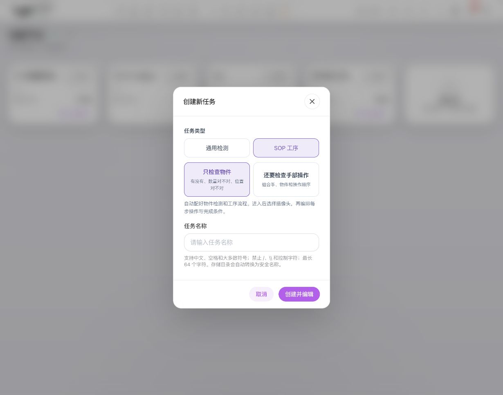{style="position:absolute;max-width:none;width:294.117647%;left:-97.058824%;top:-35.593220%;"}](../../assets/sop/zh-02-create-task.jpg)

1
2
3
4

图 C1 · 新建 SOP 任务：先选类型，再命名并创建。数字是本手册的定位标注，不是网页按钮。点击图片可打开无标注原图；功能说明见下表。

| 图中编号 | 对应位置与功能组 |
|---|---|
| **1** | SOP 工序：任务类型区右侧 |
| **2** | 物件/手部：类型下方两张选择卡片 |
| **3** | 任务名称：窗口下半部输入框 |
| **4** | 创建并编辑/取消：窗口右下角 |

位置说明：窗口上部为任务类型；中部是物件/手部选择；下部是任务名称；右下角是创建，左侧是取消。

| 控件 | 功能与操作 | 结果与核对 |
|---|---|---|
| 通用检测 | 创建普通分析流程 | 不是本手册的 SOP 编排入口 |
| SOP 工序 | 创建包含工序工作流的任务 | 继续选择本流程是否需要手部 |
| 只检查物件 | 以物件、数量、位置等为起步能力 | 不会自动要求每步识别手 |
| 还要检查手部操作 | 为手与物件配合准备相应来源 | 后续仍要配置具体手部条件 |
| 任务名称输入框 | 输入易区分的现场名称 | 空名称或非法内容应按页面提示改正 |
| 创建并编辑 | 创建后进入任务编辑 | 不表示任务已运行或已验证 |
| 取消 / 右上角关闭 | 退出创建 | 没有创建完成时，不应认为任务已保存 |

## 3. 方案栏与窗口控件

1
2
3
4
5
6

图 C2 · 编辑器总览：方案、导航、目标、参考与完成入口。数字是本手册的定位标注，不是网页按钮。点击图片可打开无标注原图；功能说明见下表。

| 图中编号 | 对应位置与功能组 |
|---|---|
| **1** | 方案栏：摄像头、导出和导入；窗口控制在其上方右侧 |
| **2** | 步骤栏：顶部的排序与收起/展开，下面为步骤列表 |
| **3** | 主区左上：视频/目标模式切换 |
| **4** | 画布右上：缩放、适应窗口、平移 |
| **5** | 主图右侧：参考列表与补充角度 |
| **6** | 编辑器右下：完成；它先返回任务草稿 |

| 位置/控件 | 作用 | 操作后的核对 |
|---|---|---|
| 最上方右侧：最大化/还原 | 在当前浏览器可用空间内扩大/恢复编辑器 | 页面内容和滚动位置，不改变业务规则 |
| 最上方右侧：关闭 | 退出工序编辑器 | 有修改时先处理草稿提示 |
| 方案名称输入框 | 修改方案名称 | 名称属于当前方案，语言切换不自动翻译 |
| 名称旁版本标记 | 显示版本信息 | 它不是可随意改写的业务名称 |
| 摄像头栏“选择 / 更换” | 打开工位来源选择 | 来源地址、认证和实际画面 |
| 导出方案 | 导出当前可导出的方案内容 | 保存下载文件并核对名称；别假定所有视频都已独立备份 |
| 导入方案 | 从方案文件载入配置 | 先读替换/兼容提示，检查目标、来源、区域及规则，再验证保存 |
| 左侧顶部：收起/展开 | 改变步骤栏占用空间 | 编号导航仍可用于选择工序 |
| 左侧：添加工序/加号 | 增加新的工作单元 | 随后补名称、说明、规则和完成方式 |

## 4. 摄像头选择窗口

[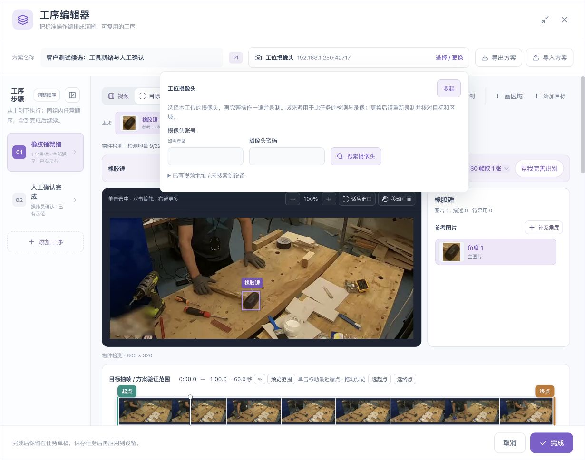{style="position:absolute;max-width:none;width:178.571429%;left:-46.428571%;top:-53.571429%;"}](../../assets/sop/zh-05-camera.jpg)

1
2
3
4

图 C3 · 摄像头入口：认证、搜索、已有地址。数字是本手册的定位标注，不是网页按钮。点击图片可打开无标注原图；功能说明见下表。

| 图中编号 | 对应位置与功能组 |
|---|---|
| **1** | 摄像头账号与密码：浮层中部，两者均未填写 |
| **2** | 搜索摄像头：密码框右侧 |
| **3** | 已有视频地址/未搜索到设备：表单下方折叠入口 |
| **4** | 收起：浮层右上，返回主编辑区 |

| 控件 | 位置与使用方法 | 注意事项 |
|---|---|---|
| 视频来源选择 | 窗口内存在多个输入时，在上方选择 | 选对当前工位，不是随意选一条可连接地址 |
| 用户名 | 搜索表单内 | 摄像头账号可能与盒子网页账号不同 |
| 密码 | 用户名旁或下方 | 按摄像头认证要求填写，不写进操作要点 |
| 搜索 | 认证字段之后 | 等待结果；搜索中不重复点击 |
| 搜索结果“使用” | 每条发现的摄像头结果旁 | 返回后核对工位摄像头栏 |
| 已有视频地址入口 | 搜索区域下方折叠项 | 发现不到时由管理员核对已有地址与网络 |
| 使用此地址 | 有效地址输入框之后 | 地址无效时不可用；不能靠重复点击修复格式 |

## 5. 视频与录制工具

[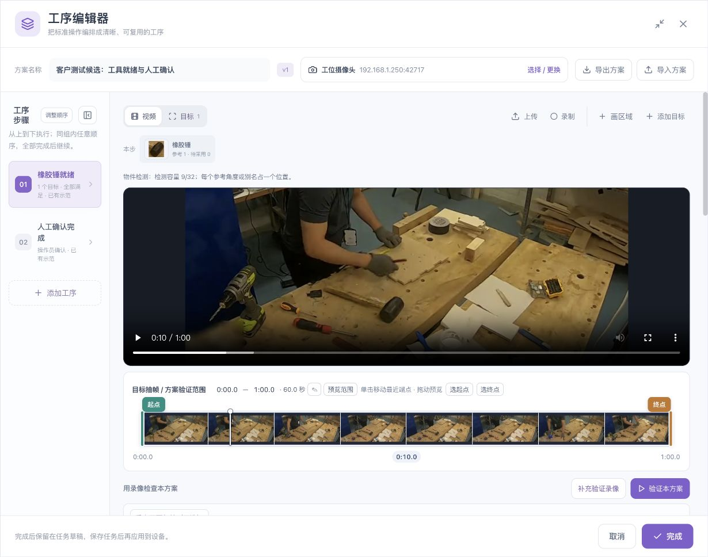](../../assets/sop/zh-06-teaching-video.jpg)

1
2
3
4
5

图 C4 · 教学视频：素材工具、播放器和总选段。数字是本手册的定位标注，不是网页按钮。点击图片可打开无标注原图；功能说明见下表。

| 图中编号 | 对应位置与功能组 |
|---|---|
| **1** | 主区上方右侧：上传、录制、画区域、添加目标 |
| **2** | 播放器左下：播放/暂停；右下为音量和全屏 |
| **3** | 播放器底部：视频播放进度条 |
| **4** | 播放器下方：总范围，供目标抽帧和方案验证 |
| **5** | 总范围下方右侧：补充验证录像、验证本方案 |

| 控件 | 所在位置 | 功能、前提与结果 |
|---|---|---|
| 视频 | 主工作区左上模式切换 | 回到教学视频，进行播放、定位和绘制 |
| 目标 | 与“视频”并排 | 查看当前步骤目标及参考；无目标/画面或忙碌时可能不可用 |
| 上传 | 主工作区上方工具区 | 选择完整流程视频；等待处理和缩略图加载 |
| 录制 | 上传入口旁 | 从所选工位来源准备录制；先选摄像头 |
| 播放/暂停 | 视频底部控制条 | 只控制回看，不配置完成规则 |
| 视频进度条 | 播放器底部 | 定位教学视频，不等同于修改阶段范围 |
| 音量 | 视频控制条 | 仅影响播放声音；本手册的视觉条件不能由声音证明 |
| 全屏 | 视频控制条右侧 | 放大查看视频；不是工序编辑器最大化 |
| 视频更多菜单 | 视频控制条右侧 | 由浏览器提供的播放功能，显示项以浏览器为准 |

### 5.1 录制状态下的按钮

[{style="position:absolute;max-width:none;width:263.157895%;left:-81.578947%;top:-137.037037%;"}](../../assets/sop/zh-07-record-warning.jpg)

1
2
3

图 C5 · 重新录制：先阅读替换范围，再选择取消或开始。数字是本手册的定位标注，不是网页按钮。点击图片可打开无标注原图；功能说明见下表。

| 图中编号 | 对应位置与功能组 |
|---|---|
| **1** | 窗口正文：替换对象、起止时间重置及保留内容 |
| **2** | 取消：保留当前编辑并返回 |
| **3** | 开始录制：明确需要替换素材时才执行 |

| 控件 | 什么时候使用 | 影响 |
|---|---|---|
| 开始录制/继续录制 | 来源已准备且用户确实要录制时 | 开始采集新教学素材 |
| 停止并使用 | 录制过程中、完整动作已拍到时 | 停止并等待可用素材结果 |
| 取消录制 | 放弃本次录制时 | 按结果提示核对原草稿和素材 |
| 离开等待/状态待核对入口 | 请求结果暂无法确定时 | 先核对原操作状态，不应立即新开重复录制 |
| 替换确认中的取消 | 不希望覆盖已有示范素材时 | 返回当前编辑，不开始录制 |
| 替换确认中的开始 | 已核对替换范围后 | 可能替换整套示范及独立分步素材，并重置有关起终点；原目标、区域、规则按提示保留 |

只想回看旧录像时用播放，不点录制。

## 6. 画布工具与右键菜单

[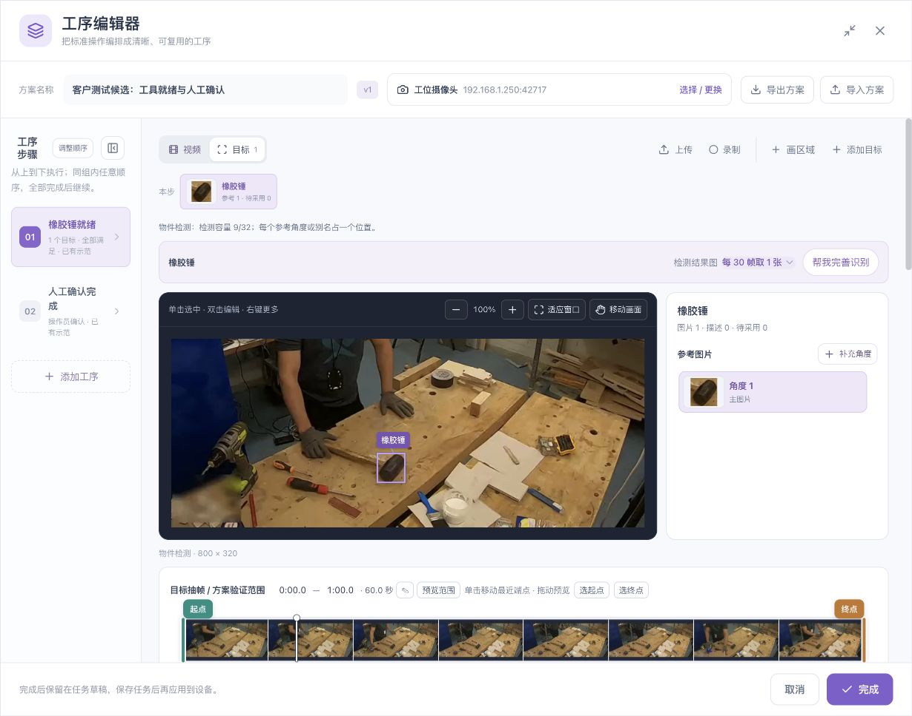](../../assets/sop/zh-10-target-reference.jpg)

1
2
3

图 C6 · 画布：查看工具和目标框。数字是本手册的定位标注，不是网页按钮。点击图片可打开无标注原图；功能说明见下表。

| 图中编号 | 对应位置与功能组 |
|---|---|
| **1** | 画布顶部右侧：减号、比例、加号、适应窗口、移动画面 |
| **2** | 画面内目标框：单击选择、双击编辑、右键更多 |
| **3** | 画布顶部左侧：当前交互提示 |

| 控件 | 位置 | 用途与核对 |
|---|---|---|
| 减号 | 画布上方工具条 | 缩小显示；到显示下限后不可再缩 |
| 百分比 | 减号和加号之间 | 当前查看比例，不是检测分数 |
| 加号 | 比例右侧 | 放大显示；不改变源视频像素 |
| 适应窗口 | 加号右侧 | 恢复适合当前窗口的查看比例 |
| 移动画面 | 画布工具条右侧 | 开启/关闭平移；画框前检查是否仍在此模式 |
| 单击目标框 | 画面内已有框 | 选择对应目标 |
| 双击目标框 | 画面内已有框 | 打开对应编辑状态，以页面提示为准 |
| 右键目标框 | 画面内已有框 | 打开编辑/移除菜单；先核对所指目标 |
| 重新绘制 | 多边形编辑工具条 | 清除当前绘制草图并重新画，不等于删除整个方案 |
| 闭合区域 | 顶点满足绘制要求后 | 结束多边形轮廓，随后命名和确认 |
| 区域顶点/手柄 | 区域轮廓上 | 调整相应点，完成后核对区域形状 |

“移除框”“删除区域”“删除工序”是不同对象的操作。使用菜单前读清对象名称和范围。

## 7. 新建目标与参考角度

1
2
3
4
5

图 C7 · 目标资料：参考列表、补充角度和完善识别。数字是本手册的定位标注，不是网页按钮。点击图片可打开无标注原图；功能说明见下表。

| 图中编号 | 对应位置与功能组 |
|---|---|
| **1** | 当前目标卡片：检查名称、参考数和待采用数 |
| **2** | 右侧标题：当前目标与图片/待采用数量 |
| **3** | 补充角度：参考图片标题右侧 |
| **4** | 角度卡片：选中后在主图核对该参考 |
| **5** | 帮我完善识别：目标标题条右端 |

| 控件 | 所在位置 | 操作与预期 |
|---|---|---|
| 添加目标 | 视频/目标工作区上方 | 定位清楚画面后框选，输入名称；必要时选择检测来源 |
| 使用当前画面 | 从录像选参考的确认区 | 采用当前暂停画面作为绘制依据；核对时间 |
| 目标名称 | 目标绘制表单 | 表达逻辑物件，不是某个参考角度 |
| 检测来源选择 | 有多个来源的新建目标表单 | 明确由哪个来源识别该目标 |
| 加入本步 | 新目标表单确认区 | 把新目标用于本步，随后检查数量/区域/完成要求 |
| 取消绘制 | 绘制表单确认区 | 退出当前未提交的画框 |
| 补充角度 | 右侧参考图片标题旁 | 给同一目标补参考；不会自动增加实物数量 |
| 保存补充参考 | 补参考表单确认区 | 保存新的参考角度到当前目标 |
| 应用修改 | 已有目标编辑表单 | 应用所编辑的框/名称等内容，核对影响步骤 |
| 仅本步 / 所有使用步骤 | 共享目标修改范围选择 | 先读受影响名称，再选范围 |
| 角度卡片 | 右侧参考列表 | 选择该角度并在主画面核对 |
| 删除补充参考入口 | 选中的非主参考可用时 | 移除该角度；不要误删业务目标 |
| 重新读取图片 | 图片读取失败的主画面提示区 | 重试读取原图，不是重新运行识别 |
| 待采用预览 | 补框资料区 | 查看尚未进入参考库的内容 |
| 重试补框预览 | 预览读取失败时 | 重试取图，不应重复补同一框 |
| 采用并复验 | 待采用资料可用时 | 显式采用改进并复验；之后仍需验证阶段/方案和保存任务 |

## 8. 时间轴控件

[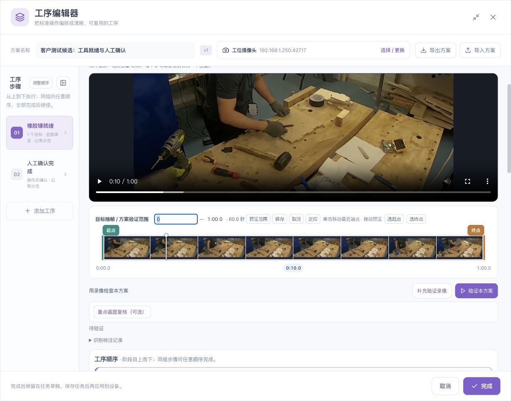](../../assets/sop/zh-08-plan-range.jpg)

1
2
3
4
5
6

图 C8 · 时间轴：精确时间、预览、起点、终点与播放头。数字是本手册的定位标注，不是网页按钮。点击图片可打开无标注原图；功能说明见下表。

| 图中编号 | 对应位置与功能组 |
|---|---|
| **1** | 起点/终点文字：此图正在编辑起点，单位与格式见正文 |
| **2** | 时间编辑后面的预览、保存、取消、定位 |
| **3** | 选起点/选终点：把有效预览位置设为相应端点 |
| **4** | 绿色起点手柄：决定片段开始 |
| **5** | 橙色终点手柄：决定片段结束 |
| **6** | 白色播放头：当前回看时间，不是范围边界 |

| 控件 | 怎么用 | 怎么确认没有改错 |
|---|---|---|
| 起点时间 | 点击时间值，输入秒或分:秒 | 起点小于终点，处于录像内 |
| 终点时间 | 点击时间值编辑 | 时长与期望片段一致 |
| 铅笔/编辑起止时间 | 时间文字旁 | 打开对应范围编辑，不是改所有阶段 |
| 起点手柄 | 时间轴左端或选段开始处拖动 | 主画面与起点文字一致 |
| 终点手柄 | 选段结束处拖动 | 主画面与终点文字一致 |
| 播放头 | 拖动到要查看的位置 | 当前时间更新，避免误动端点 |
| 选起点 | 将当前有效预览位置设为开始 | 检查新的起点和范围 |
| 选终点 | 将当前有效预览位置设为结束 | 检查新的终点和范围 |
| 预览范围 | 播放当前区间 | 实际从所选起点开始，到终点停止 |
| 恢复完整录像 | 总范围区域右侧 | 总范围恢复整段，不应误以为所有工序内容被删除 |
| 验证范围 | 阶段时间轴上方 | 编辑该阶段验证段，并按提示同步示范 |
| 操作示范 | 与阶段验证范围并排 | 可配置独立供操作员回看的教学片段 |

**总时间轴与阶段时间轴：** 同名控件只影响所在的范围。改完一条轴后，核对它上方的标题和对应阶段。

## 9. 扫描控制按钮

“帮我完善识别”可能读取已有扫描，也可能按当前范围开始新的检查。操作前确认目标和选段；扫描忙碌时等待明确状态，不要连续启动。

| 控件 | 功能 | 结果与注意事项 |
|---|---|---|
| 每多少帧取一张 | 选择检测结果图采样间隔 | 间隔更小意味着更多结果图，不等于视频帧率变化 |
| 帮我完善识别 | 进入当前目标的抽帧/复核工作区 | 核对实际范围、目标与进度 |
| 扫描所选片段 | 用当前有效选段开始扫描 | 所有结果时间应对应该范围 |
| 扫描整段录像 | 未限制片段时检查整片 | 与只检查一个阶段不同 |
| 刷新扫描画面 | 读取当前扫描的最新结果 | 不应据此推断已重新推理全部录像 |
| 补齐结果图 | 已生成数多于页面读取数时取回余图 | 等待读取，检查缺图是否补齐 |
| 继续扫描 | 原启动状态需要恢复读取时 | 核对原扫描，不要另开重复请求 |
| 停止扫描 | 请求结束正在执行的扫描 | 等待停止结果和资源释放；已生成图仍可保留 |
| 重试停止 | 原停止结果待核对时 | 针对原操作，不是开始新扫描 |
| 结束上次扫描 | 旧扫描被中断、资源待恢复时 | 先安全结束，再按提示重扫 |
| 关闭本次扫描 | 已完成并满足关闭条件时 | 关闭本轮工作区；不等于删除历史 |
| 收起/返回目标图片 | 暂时回到目标资料 | 不把收起当停止或采用 |
| 分析漏检原因 | 已有可分析的扫描和人工核对时 | 分析证据与筛选原因；不是自动保证修好识别 |

## 10. 逐帧人工核对按钮

本组按钮在“帮我完善识别”的当前图片侧栏。先看原图，再记录人工判断。

| 控件 | 何时点 | 实际含义 |
|---|---|---|
| 时间缩略图 | 要查看某张扫描图片 | 选择时间点；核对当前目标 |
| 下一张待处理 | 想继续复核未处理图片 | 跳到下一待处理项，不代表自动判断 |
| 有目标补框 | 原图中确实有当前目标 | 进入补框；多个实例分别画 |
| 再画一个目标 | 本帧还有一个实例未框 | 新增框，不调整旧框 |
| 调整补框 N | 某个人工框位置不准 | 进入该框编辑状态 |
| 删除补框 | 该人工框错误或重复 | 删除这一个框；不删除整段录像 |
| 画面清楚，已全部框齐 | 已检查完整画面且同类目标均框出 | 表明整帧人工核对完整，不是算法自动全检出 |
| 画面清楚，确实没有 | 能明确排除当前目标 | 记录可信负例；遮挡/模糊不能这样标 |
| 看不清 | 无法可靠判断有无目标 | 记录不确定，不计为明确正例或负例 |
| 撤销核对 | 要撤销本帧人工判断 | 回到未确认状态，再重新检查 |
| 确认删除补框并标记 | 已有补框却改为另一互斥判断时 | 会移除冲突框，先核对 |
| 保留补框 | 不想执行上述删除 | 保留已有框并取消冲突操作 |
| 重试保存 | 人工核对保存失败时 | 保留本页补框并再次保存；不要先关页 |
| 读取最新状态 | 同一帧被另一窗口修改时 | 先核对最新内容，再决定如何保存 |

### 10.1 试检与候选按钮

| 控件 | 作用 | 必须核对 |
|---|---|---|
| 重新检测当前图片 | 用本帧临时参考和试检条件检查当前帧 | 算法框是否命中人工框；不能只看总框数 |
| 试检详情 | 展开试检条件与结果 | 与“上次扫描”分开阅读 |
| 试检阈值 | 影响当前试检的筛选 | 不等于已修改所有参考和所有工序 |
| 上次扫描的结果与门槛 | 展开之前扫描依据 | 不要与刚试检的分数混用 |
| 在图中查看候选线索 | 显示可定位的候选 | 候选只是线索，不算正式检出 |
| 隐藏候选线索 | 收起额外叠加 | 不删除候选或人工标注 |
| 查看对应候选 | 高亮某个补框对应的候选 | 核对是否为同一实物 |
| 查看并修改此参考门槛 | 打开当前参考的阈值修改 | 只改对应参考，确认后重验正反例 |
| 查看各查询的低分候选 | 查看来源明细 | 不把不同参考分数相加成准确率 |

## 11. 独立录像与建议按钮

| 控件 | 使用条件 | 作用与后续 |
|---|---|---|
| 加入独立复验录像 | 当前录像已进行完整人工核对时 | 选择另一次真实拍摄录像 |
| 更换复验录像 | 已选独立录像且需要替换时 | 核对不是同一片段的改名副本 |
| 检查这段复验录像 | 原扫描已安全结束，独立素材可用 | 运行该独立录像的识别检查 |
| 当前录像 / 独立复验录像 | 两侧结果可查看时 | 切换证据，不改变原录像身份 |
| 我确认这是另一段独立拍摄的录像 | 已人工核对来源 | 对独立性作明确确认；不能只为解锁按钮勾选 |
| 核对两段录像 | 两侧满足核对条件时 | 比较当前与独立录像的证据 |
| 确认应用建议 | 界面给出可采用建议且已阅读时 | 修改当前目标草稿；之后重验并保存 |
| 补充验证录像 | 方案验证区域 | 给本次方案验证提供另一素材，不是替换教学示范 |

未给出建议时，先读缺少哪类证据。不应把“没有建议”理解成“默认建议降低到某数值”。

## 12. 阶段工具栏与动作配置

[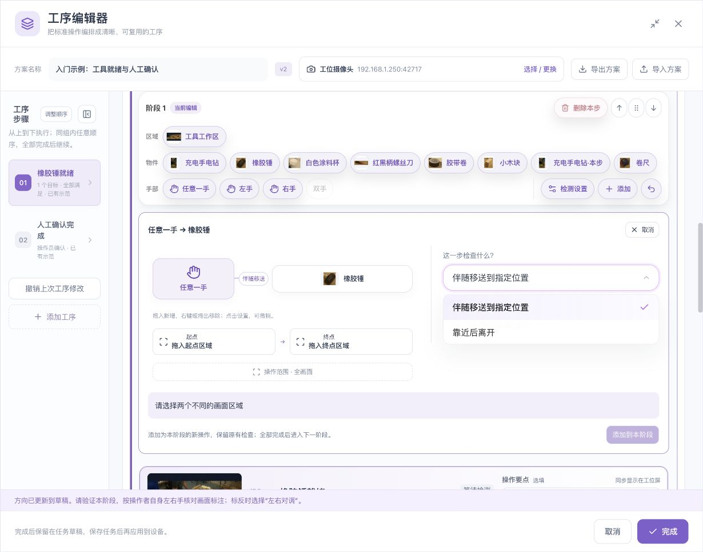{style="position:absolute;max-width:none;width:129.870130%;left:-24.675325%;top:-21.739130%;"}](../../assets/sop/zh-19-hand-actions.jpg)

1
2
3
4
5
6

图 C9 · 手部动作配置：选择端点、动作、区域并添加。数字是本手册的定位标注，不是网页按钮。点击图片可打开无标注原图；功能说明见下表。

| 图中编号 | 对应位置与功能组 |
|---|---|
| **1** | 工具栏物件行：选择对应物件 |
| **2** | 工具栏手部行：选择任意一手、左手或右手 |
| **3** | 右侧动作选择：伴随移送或靠近后离开 |
| **4** | 动作图下方：起始区与到达区槽位 |
| **5** | 更下方：操作范围；应覆盖整个过程 |
| **6** | 面板右下：添加到本阶段，条件不完整时不可用 |

| 控件 | 所在位置/作用 | 操作后核对 |
|---|---|---|
| 区域卡片 | 工具栏区域行，点击选择或拖动绑定 | 接收位置及最终区域文字 |
| 物件卡片 | 工具栏物件行，选择或拖入 | 是新增、替换还是动作配置 |
| 任意一手 | 工具栏手部行 | 不指定左右；下一步选相关物件 |
| 左手/右手 | 手部方向可用时 | 按操作者本人左右核对 |
| 双手 | 当前界面可能显示为不可用 | 不可用时不能作为已配置能力 |
| 检测设置 | 工具栏操作区 | 打开共用设置窗口 |
| 添加 | 工具栏操作区 | 为本阶段添加检查或进入选择；看当前所选对象 |
| 撤销图标 | 有可撤销修改时显示 | 撤回后核对关系图与步骤数量 |
| 这一步检查什么 | 动作配置中的选择项 | 选择就绪、位置、靠近后离开或支持的移送方式 |
| 操作范围 | 动作图及设置内 | 覆盖手与物件的整个过程 |
| 起始区/到达区 | 移送动作的槽位 | 两端是不同业务位置 |
| 操作手/操作物件 | 点动作图对应节点后 | 改变当前动作端点，核对名称 |
| 查看判断条件 | 动作配置下方折叠项 | 阅读将要生成的具体条件 |
| 添加到本阶段 | 动作配置底部 | 真正提交新操作，保留原有检查时核对新增项 |
| 动作配置的取消 | 动作面板顶部 | 取消未提交动作，不删除原操作 |

## 13. 检测设置窗口

[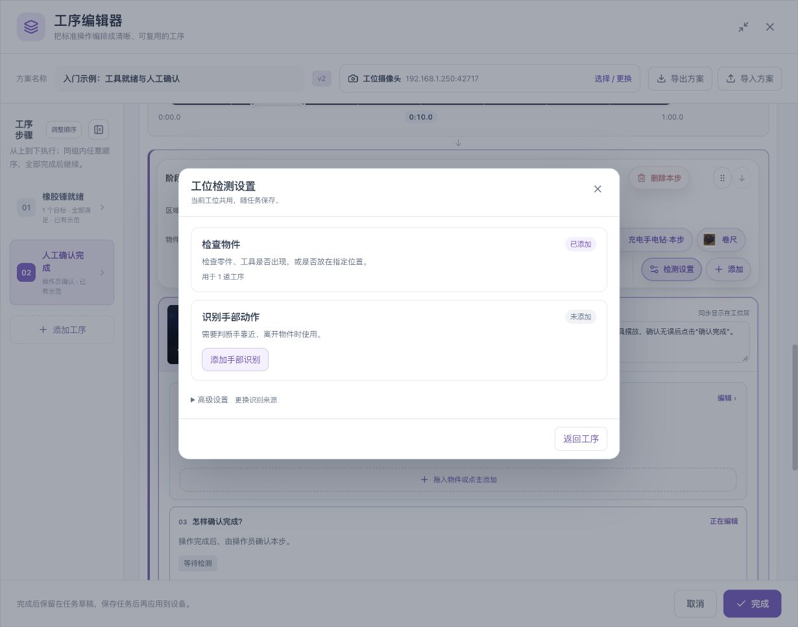{style="position:absolute;max-width:none;width:178.571429%;left:-39.285714%;top:-54.166667%;"}](../../assets/sop/zh-16-detection-settings.jpg)

1
2
3
4
5

图 C10 · 检测设置：物件、手部、可选高级来源。数字是本手册的定位标注，不是网页按钮。点击图片可打开无标注原图；功能说明见下表。

| 图中编号 | 对应位置与功能组 |
|---|---|
| **1** | 上方卡片：物件能力与使用工序数 |
| **2** | 中部卡片：手部识别状态及用途 |
| **3** | 添加手部识别：未添加时显示 |
| **4** | 高级设置：按需要更换共用识别来源 |
| **5** | 返回工序：关闭设置返回编排；不是保存任务 |

| 控件 | 功能 | 注意事项 |
|---|---|---|
| 物件识别来源 | 选择工位物件识别能力 | 更换会影响下方列出的使用步骤 |
| 识别手部动作/添加手部识别 | 添加所需手部能力 | 仍需在步骤中选择具体要求 |
| 左右手：不区分 | 不启用左右限制 | 后续优先使用任意一手 |
| 左右手：区分 | 启用可区分的手部目标 | 仍需用本人左右实际校对 |
| 左右对调 | 修正已核对的相反标注 | 相机方向改变后重新核对 |
| 高级来源设置 | 需要管理共用来源时展开 | 先读影响步骤 |
| 应用到 N 道工序 | 应用所选来源到列出的使用步骤 | 检查数量和步骤名称，不误当只改当前一步 |
| 移除未使用来源 | 清理没有被步骤使用的来源 | 先确认未使用，不删除正在引用的能力 |
| 返回工序 / 右上关闭 | 返回原编排位置 | 保留在任务草稿；仍需完成并保存任务 |

## 14. 检查关系与完成设置

[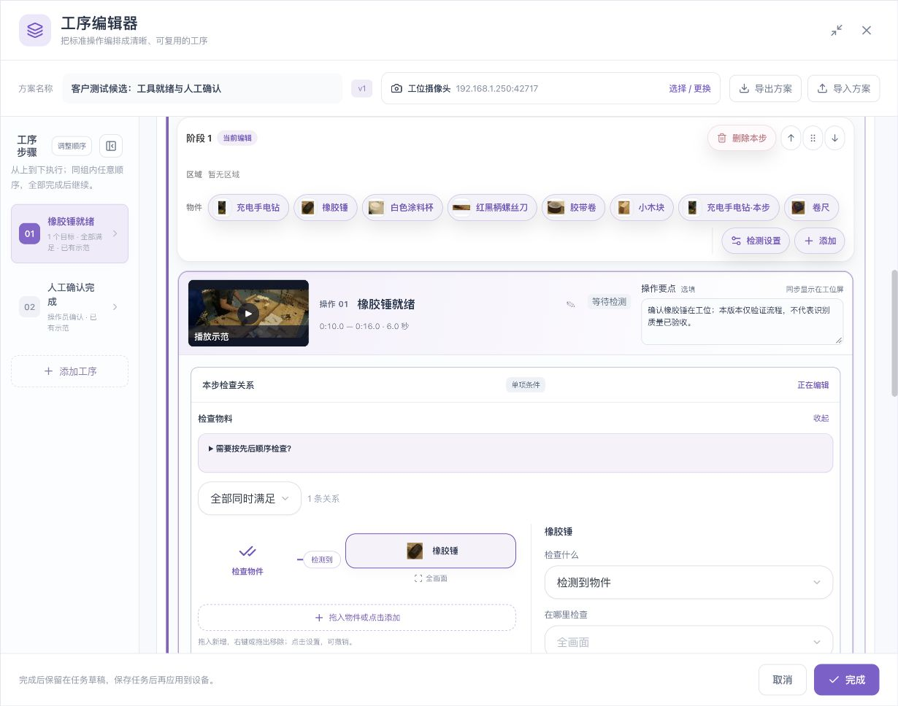{style="position:absolute;max-width:none;width:133.333333%;left:-26.666667%;top:-113.953488%;"}](../../assets/sop/zh-11-object-condition.jpg)

1
2
3
4

图 C11 · 检查关系：组合、物件、添加入口与具体要求。数字是本手册的定位标注，不是网页按钮。点击图片可打开无标注原图；功能说明见下表。

| 图中编号 | 对应位置与功能组 |
|---|---|
| **1** | 左侧组合选择：全部同时满足等 |
| **2** | 左侧图示物件：点击选择要设置的条件 |
| **3** | 图示下方虚线入口：添加检查物件 |
| **4** | 右侧检查什么：本图下方还可继续滚动设置区域和更多参数 |

| 控件 | 用法 | 结果 |
|---|---|---|
| 本步检查关系 → 编辑 | 展开当前步骤的规则设置 | 不影响其他步骤，除非修改共享资料 |
| 检测到物件 | 要求可信检测存在 | 名称、区域和最低分数共同生效 |
| 未检出物件 | 要求没有保留的目标检测 | 不直接证明物件物理离开 |
| 数量符合 | 设置至少、最多 | 相同数值表示恰好，先排除重复框 |
| 全部同时满足 | 多项同一时刻成立 | 任何一项未满足会影响组合 |
| 任意一项满足 | 允许合法替代项 | 不适合多个物件必须备齐的场景 |
| 按先后顺序 | 配置多项按顺序发生 | 验证顺序变化和时限 |
| 关系图中的物件 | 选择要编辑的端点 | 右侧或下方显示该项设置 |
| 物件范围/区域小字 | 选择对应目标的区域 | 核对实际绑定，而不是只看上方区域卡片 |
| 更换物件/目标 A/目标 B | 替换相应端点 | 原区域、数量、分数和另一端需重新核对 |
| 添加关系物件 | 打开目标选择器 | 新增条件，不能误当补参考 |
| 添加空间关系 | 创建两端位置要求 | 必须有相应来源和能力 |
| 更多设置 | 展开分数等不常用参数 | 修改后重新验证 |
| 复制条件 | 复制可支持的当前条件 | 不用重复条件表示两件实物 |
| 删除关系 | 删除选中要求 | 注意是否是最后一项及页面限制 |
| 收起 | 返回规则摘要/图示 | 收起不是保存任务 |

[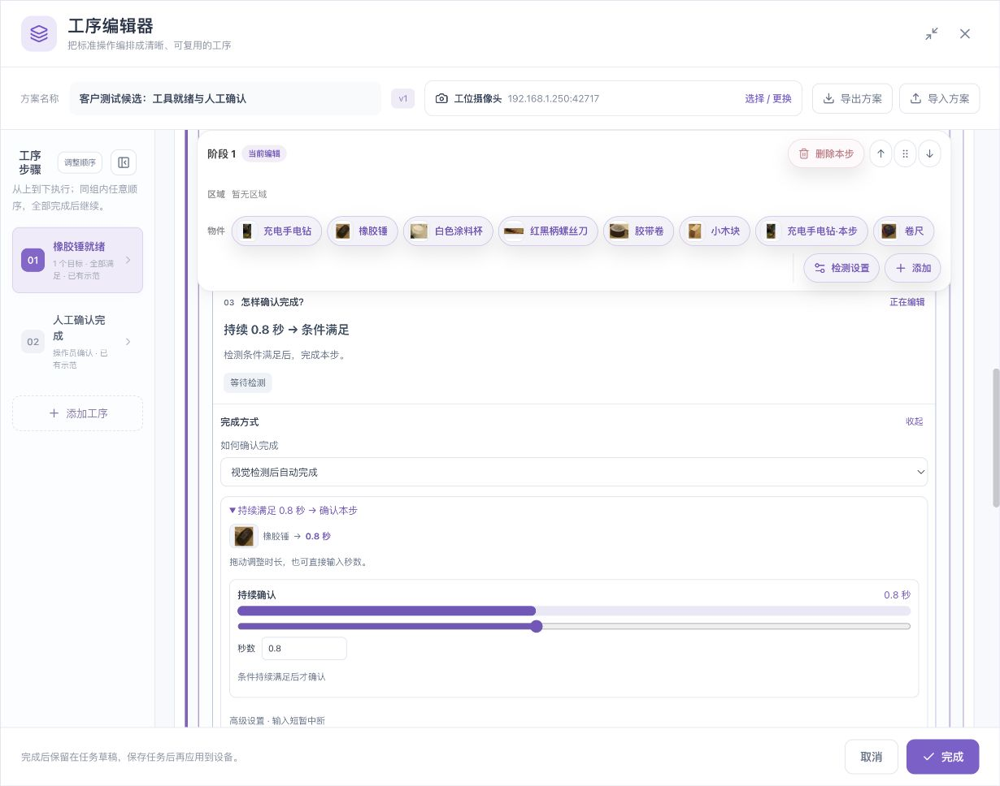{style="position:absolute;max-width:none;width:133.333333%;left:-26.666667%;top:-61.403509%;"}](../../assets/sop/zh-12-auto-completion.jpg)

1
2
3
4

图 C12 · 完成方式：自动/辅助/人工、持续时长和高级时间。数字是本手册的定位标注，不是网页按钮。点击图片可打开无标注原图；功能说明见下表。

| 图中编号 | 对应位置与功能组 |
|---|---|
| **1** | 完成方式下拉框：决定由系统还是人确认 |
| **2** | 持续确认滑杆：调整满足要求的持续时长 |
| **3** | 秒数输入框：直接填写持续时间 |
| **4** | 高级设置：继续向下查看输入短暂中断与完成时限 |

| 控件 | 功能 | 核对 |
|---|---|---|
| 怎样确认完成 → 设置 | 展开完成要求 | 自动/辅助/人工三种用途 |
| 视觉检测后自动完成 | 检测要求满足后推进 | 不能遗漏持续时间或错误样本验证 |
| 视觉检测＋人工核对 | 检测满足后由人确认 | 操作说明应写明核对内容 |
| 人工确认 | 由操作员判断完成 | 不以视频像素假装人员已确认 |
| 持续时间滑杆/秒数 | 编辑稳定满足时长 | 单位是秒，不是帧或整段时长 |
| 高级时间设置 | 展开输入中断容忍等 | 不用大间隔掩盖明确错误 |
| 完成时限 | 设置本步最长时间 | 0 为不检查超时，不等于持续时间 0 |
| 本步将这样判断 | 展开实际生成的要求 | 与工艺负责人逐项读回 |

## 15. 目标选择器

[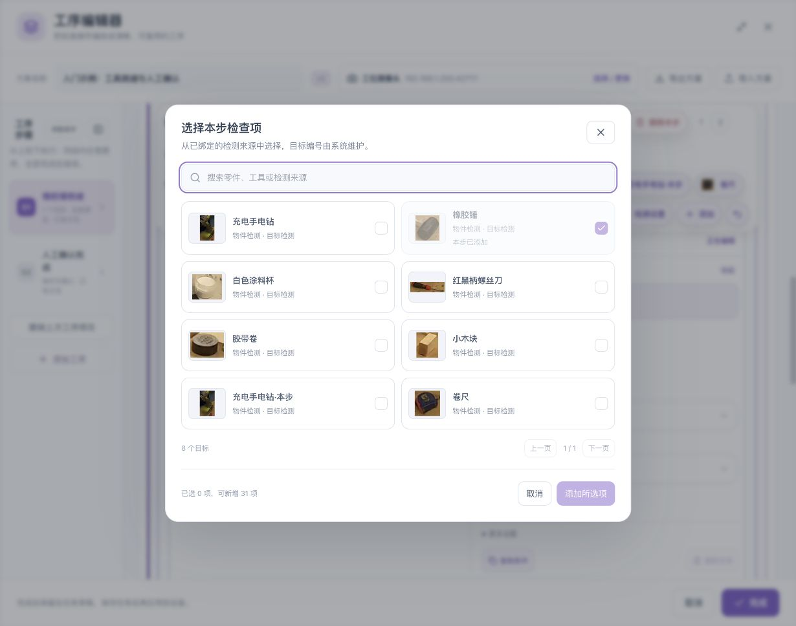{style="position:absolute;max-width:none;width:166.666667%;left:-33.333333%;top:-23.529412%;"}](../../assets/sop/zh-25-target-picker.jpg)

1
2
3
4
5

图 C13 · 目标选择：搜索、卡片、分页、选择计数与提交。数字是本手册的定位标注，不是网页按钮。点击图片可打开无标注原图；功能说明见下表。

| 图中编号 | 对应位置与功能组 |
|---|---|
| **1** | 上方搜索框：按名称或来源筛选 |
| **2** | 中部卡片：勾选目标；灰色卡片可能已加入本步 |
| **3** | 列表右下：页数与上一页/下一页 |
| **4** | 窗口左下：已选数量和可新增数量 |
| **5** | 窗口右下：取消或添加所选项 |

| 控件 | 功能 | 核对 |
|---|---|---|
| 搜索 | 按已有目标资料过滤 | 搜索不会新建目标 |
| 目标卡片 | 选择待添加/替换目标 | 名称、来源和参考图片 |
| 上一页/下一页 | 翻目标列表 | 选择数量和当前页 |
| 已选数量/上限 | 告知本次选择范围 | 不是物理实例数量要求 |
| 添加所选 | 提交选中的新增目标 | 返回后关系数量增加 |
| 替换 | 在替换模式提交单个目标 | 原条件对象改变，未必新增一项 |
| 取消/关闭 | 放弃当前选择 | 原规则保持，除非之前已另行提交 |

## 16. 工序排序按钮

[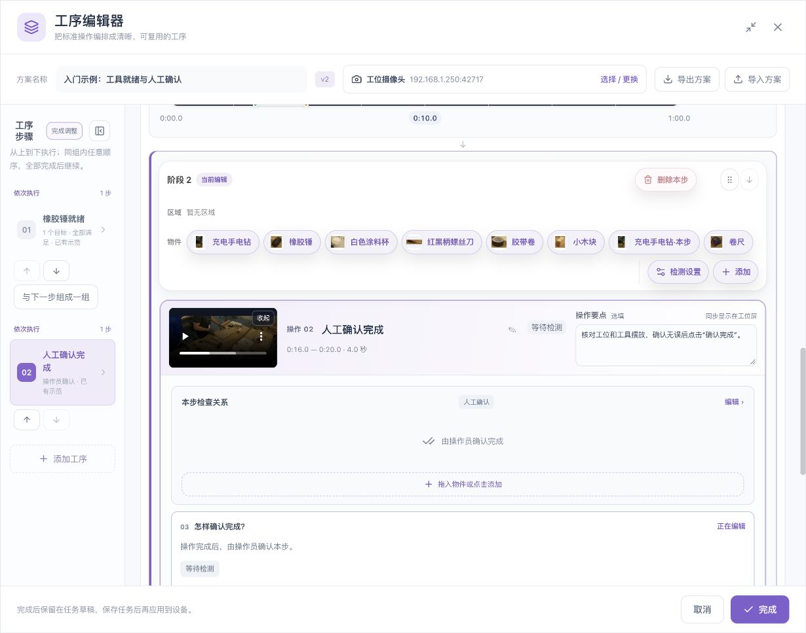](../../assets/sop/zh-17-ordering.jpg)

1
2
3
4

图 C14 · 工序排序：调整模式、上下移动、无序分组与阶段操作。数字是本手册的定位标注，不是网页按钮。点击图片可打开无标注原图；功能说明见下表。

| 图中编号 | 对应位置与功能组 |
|---|---|
| **1** | 左栏顶部：完成调整，退出排序模式 |
| **2** | 每张步骤卡片下：上移/下移 |
| **3** | 第一步下方：与下一步组成一组，适合可任意先后的工作 |
| **4** | 阶段工具栏右上：删除本步、拖动柄及移动按钮 |

| 控件 | 作用 | 注意事项 |
|---|---|---|
| 调整顺序 | 打开阶段组织操作 | 先明确工艺依赖 |
| 上移/下移 | 移动所指阶段或组内工序 | 首尾位置可能禁用一个方向 |
| 拖动柄 | 拖动调整位置；按提示可用方向键 | 不要拖目标图片来排序 |
| 与下一步组成任意顺序 | 把可独立完成的工序并到同组 | 本组仍需全部完成 |
| 加入/合并同组 | 按页面提示组织任意顺序阶段 | 不把严格前后依赖放进同组 |
| 拆开/移出组（界面提供时） | 重新形成独立阶段 | 重验后续顺序 |
| 删除本步 | 移除所指工序 | 阅读确认对象，先备份重要方案 |

## 17. 验证、记录与保存按钮

| 控件 | 所在位置 | 功能与注意事项 |
|---|---|---|
| 验证阶段 N | 对应阶段时间轴旁 | 只验证该阶段及所选范围 |
| 验证本方案 | 总范围下方 | 验证整套编排；总范围应覆盖参与阶段 |
| 本步检查与原因 | 结果详情 | 解释未满足、等待或不确定的具体项 |
| 重点画面复核（可选） | 方案验证相关区域 | 选择/核对关键证据；不代替完整流程验证 |
| 识别标注记录 | 编排上方折叠区 | 进入待提交或已保存的复核资料 |
| 待提交标注 | 记录区域 | 查看尚未正式提交的核对，不等同历史封存 |
| 复验与标注 | 记录区域 | 只读回看与当前保存任务相符的历史资料 |
| 刷新记录/加载更多 | 历史列表 | 读取记录，不重新运行识别 |
| 验证记录 | 编排底部等相应入口 | 查已有验证；记录有无采样需分别核对 |
| 完成 | 工序编辑器右下角 | 回任务草稿；不等于保存/运行 |
| 节点确定/确认 | SOP 节点配置右下角 | 回外层任务编辑 |
| 保存 | 外层流程图上方 | 持久保存，等待明确结果 |
| 运行 | 外层流程图上方 | 启动保存后的任务，影响实际运行 |
| 工位运行 | 任务卡片 | 打开操作员页面；任务停止时未必有活动实例 |

完整运行按钮及异常处理见[操作员工位手册](operator-guide.md)。参数单位、边界及作用见[参数说明](parameters.md)。

*配图素材署名见[示例素材与截图来源](reference.md#7-示例素材与截图来源)。*
