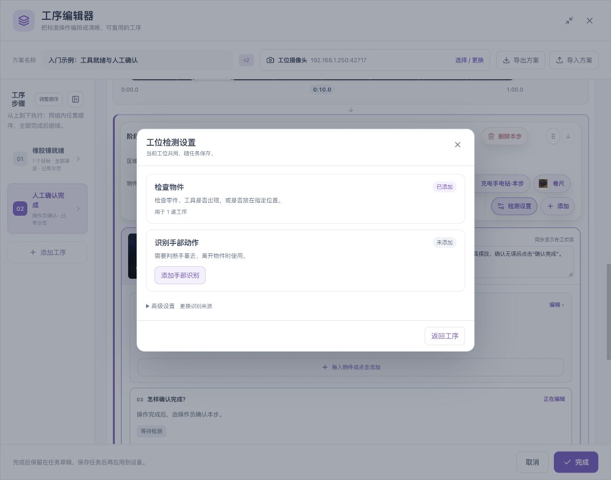
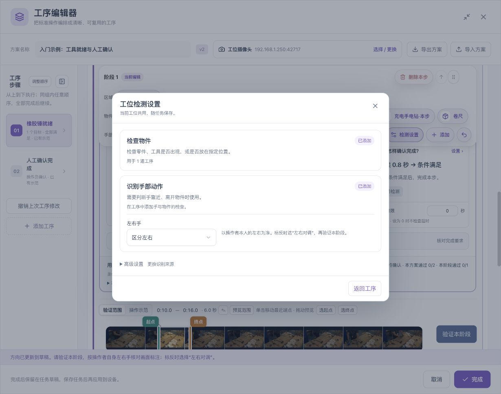
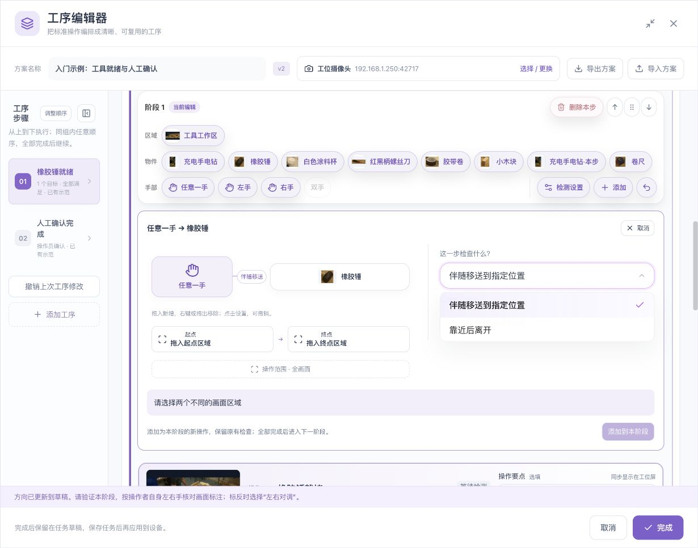
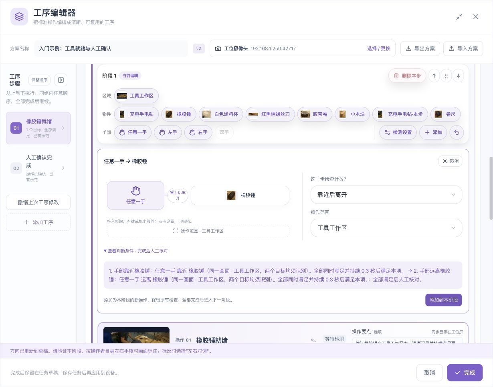
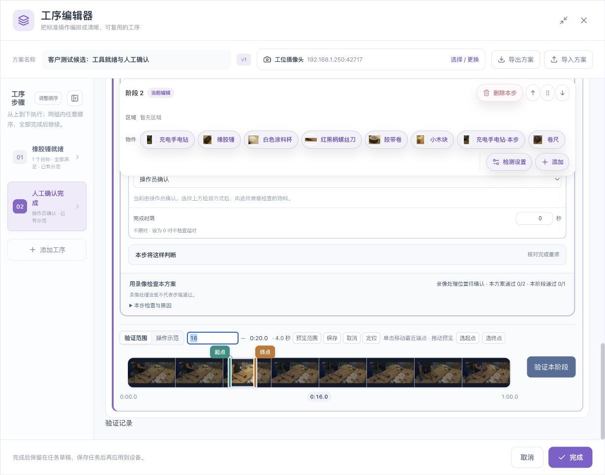

# 手部操作：从选择手到验证完整动作条件

[English](../../en/sop/hand-operations.md) · [手册首页](index.md)

本章面向需要检查“哪只手在操作、手是否靠近或离开工具、手是否伴随物件移动”的工序。建议先完成单物件入门流程，再增加手部条件。

**先分清两件事：识别到手，是观察；手与物件按要求配合，才是工序条件。** 手部关键点不能直接证明抓握力度、拧紧扭矩、压装质量、接触压力或零件内部状态。

## 1. 先把工艺要求改写成可见条件

| 现场要求 | 可以配置的可见条件 | 还需要核对什么 |
|---|---|---|
| 操作员把手伸向橡胶锤 | 可见手靠近橡胶锤 | 是否真的拿稳 |
| 操作后手离开工具 | 先靠近，再在工具仍可见时远离 | 是否完成了预期加工 |
| 把零件移到装配区再放开 | 起始区 → 手伴随物件移动 → 物件到达并保留 → 手离开 | 到位精度、卡扣或紧固质量 |
| 规定使用左手或右手 | 校对方向后选择本人左手或右手 | 相机移动后方向是否仍正确 |
| 双手协作 | 明确配置需要的两只手及各自条件，或按设备支持的双手功能设置 | 是否为同一操作员、是否可区分且持续可见 |
| 只要工具就位，不关心手 | 仅物件检查 | 不必增加手部识别 |

不需要检查手时，选择“只检查物件”可以减少配置和核对负担。不要因为录像中有手，就默认每一步都必须启用手部检查。

## 2. 添加手部识别

1. 进入工序编辑器，打开当前阶段工具栏的 **检测设置**。
2. 找到 **识别手部动作**。
3. 未添加时，点击 **添加手部识别**。
4. 返回工序，确认工具栏出现 **任意一手、左手、右手** 等设备支持的手部入口。
5. 检查物件识别来源仍然正确。手与物件的配合条件同时需要手部和物件来源。

检测设置为当前工位共用，会随任务保存。添加了识别来源，不等于已经给所有工序添加了手部要求；仍须在相应步骤配置检查。

如果入口不可用，先检查设备插件与功能支持；不要反复新建多个手部来源来尝试解锁。

## 3. 校对操作者本人的左右手

### 3.1 “左手”按谁的方向？

**以操作者本人的左、右手为准，不是观看屏幕时的左右位置。** 正对相机时，操作者的左手可能出现在图像右侧。相机镜像、安装朝向和画面翻转也可能影响显示。

### 3.2 校对步骤

1. 让实际操作员站在正常作业位置。
2. 打开 **检测设置 → 左右手**。
3. 不需要区分左右时，使用 **不区分左右**，后续优先使用任意手。
4. 需要区分时，选择 **区分左右**。
5. 让操作员单独展示本人左手，再展示右手，用本阶段验证画面检查标注。
6. 如果本人左手被标为右手，选择 **左右对调**，再验证。
7. 只有两侧都核对正确，才在工序中使用左手/右手约束。
8. 相机位置、镜像或方向改变后，重新校对。

**检查点：** 操作员分别展示左、右手时，画面标签与本人一致。选择“区分左右”只是配置动作，不是校对已经完成的证据。

### 3.3 任意手、指定手与双手

| 选择 | 含义 | 适用情况 |
|---|---|---|
| 任意一手 | 不指定本人左手还是右手 | 工艺允许任意手操作 |
| 左手 | 只使用校对后的本人左手条件 | 工艺确实规定左手 |
| 右手 | 只使用校对后的本人右手条件 | 工艺确实规定右手 |
| 双手/分别配置两手 | 以设备实际提供的功能与条件为准 | 需要两只手协作且图像能可靠区分 |

“最多检测两只手”是数量限制，**不能证明两只手属于同一人**。多人同时进入画面、手交叉或目标不唯一时，需要重新核对工位隔离、区域和结果。某个双手入口显示不可用时，不要将其写成已经启用；可以检查版本与能力，或使用明确的左手、右手条件和人工核对。

## 4. 用工具栏建立“手 → 物件”配合

1. 在左侧选择要编辑的阶段。
2. 在工具栏先选择 **任意一手**、左手或右手。
3. 再点击需要操作的物件，例如橡胶锤。
4. 页面出现“所选手 → 橡胶锤”的操作配置。
5. 在 **这一步检查什么？** 中选择实际需要的操作方式。
6. 设置操作范围，查看判断条件，确认后点击 **添加到本阶段**。

工具栏可以提供“靠近后离开”“伴随移送到指定位置”等完整操作模板。页面明确提示它是**添加为本阶段的新操作，保留原有检查**时，添加后应检查阶段内是否多出一个步骤。不要以为它必然替换当前物件条件。

如果只需要单项“手靠近”或“可见手远离”，可以在本步检查关系中配置相应空间关系；完整动作模板与单项关系不是同一个含义。

## 5. 单项条件：手靠近物件

配置时明确：

- 检查哪只手。
- 配合哪个物件。
- 在哪个区域检查。
- 条件需要持续多久。
- 条件满足后自动完成，还是由操作员继续核对。

判断需要手和物件在同一可信画面中可见并被识别。界面中的距离范围用于位置关系判断，会参考物件大小；它不是厘米、接触力或抓握力度。

**适合：** 确认操作发生在指定工具附近，再结合物件就位等条件。

**不宜直接当成：** 已拿起工具、已用力压紧、已拧紧、已成功安装。

如果手在物件附近但不执行操作，也会满足“靠近”的位置条件。想区分完整过程，应增加先后、到达区域、物件保留或人工核对。

## 6. 单项条件：可见手远离物件

“远离”要求相应手与物件仍有有效可见证据，并且位置关系达到要求。

以下情况不能简单当成“手已经离开”：

- 手被身体、工具或其他人遮住。
- 手移出相机画面。
- 手部关键点没有可靠输出。
- 物件被拿出画面或没有可靠识别。
- 网络断流、画面过期或来源不一致。

不要用“未检出手”替代“可见手远离物件”。如果工艺确实要求操作者离开一个区域，应选择与该工艺相符的条件，并用实际录像核对遮挡与离开能否区分。

## 7. 完整模板：手靠近后离开

### 7.1 适合的场景

例如操作员在橡胶锤附近进行一次操作，完成后把手移开。系统可检查可见的先后变化，再由人核对实际工艺质量。

### 7.2 配置步骤

1. 先选手，再选橡胶锤。
2. 在操作方式中选择 **靠近后离开**。
3. 将 **操作范围** 设为能覆盖手与工具的当前工位区域。
4. 展开 **查看判断条件**。
5. 核对条件顺序：先靠近，再远离；两端均有有效识别。
6. 核对每一项的持续时间。示例默认显示值不一定适合您的节拍。
7. 保留或选择 **完成后人工核对**，用于确认画面不能证明的质量。
8. 点击 **添加到本阶段**，检查新增操作名称与条件。

**预期结果：** 只一直靠近不会完成“靠近后离开”；一开始就远离也不应跳过前面的靠近阶段。后一项需要在前一项完成后发生有效的条件变化。

### 7.3 建议的反例

- 不伸手，工具始终在桌上。
- 手靠近但一直不移开。
- 手突然被遮挡，而不是可见地远离。
- 工具与手一起离开画面。
- 相邻工位的人把手伸入镜头。
- 两把相似工具同时出现，无法确认正在操作哪一把。

这些反例应得到等待、未满足或不确定等符合事实的结果，而不是一律通过。

## 8. 完整模板：手伴随物件移动，到位后离开

### 8.1 先画好区域

1. 在实际画面中画出 **起始区**。
2. 画出 **到达区**。
3. 两个区域应有清楚的业务区别，不能把同一区域同时当起点与终点。
4. 设置覆盖完整路径的 **操作范围**，不只覆盖端点。
5. 避免区域边界使同一物件在起点、终点同时成立而失去状态变化。

### 8.2 配置操作

1. 选择操作手与物件。
2. 选择 **伴随移送到指定位置**。
3. 将起始区和到达区分别放入对应槽位，或点击槽位从列表选择。
4. 检查操作范围覆盖移动途中。
5. 展开判断说明，核对“起始 → 移动中要求 → 到达 → 手离开”的含义。
6. 点击添加后，逐项检查条件和时长。

### 8.3 需要持续成立的要求

界面提示“移动途中手须持续靠近物件”时，这不仅是两张端点图片。移动过程中也要持续获得有效观察；到达后，物件应保留在终点，直到手离开。中途不满足、看不清、同类目标不唯一等情况可能重置顺序。

该检查不等于具有遮挡后重新识别同一实物的能力。不要在工具完全消失后，仅凭另一把相似工具重新出现就认为原物件完成了移动。

## 9. 手在区域内与手和物件的关系要分别设置

| 您的要求 | 需要表达的条件 |
|---|---|
| 任意手出现在装配区 | 手部目标出现，并限制在装配区 |
| 手在装配区且靠近杯子 | 手的区域约束，加手与杯子的关系 |
| 杯子在工具区，手在装配区 | 分别设置两个目标端的区域 |
| 只检查当前工位，不受旁边人影响 | 合理绘制工位区域，并逐项核对手与物件检查的范围 |

区域是画面坐标中的位置约束，不会自动保证画面里只剩一个操作员。跨区域关系的两端应分别核对，不能只看工具栏是否显示一个区域图标。

## 10. 持续时间、输入中断与超时

不要将以下三个时间混为一谈：

| 时间 | 控制什么 | 例子 |
|---|---|---|
| 持续满足 | 某个条件要稳定成立多久 | 手靠近工具持续一小段时间 |
| 输入中断容忍 | 可信观察暂时中断时可以等待多久 | 网络或关键点输入短时中断 |
| 完成时限/顺序最长用时 | 整步或整段顺序最多花多久 | 移送应在规定节拍内结束 |

正常画面里明确不满足，与“没有新的可信输入”不同。增加输入中断容忍不能用来掩盖已观察到的错误动作。带连续目标观察的顺序功能，可能有更严格的中断上限；以界面的限制和说明为准。

## 11. 验证手部操作的正确方法

1. 先验证物件识别，确认不是工具漏检导致关系失败。
2. 再核对手部是否有有效输出，左右手是否标对。
3. 再验证单项靠近/远离与区域。
4. 最后验证完整先后操作及人工确认。
5. 用另一段独立录像检查姿态、速度和摆放变化。
6. 同时检查正常样本和反例，不只挑最清楚的一次。

| 现象 | 先检查 | 不要直接做什么 |
|---|---|---|
| 手一直没有结果 | 机位、清晰度、手套、遮挡、手部来源 | 把物件阈值一直降低 |
| 左右手相反 | 本人左右校对、镜像和相机方向 | 按画面左边直接认定左手 |
| 靠近成立但动作未完成 | 单项关系是否过于宽泛 | 直接宣布工艺完成 |
| 远离一直不成立 | 手、物件是否都仍然可见，范围是否合理 | 把手消失当成远离 |
| 顺序反复从头开始 | 目标唯一性、遮挡、连续观察和中途要求 | 取消所有中途保护以求通过 |
| 多人误触发 | 工位区域、人员隔离、手目标选择 | 假定两只手必然属于同一个人 |

## 12. 手部工序交付前检查

- [ ] 明确哪些步骤确实需要手部条件。
- [ ] 相机固定，手指与物件在关键过程清楚可见。
- [ ] 需要左右区分时，已经按本人左右分别核对。
- [ ] 手、物件与区域的选择正确。
- [ ] “可见远离”与“未检出”没有混用。
- [ ] 先后变化、中途持续要求和时间设置与工艺一致。
- [ ] 已测试手套、遮挡、多人或多工具等现场常见情况。
- [ ] 不确定状态不会被当成通过。
- [ ] 需要人工核对的质量要求保留了确认步骤。
- [ ] 保存后重新打开，手部来源、方向和规则仍正确。

**相关：[工具栏与拖拽](toolbar-and-drag.md) · [规则与区域](rules-and-regions.md) · [验证与运行](validation-and-operation.md)**

*配图中的示例录像及参考画面来源：[木箱装配数据集与 CC BY 4.0 署名说明](reference.md#7-示例素材与截图来源)。*
