# SOP 系统用户使用手册

[English](../../en/sop/index.md)

本手册面向第一次使用 AIBox SOP 的工艺人员、现场操作员、实施人员和管理员。通过物件入门与手物操作两套实例，完成 **选择摄像头 → 准备录像 → 选择目标 → 完善识别 → 编排工序 → 分阶段验证 → 验证方案 → 保存 → 工位运行**。不需要编写代码、规则表达式或 JSON。

**第一次使用请先读第 1 章认识系统，再跟第 2 章[5 分钟快速上手实例](#five-minute-quickstart)完成操作，之后按需查阅工具详解。** 本手册所有章节都在当前页面。使用右侧“本页目录”定位章节，或点击下表跳到本页对应内容。

| 您现在要做什么 | 阅读位置 |
|---|---|
| 跟着完整实例完成第一个 SOP | [5 分钟快速上手](#five-minute-quickstart) |
| 完整练习物件＋手部动作＋人工核对 | [工具箱与手部操作实例](#five-minute-hand-example) |
| 从零建立第一个可理解的方案 | [入门：工具就绪与人工确认](#quickstart) |
| 录制、上传、播放、选取时间段 | [视频、目标与识别](#video-and-recognition) |
| 框选物件、补充角度、人工补框、处理漏检和重复框 | [视频、目标与识别](#video-and-recognition) |
| 只检查指定几个区域、设置数量或物件位置关系 | [检查规则、区域与时间](#rules-and-regions) |
| 任意手、左右手、手靠近/离开、手随物件移动 | [手部操作专章](#hand-operations) |
| 从工具栏拖入物件、手和区域，了解高亮、替换、撤销 | [工具栏与拖拽专章](#toolbar-and-drag) |
| 验证阶段/方案、人工确认、保存、运行与查历史 | [验证、保存与工位运行](#validation-and-operation) |
| 找不到画面、无法拖动、按钮不可用、结果不确定 | [排障与日常维护](#troubleshooting) |
| 交付前逐项检查、术语解释 | [检查清单与术语](#reference) |

!!! note "适用界面与配图"
    本手册以 2026 年 11 月采集的设备 Web 界面为说明依据。设备应用、算法插件、网页和云端网页需要相互匹配；可选功能以设备实际提供的入口为准。截图中的 IP、工具名称、时间、参考数量和任务名称均为例子，请使用自己工位的设置。

    中文页面使用中文界面截图；英文手册优先使用英文截图，部分实测过程共用原始中文截图并注明英文操作名。用户自己命名的任务、物件、区域和操作说明不会因为切换界面语言而自动翻译。

点击任意配图可打开图片查看器，选择 **适应窗口** 或 **原图 100%**；按 **＋/−** 调整倍率，按 **Esc** 或 **关闭** 返回原阅读位置。按住浏览器的新标签快捷键点击图片，可直接打开原图。图中“等待检测”“待验证”是当前页面状态，不是已经通过验收的标记。

## 1. 认识 SOP 与阅读指南 {#overview}
### 1.1 先理解系统检查的是什么 {#overview--1-先理解系统检查的是什么}

SOP 将现场要求拆成可观察的条件。例如：

- **物件**：橡胶锤是否出现，数量是否符合，是否位于工具工作区。
- **空间关系**：物件 A 是否在物件 B 内部、左侧、右侧或附近；手是否靠近或远离物件。
- **时间**：条件需要持续多久，完成这一步最多允许多久。
- **顺序**：先完成哪一步，再完成哪一步；哪些步骤可以任意先后完成。
- **人工确认**：哪些质量要求必须由操作员核对后确认。

系统使用相机画面与规则提供指导和检查。只凭“手靠近了工具”，不能直接证明工具已经拿牢、螺丝已经拧紧或零件已经装配到位。对无法从画面可靠证明的质量要求，应保留人工核对。

### 1.2 本手册贯穿示例 {#overview--2-本手册贯穿示例}

选择固定机位的工作台录像，画面中有橡胶锤、电钻、涂料杯等物件。入门流程只使用橡胶锤，避免一开始同时配置多种条件。

| 阶段 | 工序名称 | 检查要求 | 完成方式 | 示例片段 |
|---|---|---|---|---|
| 1 | 橡胶锤就绪 | 橡胶锤清晰可见；需要时限制在工具工作区 | 持续满足 0.8 秒后完成 | 原视频第 10–16 秒 |
| 2 | 人工确认完成 | 操作员核对工具和工位 | 操作员确认 | 原视频第 16–60 秒 |

示教原片约 60 秒。上述时间仅用于解释选段；不同录像应根据真实动作重新设置。先使用单目标流程理解操作，再扩展到多工具备齐、区域检查、手部操作和无序步骤。

[{loading="lazy" decoding="async" width="2650" height="1935"}](../../assets/sop/zh-04-editor-overview.png)

*图 1：左侧选择工序，中间查看视频与目标，右侧管理参考资料。上方是方案和摄像头，下方继续编排与验证。*

### 1.3 几个容易混淆的概念 {#overview--3-几个容易混淆的概念}

| 名称 | 用途 | 不能混同为 |
|---|---|---|
| 示教视频 | 展示标准操作，供框选目标、选段和操作员回看 | 已完成识别验收的录像 |
| 目标参考图片 | 告诉系统同一个物件是什么样子；不同角度仍可属于同一目标 | 需要检测的实际物件数量 |
| 人工补框 | 标记这一帧中应该出现、但识别需要完善的物件 | 算法已经自主检出的结果 |
| 目标抽帧 | 在所选范围内按采样间隔检查识别结果 | 每一视频帧都已经人工核对 |
| 阶段验证范围 | 检查当前阶段的一段录像 | 全方案通过 |
| 操作示范片段 | 给操作员播放这一操作的标准动作 | 强制改变其他阶段时间 |
| 方案验证范围 | 用来检查整套编排的录像范围 | 正式任务的实时运行时长 |
| 保存任务 | 将当前编辑内容应用为设备任务配置 | 自动启动生产任务 |
| 工位运行 | 操作员查看当前任务、步骤和确认入口 | 录像抽帧结果页 |

“阶段”是一组执行位置；它可以包含一步，也可以包含一个任意顺序组。阶段从上向下执行；同组中的步骤可以任意先后完成，全部完成后再进入下一阶段。它与单个条件内部的“全部同时满足”不同，详见[规则说明](#rules-and-regions)。

### 1.4 推荐学习顺序 {#overview--4-推荐学习顺序}

1. 跟第 2 章[5 分钟快速上手实例](#five-minute-quickstart)建立“橡胶锤就绪 → 人工确认”的两步流程；需要更多说明时查[入门详解](#quickstart)。
2. 在[识别章节](#video-and-recognition)确认目标在不同位置、角度以及有手遮挡时的表现。
3. 在[规则章节](#rules-and-regions)增加所需区域、数量、持续时间和分组。
4. 有手部要求时，完成[手部方向校对和动作条件配置](#hand-operations)。
5. 先验当前阶段，再验整套方案；核对结果后保存并进入[工位运行](#validation-and-operation)。
6. 用[交付清单](#reference)检查正常操作、错误顺序、缺件、遮挡、断流和恢复。

不要在同一轮同时修改目标参考、识别阈值、区域、时间和顺序。每次解决一个已定位的问题，重新检查对应结果，更容易知道修改是否有效。

### 1.5 操作角色 {#overview--5-操作角色}

| 角色 | 主要工作 |
|---|---|
| 工艺/配置人员 | 准备标准录像，命名目标与步骤，配置规则，检查识别，验证并保存方案 |
| 现场操作员 | 根据工位屏执行操作，核对需要人工确认的要求，处理提示 |
| 管理员/实施人员 | 保证摄像头、算法来源、版本、存储和网络可用，配置运行位置并维护历史 |

### 1.6 手册结构与阅读路径 {#overview--6-手册结构与阅读路径}

本手册分为六部分。现场人员可以按任务查找，首次配置人员先跟快速上手实例操作，再查实施准备与工具详解。

| 部分 | 章节 | 解决什么问题 |
|---|---|---|
| 开始使用 | [5 分钟完整实例](#five-minute-quickstart)、[实施准备](#preparation)、[入门详解](#quickstart) | 先走完两步流程，再准备自己的真实工艺 |
| 界面与控件 | [界面说明](#workspace-reference)、[工具与按钮](#control-reference)、[参数与状态](#parameters) | 查找按钮位置、用途、可用条件和修改影响 |
| 识别与规则 | [视频和目标](#video-and-recognition)、[区域与时间](#rules-and-regions)、[手部动作](#hand-operations)、[拖拽](#toolbar-and-drag) | 完成实际配置，分清每层作用 |
| 完整实训 | [六类典型场景](#scenario-labs) | 把单个功能串成可以验证的场景 |
| 验证与运行 | [验证和保存](#validation-and-operation)、[操作员工位手册](#operator-guide) | 逐级验收、持久保存、实际执行与异常处理 |
| 运维与交接 | [备份迁移维护](#maintenance)、[排障](#troubleshooting)、[速查清单](#reference) | 换设备、改现场、查故障和交付 |

#### 1.6.1 按角色阅读 {#overview--按角色阅读}

- **第一次配置：** 5 分钟快速上手实例 → 实施准备 → 入门详解 → 视频与目标 → 规则 → 验证与保存。
- **工艺负责人：** 需求整理 → 参数含义 → 场景实训 → 交付验收。
- **现场操作员：** 操作员工位手册；需要时查播放示范与异常处理。
- **实施管理员：** 界面与控件 → 检测设置 → 备份迁移 → 维护排障。
- **只想找一个按钮：** 直接打开[工具、按钮与所在位置](#control-reference)，按当前窗口查找。

### 1.7 本手册的操作约定 {#overview--7-本手册的操作约定}

| 写法 | 含义 |
|---|---|
| “本步” | 当前选中操作，不自动代表整个阶段或整套方案 |
| “当前目标” | 目标模式中选中的逻辑物件；参考角度可能有多个 |
| “点击 X → Y” | 先进入 X，再选 Y；不是同时点击 |
| “预期结果” | 用户应检查的结果，不是替现场测得的通过结论 |
| “不可用/灰色” | 当前前提、能力、只读或忙碌状态不允许操作 |
| “草稿” | 当前编辑内容，仍需按完成、确认、保存流程持久化 |
| 图中的名称和数值 | 便于讲解的例子，不要直接当作工艺标准 |

每个关键操作按“前提 → 入口位置 → 操作步骤 → 预期结果 → 不符合时处理”阅读。参数边界按当前界面实现说明；实际是否接受，还由设备能力与规则校验决定。

### 1.8 配图怎样使用 {#overview--8-配图怎样使用}

1. 先读图题，确认它展示的是配置、目标参考、动作面板还是保存入口。
2. 结合本章的位置表找到上方、左侧、右侧或底部控件。
3. 点击图片查看原始大图；不要靠缩略图猜输入内容。
4. 按自己工位的任务、物件和区域名称操作。
5. 完成后回到真实页面核对结果，不把截图中的状态当成当前状态。

本手册界面配图现采用重新采集的原生无损 PNG，正文按版心缩小预览，点击后可按原图 100% 查看小字。截图像素不等于视频源的细节：示例录像为 800 × 320，放大截图不会凭空增加原片细节。视频内已经叠加的文字也不随网页语言自动改写。

中文和英文分别提供对应界面截图。示例原录像可从[入门章节](#quickstart--使用配套示例录像)下载；出处与许可见[素材署名](#reference--7-示例素材与截图来源)。

**下一步：[第 2 章：5 分钟快速上手完整实例 →](#five-minute-quickstart)**

*配图中的示例录像及参考画面来源：[木箱装配数据集与 CC BY 4.0 署名说明](#reference--7-示例素材与截图来源)。*

## 2. 5 分钟快速上手：一步一步完成第一个 SOP {#five-minute-quickstart}

这一章包含两套可以照着操作的完整实例：**2.1–2.6 物件与人工确认；[2.7 工具箱、手部动作与人工核对](#five-minute-hand-example)**。请先掌握基础，再完成手部实例，之后查各工具详解。您将亲手完成 **上传录像 → 框选橡胶锤 → 检查并完善识别 → 编排自动步骤和人工步骤 → 分阶段验证 → 验证整套方案 → 保存 → 工位运行**。第一次使用请从 2.1 开始，不要跳过检查点。

“5 分钟”表示先理解一条完整操作路线；首次逐项练习、上传、扫描及等待设备验证需要更长时间。每个小节都写明点哪里、填什么、应看到什么，以及结果不符时怎样处理。配图为本实例实际操作的原生截图，多数为 **3840 × 2160 无损 PNG**，点击可按原图 100% 查看。物件实例录像为 800 × 320，手部实例为 480 × 480；截图不会增加录像细节。

**先下载：[工作台示例录像 workbench-60s.mp4（60 秒，约 9.5 MB）](../../assets/sop/workbench-60s.mp4)**。这段录像中有一把木柄、黑色锤头的橡胶锤；本例只用这一目标，先把自动与人工配合跑通。素材许可与出处见[署名说明](#reference--7-示例素材与截图来源)。

| 最终配置 | 本例填写值 | 为什么这样设置 |
|---|---|---|
| 任务和方案名称 | 入门教程:橡胶锤就绪与人工确认 | 便于在任务卡片中找到练习 |
| 目标 | 橡胶锤；10 秒画面中的 1 张主参考 | 先用清楚、完整的目标建立基线 |
| 阶段 1 | 橡胶锤就绪；全画面检测到橡胶锤，连续 0.8 秒后自动完成 | 学会视觉自动推进 |
| 阶段 1 验证范围 | 10–16 秒 | 单独检查 6 秒的清楚画面 |
| 阶段 2 | 人工确认完成；操作员确认；验证范围 16–60 秒 | 留足时间阅读和点击人工确认 |
| 总体验证范围 | **0–60 秒，完整原片** | 用完整录像检查两步串行执行 |
| 完成时限 | 两步都为 0 秒 | 本例不额外施加超时要求 |

!!! note "先分清两种输入"
    **编辑器验证直接读取上传或录制后保存的视频文件。** 真实任务运行使用任务图中已配置的摄像头输入。学习录像不会自动出现在您自己的摄像头里；到工位运行时，需要同一机位、同一工具的输入。不要为了编辑验证另建 RTSP 推流，也不要照抄截图中的测试地址。

### 2.1 建立练习任务，准备视频与摄像头 {#five-minute-media}

#### 2.1.1 新建一个独立任务

1. 打开设备网页，登录后确认顶部为**在线**。先检查任务卡片；设备忙碌时不要停止他人的任务来练习。
2. 点击右上角 **添加任务**，在创建窗口选择 **SOP 工序 → 只检查物件**。
3. 在名称框填 **入门教程:橡胶锤就绪与人工确认**，点击 **创建并编辑**。本例暂不选择手部模板。
4. 应进入“编辑设备节点”画布，看到网络拉流、提示词检测、SOP 工序等已连好的节点。保留自动生成的连线。

[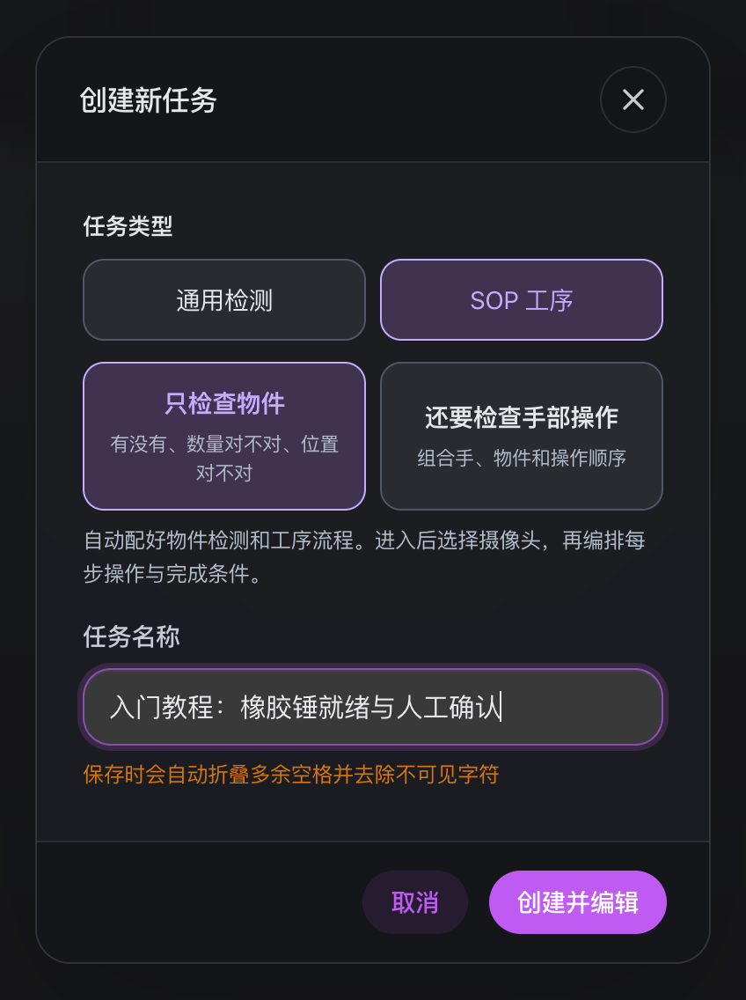{loading="lazy" decoding="async" width="848" height="1136"}](../../assets/sop/zh-q01-create-task.png)

**检查点：** 画布顶部任务名正确。若仍在创建窗口，先看名称或能力提示；不要连续重复创建同名任务。

#### 2.1.2 从任务画布进入工序编辑器

1. 在画布中双击 **SOP 工序** 节点。
2. 节点窗口中点击 **编辑工序**，不是外层的“运行”。
3. 工序编辑器出现后，可点击右上角放大图标 **最大化编辑器**，让视频、工具栏和阶段区域有足够空间。
4. 顶部 **方案名称** 填相同名称。左侧第一步此时可能仍叫“工序 1”，后面再改名。

[{loading="lazy" decoding="async" width="3840" height="2160"}](../../assets/sop/zh-q03-open-editor.png)

**检查点：** 窗口标题为“工序编辑器”，能看到方案名称、左侧工序列表以及视频区域。找不到入口时回到任务画布双击节点，不要把任务的网络推流配置当成工序编辑器。

#### 2.1.3 上传配套录像

1. 在编辑器主区的视频工具栏点击 **上传**，系统文件选择框的用途为“上传完整流程视频”。
2. 选择下载好的 **workbench-60s.mp4**，确认上传；等待进度结束和首帧出现，期间不要再次选文件。
3. 点击播放器播放按钮，确认画面确实移动，再暂停。
4. 向下查看总片段，应为 **0:00.0–1:00.0，60.0 秒**。本例后续整套验证保留完整范围。

[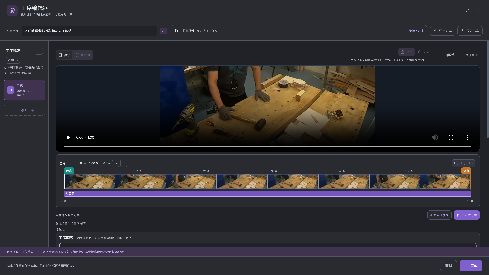{loading="lazy" decoding="async" width="3840" height="2160"}](../../assets/sop/zh-q05-video-ready.png)

**检查点：** 有真实工作台画面、能播放、总时长约 60 秒。若仅有加载占位或错误提示，先检查文件上传和视频解码；未出现画面时不要开始框选。已有视频时，替换可能影响原有时间段和目标依据，先确认当前是独立练习任务。

#### 2.1.4 配置摄像头，并认识“现场录制”这条路径

1. 点击顶部“工位摄像头”右侧 **选择 / 更换**，选择本工位已配置且能正常取图的摄像头；使用地址方式时填写您自己的有效地址，按窗口中的应用按钮确认。
2. 返回编辑器，检查“工位摄像头”不再显示“尚未选择摄像头”。截图中的地址仅为本次受控演示源，不是可供客户长期连接的服务。
3. **用自己的现场录像代替配套文件时：** 先配好摄像头，点击视频区 **录制**。已有视频时会出现“重新录制完整流程？”；要替换整套示范才点 **开始录制**，继续用配套文件则点 **取消**。替换会重置各步时间，请不要在已经编排好的实例中随意确认。
4. 看到 **正在录制完整流程** 后，在工位完整演示“工具就绪 → 人核对”，保留开始和结束画面；点击录制状态行中的 **停止并使用录像**。等待“正在结束录制…”及视频检查完成，录像会载入编辑器。要放弃本次录制使用 **取消**，不要把关闭网页当作正常结束。
5. 等录像处理完成，回放确认工具清楚、动作完整、总时长正常，再进行框选。自己的录像要重新选择真实时间，不能照搬本例的 10 秒参考帧和 10–16 秒区间。

[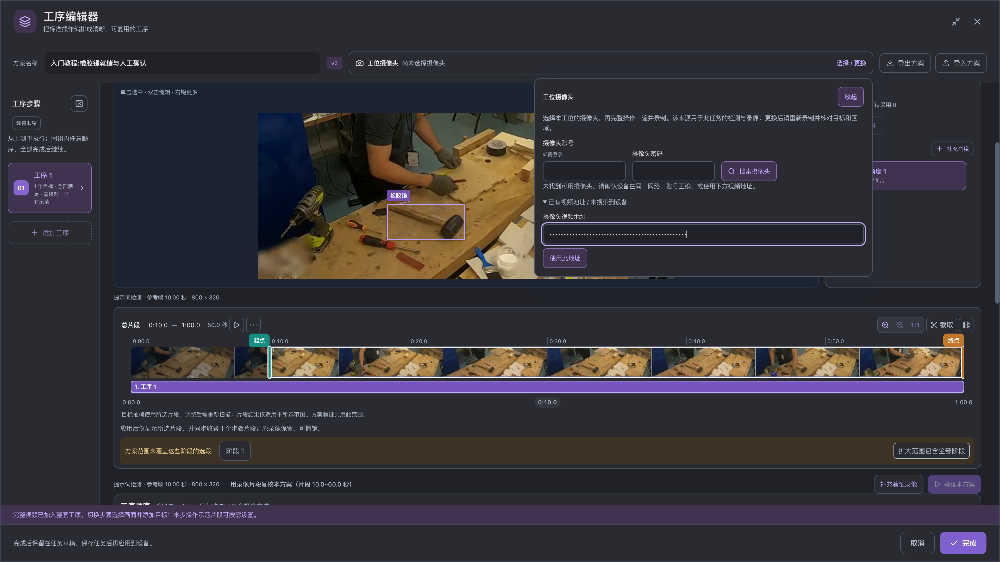{loading="lazy" decoding="async" width="3840" height="2160"}](../../assets/sop/zh-q08-camera-address.png)

[{loading="lazy" decoding="async" width="2650" height="1935"}](../../assets/sop/zh-07-record-warning.png)

**检查点：** 配套文件路线仍使用刚上传的 60 秒录像；现场录制路线则使用刚录完且能回放的文件。录制按钮灰色时，先检查摄像头是否已应用、是否有其它检测正在执行及页面提示。不要通过切换真实任务输入来代替上传文件验证。

### 2.2 建立目标，逐帧理解“完善识别” {#five-minute-recognition}

#### 2.2.1 精确找到第 10 秒画面

1. 切到 **视频** 页，暂停播放。
2. 可在时间轴上定位到 **0:10.0**。需要精确输入时，点击总片段的**起点时间**，在“起点时间（秒或分:秒）”中输入 **10**，点击 **定位**。
3. 注意：这里的“定位”同时涉及片段端点，不是独立的播放器跳转。定位后若总片段变为 10–60 秒，完成框选后把起点改回 **0** 并点击 **保存**，保留终点 **60**。
4. 如果出现阶段范围超出总范围的提示，点击 **扩大范围包含全部阶段**，再核对总范围确实为 0–60 秒。

[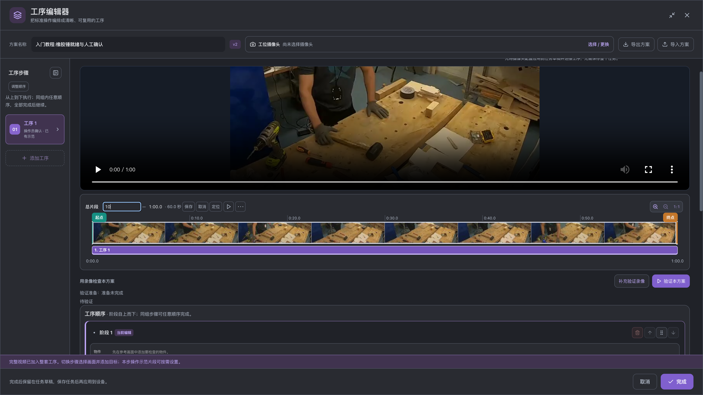{loading="lazy" decoding="async" width="3840" height="2160"}](../../assets/sop/zh-q06-locate-frame.png)

**检查点：** 视频约在 10 秒，画面中木柄和黑色锤头清楚。不要在拖动期间、遮挡严重或锤已离开画面时取主参考。

#### 2.2.2 框住完整橡胶锤，加入本步

1. 点击视频区右上 **添加目标**。进入框选后，在“画框目标名称”中填 **橡胶锤**。
2. 在画面上按住鼠标左键拖出矩形，包含**整根木柄与黑色锤头**，尽量贴合。不要只框锤头，也不要把旁边的螺丝刀或手一起当成目标。
3. 松开后检查下方 **框选预览**；拖动角点可以修正边界，名称可直接编辑。框错时点 **取消框选**，重新框。
4. 确认后点击右下 **加入本步**。本例由此建立一个逻辑目标和一张主参考，并给当前步骤加入物件检查。

[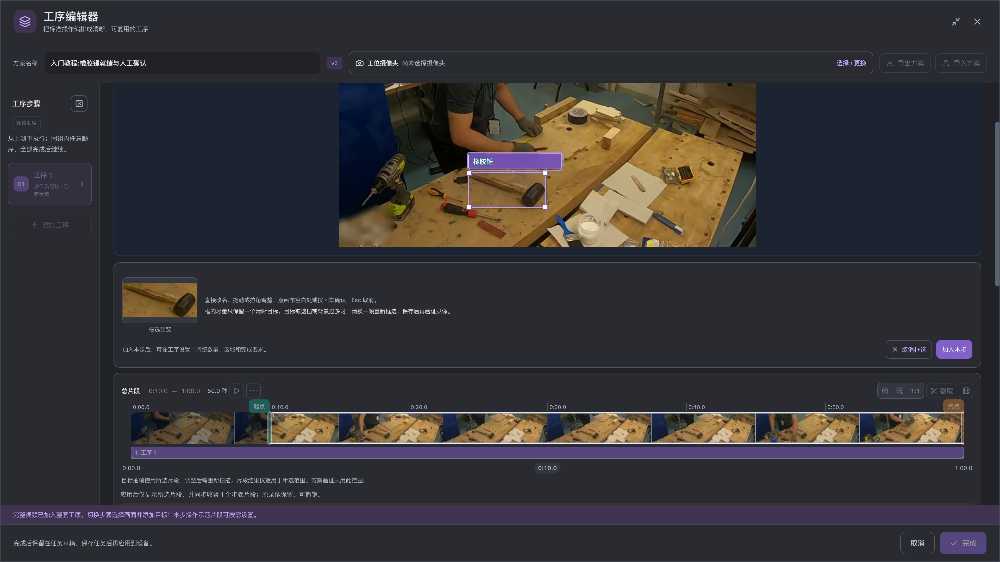{loading="lazy" decoding="async" width="3840" height="2160"}](../../assets/sop/zh-q07-draw-target.png)

**检查点：** “本步”中出现橡胶锤，目标参考数量为 1。1 张参考不是“需要 1 把锤”的计数规则；同一物件以后可以有多个参考角度。此时第一步可能默认成“视觉检测＋人工核对”，后面必须按 2.3 改为自动完成。

#### 2.2.3 首次保存，让录像检查入口就绪

1. 检查顶部已有摄像头、录像已加载、橡胶锤参考已加入。
2. 点击编辑器底部 **完成**，将当前方案交回任务草稿。若返回节点配置窗口，继续点 **确定**；若直接返回任务画布，就不用再找这一步。
3. 在外层任务画布工具栏点击 **保存**，等待保存成功，不要刚点保存就刷新。
4. 重新双击 **SOP 工序 → 编辑工序**，进入 **目标** 页，选择橡胶锤。

[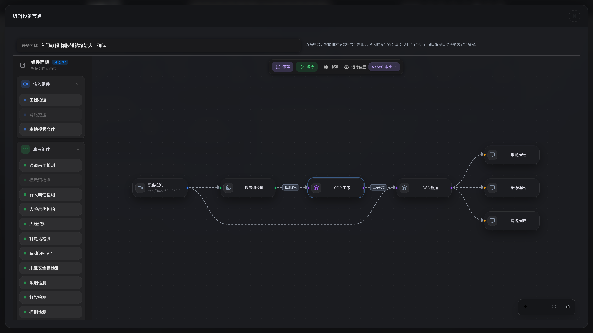{loading="lazy" decoding="async" width="3840" height="2160"}](../../assets/sop/zh-q09-first-save.png)

**检查点：** 重开后视频、摄像头和 1 张参考都还在；**完善识别** 可用。灰色且提示“先配置工位摄像头，完成编辑并保存任务，再检查录像”时，按本节补齐首次保存。等待设备能力加载后再检查，不需要重复新建任务。

#### 2.2.4 扫描目标：先看图，再看分数

1. 在 **目标** 页选 **橡胶锤**，将采样设为 **每 30 帧取 1 张**。本片 15 帧/秒，因此约每 2 秒抽一张。
2. 核对总范围为 **0–60 秒**，点击 **完善识别**（辅助名称“帮我完善识别”）。
3. 等扫描结果陆续出现。本次完整范围处理 **30/30 张**；处理数量是进度，不是“30 张都已人工验收”。
4. 点击一张缩略图，在下方原图查看锤是否框在正确位置；再依次看不同时间、手遮挡和角度变化的图片。横向缩略条超出窗口时滚动查看，不只看第一张。

[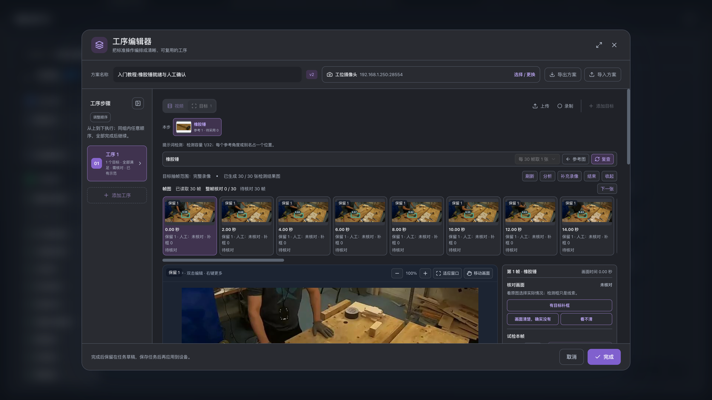{loading="lazy" decoding="async" width="3840" height="2160"}](../../assets/sop/zh-q11-scan-results.png)

**本次实测观察：** 主参考能在 10–18 秒的抽样图片中保留正确锤框；整段某些画面仍有额外框。因此本章不会把“扫描结束”说成整段识别质量已经通过。先完成下面的核对练习，再采用经过复查的参考。

#### 2.2.5 颜色、黄色候选和低于阈值分别是什么意思

| 画面/标签 | 应怎样读 | 下一步 |
|---|---|---|
| 青绿色算法框 | 当前显示结果层中的检测框 | 核对是否真的是锤，位置是否正确、有无重复 |
| 紫色人工框 | 您画出的“这里应该有目标” | 它是人工标记，不能直接证明算法检出 |
| 黄色/橙色虚线候选 | 展开的候选线索，可能尚未进入正式保留结果 | 对照标签、分数和过滤说明，不只凭颜色判断 |
| **低于阈值** | 有匹配候选，但分数未达到对应参考的门槛 | 打开识别说明，检查参考、候选和门槛 |
| 没有匹配候选 | 本次结果没有与该人工框相匹配的候选 | 先检查框的位置、画面清晰度和参考角度 |
| 待核对 / 多余检测框 | 有结果尚未与人工框或整张画面核对完 | 检查同一物件重复框和其它物件误检 |

**查看低分原因的具体操作：** 点击补框行右侧 **ⓘ（识别说明）**，展开当前结果、对应候选及门槛；候选按查询/参考分别列出时，查看对应那一张参考。若提供 **查看对应候选**，点击后在原图对照位置。分数表示相似匹配依据，不能当作“识别准确率”。

**确实低于门槛时：** 先修正不贴合、带太多背景或不清楚的框，尝试增加真正不同且清楚的角度，再试检。需要调整门槛时，使用该参考的门槛入口，记录原值，仅调整已经定位的参考，之后重验正例和无目标反例。**候选已经过门槛却未保留时**，继续看区域、重复框及其它过滤原因，降低门槛不一定解决问题。本例最终配置保留原门槛，不靠降阈值通过。

#### 2.2.6 补框后，立即“试检本帧”

这一段用扫描列表的 **0.00 秒** 图片做完整练习：即使已有锤框，也可以学习人工框如何与检测对应；没有漏检时无需为了增加参考而强行补框。

1. 点击 **0.00 秒** 缩略图，点击右侧 **有目标补框**。提示会要求先在原图画出实际目标。
2. 在原图中框住整把锤。若同类目标有多个，要分别框齐；只框您确实能看清的物件。
3. 右侧出现 **人工补框 1 / #1**。框错时点该行 **编辑** 后调整，或点 **删除** 只删除这条补框。
4. **补框后直接点击右侧“试检本帧”**。它把本帧补框当作临时参考，检查当前图片能否检出，不必先重扫整段，也不会直接改方案。
5. 等结果返回，核对“匹配几个 / 共几个”、人工框旁结果及是否还有多余检测框。需要时展开 **逐框试检结果** 和 **识别说明**。

[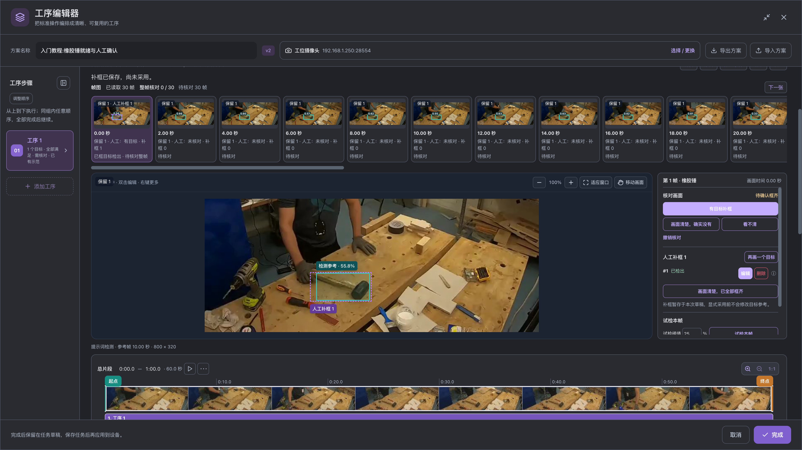{loading="lazy" decoding="async" width="3840" height="2160"}](../../assets/sop/zh-q12-human-box.png)

[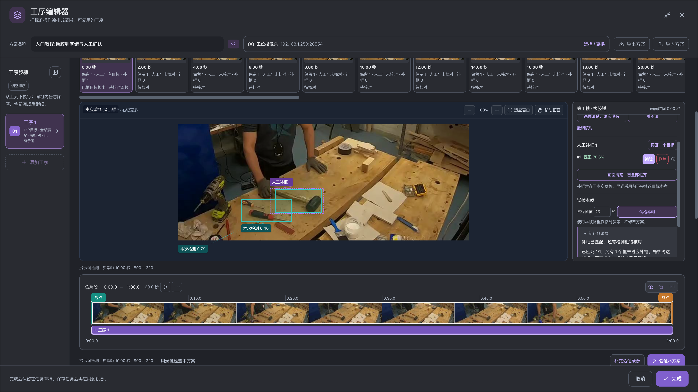{loading="lazy" decoding="async" width="3840" height="2160"}](../../assets/sop/zh-q13-trial-result.png)

**检查点：** 切换 **本次试检 / 上次扫描**，不要把旧结果当作新结果。本次截图中锤与人工框匹配，但旁边螺丝刀区域还有额外框；所以提示“补框已匹配，还有检测框待核对”。若没有匹配，先修框再试检；若多余框是误检，不要通过补一个不存在的锤来凑数量。

#### 2.2.7 核对整图，再决定采用还是放弃补框

1. 确实能看清且同类目标全部画齐后，点击 **画面清楚，已全部框齐**。此操作确认您的整图人工标记，不代表所有算法框都正确。
2. 图中确实没有锤时，才选 **画面清楚，确实没有**；看不清则选 **看不清**。不要把遮挡或模糊当作确定不存在。误选可点 **撤销核对**。
3. 需要让补框成为新参考时，在上方“待采用 1 个补框”处点击 **采用并复验**。它会显式采用补框，再重新检查录像；等待扫描完成。
4. 核对参考数量增加、待采用数量清零，并逐张比较采用前后：原来的漏检改善了吗？有没有新误检或重复框？

[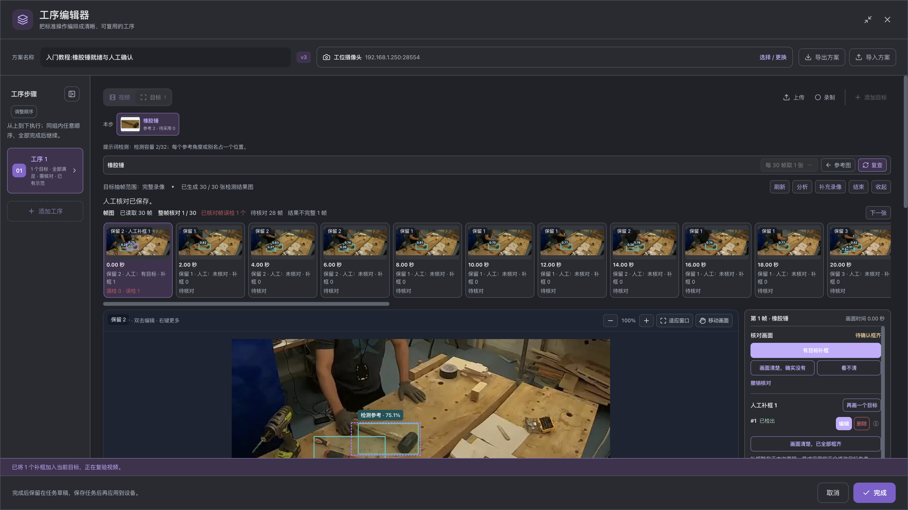{loading="lazy" decoding="async" width="3840" height="2160"}](../../assets/sop/zh-q14-adopt-recheck.png)

**本例的重要纠错分支：** 本次 0 秒补框作为第二参考后增加了额外检测，因此最终两步教程**不保留这张新增角度**。请按下面操作恢复已核对的单参考基线，不能一边看到误检一边继续累加参考。

1. 点击扫描工具栏 **结束**，返回参考图片。
2. 选中新增的 **橡胶锤 角度 2**，点击 **移除橡胶锤角度 2**。
3. 在“移除参考角度？”窗口确认删除的是这张新增参考，点击 **移除此角度**。不要删除主目标。
4. 检查橡胶锤仍存在，参考恢复 **1 张**、待采用为 **0**。再打开 **完善识别 / 复查** 检查当前配置；最终阶段验证也必须使用恢复后的配置。

[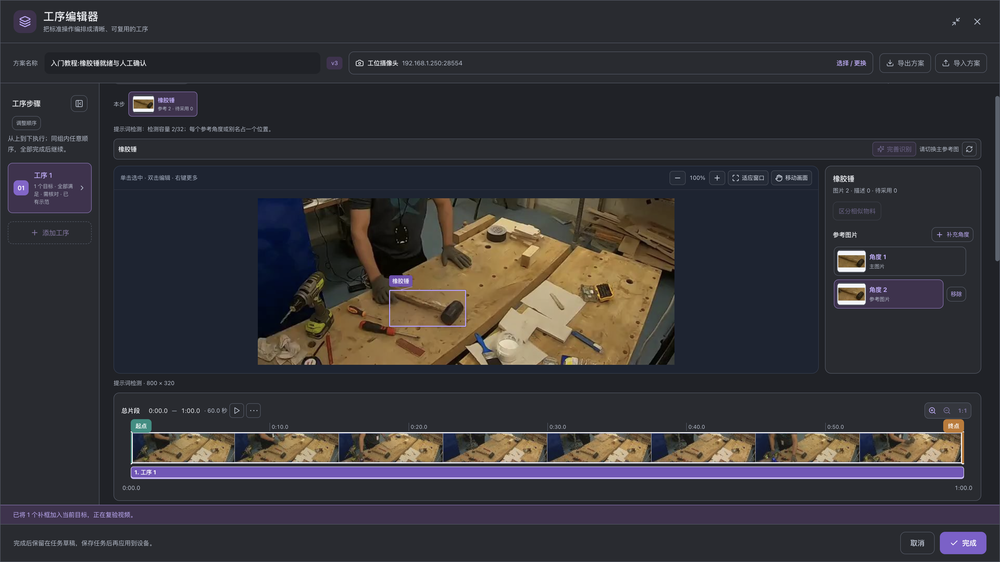{loading="lazy" decoding="async" width="3840" height="2160"}](../../assets/sop/zh-q15-reference-cleanup.png)

**检查点：** 临时补框、采用参考、复验和外层保存是四件不同的事。学会试检之后，无需把每一个练习补框都带入最终方案；只有改善且没有引入不可接受误检的参考才应保留。扫描未完成、按钮忙碌时先等待；错误结果不要用反复点击“采用”掩盖。

### 2.3 编排两步：先自动检查，再人工确认 {#five-minute-authoring}

#### 2.3.1 把第一步改名并填写操作要点

1. 在左侧点击 **工序 1**，找到主区操作名称旁的铅笔按钮。
2. 点击 **编辑工序 1 名称**，输入 **橡胶锤就绪**，按回车确认。
3. 在 **操作要点** 文本框输入：**确认橡胶锤清晰可见并放在工位上。**
4. 检查左侧名称同步变化；操作要点是给人看的说明，不能代替下面的检测规则。

#### 2.3.2 从工具栏确认物件规则

1. 找到阶段内的 **物件** 工具栏，应已有橡胶锤。它是可复用目标；不是再上传一张图片的入口。
2. 找到 **本步检查关系**，点右上 **编辑 ›**。此前“加入本步”已加入橡胶锤，先检查是否已存在，避免重复添加相同条件。
3. 若未添加，从上方拖 **橡胶锤** 到“拖入物件或点击添加”的目标位置；鼠标停在有效位置会高亮，松开后出现目标卡。也可以点该添加区选择橡胶锤。
4. 选中橡胶锤规则，**检查什么** 选 **检测到物件**，**在哪里检查** 选 **全画面**。本例不增加数量、区域或物件间位置限制。
5. 检查关系图为“检查物件 → 检测到 → 橡胶锤”，下方范围为全画面。多条件的“全部同时满足”与阶段先后顺序是不同设置。

[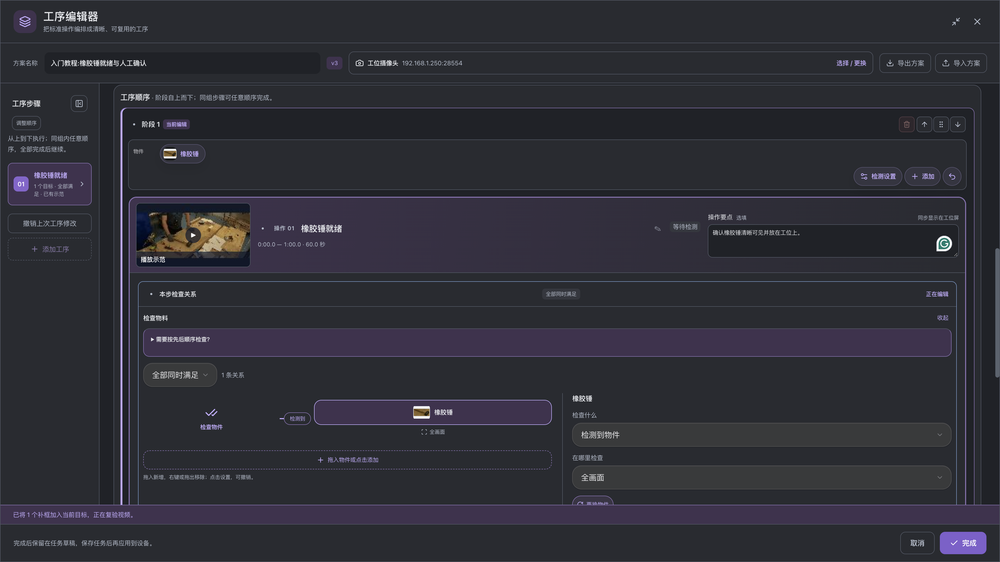{loading="lazy" decoding="async" width="3840" height="2160"}](../../assets/sop/zh-q17-object-rule.png)

**检查点：** 只有需要的橡胶锤条件。拖错目标时在当前关系图修正/移除该条件，不要直接删除工具栏中的逻辑目标。拖动无高亮时，先确认正在编辑关系、拖的是目标卡而不是视频图片。

#### 2.3.3 让第一步满足 0.8 秒后自动完成

1. 在右侧 **03 怎样确认完成？** 卡片点 **设置 ›**。
2. 在 **如何确认完成** 下拉框选择 **视觉检测后自动完成**。
3. 持续确认的秒数填 **0.8**；中断处理保留 **必须连续满足**。
4. **完成时限** 填 **0**。这是不限时，不是立即判定完成。
5. 检查摘要变为 **持续 0.8 秒 → 条件满足**，说明为检测条件满足后完成本步。若显示“视觉检测＋人工核对”，第一步仍需人点确认，必须改正。

[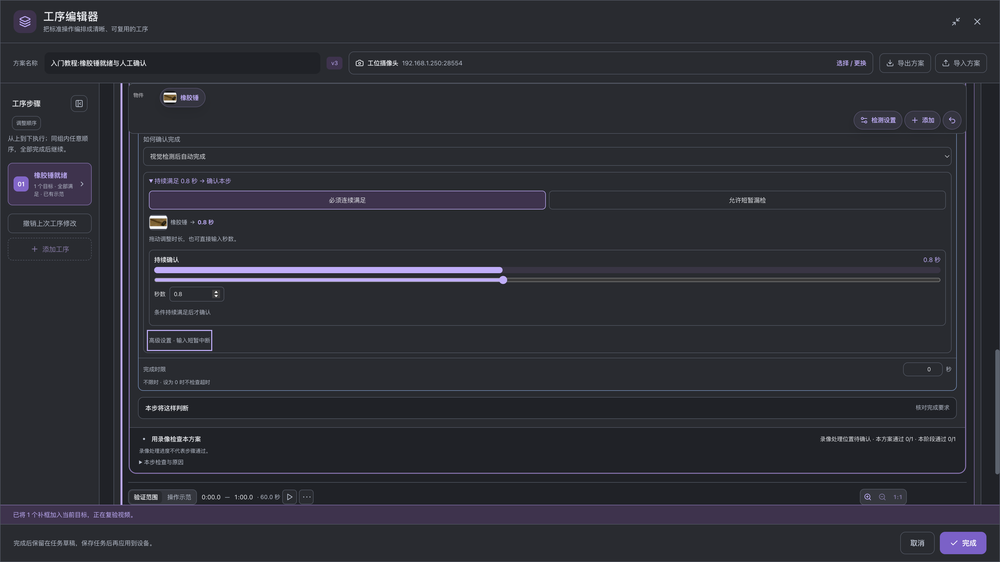{loading="lazy" decoding="async" width="3840" height="2160"}](../../assets/sop/zh-q16-auto-completion.png)

**检查点：** 自动完成仍需要正确检出、连续时间和其它已配置条件全部满足；不是点击“自动”就无条件通过。条件闪断时先看画面与检测，不要把持续时间改成 0 来掩盖问题。

#### 2.3.4 添加第二阶段，明确由操作员确认

1. 点击左侧底部 **添加工序**。新工序应在第一步下方，作为后续阶段。
2. 用名称旁铅笔改为 **人工确认完成**，操作要点填：**核对工具摆放和工位状态，确认无误后点击确认本步。**
3. 在 **怎样确认完成 → 设置 ›** 中选择 **操作员确认**。
4. 本步不添加必须由视觉满足的目标；完成时限仍为 **0**。
5. 左侧核对两步顺序为“橡胶锤就绪 → 人工确认完成”；不要把两步拖进任意顺序组。若排错，用阶段移动按钮调整到正确上下顺序。

[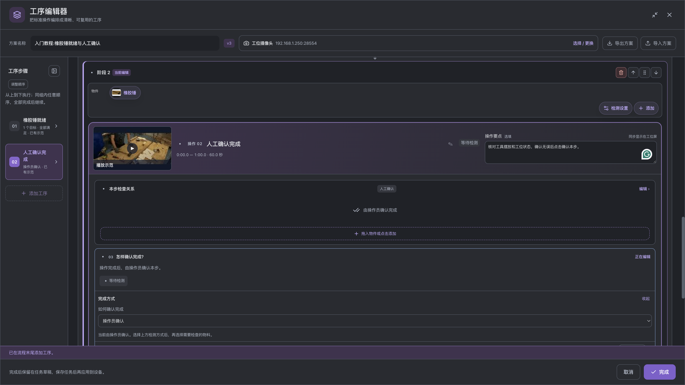{loading="lazy" decoding="async" width="3840" height="2160"}](../../assets/sop/zh-q18-manual-stage.png)

**检查点：** 第二步不会因为画面上有锤而自动通过；它必须等待人的确认。若仍显示物件规则，确认是否误复制了第一步或选择了视觉＋人工模式。

#### 2.3.5 接着完成手部动作实例

这套橡胶锤两步练习用于掌握基本操作，不能证明手部动作已经通过。完成 2.4–2.6 后，请继续同章的 **[2.7 手部动作完整实例](#five-minute-hand-example)**：另建“工具箱就绪 → 手靠近工具箱 → 人工核对完成”，使用配套录像、两个参考角度、真实手部来源，逐项设置并验证，最后在工位完成一件。该节有完整按钮、填写值、低分补框试检、检查点与超高清实拍图。

手部靠近、靠近后离开与伴随移送是不同规则。先照 2.7 完成单项靠近；需要移送与左右手时再查[手部操作详解](#hand-operations)，不要用物件基线的通过结果代替手物动作验证。

### 2.4 验第一阶段、第二阶段，再验完整方案 {#five-minute-validation}

#### 2.4.1 设置第一阶段 10–16 秒并验证

1. 选择 **橡胶锤就绪**，向下找到该阶段底部的独立时间轴，点击 **验证范围**，不要改上方总片段。
2. 点击起点时间，输入 **10**，点该时间轴的 **保存**；点击终点时间，输入 **16**，点 **保存**。
3. 检查显示 **0:10.0–0:16.0 · 6.0 秒**。切到 **操作示范** 时也核对示范是想让人回看的动作片段；它不是另一个通过按钮。
4. 点击该时间轴右侧 **验证本阶段**。等待准备完成；检测从上传文件读取，按设备实际画面和状态更新。
5. 展开 **本步检查与原因**，核对橡胶锤满足、0.8 秒持续条件完成，以及 **本阶段通过 1/1**。

[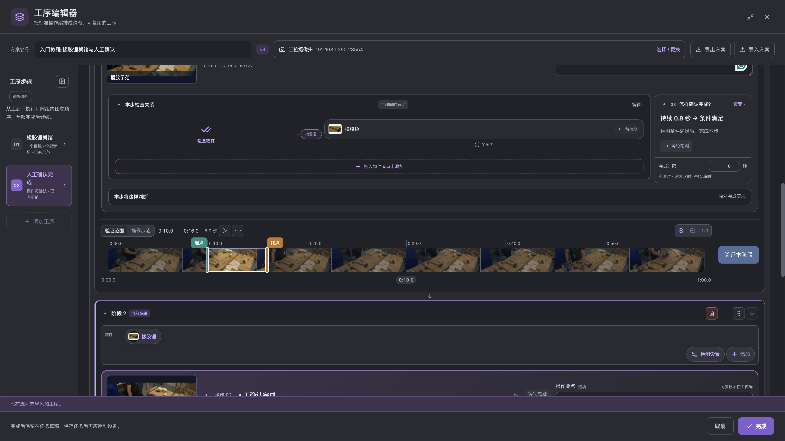{loading="lazy" decoding="async" width="3840" height="2160"}](../../assets/sop/zh-q19-stage1-range.png)

[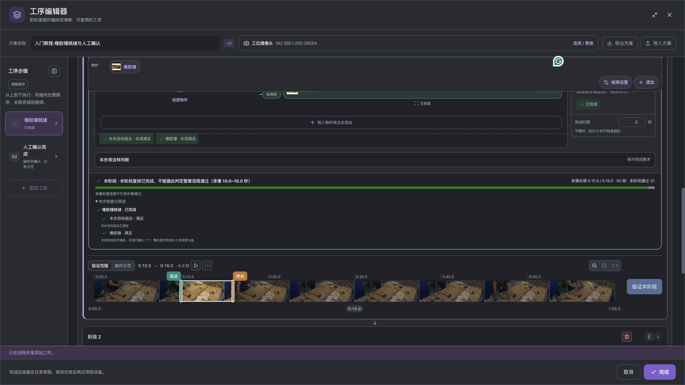{loading="lazy" decoding="async" width="3840" height="2160"}](../../assets/sop/zh-q21-stage1-passed.png)

**不符合时：** 目标未满足先核对参考及画面；检测正确但时间未达到则看是否中断；状态不确定先看输入/连接提示。修改一个已定位的问题后重验当前阶段，不要同时改目标、阈值和时间。

#### 2.4.2 设置第二阶段 16–60 秒，亲手确认一次

1. 选 **人工确认完成**，找到它自己的阶段时间轴，点击 **验证范围**。
2. 起点填 **16** 并保存，终点填 **60** 并保存。留 44 秒让新手阅读和操作，不使用只有几秒的人工确认窗口。
3. 点击 **验证本阶段**，等准备结束。看到“等待确认”和 **确认本步** 后，先核对实际画面及操作要点。
4. **在本段录像仍在验证时**点击一次 **确认本步**，等待设备接受，再检查步骤切换为已完成。不要等录像已经结束后才找按钮。
5. 等录像自然结束，展开原因，应看到 **本阶段通过 1/1**。

[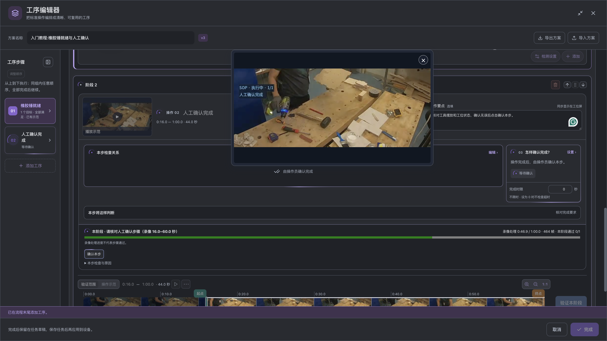{loading="lazy" decoding="async" width="3840" height="2160"}](../../assets/sop/zh-q22-stage2-manual-ready.png)

[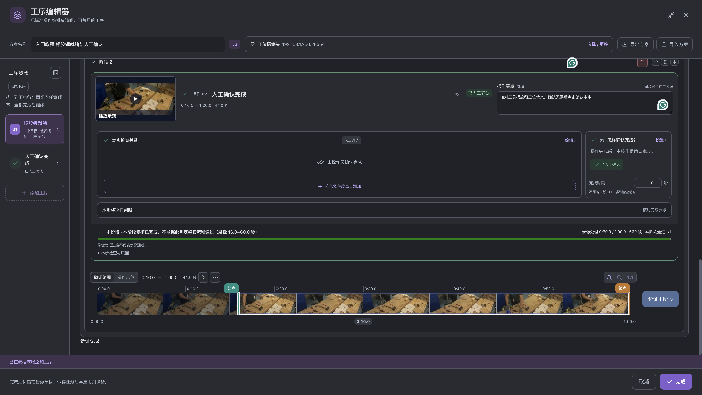{loading="lazy" decoding="async" width="3840" height="2160"}](../../assets/sop/zh-q24-stage2-passed.png)

**不符合时：** 如果录像结束仍为 0/1，检查是否错过实时确认；重新启动本阶段验证并在运行时确认。按钮不可用时读原因，检查当前步骤、画面是否有效及是否确实选择“操作员确认”，不要用重复点击代替核对。

#### 2.4.3 用完整 0–60 秒检查两步串行推进

1. 回到上方总片段，核对 **0:00.0–1:00.0 · 60.0 秒**。若显示 10–20 秒，改回起点 **0**、终点 **60** 并保存。
2. 点击总片段下方 **验证本方案**，进入带“验证工序列表、判断详情、盒子检测画面”的验证视图。
3. 第一阶段先进入“进行中”；橡胶锤条件连续满足 0.8 秒后显示 **已完成**，第二阶段才进入 **等待确认**。
4. 阅读右侧“人工确认完成”的说明，在录像仍运行时点击 **已核对画面，确认本步**。这是这个验证入口的按钮文字，与内嵌阶段验证的“确认本步”作用对应。
5. 等待确认回读与整段结束。核对两个步骤均完成、通过数 **2/2**、结果为 **本段录像的工序条件已满足**。

[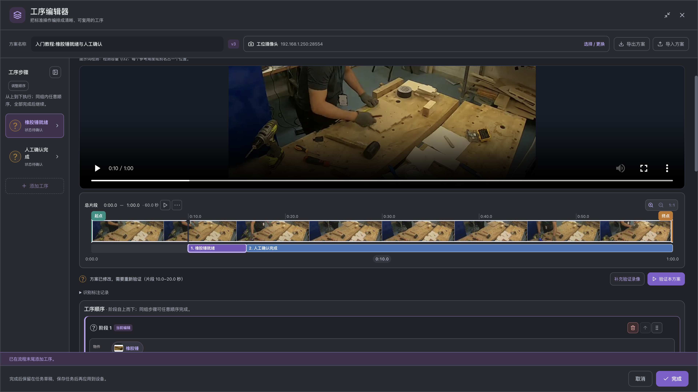{loading="lazy" decoding="async" width="3840" height="2160"}](../../assets/sop/zh-q20-plan-range.png)

[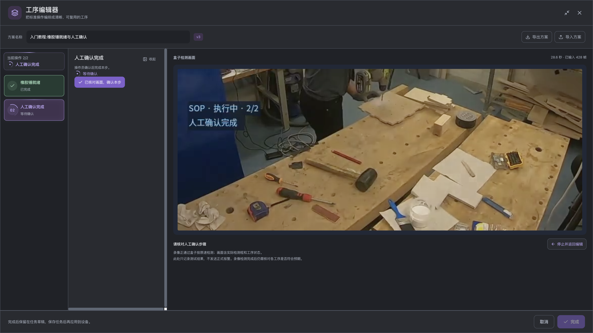{loading="lazy" decoding="async" width="3840" height="2160"}](../../assets/sop/zh-q23-plan-manual-ready.png)

[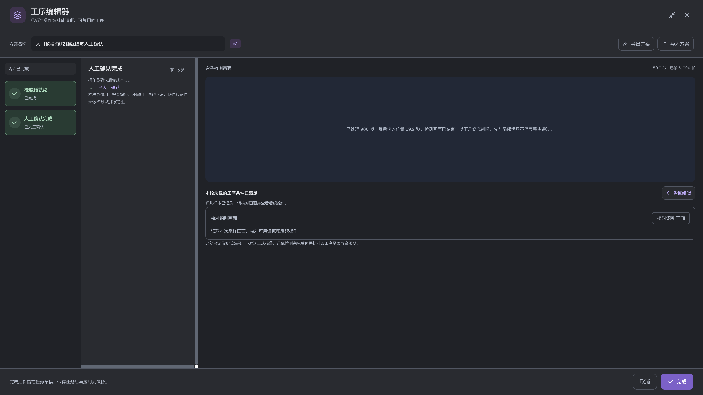{loading="lazy" decoding="async" width="3840" height="2160"}](../../assets/sop/zh-q25-plan-passed.png)

**检查点：** “录像处理结束”“某阶段通过”“本段录像工序条件满足”含义不同。只验 10–16 秒不能证明第二阶段；只选总片段的一小段也不能作为完整方案通过。修改了参考、规则、范围或顺序后，必须重新验证受影响阶段和整套方案。

### 2.5 理解自动、人工与视觉后人工确认 {#five-minute-completion}

| 您希望的行为 | 选择的完成方式 | 运行时应看到什么 | 不该怎样操作 |
|---|---|---|---|
| 画面条件稳定后直接推进 | 视觉检测后自动完成 | 运行动效 → 条件持续进度 → 已完成 | 不要额外等待人工按钮 |
| 由人检查并确认 | 操作员确认 | 待人工核对 → 确认按钮 → 已完成 | 不把检测到目标当成人已确认 |
| 先满足视觉，再由人核对 | 视觉检测＋人工核对 | 先检测；满足后提示可人工确认；确认才完成 | 条件未就绪时不能跳过视觉要求 |

本例使用前两行：**橡胶锤连续满足 0.8 秒 → 第一步自动完成 → 第二步等待人工 → 人确认 → 两步完成**。要做全自动流程，每一步都必须有可可靠观察的规则，并选视觉自动完成；不能把纯人工步骤改成自动而不配置条件。

运行中的细环/光流用于提示正在处理；人工确认用待核对状态提示；绿色勾选表示对应条件或步骤完成。**动画不是判据，最终要核对文字、原因和实际画面。** 暂停、失联或不确定时先处理对应原因。正在执行的步骤或目标会按状态变化进入可视区域；手动翻看其它内容时仍可回到当前步骤，不需要靠反复刷新追踪。

### 2.6 保存、重开，在工位完成一件 {#five-minute-station}

#### 2.6.1 完成编辑并真正保存任务

1. 整体验证结束后点 **返回编辑**。检查两步名称、顺序、主参考数量 1、自动 0.8 秒、第二步人工确认，以及三个时间范围。
2. 点击编辑器底部 **完成**。若返回 SOP 节点配置，点 **确定**；若已回画布则继续下一步。
3. 点击外层工具栏 **保存**，等待成功提示。编辑器“完成”只交回草稿，不能替代任务保存。
4. 重新打开同一任务的 **SOP 工序 → 编辑工序**，逐项核对以上配置仍存在。确认无误后返回，不要额外改动。

[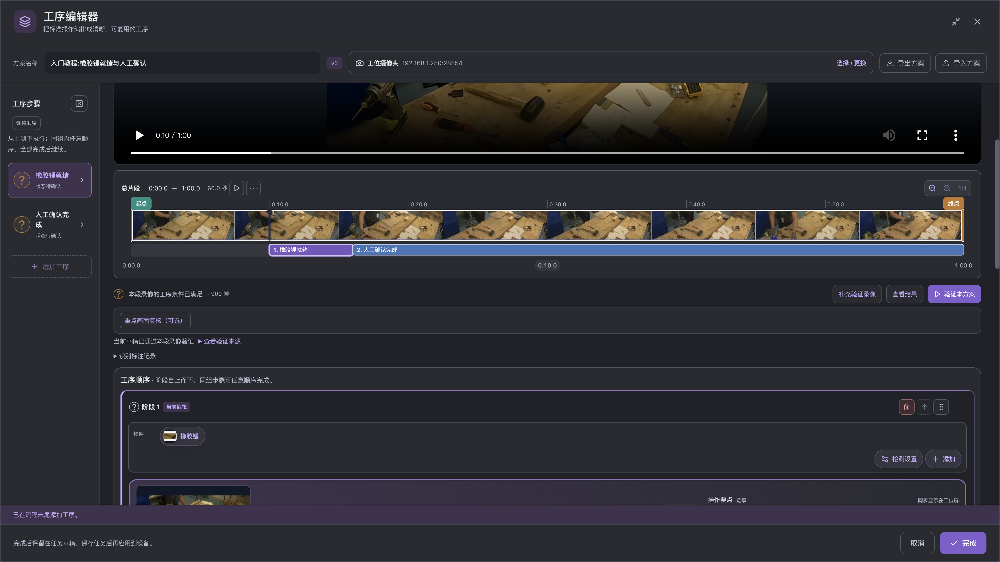{loading="lazy" decoding="async" width="3840" height="2160"}](../../assets/sop/zh-q26-complete-editor.png)

**检查点：** 关闭再打开仍是相同配置。若出现“当前编辑内容与已保存方案不同，待验证”，先检查是否保存了外层任务，或重开后又有改动；不要把旧的通过结果当作新草稿的验证结果。

#### 2.6.2 启动任务，打开工位页

1. 真实运行前确认任务使用的摄像头能看到同一工位和工具。本例截图的运行演示使用同一示例录像的受控视频源；客户现场请用自己的摄像头、工具参考和对应录像先复验。
2. 返回任务画布，点击 **运行**；等待任务进入运行状态。若提示其它任务占用资源，先协调，不强行停止他人的任务。
3. 回到任务卡片，点击本练习任务的 **工位运行**。核对工位标题是本例名称、视频画面确实在更新。
4. 点击 **开始本件**。任务运行与开始本件是两层操作：前者启动检测任务，后者开始记录这一件产品的工序。

[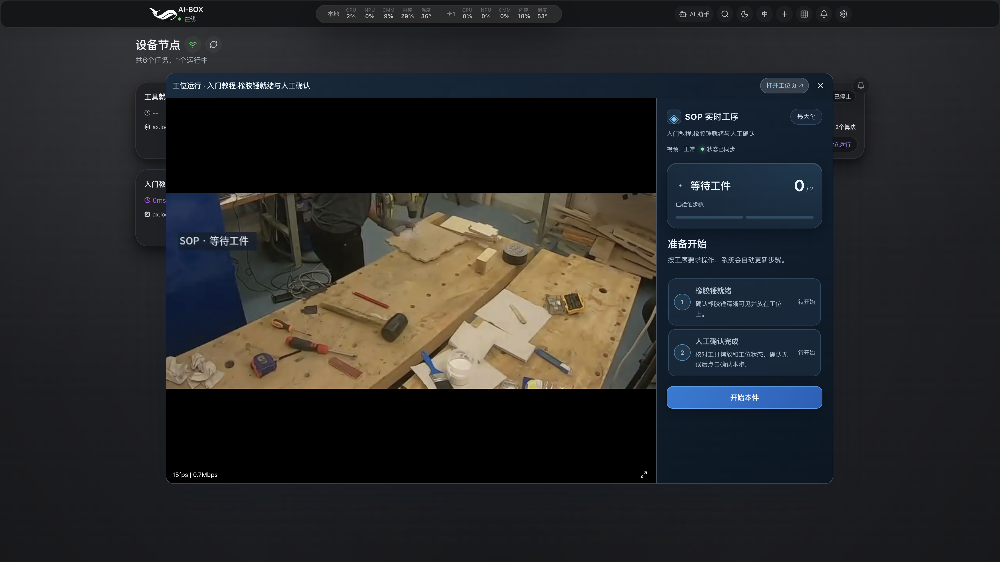{loading="lazy" decoding="async" width="3840" height="2160"}](../../assets/sop/zh-q27-station-ready.png)

#### 2.6.3 观察自动推进，再确认人工步骤

1. 放好橡胶锤，保持画面清楚。观察 **橡胶锤就绪** 条件连续满足，步骤卡出现绿色勾选并显示 **已验证**。
2. 当前操作转到 **人工确认完成**。本例是纯人工模式，步骤可能显示“进行中”，并出现 **人工确认完成** 按钮；先看操作要点，核对真实工具摆放和工位状态。
3. 点击该卡片上的 **人工确认完成**；等待状态回读。若使用“视觉检测＋人工核对”模式，就绪时才会出现“待人工核对”及“核对现场并确认本步”入口，不能与本例纯人工按钮混同。不要把页面滚动到位或看到呼吸动画当作已确认。
4. 检查两张卡都 **已验证**、计数 **2/2**，再按当前入口提示结束本件。若系统已自动进入“本件合规完成”，无需再找不存在的完成按钮。

[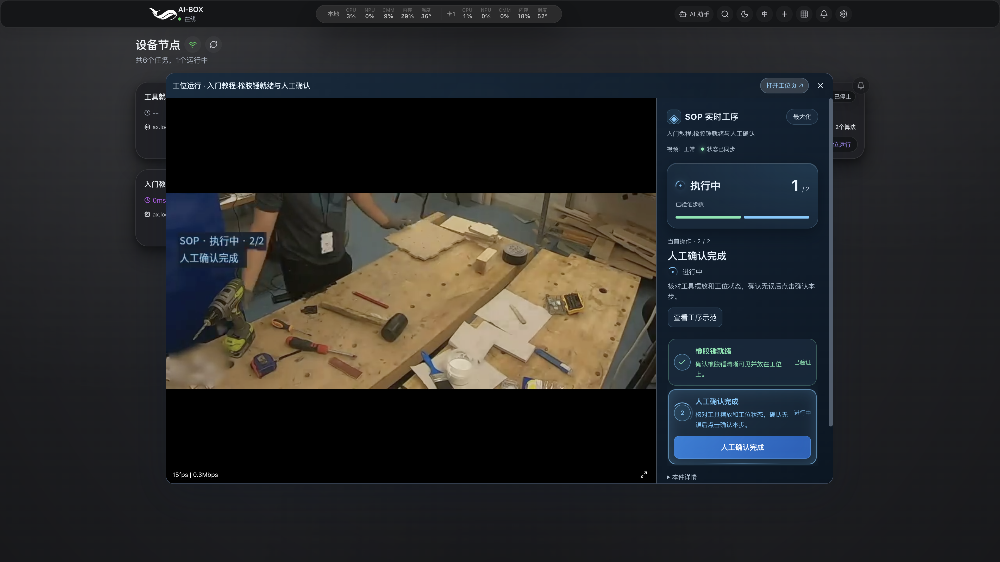{loading="lazy" decoding="async" width="3840" height="2160"}](../../assets/sop/zh-q28-station-manual.png)

[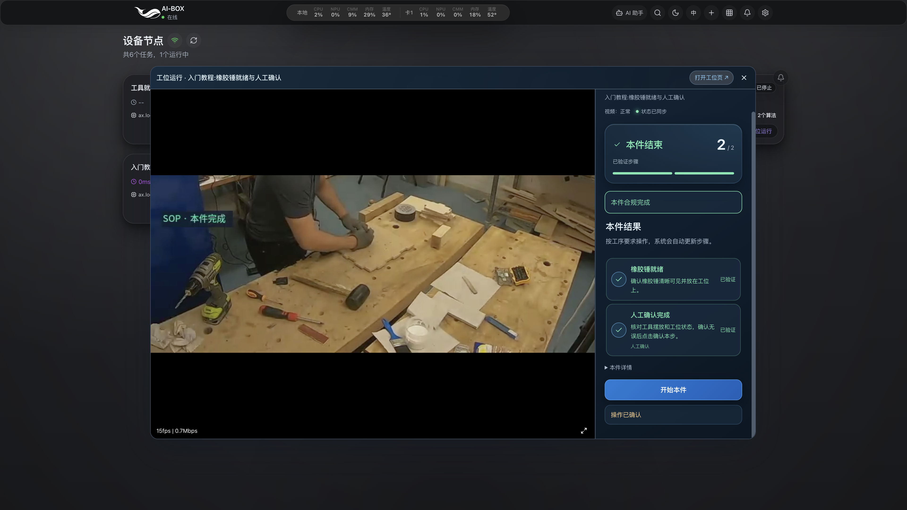{loading="lazy" decoding="async" width="3840" height="2160"}](../../assets/sop/zh-q29-station-completed.png)

**不符合时：** 第一步卡住先看是否看到正确锤、视频是否新鲜、条件为何不满足；第二步卡住先看是否已确认以及确认是否被接受。断流或暂停先恢复有效输入，不能通过刷新网页把未完成步骤变成通过。本件结束后再点“开始本件”才进入下一件；练习结束停止自己启动的教程任务。

#### 2.6.4 最后按这张表验收自己的练习

| 位置 | 应核对的结果 | 不一致时回到哪里 |
|---|---|---|
| 视频 | 同一个 60 秒示例能正常播放 | 2.1.3 上传/回放 |
| 目标 | 橡胶锤完整主参考，最终参考 1 张 | 2.2.2；新增角度问题看 2.2.7 |
| 识别 | 人工框与算法结果分开；多余框已识别并处理 | 2.2.4–2.2.7 |
| 阶段 1 | 10–16 秒，自动连续 0.8 秒，本阶段 1/1 | 2.3.2–2.4.1 |
| 阶段 2 | 16–60 秒，运行时人工确认，本阶段 1/1 | 2.3.4、2.4.2 |
| 整套验证 | 0–60 秒，两步顺序正确，完整结束 2/2 | 2.4.3 |
| 保存 | 完成 → 必要时确定 → 外层保存；重开仍正确 | 2.6.1 |
| 工位 | 开始本件，自动第一步，人确认第二步，本件合规完成 | 2.6.2–2.6.3 |

这份示例证明您已掌握一条实际可操作的路径；上线自己的工艺时，还需检查缺件、误操作、遮挡、错误顺序和断流等反例。继续查[工具与按钮详解](#control-reference)，或用[实施准备](#preparation)把真实工艺整理成新的方案。

### 2.7 手部动作完整实例：工具箱就绪 → 手靠近工具箱 → 人工核对 {#five-minute-hand-example}

这一节从新建任务重新走完一套**同时使用物件检测和手部关键点**的实例，不是在上一套物件示例后加一张示意图。请按 2.7.1–2.7.16 操作；每一步的检查点都满足后再继续。先前的橡胶锤任务保留，另建本节练习任务。

本例使用一段真实的工具整理录像：工具箱清晰出现，手在工具箱附近操作，最后由操作员核对。我们只判断**可见的手与工具箱的靠近关系**，不把它解释成“拿牢工具”“整理正确”或“装配合格”。本次实测：手部单阶段 **1/1**；整套本地录像验证 **3/3，已人工确认**；工位运行 **3/3，本件合规完成**。这些结果对应下表的参考与规则，不代表整段录像每帧识别都正确。

| 项目 | 请照着填写或核对 |
|---|---|
| 任务、方案名称 | `入门教程:工具箱与手部操作` |
| 配套录像 | [toolbox-hand-31s.mp4（31.2 秒，约 2.5 MB）](../../assets/sop/toolbox-hand-31s.mp4)；480 × 480、10 帧/秒，完整原片 |
| 一个逻辑物件 | `工具箱`；28.8 秒的合盖主参考＋4.4 秒的开盖补充角度，最终参考 2、待采用 0 |
| 阶段 1 | `工具箱就绪`；全画面检测到工具箱，连续 0.8 秒，视觉检测后自动完成 |
| 阶段 2 | `手靠近工具箱`；任意一手靠近工具箱；双方全画面；距离范围 25%；累计检出 0.8 秒；视觉检测后自动完成 |
| 阶段 2 的时间保护 | 最长漏检间隔 0.3 秒；累计观察范围 1.6 秒；最低检出时间占比 80%；输入中断容忍 0.5 秒 |
| 阶段 3 | `人工核对完成`；操作员确认；不添加视觉检查项 |
| 时间范围 | 三个阶段的验证范围、示范范围及总片段均用 **0–31.2 秒**；阶段仍自上而下串行执行 |
| 完成时限 | 三步均 0 秒，不额外检查超时 |

素材来自 FraunhoferIPK 的 IndEgo 数据集，按 CC BY 4.0 提供，下载文件未裁剪、未转码。出处及固定版本见[素材署名](#reference--7-示例素材与截图来源)。本节配图都是实际界面原生 **3840 × 2160 PNG**，点击打开原图；录像自身仍是 480 × 480。

#### 2.7.1 下载录像，创建“物件＋手部”的独立任务

1. 下载上表录像到电脑，先在本地播放，确认能看到开合的黑色工具箱及操作者的手，时长约 31 秒。不要下载网页缩略图，也不要用上一节的橡胶锤录像替代。
2. 回到 AIBox 任务管理，点击右上角 **添加任务 → SOP 工序**。
3. 在创建方式中选择 **还要检查手部操作**，即“组合手、物件和操作顺序”这一项。任务名填写 `入门教程:工具箱与手部操作`，点 **创建并编辑**。
4. 在画布点击 **排列**。应看到同一视频输入分别连接 **提示词检测** 与 **手部关键点**，两路的“检测结果”都进入 **SOP 工序**；SOP 状态再进入 OSD。不要只保留物件检测一条线。

[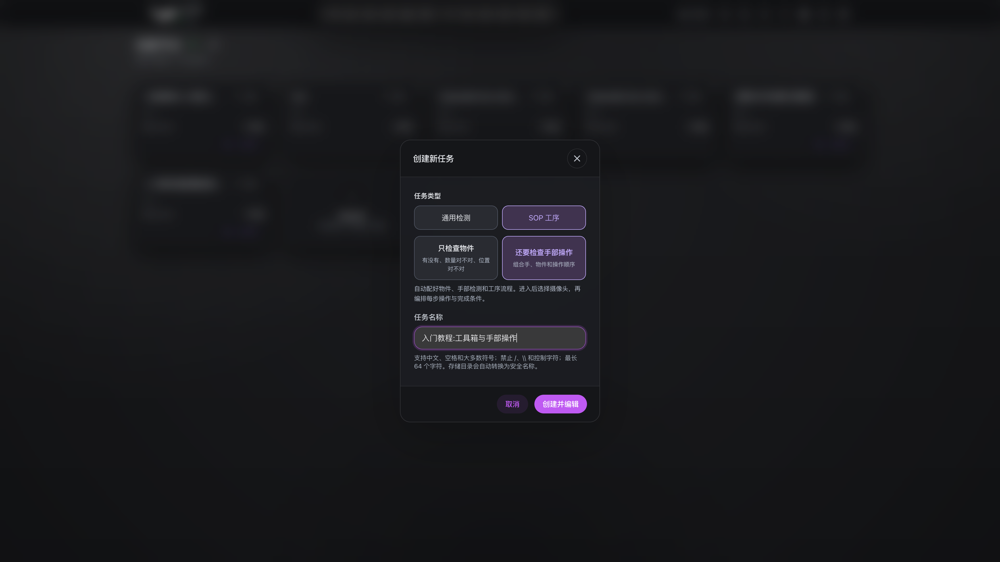{loading="lazy" decoding="async" width="3840" height="2160"}](../../assets/sop/zh-h01-create-hand-task.png)

[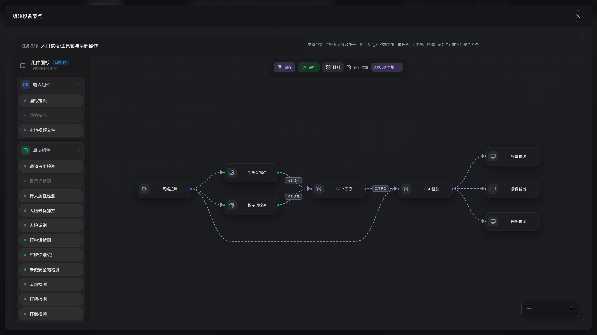{loading="lazy" decoding="async" width="3840" height="2160"}](../../assets/sop/zh-h02-hand-input-graph.png)

**检查点：** 两个算法节点均存在，连线正确。若没有手部关键点，先回创建方式核对，或按[检测来源设置](#hand-operations)补齐已有手部来源；不要把物件参考框命名为“手”来代替手部关键点。

#### 2.7.2 打开编辑器，上传完整本地录像

1. 双击画布 **SOP 工序**，点击 **编辑工序**；点击窗口右上角 **最大化编辑器**。
2. 方案名称也填写上面的教程名。在摄像头选择处，核对的是这套任务现场运行时的输入；截图中的测试 IP 和端口不是客户可长期使用的地址，不要照抄。
3. 点击画面上方 **上传**，选择刚下载的 `toolbox-hand-31s.mp4`。等上传、视频解码及缩略图读取完成。
4. 点播放再暂停。检查总时长 **0:31.2**、画面内容和缩略图正确。若刚定位时图片尚未就绪，等画面出现后再添加目标。
5. 如果使用自己的现场录像，入口是 **录制**：选择摄像头，开始录制完整动作，停止并保存，再确认能回放。要复现本例数值和截图，请先使用本节配套文件。

[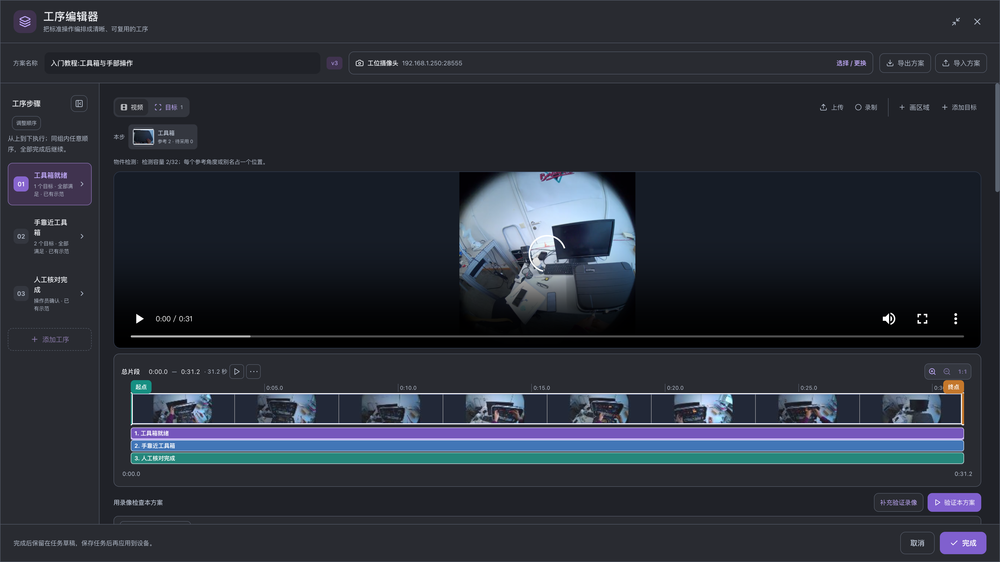{loading="lazy" decoding="async" width="3840" height="2160"}](../../assets/sop/zh-h03-video-loaded.png)

**检查点：** 本节的阶段和整体验证读取上传文件，**不需要为编辑验证启动 RTSP 推流**。网络输入用于后面的真实任务运行；两个用途请分开核对。

#### 2.7.3 在 28.8 秒建立“工具箱”主参考

1. 点击视频总片段的起点时间，输入 **28.8**，点 **定位**。等合盖工具箱画面出现，不要在上一帧还未更新时画框。
2. 点击 **添加目标**，从工具箱左上外缘拖到右下外缘，包含完整箱体，少带背景，不要把手、显示器或整张桌子一起圈入。
3. 在 **目标名称**（输入框的可访问名称为“画面内目标名称”）填 `工具箱`，点 **加入本步**。等参考图保存完成。
4. 核对本步目标只有一个“工具箱”、主参考一张。480 × 480 原画面中的参考位置约为左上 **(202,280)**、右下 **(409,425)**；坐标只是帮助找位置，实际在图片上拖框，不要按网页窗口像素照搬。

[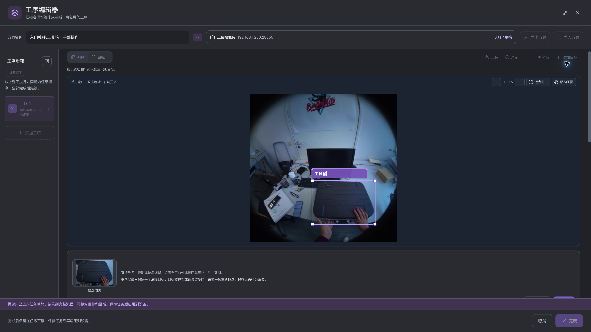{loading="lazy" decoding="async" width="3840" height="2160"}](../../assets/sop/zh-h04-closed-reference.png)

**不符合时：** 误框整张桌面就取消重画；参考还在上传时先等保存，不要连续点“加入本步”建出多个重复目标。

#### 2.7.4 给同一工具箱补一个开盖角度

1. 选择已有 **工具箱**，点击其参考图片区的 **补充角度**，不要再点“添加目标”新建第二个工具箱。
2. 返回视频画面，定位 **4.4 秒**。选择 **使用当前画面**，在开盖工具箱的完整外轮廓补框，包含箱盖和下半箱体。
3. 点 **保存补充参考**，等待保存。该帧原图参考范围约为 **(111,207)–(354,478)**。
4. 回到目标列表，核对 **一个工具箱，参考 2，待采用 0**。打开角度 1、角度 2，应分别看到合盖和开盖，目标名称仍相同。
5. 刚才精确定位可能改变总片段起点。点击 **扩大范围包含全部阶段**，或编辑总片段起止时间，恢复 **0–31.2 秒**。核对三个阶段范围前也要检查这里。
6. 先保存这份两参考基线：**完成 → 确定（若出现）→ 外层保存**，等保存完成再重开编辑器。下一小节的补框试检是独立练习；不采用时可取消本轮草稿，返回这份已保存基线。

[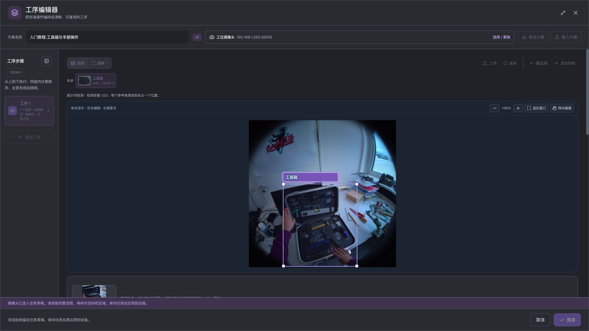{loading="lazy" decoding="async" width="3840" height="2160"}](../../assets/sop/zh-h05-open-reference.png)

**检查点：** “两个角度”不是“两个实物”。参考角度各占检测容量，不能通过重复目标名来表达同一箱体的不同外观。

#### 2.7.5 先看一次“完善识别”，读懂黄色与规则后 0

1. 选中 **工具箱**，点击 **完善识别**。保持本例每 30 帧一张，完整 31.2 秒录像会得到 **11 张**扫描结果图；等状态显示已生成 11/11。
2. 点 **3.00 秒**缩略图，看工具箱位置和候选分数；再点 **24.00 秒**或 **30.00 秒**的黄色结果，逐张看原图。
3. 本次真实扫描中，这两张的最高候选约 **0.21**，当前试检门槛 **25%**，所以显示 **规则后 0**。黄色表示有待核对的低分候选，不是已满足工序；规则筛掉候选也不等于实物确实不存在。
4. 在右侧按真实画面选择：确有工具箱但漏检/低分时选 **有目标补框**；画面清楚且确实没有才选 **画面清楚，确实没有**；遮挡或模糊无法判断选 **看不清**。

[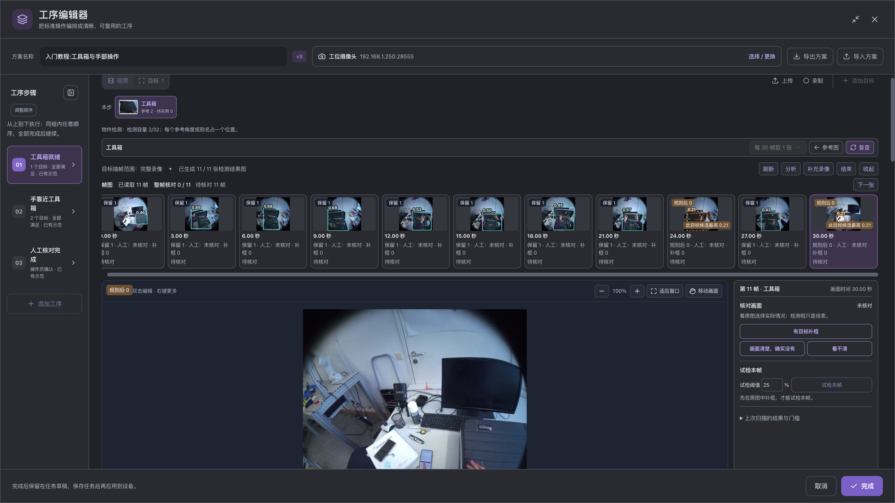{loading="lazy" decoding="async" width="3840" height="2160"}](../../assets/sop/zh-h19-low-score-frame.png)

**检查点：** 数值是该帧候选分数，不是方案准确率。“11/11 已生成”只是扫描完成，不是 11 帧人工复核全通过。识别完整操作见 [2.2](#five-minute-recognition)，本例下面继续示范同帧试检。

#### 2.7.6 补框后直接试检本帧，先看结果再决定采用

1. 在 **24.00 秒**原图点 **有目标补框**，拖出工具箱实际外轮廓。若画布被窗口底部遮住，先滚动到整张图片都可见，再画框；不要画到页面按钮上。
2. 右侧应出现 **人工补框 1**。框不准确点对应框的 **编辑**，多画了就点 **删除**；有多个真实目标要逐个补齐，最后才选 **画面清楚，已全部框齐**。
3. 直接点 **试检本帧**。这是把本帧补框作为**临时参考**检测当前图片，不会自动修改已保存方案。保持 25% 门槛，等待“正在检测”结束。
4. 看 **新补框试检** 与 **逐框试检结果**，核对检测位置是否与人工框对应，不能只看图上出现了彩色框。本例这张实测仍显示 **1 个补框仍未匹配 / 同帧试检尚未通过**，应继续核对参考内容与候选位置，不能写成“试检通过”。
5. **本入门方案最终仍用前面两张参考。** 这一张用于认识低分处理：不要采用这张未通过的临时框；点击 **结束**返回目标区，检查待采用数量。如有待采用框，在此次练习中返回编辑器底部 **取消**，放弃这一轮未采用草稿，再重开已保存方案，核对参考 2、待采用 0。不要点“完成＋保存”把练习草稿混入已验证版本。

[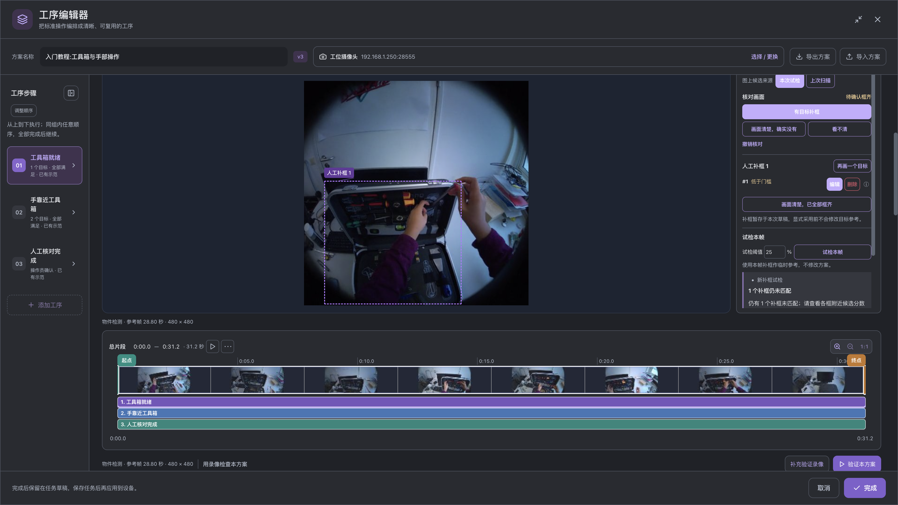{loading="lazy" decoding="async" width="3840" height="2160"}](../../assets/sop/zh-h21-frame-trial-result.png)

!!! note "什么时候才采用并应用？"
    对您自己的新素材，先换到清楚、有代表性的角度重新补框和试检。确认参考内容正确、结果位置匹配后，回目标区显式点 **采用补框**，再点 **复查**重新扫描当前目标。复查、阶段验证、整体验证都需按新参考重做，最后 **完成 → 确定（若出现）→ 外层保存**。只在某一帧试检命中，不等于其它帧或整套流程已通过；不要只降低门槛凑出绿框。本例已有两张清楚参考、在有效动作时段能够完成条件，不要求采用这张试检未通过的参考。

#### 2.7.7 编排阶段 1：工具箱就绪

1. 选择第一步，点名称旁铅笔，改名 **工具箱就绪**；操作要点填“确认工具箱清晰可见，等待物件条件稳定”。
2. 点 **本步检查关系 → 编辑**，检查对象是 **工具箱**、关系是 **检测到**、范围是 **全画面**，保留一项条件。
3. 点 **怎样确认完成 → 设置**，在“如何确认完成”选择 **视觉检测后自动完成**；检测中断时用 **必须连续满足**，秒数填 **0.8**。
4. 完成时限保持 **0**。阶段底部选 **验证范围**，起止 **0–31.2 秒**；切到 **操作示范**，也核对为完整原片。

[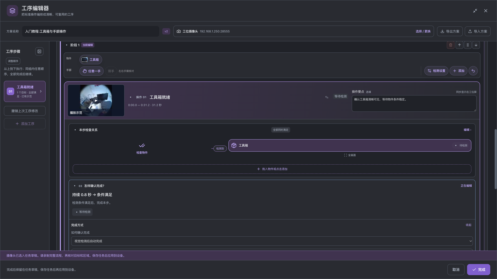{loading="lazy" decoding="async" width="3840" height="2160"}](../../assets/sop/zh-h06-object-auto.png)

**检查点：** 预览写“持续 0.8 秒 → 条件满足”，不是“人工核对”。不要把第一阶段与第二阶段放进任意顺序组。

#### 2.7.8 添加阶段 2，确认手部来源

1. 点左侧 **添加工序**，把新步骤改名 **手靠近工具箱**。操作要点填“将任意一只可见手靠近工具箱，保持片刻；本步只检查可见的靠近关系”。
2. 选择这一步，点阶段工具栏 **检测设置**，核对有 **手部关键点**来源。返回后应出现 **手部 → 任意一手**；手部内置识别，无需像物件那样再画一张“手”的参考图。
3. 本例使用 **任意一手**。左、右手入口尚未核对方向时可能不出现或提示“左右手需核对”，不要强行选用；现场确需区分时才按[手部方向说明](#hand-operations)完成校对。
4. 保持本阶段验证范围和操作示范 **0–31.2 秒**。这段第一视角录像机位会动，双方都用全画面，本例不画固定的起点/终点区域。

**检查点：** 算法图有手部关键点，工具栏有任意一手；对象仍只有一个工具箱。手不可见时不能把它判成“已经远离”。

#### 2.7.9 从“本步检查关系”添加单项靠近

1. 在第二步点 **本步检查关系 → 编辑**。新建步骤默认可能是人工确认，点 **改为视觉检测并添加空间关系**；已有视觉规则时入口叫 **添加空间关系 · 可选择手与物件**。
2. “选择目标 A”中点 **任意一手 · 手部关键点**，再点 **下一步：选择 B**。
3. “选择目标 B”中点 **工具箱 · 物件检测**，核对 A 与 B 没有选反，再点 **添加空间关系**。
4. 点图中的 **靠近**关系，在右侧确认“怎样配合”为 **手靠近物件**。手的判断区域与工具箱判断区域都选 **全画面**。
5. 展开 **更多设置**，距离范围保持 **25%**。这是随物件大小变化的相对距离范围，不是 25 厘米，也不是手部识别置信度。

[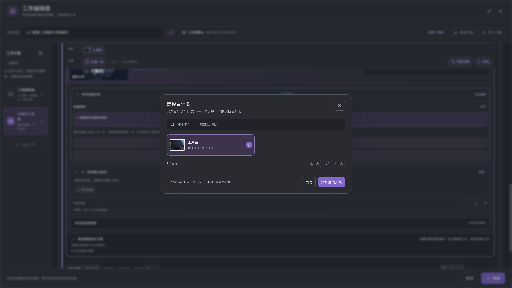{loading="lazy" decoding="async" width="3840" height="2160"}](../../assets/sop/zh-h08-hand-select.png)

[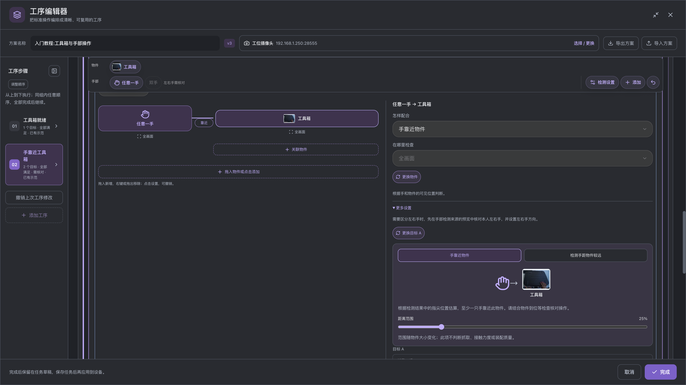{loading="lazy" decoding="async" width="3840" height="2160"}](../../assets/sop/zh-h09-near-rule.png)

**检查点：** 关系图为 **任意一手 → 靠近 → 工具箱**。工具栏中的“靠近后离开”或“伴随移送”是不同动作模板，需要完整离开过程或起终点；本例不要用它们替代单项靠近。

#### 2.7.10 让靠近步骤自动完成，正确理解时间保护

1. 点第二步 **怎样确认完成 → 设置**。新建手物关系可能默认“视觉检测＋人工核对”；本例改为 **视觉检测后自动完成**，把人工核对留在独立第三步。
2. 点 **允许短暂漏检**，累计检出秒数 **0.8**。漏检时暂停累计，漏检时间不算在这 0.8 秒里。
3. 展开 **高级设置 · 输入短暂中断**，核对 **输入中断容忍 0.5 秒**；下方 **最长漏检间隔 0.3 秒、累计观察范围 1.6 秒、最低检出时间占比 80%**。
4. 完成时限仍 **0**。收起设置后，完成预览应显示 **累计检出 0.8 秒（允许短暂漏检）**，并注明检测条件满足后完成本步。

[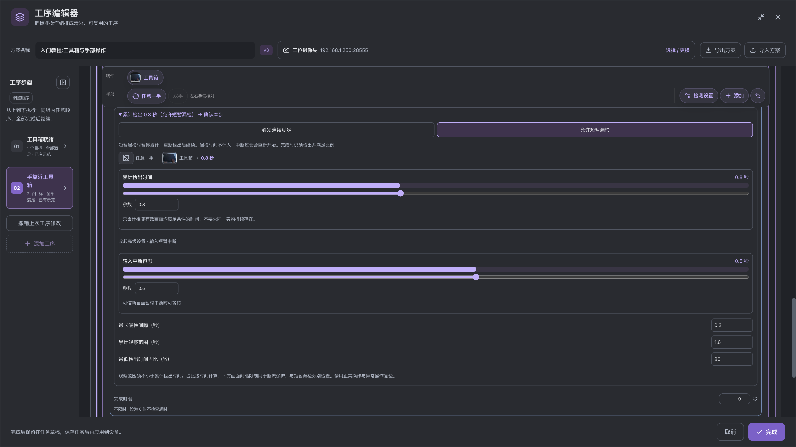{loading="lazy" decoding="async" width="3840" height="2160"}](../../assets/sop/zh-h10-hand-completion.png)

**检查点：** “0.3 秒漏检间隔”与“0.5 秒输入中断”不能混写成允许连续 0.5 秒没有手仍算满足。完成时仍要有有效检出与足够时间占比；不能依靠断流或不可见来完成动作。

#### 2.7.11 添加阶段 3：操作员核对完成

1. 再点 **添加工序**，改名 **人工核对完成**。要点填“核对工具箱与现场操作，确认后完成本件；看见手靠近不代表抓取或装配合格”。
2. 本步保持 **操作员确认**，不添加工具箱或手部视觉规则；完成时限 **0**。
3. 阶段验证范围和示范范围均 **0–31.2 秒**。左侧顺序必须是工具箱就绪、手靠近工具箱、人工核对完成，共三阶段、每阶段一步。
4. 先点编辑器底部 **完成**，若出现节点配置点 **确定**，再点外层 **保存**。等保存完成后重开，核对三阶段、参考 2、待采用 0，避免上面的临时试检补框混入最终方案。

[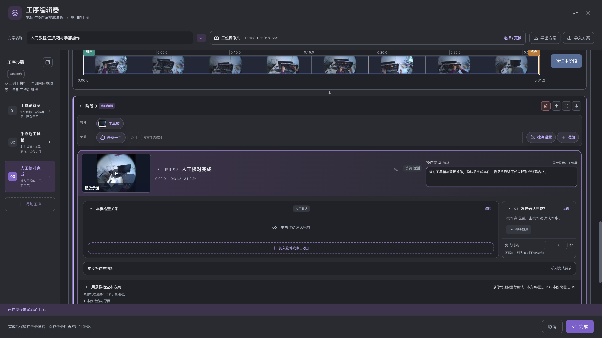{loading="lazy" decoding="async" width="3840" height="2160"}](../../assets/sop/zh-h11-manual-stage.png)

#### 2.7.12 验证手部当前阶段，分清本阶段和整套结论

1. 重开编辑器，选择第二步 **手靠近工具箱**，确认本阶段 **验证范围 0–31.2 秒**，点该阶段底部 **验证本阶段**。
2. 等检测准备好，看真实检测画面、手部与工具箱的检查原因。状态环、关系线高亮、持续进度随真实状态改变；动画或录像处理进度本身不是通过依据。
3. 检测结束后返回编辑区，看第二阶段的 **本步检查与原因**。本次实测完整输入 **312 帧**、本阶段 **1/1**，手物距离条件已满足。
4. 第一阶段可用同一入口检查物件条件；第三阶段须在验证仍运行时按提示核对并确认。各阶段单独通过，只能证明各自片段，不等于整套顺序通过。下面必须继续整体验证。

[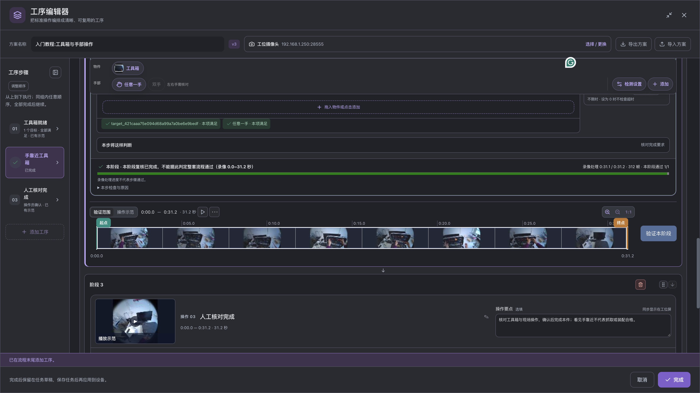{loading="lazy" decoding="async" width="3840" height="2160"}](../../assets/sop/zh-h12-hand-stage-pass.png)

**不符合时：** 展开原因，先分清手未有效检出、工具箱未有效检出、距离不满足、时间未累计够，还是来源/视频无效。先修正对应前提，不要同时改多个阈值。页面显示“身份不明确”时也应看原图，不能当作数量或缺席的证据。

#### 2.7.13 验证完整三阶段，并真正确认最后一步

1. 先读完本小节，确认知道第三步的按钮位置；原片只有 31.2 秒。检查总片段恢复为 **0–31.2 秒**，点上方 **验证本方案**，不要误点第二阶段的“验证本阶段”。
2. 等录像正式开始检测，左侧先后应出现 **工具箱就绪 已完成**、**手靠近工具箱 已完成**。当前操作转到第三步 **人工核对完成 / 等待确认**。
3. 阅读右侧说明，核对画面。按钮 **已核对画面，确认本步**可用时，在录像仍运行期间点击一次，等待状态回读。只点击了按钮、按钮暂时禁用或画面自动滚到第三步，都不等于确认已经成功。
4. 检查第三步实际变为 **已人工确认**。若仍显示等待确认，先看错误或回执提示；有“重新核对状态/重试上次确认”时按提示核对，不连点提交。确认仍未生效而录像已结束，本次保留为 2/3，返回编辑后重新验证并及时核对，不能事后把结果补成通过。
5. 等完整输入结束，最终应同时看到 **3/3 已完成**、第三步 **已人工确认**、**本段录像的工序条件已满足**。本次成功记录完整输入 312 帧。实测中先有两次人工确认未完成的结果，最后一次才有明确生效回执；本图展示的是后者。

[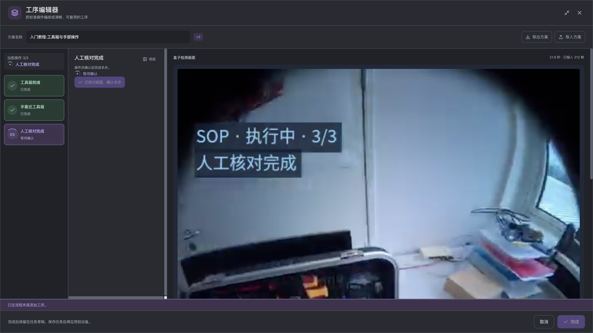{loading="lazy" decoding="async" width="3840" height="2160"}](../../assets/sop/zh-h13-whole-manual.png)

[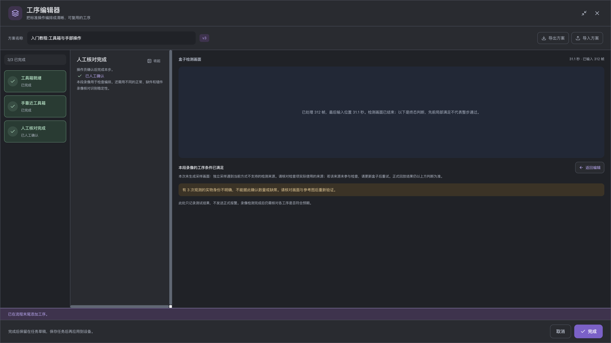{loading="lazy" decoding="async" width="3840" height="2160"}](../../assets/sop/zh-h15-whole-pass.png)

**还要读提示：** 本例仍有 3 次实物身份不明确观测；独立采样也提示当前方式不支持该检测来源。整套正式回放的 3/3 与这些识别质量/采样提示是不同结论，不能说采样、识别稳定性或商用验收全部通过。上图保留了实际提示。

#### 2.7.14 完成、保存并重开核对

1. 点 **返回编辑**，确认没有在验证后又改变目标、参考、规则、范围或顺序。
2. 点底部 **完成**，等编辑器真正关闭；如仍在 SOP 节点配置，点 **确定**。
3. 回到任务画布点 **保存**，等“正在保存任务”结束。再双击 SOP 工序，摘要应为 **3 道工序**，重开编辑器检查参考 **2**、待采用 **0** 与表中规则。
4. 如重开后显示待验证，先检查当前草稿是否与本次验证版本不同；不要拿旧版本截图证明新配置通过。

[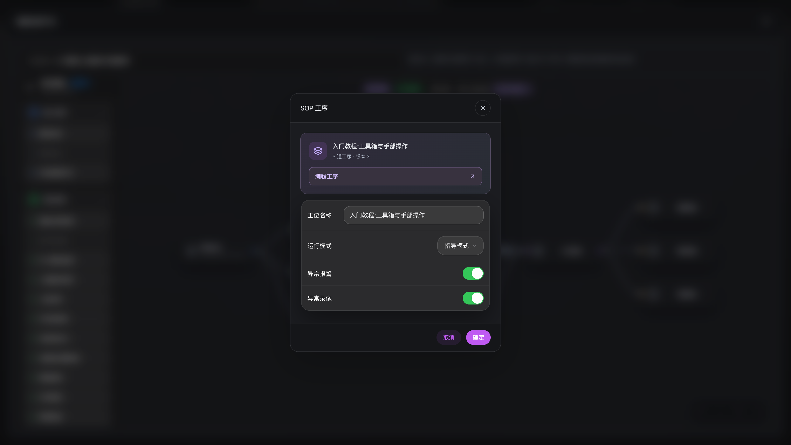{loading="lazy" decoding="async" width="3840" height="2160"}](../../assets/sop/zh-h22-saved-summary.png)

#### 2.7.15 在工位看自动推进，再由人员确认并结束本件

1. 本节文件验证完成后，真实任务输入还要看到**同一个工具箱、相同外观与手部操作**。本次工位截图使用同一原片的受控演示视频源；截图测试地址在演示后已停止，不能直接作为客户输入。用自己的摄像头时，应重新录制、建立自己的参考并验证；仅上传文件不会自动替换现场摄像头画面。
2. 回任务画布点 **运行**，等任务运行起来。资源被其它任务占用时先协调，不停止别人的任务。回任务卡片点本任务的 **工位运行**；需要大屏时点 **打开工位页**。
3. 核对页面标题、**视频：正常**、**状态已同步**与实际更新的图像，再点 **开始本件**。任务启动和开始本件是两次不同操作。
4. 观察工具箱和手部两个自动步骤先后变为 **已验证**，计数到 **2/3**。当前第三步出现 **人工确认完成**按钮。阅读要点，核对现场后点此按钮，等“操作已确认”及第三步“已验证”。
5. 计数到 **3/3**后，本例还需点击 **完成本件**。应显示 **本件结束 / 本件合规完成**；“三个步骤已验证”与“工件已结束”是两个检查点。
6. 练习结束停止自己启动的教程任务。**开始本件**会开始下一件，不是查看上一件结果的按钮。

[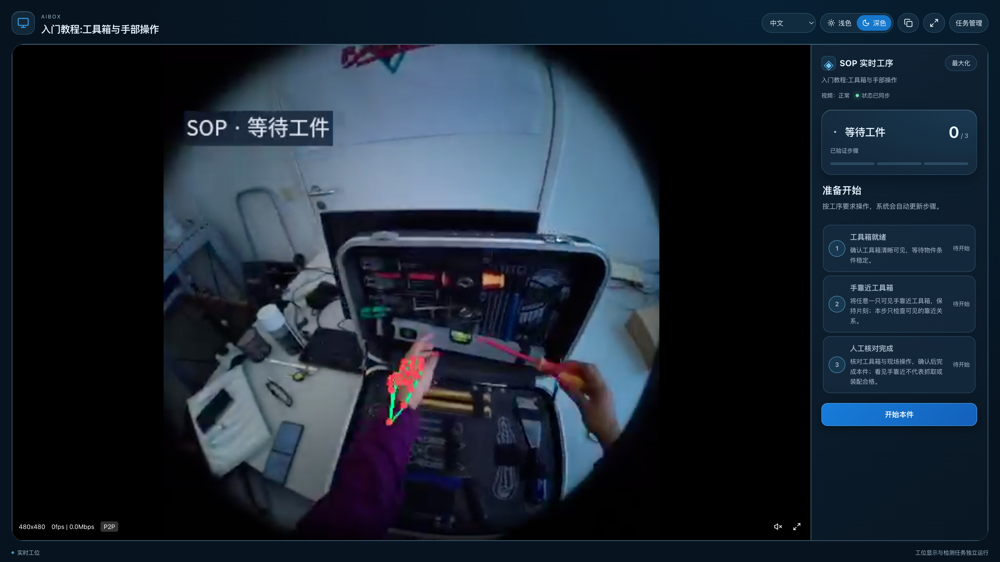{loading="lazy" decoding="async" width="3840" height="2160"}](../../assets/sop/zh-h16-station-ready.png)

[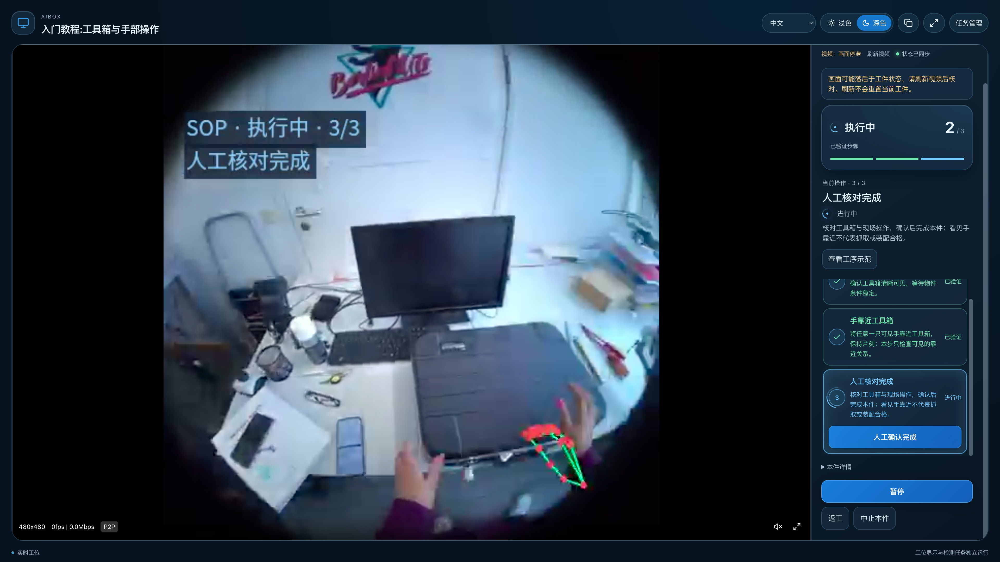{loading="lazy" decoding="async" width="3840" height="2160"}](../../assets/sop/zh-h17-station-manual.png)

[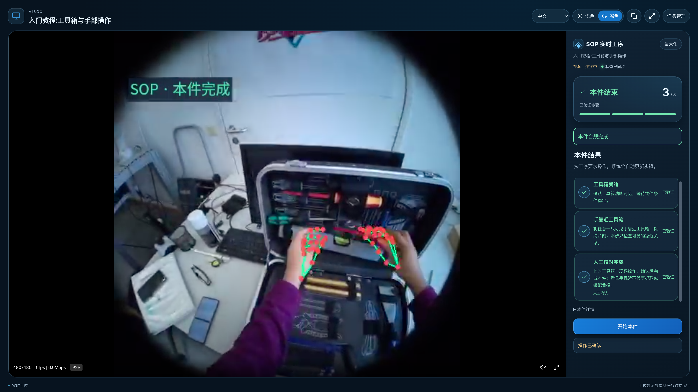{loading="lazy" decoding="async" width="3840" height="2160"}](../../assets/sop/zh-h18-station-completed.png)

**读图提示：** 工位配图保留了当时显示端的“连接中”或“画面停滞”提示。它们用于展示步骤和已回读的工件结果，不能作为视频持续正常的证明；操作时须先刷新并等画面恢复，再核对或开始下一件。

**画面或确认异常时：** “画面停滞”先点 **刷新视频**，等恢复再核对；刷新不重置工件。确认结果未知时先用 **重新核对状态**，只有系统允许才重试原确认，不重新开件来掩盖未知结果。暂停、断流、等待人工时的状态提示都不能当作已完成。

#### 2.7.16 对照验收本次练习，再进入详细工具说明

| 检查点 | 本实例应有结果 | 若不一致 |
|---|---|---|
| 输入图 | 手部关键点与物件检测并行进入 SOP | 回 2.7.1 |
| 文件 | 31.2 秒本地视频能回放 | 回 2.7.2 |
| 参考 | 一只工具箱、两个角度、待采用 0 | 回 2.7.3–2.7.4；取消未采用试检草稿 |
| 黄色低分 | 0.21 低于 25%，没有被当作满足 | 回 2.7.5–2.7.6 |
| 手物规则 | 任意一手靠近工具箱，双方全画面 | 回 2.7.8–2.7.9 |
| 时间与完成 | 第一阶段连续 0.8 秒；第二阶段累计 0.8 秒及明确容差；第三阶段人工 | 回 2.7.7、2.7.10–2.7.11 |
| 单阶段 | 第二阶段正式输入 312 帧，本阶段 1/1 | 回 2.7.12，展开原因 |
| 整套验证 | 原片完整结束，3/3，最后一步已人工确认 | 回 2.7.13，不能只看处理进度 |
| 保存 | 重开仍为三阶段与两张参考 | 回 2.7.14 |
| 工位 | 自动两步 → 人工确认 → 完成本件 → 合规完成 | 回 2.7.15 |

到这里，物件、手部、时间规则、人工确认与工位运行已经在同一实例中连起来。之后按现场需要查[手部操作详解](#hand-operations)、[工具栏与拖拽](#toolbar-and-drag)、[验证与运行](#validation-and-operation)。要做“靠近后离开”或“移送放置”，另选动作完整、机位适合的录像与反例，不能把本例靠近通过结果当作这些动作已验证。

## 3. 实施准备与工序需求整理 {#preparation}

本章用于正式配置前的准备。完成后，您应当得到一份明确的工序表、一段可用的教学录像、可区分的物件清单，以及需要人工核对的质量要求。这样进入编辑器后，每次操作都有明确目的。

### 3.1 谁来准备，谁来使用 {#preparation--1-谁来准备谁来使用}

| 角色 | 配置前需要提供什么 | 配置后需要核对什么 |
|---|---|---|
| 工艺负责人 | 正确操作顺序、允许的变化、必须检查的质量要求 | 系统规则是否表达真实工艺，哪些质量要求仍由人核对 |
| 配置人员 | 摄像头、录像、目标和区域命名 | 每条规则的对象、范围、时间、组合和完成方式 |
| 现场操作员 | 一次正常操作，以及常见的错误操作 | 工位屏的名称、示范、提示和确认入口是否易懂 |
| 实施/管理员 | 设备可连接、所需识别能力、存储、备份和运行权限 | 保存重开、任务运行、异常处理、版本及记录可追溯性 |

一人可以兼任多个角色，但不要省略核对责任。配置人员理解页面，不等于操作员理解工艺提示。

### 3.2 第一次打开前的检查 {#preparation--2-第一次打开前的检查}

#### 3.2.1 设备和浏览器 {#preparation--21-设备和浏览器}

1. 完成[设备开箱与快速上手](../device-onboarding.md)，确认计算机能访问设备管理地址。
2. 使用现场确定的设备地址登录。截图里的局域网地址只是示例。
3. 核对设备在线状态；先解决持续断线，再配置工序。
4. 确认将要编辑的任务名称，避免同时打开多个相同名称的任务。
5. 选取足够的浏览器窗口空间。需要时最大化工序编辑器或折叠左侧步骤栏。
6. 若出现浏览器证书提示，由现场管理员按设备安全要求处理。

**预期结果：** 页面能稳定读取设备状态，任务卡片和编辑入口可见。此时不必启动任务。

#### 3.2.2 摄像头 {#preparation--22-摄像头}

| 检查项 | 可接受的准备状态 | 需要先处理的情况 |
|---|---|---|
| 安装位置 | 固定，能看到关键工具与动作 | 头戴移动画面却配置了固定工作区 |
| 拍摄方向 | 与正常作业方向一致 | 镜像或翻转后仍沿用旧左右手设置 |
| 工作区大小 | 关键物件占有足够画面 | 工具只在远处占很少像素 |
| 遮挡 | 常规握持时关键外观仍可见 | 操作员身体长期挡住目标 |
| 光照 | 关键位置没有持续强反光或过暗 | 金属表面反光使轮廓不稳定 |
| 周边干扰 | 相邻工位与本工位有清楚界线 | 多个人和多把相似工具混在同一区域 |

固定区域跟随画面坐标。相机移动后，原区域可能仍画在屏幕上，但已经不对应真实工位。

#### 3.2.3 功能准备 {#preparation--23-功能准备}

只检查物件的流程先使用物件识别。需要手与物件配合时，再增加手部识别。左右手必须在实际安装方向下核对。

不要仅根据“存在插件名称”推断整个工序能力已可用。应检查编辑器中相应目标、条件和验证入口是否可用，并完成实际录像验证。

### 3.3 把现场语言整理成工序表 {#preparation--3-把现场语言整理成工序表}

先写动作，再写系统能观察到的依据。例如“取锤完成”可能包含“手靠近、锤开始移动、锤到指定区、操作者确认”；单独看到手靠近并不能证明取锤已经完成。

推荐每行只写一个可明确完成的工作单元：

| 项目 | 需要填写的内容 | 例子 |
|---|---|---|
| 工序名称 | 操作员能理解的动作或状态 | 工具就绪 |
| 前提 | 开始本步前必须完成什么 | 新一轮工件已经准备 |
| 检查物件 | 必须出现或计数的物件 | 橡胶锤 |
| 检查位置 | 当前工位的哪个位置 | 工具工作区 |
| 手部要求 | 不关心手、任意手或指定手 | 本步不检查手 |
| 时间要求 | 保持多久，是否有限时 | 连续就绪 0.8 秒；本步暂不限时 |
| 组合关系 | 同时、任选、先后或独立工序 | 该物件就绪 |
| 完成方式 | 自动、视觉后人工核对或人工确认 | 视觉检测后自动完成 |
| 人工质量要求 | 画面不能证明的内容 | 下一步由人核对工具与工位 |
| 验证反例 | 应当不能完成的情况 | 橡胶锤缺失或放在区域外 |

**不要把无法观察的质量要求改写成一个容易通过的位置条件。** 例如“电钻在螺丝旁”不等于扭矩合格，“杯子进入区域”不等于杯中液量合格。

### 3.4 确定阶段与步骤之间的依赖 {#preparation--4-确定阶段与步骤之间的依赖}

先回答三个问题：

1. B 是否必须在 A 完成后才能开始？
2. A 与 B 是否可以任意顺序完成，但都不可缺少？
3. A 与 B 是否必须在同一时刻成立？

| 回答 | 编排方法 | 验证时要特别检查 |
|---|---|---|
| B 必须在 A 后 | 放在先后执行的不同阶段 | 反序操作不能被当成正确顺序 |
| A、B 可任意先后且都要完成 | 放入同一任意顺序阶段 | 两种顺序都应可完成；缺少一步不能完成整组 |
| A、B 必须同时成立 | 在同一步内使用全部同时满足 | 不能把分开出现的条件相加 |
| A、B 是可替代选择 | 同一步内任意一项满足 | 每个选项确实是工艺允许的替代项 |

录像里两段时间重叠，不意味着两道工序可以互相替代；两段时间不重叠，也不必然意味着工艺要求严格顺序。编排依据是工艺依赖。

### 3.5 准备教学录像 {#preparation--5-准备教学录像}

#### 3.5.1 录像应该包含哪些内容 {#preparation--51-录像应该包含哪些内容}

建议从操作前的稳定工位开始，拍到正常操作和结束状态。关键过程不要刚好落在片头、片尾或相机转动期间。

1. 先让工位保持短暂稳定，方便选取清楚的目标参考。
2. 按正常速度执行，不必为了系统刻意极慢操作。
3. 保留真实的手部进入、物件移动和手部离开过程。
4. 不要在关键动作中切镜头或拼接成不连续画面。
5. 结束后保留能看清物件最终位置的画面。
6. 再录另一次操作，作为独立验证录像。

#### 3.5.2 上传后先做完整性检查 {#preparation--52-上传后先做完整性检查}

| 操作 | 应看到什么 | 未达到时怎么办 |
|---|---|---|
| 播放片头 | 正确工位和方向 | 核对选错文件、镜像或视频来源 |
| 定位中间 | 画面随时间更新 | 等待加载，仍异常则查看媒体提示 |
| 定位片尾 | 有真实结束画面 | 检查原片是否完整 |
| 查看时间轴 | 显示真实缩略图 | 不要用静态参考图正常来推断缩略图已就绪 |
| 拖动播放头 | 预览位置改变 | 区分播放头与起终点手柄，见[界面说明](#workspace-reference) |
| 核对时长 | 与上传/录制片段一致 | 检查是否正在看旧素材或另一操作的示范 |

[{loading="lazy" decoding="async" width="2650" height="1935"}](../../assets/sop/zh-06-teaching-video.png)

**本节完成标志：** 您能说出目标清楚出现的时间、动作开始与结束时间，以及一段物件确实不在位或操作未完成的画面。

### 3.6 准备目标清单 {#preparation--6-准备目标清单}

#### 3.6.1 名称应如何写 {#preparation--61-名称应如何写}

推荐“用途或外观＋物件名称”，例如“橡胶锤”“白色涂料杯”。同一逻辑目标可以有多个参考角度；不要用“正面锤”“侧面锤”把同一把锤误建为两种必须同时出现的物件。

对于相似物件，应能清楚说明区别。若画面分辨率下本身无法区分，不应依赖更长名称解决视觉混淆。

#### 3.6.2 参考选择表 {#preparation--62-参考选择表}

| 参考内容 | 为什么需要 | 需要同时检查的反例 |
|---|---|---|
| 正常摆放的清楚正面 | 建立主要外观 | 背景相似形状 |
| 正常侧面或旋转姿态 | 覆盖常见朝向 | 相似工具 |
| 正常握持状态 | 检查手遮挡下是否仍可识别 | 只有手、没有工具 |
| 常见远近位置 | 检查真实大小变化 | 很小或模糊到不可判断的目标 |

增加参考后，应验证它是否改善真实漏检，同时没有增加误检和重复框。参考越多并不自动越稳定。

### 3.7 准备区域清单 {#preparation--7-准备区域清单}

区域名称应描述用途，例如“工具区”“备料区”“装配区”，并由工艺人员确认边界。

- 同一工位可以有多个区域。
- 区域可以重叠，但必须明确重叠时规则的含义。
- 起始区、到达区应能反映真正的状态变化。
- 覆盖操作过程的区域要包含移动途中，不应只包住两个端点。
- 画好全局区域后，还要逐条把条件绑定到需要的区域。

[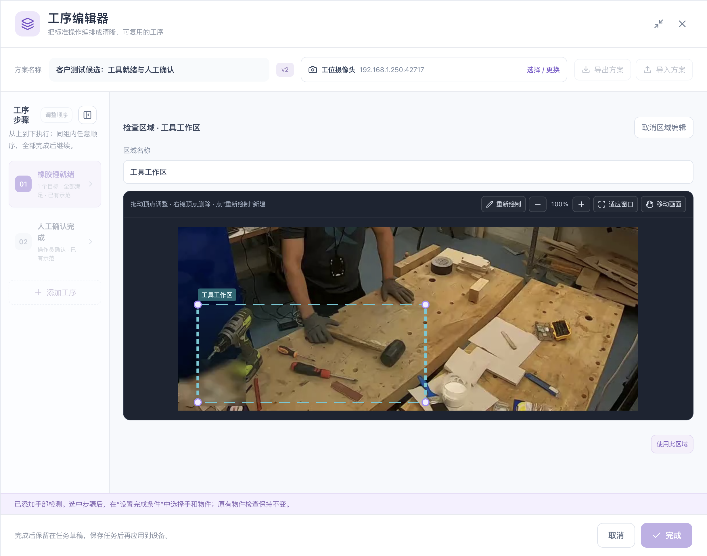{loading="lazy" decoding="async" width="2459" height="1935"}](../../assets/sop/zh-18-draw-region.png)

### 3.8 准备验证样本 {#preparation--8-准备验证样本}

| 类别 | 最小应包含的内容 | 判断原则 |
|---|---|---|
| 正常操作 | 一次清楚、完整的标准流程 | 检查正确动作能完成 |
| 缺件 | 拿走一件必需物件 | 不能仅因其他物件存在就通过 |
| 放错位置 | 同一物件移到区域外 | 检查区域确实生效 |
| 数量错误 | 少一件或多一件 | 先排除重复框 |
| 顺序错误 | 反过来执行一项要求 | 检查顺序是否被错误放宽 |
| 手部反例 | 只靠近不离开、遮挡、多人 | 不把漏检当动作完成 |
| 独立录像 | 另一次真实操作 | 检查是否只对原示教片有效 |
| 输入异常 | 断流、停帧或不可判断画面 | 不确定不能被当成完成 |

这些是样本设计要求，不是本手册已经测得的通过结果。现场应保留录像、配置版本、预期和实际结果。

### 3.9 配置前确认表 {#preparation--9-配置前确认表}

- [ ] 已确认任务和工位，避免编辑错对象。
- [ ] 能正常播放、定位完整录像。
- [ ] 工序名称和完成标准已写清。
- [ ] 自动检查与人工质量核对的分工已确定。
- [ ] 物件名称、参考内容和区域用途已整理。
- [ ] 已明确先后、任意顺序、同时与替代关系。
- [ ] 关键过程的手与物件都能看清。
- [ ] 已准备正常、反例和独立录像。
- [ ] 已确定谁核对结果、谁保存、谁负责运行与维护。

**继续：[认识编辑器及每个操作入口](#workspace-reference) → [完成第一个示例](#quickstart)。**

*配图素材署名见[示例素材与截图来源](#reference--7-示例素材与截图来源)。*

## 4. 入门详解：跑通“工具就绪 → 人工确认” {#quickstart}

本章只建立一个可理解的两步流程。先让系统检查一把橡胶锤，再让操作员确认。**先确认目标识别没有问题，再继续阶段和方案验证。** 手部动作与多目标检查放在后续章节。

### 4.1 准备工位和录像 {#quickstart--1-准备工位和录像}

1. 固定摄像头，让工具工作区占画面主要部分。
2. 确认橡胶锤在正常使用位置能够清楚看见，轮廓没有被手、反光或其他工具长期挡住。
3. 准备一段包含完整操作的短录像：开始时展示工位，执行操作，最后保留完成后的画面。
4. 最好再准备另一段独立拍摄的录像，用于检查方案是否只适用于第一段示教视频。
5. 摄像头画面与录像应使用同一个机位、朝向和相近光照。重新移动摄像头后，重新核对区域与目标参考。

| 本例设置 | 建议初值 | 为什么这样开始 |
|---|---|---|
| 检查目标 | 仅橡胶锤 | 先掌握一个物件的选取与验证 |
| 手部检查 | 暂不启用 | 避免把物件和手部问题混在一起 |
| 阶段顺序 | 先工具就绪，再人工确认 | 后一步依赖前一步 |
| 目标就绪持续时间 | 0.8 秒，仅为示例 | 避免只出现一个瞬间就结束本步 |
| 完成时限 | 0，暂不限时 | 先跑通正常路径，再增加超时要求 |

**检查点：** 您能在录像中指出橡胶锤在哪里、什么时候清晰出现，以及什么时候应由操作员确认。

#### 4.1.1 使用配套示例录像 {#quickstart--使用配套示例录像}

[下载本手册的 60 秒工作台示例录像（MP4，约 9.5 MB）](../../assets/sop/workbench-60s.mp4)。在浏览器中打开后，可通过视频菜单保存，再按本章上传步骤导入。不要上传截图文件代替视频。

这份示例与配图使用相同工作台，便于核对橡胶锤、工具位置和时间。它是原录像前 60 秒的固定工作区裁剪，分辨率 800 × 320；自己的工位应使用自己的固定机位录像，不必照抄示例坐标。原作者、出处、许可和裁剪说明见[示例素材来源](#reference--7-示例素材与截图来源)。

### 4.2 登录并创建 SOP 任务 {#quickstart--2-登录并创建-sop-任务}

1. 在浏览器中打开设备管理地址并登录。
2. 等待页面显示设备已连接。首次连接设备请先完成[设备开箱与快速上手](../device-onboarding.md)。
3. 点击顶部 **添加任务**。
4. 在任务类型中选择 **SOP 工序**。
5. 选择 **只检查物件**。它适合零件、工具是否出现、数量或位置检查。
6. 填写容易辨认的任务名称，例如“工具就绪与人工确认”。
7. 点击 **创建并编辑**，进入任务编辑流程，再进入 **编辑工序**。

[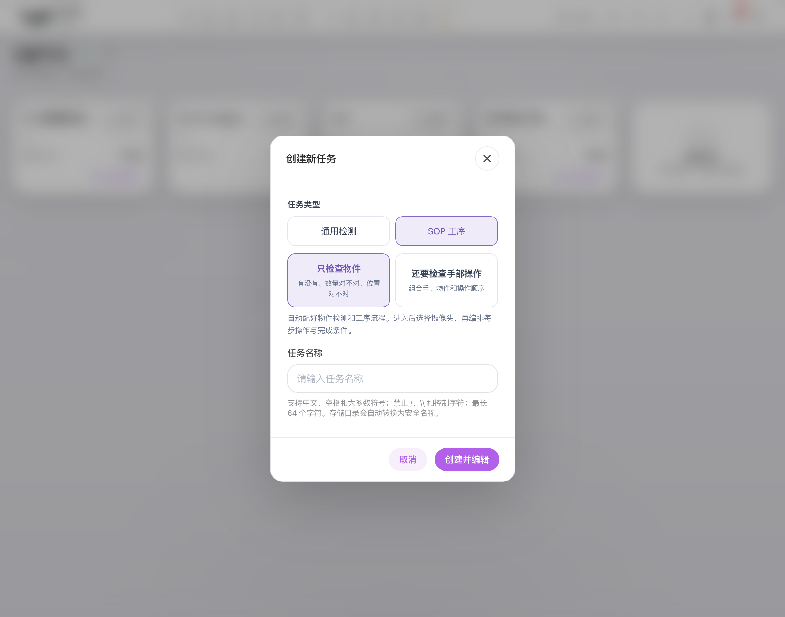{loading="lazy" decoding="async" width="2459" height="1935"}](../../assets/sop/zh-02-create-task.png)

*图 2：入门流程选择“只检查物件”。如果工艺需要手靠近、离开或移动，参阅手部专章。*

任务名称、方案名称和工位名称可以不同：任务名称用于管理任务，方案名称用于辨认工艺，工位名称用于现场显示。建议保持语义一致，不要全部使用“测试”“新建方案”这类难以辨认的名称。

### 4.3 认识工序编辑器 {#quickstart--3-认识工序编辑器}

[{loading="lazy" decoding="async" width="2650" height="1935"}](../../assets/sop/zh-04-editor-overview.png)

| 区域 | 怎么用 |
|---|---|
| 顶部方案栏 | 修改方案名称，选择摄像头，导入或导出方案 |
| 左侧工序列表 | 选择当前步骤、调整顺序、组成任意顺序组或新增工序 |
| 视频/目标切换 | “视频”用于播放与定位；“目标”用于查看当前目标与参考图片 |
| 上方时间轴 | 选择目标抽帧及整套方案验证的范围 |
| 工序卡片 | 查看或修改名称、示范片段、操作要点、检查关系与完成方式 |
| 阶段下方时间轴 | 设置该阶段自己的验证范围与操作示范片段 |
| 底部完成 | 将编辑结果放回任务草稿；随后仍需保存任务 |

空间不足时，可收起左侧列表，或使用窗口右上角的最大化。收起后仍可通过编号选择工序。常规滚轮用于滚动页面；缩放画布时按住界面提示的修饰键，或使用画面上方的加减按钮。

### 4.4 选择摄像头 {#quickstart--4-选择摄像头}

1. 点击方案栏里的 **选择 / 更换**。
2. 优先选择当前工位已配置的摄像头。
3. 搜索摄像头需要认证时，填写**摄像头的账号和密码**。它们不一定与盒子网页登录账号相同。
4. 已有视频地址但未搜索到设备时，展开对应入口，由管理员核对地址与网络。
5. 选定后，检查方案栏是否显示正确的摄像头。

[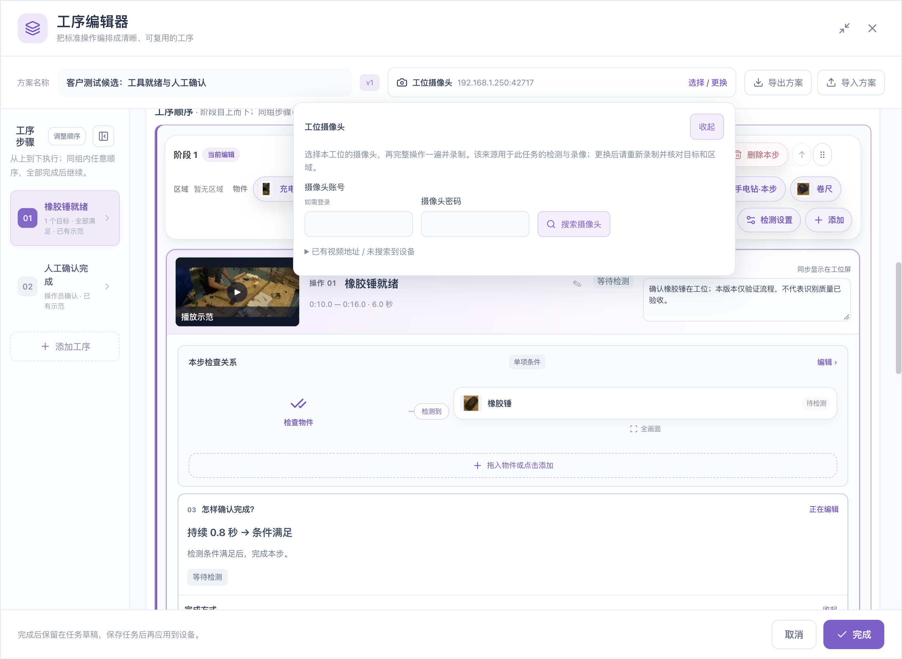{loading="lazy" decoding="async" width="2650" height="1935"}](../../assets/sop/zh-05-camera.png)

**预期结果：** 摄像头来源属于当前工位，后续录制来自该来源。

更换摄像头后，应重新录制或核对目标、区域、左右手方向和验证录像。旧机位画出的区域不能直接视为新机位仍然正确。

### 4.5 录制或上传一次完整流程 {#quickstart--5-录制或上传一次完整流程}

#### 4.5.1 使用已有录像 {#quickstart--51-使用已有录像}

1. 点击 **上传**。
2. 选择设备界面支持的视频文件。
3. 等待上传、处理和画面读取结束。
4. 播放视频，检查开头、中段和结尾是否正常，时间轴是否有真实缩略图。
5. 暂停在橡胶锤清楚可见的一帧。

[{loading="lazy" decoding="async" width="2650" height="1935"}](../../assets/sop/zh-06-teaching-video.png)

#### 4.5.2 录制现场 {#quickstart--52-录制现场}

1. 先选好摄像头。
2. 点击 **录制**。
3. 页面已有示教视频时，阅读重新录制的确认提示。
4. 确认需要替换后再开始，完整执行一次工序，结束时停止。
5. 等待录像就绪，再播放检查。

[{loading="lazy" decoding="async" width="2459" height="1935"}](../../assets/sop/zh-07-record-warning.png)

重新录制完整流程会替换该方案的示范视频，包括独立分步素材，并重置各步起止时间；已有目标、参考、全局区域和规则按提示保留。取消录制保留原草稿。不要为了“再看一次画面”而重新录制，使用播放器即可。

**检查点：** 原片能够正常播放；能定位到橡胶锤的清晰画面；摄像头与录像没有选错。

### 4.6 建立橡胶锤目标 {#quickstart--6-建立橡胶锤目标}

1. 在 **视频** 页暂停到清楚的一帧。
2. 点击 **添加目标**。
3. 在图中框住橡胶锤。尽量贴合物件轮廓，避免将手、大片桌面、相邻工具一起作为主要内容。
4. 输入名称“橡胶锤”，按界面提示确认。
5. 转到 **目标** 页，检查参考图片是否确实是橡胶锤。
6. 如正常操作中会有明显角度变化，点击 **补充角度**，从另一帧为同一个目标增加参考。不要把每个角度都新建成一个不同物件。

[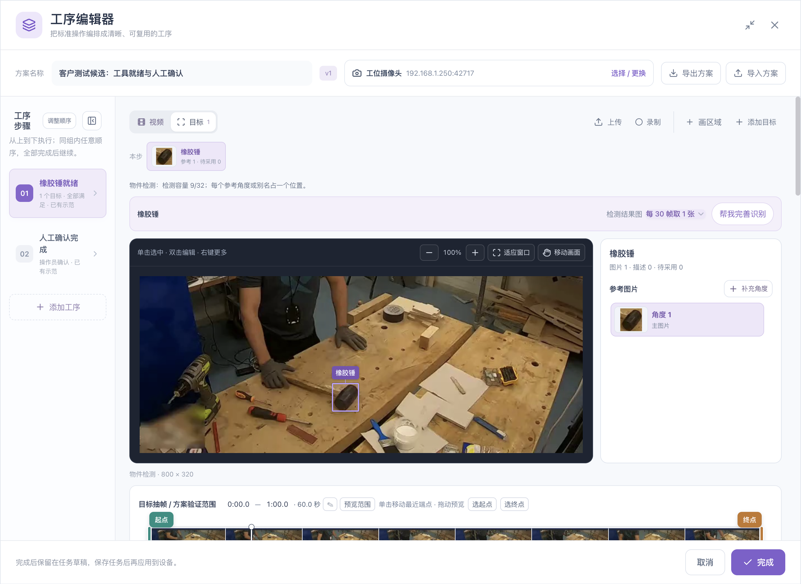{loading="lazy" decoding="async" width="2650" height="1935"}](../../assets/sop/zh-10-target-reference.png)

一把橡胶锤可以有多张参考，物件数量仍是一把。每张参考可能占用检测容量；应保留有代表性的角度，而不是重复加入几乎一样的图片。

### 4.7 先检查识别效果 {#quickstart--7-先检查识别效果}

1. 在上方时间轴选择要检查的录像范围。
2. 调整“每多少帧取一张”的采样间隔。间隔小会得到更多检查画面，也需要更多处理和核对时间。
3. 点击 **帮我完善识别**；范围变化后，按钮可能提示按所选范围重新检查。
4. 在检测结果图中查看：橡胶锤出现的画面是否正确框出，没有出现的画面是否误检，同一把工具是否出现重复框。
5. 对漏检画面进行人工核对与补框，按[识别章节](#video-and-recognition)完成试检、采用和复验。
6. 不要仅看第一帧成功就认为整段录像已通过。检查正常角度、物件移动、手靠近、遮挡及空场景。

[{loading="lazy" decoding="async" width="2650" height="1935"}](../../assets/sop/zh-10-target-reference.png)

**继续条件：** 正常清晰的目标画面能被可靠识别；漏检、误检和重复框已有明确处理结果。仍有明显错误时，停留在本步骤，不要靠放宽工序规则掩盖识别问题。

### 4.8 配置第一步“橡胶锤就绪” {#quickstart--8-配置第一步橡胶锤就绪}

1. 在工序列表选中第一步，修改名称为“橡胶锤就绪”。
2. 在操作要点中填写现场人员能理解的短句，例如“确认橡胶锤在工具工作区内，清晰可见并持续满足要求”。
3. 展开 **本步检查关系 → 编辑**。
4. 添加橡胶锤；在 **检查什么** 中选择 **检测到物件**。
5. 在 **在哪里检查** 中选择全画面、全部识别区域或已画出的指定区域。
6. 打开 **怎样确认完成 → 设置**，选择 **视觉检测后自动完成**。
7. 将持续确认设为本例的 **0.8 秒**；根据真实工艺重新决定时长。
8. 检查关系图、完成方式和区域是否与要求一致。

[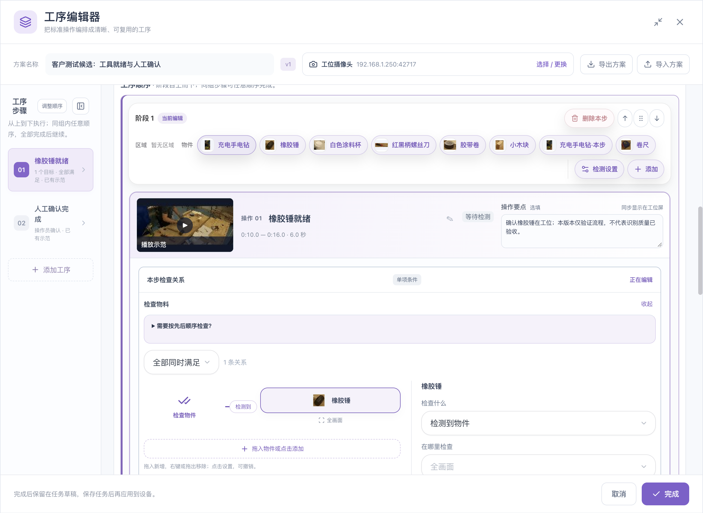{loading="lazy" decoding="async" width="2650" height="1935"}](../../assets/sop/zh-11-object-condition.png)

[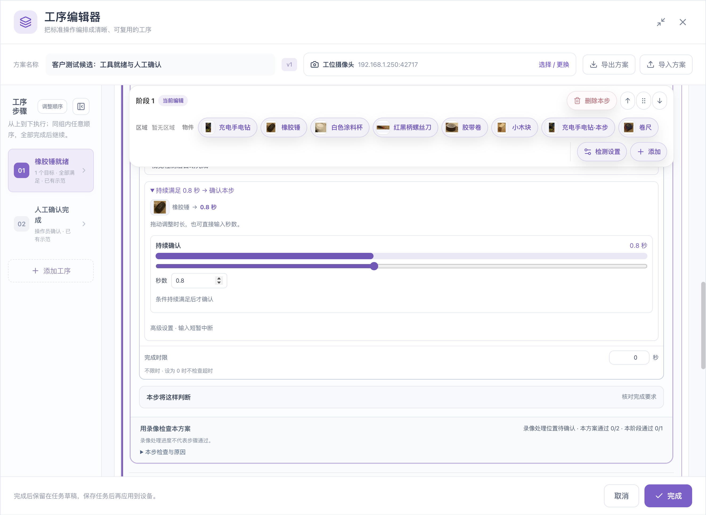{loading="lazy" decoding="async" width="2650" height="1935"}](../../assets/sop/zh-12-auto-completion.png)

如果需要人再核对一次，选择 **视觉检测＋人工核对**。它表示视觉条件满足后，仍需操作员确认；不要把它与纯人工步骤混淆。

### 4.9 配置第二步“人工确认完成” {#quickstart--9-配置第二步人工确认完成}

1. 添加第二步，并放在第一步之后。
2. 输入名称“人工确认完成”。
3. 填写操作要点，例如“核对工位和工具摆放，确认无误后点击确认完成”。
4. 打开完成方式，选择 **操作员确认**。
5. 保持两步为依次执行；本例不把它们组成任意顺序组。

[{loading="lazy" decoding="async" width="2459" height="1935"}](../../assets/sop/zh-13-manual-completion.png)

**预期结果：** 第一阶段完成后才进入人工确认步骤。未轮到此步、结果未知或旧画面失效时，不应借助旧确认按钮跳过流程。

### 4.10 给每个阶段选择自己的片段 {#quickstart--10-给每个阶段选择自己的片段}

1. 找到阶段下方的 **验证范围**。
2. 第一阶段选取橡胶锤清楚可见的片段，本例为 **10–16 秒**。
3. 第二阶段选取人工确认对应的片段，本例为 **16–60 秒**。
4. 点击显示的起点或终点可直接输入秒数或“分:秒”；使用保存、取消或定位按钮。
5. 需要时拖动端点，并核对顶部时间读数。
6. 点击本步的 **播放示范**，确认播放的是该步对应片段。

[{loading="lazy" decoding="async" width="2459" height="1935"}](../../assets/sop/zh-14-stage-range.png)

[{loading="lazy" decoding="async" width="2459" height="1935"}](../../assets/sop/zh-15-demo-player.png)

每个阶段的时间段独立，允许有交集。对同一原片做完整方案验证时，各阶段待验证范围应被总体验证范围覆盖。总体范围缩小时，先处理页面指出的冲突，不要假定系统会静默截断所有阶段。

### 4.11 先验证阶段，再验证方案 {#quickstart--11-先验证阶段再验证方案}

1. 点击 **验证阶段 1**，观看当前片段，检查橡胶锤对应的条件与完成结果。
2. 如果结果不符，展开本步检查与原因，回到相应的目标、区域或时间设置。
3. 第一阶段正确后，再检查第二阶段的人工确认入口、步骤顺序和确认结果。
4. 最后使用 **验证本方案** 检查整套编排，核对全部步骤和最终状态。
5. 再加入一段独立拍摄的录像复核，检查方案是否适用于正常变化。

阶段验证只说明该阶段在相应片段中的表现；不会自动证明整套方案通过。录像读到末尾、处理了多少帧，也不是步骤通过的比例。具体结果与人工确认操作见[验证章节](#validation-and-operation)。

### 4.12 完成、保存、重新打开核对 {#quickstart--12-完成保存重新打开核对}

1. 在工序编辑器点击 **完成**，回到任务草稿。
2. 如果仍在节点配置窗口，点击 **确定**，将节点配置交回任务编辑器。
3. 在外层任务编辑器点击 **保存**。
4. 等待保存结果，不要因为网络慢就连续重复点击。
5. 重新打开任务，检查步骤名称、物件、区域、时间、完成方式和示范视频仍然正确。
6. 确认任务保存成功后，再按现场安排启动并进入 **工位运行**。

[{loading="lazy" decoding="async" width="2459" height="1935"}](../../assets/sop/zh-23-save-task.png)

**完成**只保留到草稿，**保存**才将任务配置交给设备；**运行**是独立操作。关闭或取消未保存的编辑，应按提示决定是否保留，不要假设所有浏览器草稿已经成为设备上的正式方案。

### 4.13 本章结束前逐项核对 {#quickstart--13-本章结束前逐项核对}

- [ ] 能正常播放原视频与两个示范片段。
- [ ] 橡胶锤只有一个逻辑目标；参考角度与物件数量没有混淆。
- [ ] 已检查漏检、误检、重复框和常见遮挡。
- [ ] 第一步条件和完成方式正确，第二步明确由人工确认。
- [ ] 两步按顺序执行。
- [ ] 阶段片段与总体验证范围相容。
- [ ] 已分别核对阶段和方案结果，没有将进度当通过率。
- [ ] 保存后重新打开，配置与视频没有丢失。

**下一步：[视频、目标与识别 →](#video-and-recognition)**

*配图中的示例录像及参考画面来源：[木箱装配数据集与 CC BY 4.0 署名说明](#reference--7-示例素材与截图来源)。*

## 5. 编辑器界面与控件操作详解 {#workspace-reference}

本章按界面位置说明“在哪里操作、影响什么、操作后看哪里”。同一窗口中的视频、目标、工序和验证是相互关联的工作区；它们不是互不相关的页面。

### 5.1 界面总览 {#workspace-reference--1-界面总览}

[{loading="lazy" decoding="async" width="2650" height="1935"}](../../assets/sop/zh-04-editor-overview.png)

| 区域 | 主要内容 | 操作后核对 |
|---|---|---|
| 标题栏 | 最大化、恢复窗口、关闭 | 关闭前是否仍有未保存草稿 |
| 方案栏 | 方案名称、版本、摄像头、导入导出 | 当前任务和工位是否正确 |
| 左侧步骤栏 | 工序编号、名称、简要要求、顺序 | 当前选择的是哪一步 |
| 视频/目标切换 | 教学视频或目标资料 | 当前模式是否符合本次操作 |
| 视频工作区 | 播放、暂停、定位、区域与目标绘制 | 当前时间、方向和真实画面 |
| 目标工作区 | 参考角度、待采用、检测容量 | 当前逻辑目标和所选参考 |
| 总时间轴 | 目标扫描和方案验证范围 | 起点、终点、范围是否变化 |
| 阶段工具栏 | 可用物件、区域、手和添加入口 | 新操作要放到哪个阶段 |
| 操作卡片 | 名称、示范、操作要点、状态 | 操作员将看到什么 |
| 检查与完成卡片 | 条件、区域、组合、时长、完成方式 | 实际规则是否符合工艺 |
| 阶段时间轴 | 本阶段的验证/示范选段 | 没有误改其他阶段 |
| 底部栏 | 提示、取消、完成 | 完成后仍需保存任务 |

### 5.2 方案名称、版本与摄像头 {#workspace-reference--2-方案名称版本与摄像头}

#### 5.2.1 名称 {#workspace-reference--21-名称}

点击方案名称输入框修改。建议使用“工位或产品＋流程用途”，如“装配台 A：工具准备”。不要用版本号作为唯一名称；版本由系统记录时，仍应核对页面实际显示值。

名称是业务资料。切换界面语言不会自动把它翻成另一种语言。

#### 5.2.2 摄像头选择 {#workspace-reference--22-摄像头选择}

1. 点击方案栏的“选择 / 更换”。
2. 选择本工位摄像头。
3. 有认证要求时填写摄像头自己的账号信息。
4. 返回方案栏检查来源。
5. 核对新来源的教学画面、目标、区域和左右手方向。

[{loading="lazy" decoding="async" width="2650" height="1935"}](../../assets/sop/zh-05-camera.png)

设备网页登录账号与摄像头账号可能不同。无法连接时，应先核对来源和网络，不要在多个步骤中反复更换相同来源。

### 5.3 左侧步骤栏 {#workspace-reference--3-左侧步骤栏}

| 操作 | 方法 | 含义 |
|---|---|---|
| 选择工序 | 点击编号或工序卡片 | 中间定位到对应工序 |
| 折叠步骤栏 | 点击步骤栏顶部折叠按钮 | 给视频和规则更多空间，保留编号导航 |
| 展开步骤栏 | 点击折叠后的展开按钮 | 恢复名称和摘要 |
| 增加工序 | 点击“添加工序”或加号 | 添加新的工作单元，随后编辑名称和规则 |
| 调整顺序 | 使用“调整顺序”、移动按钮或拖动柄 | 修改阶段/组内位置 |
| 撤销 | 使用页面明确提供的撤销入口 | 撤回支持的最近修改，再核对结果 |

步骤栏的编号帮助定位，名称表达业务动作。仅改显示位置，不代表已经改变某个条件内部的先后逻辑。

### 5.4 视频与目标模式 {#workspace-reference--4-视频与目标模式}

#### 5.4.1 视频模式 {#workspace-reference--41-视频模式}

用于播放教学素材、选取参考时刻、画全局区域和添加目标。先定位清楚画面，再绘制。

#### 5.4.2 目标模式 {#workspace-reference--42-目标模式}

用于查看当前目标的参考和识别完善。进入后先看目标名称、参考数量和待采用数量。

**常见误解：** 在视频中看到物件，不等于已经建立目标；建立目标，也不等于每个工序都已经配置该目标。

[{loading="lazy" decoding="async" width="2650" height="1935"}](../../assets/sop/zh-10-target-reference.png)

#### 5.4.3 参考角度选择 {#workspace-reference--43-参考角度选择}

点击参考角度卡片后，核对主画面与当前参考是否对应。补充角度用于同一目标的另一种外观，不会表达现场同时需要两件该物件。

“待采用”属于尚未进入正式参考的改进内容。请按[识别完善](#video-and-recognition)完成试检、采用和录像复验。

### 5.5 画面查看、滚动、缩放与移动 {#workspace-reference--5-画面查看滚动缩放与移动}

| 目的 | 使用什么 | 不会自动改变什么 |
|---|---|---|
| 上下浏览编辑器 | 普通滚轮/页面滚动 | 不应被当成改框或改规则 |
| 放大细节 | 画面加减按钮或界面提示的修饰键 | 不会提高原视频清晰度 |
| 恢复适合大小 | “适应窗口” | 不会改目标原始坐标 |
| 查看放大画面的另一处 | “移动画面” | 不会移动工件本身 |
| 新增目标框 | 添加目标或人工补框模式 | 不应移动旧框 |
| 修改已有框 | 先选中，再使用明确的编辑状态 | 不应被当作新增目标 |

画框前先看模式提示。指针起点落在旧框内部时，尤其要区分“新增框”与“调整旧框”。

窗口变窄时，先最大化、折叠步骤栏或收起不需要的设置。不要靠把网页缩得非常小来解决所有空间问题。

### 5.6 时间轴的三个可操作对象 {#workspace-reference--6-时间轴的三个可操作对象}

1. **播放头**：当前查看位置。
2. **起点手柄**：选段开始位置。
3. **终点手柄**：选段结束位置。

[{loading="lazy" decoding="async" width="2650" height="1935"}](../../assets/sop/zh-08-plan-range.png)

#### 5.6.1 只想预览某个时刻 {#workspace-reference--61-只想预览某个时刻}

拖动播放头或按页面说明定位。操作后检查主画面和当前时间，不要只看缩略条。避免误抓起点/终点手柄。

#### 5.6.2 想改变范围 {#workspace-reference--62-想改变范围}

1. 先确认这是总范围还是某个阶段的范围。
2. 拖动对应端点，或点击起点/终点显示值进行编辑。
3. 核对两个端点和显示时长。
4. 点击“预览范围”，检查实际开始和停止位置。
5. 如果用于抽帧，按提示重新扫描；如果用于阶段验证，重新验证该阶段。

“单击移动最近端点”表示一次点击可能改变范围，不是单纯播放定位。只想回看时优先使用拖动预览和明确的播放控制。

#### 5.6.3 选起点与选终点 {#workspace-reference--63-选起点与选终点}

先把视频定位到所需位置，再点“选起点”或“选终点”。灰色时先确认视频已加载并有有效位置。不要把灰色按钮当成已经设置成功。

#### 5.6.4 独立阶段 {#workspace-reference--64-独立阶段}

每个阶段保留自己的时间范围，可以与其他阶段重叠。阶段时间轴上的“验证范围”和“操作示范”用于不同目的，切换后核对当前显示值。

[{loading="lazy" decoding="async" width="2459" height="1935"}](../../assets/sop/zh-14-stage-range.png)

### 5.7 阶段工具栏 {#workspace-reference--7-阶段工具栏}

#### 5.7.1 先确认作用范围 {#workspace-reference--71-先确认作用范围}

阶段工具栏列出可用区域、物件和手部入口。选择一个工具，不一定立即改变当前规则；有时会进入动作配置，最后仍需点击“添加到本阶段”。

#### 5.7.2 先点谁，再点谁 {#workspace-reference--72-先点谁再点谁}

- 建立手与物件配合：先选手，再选物件。
- 物件就绪或位置要求：选择物件，再按页面给出的操作方式配置。
- 绑定区域：将区域放到对应区域位置，或点区域槽位选择。
- 编辑已有关系：点关系图中的对应对象或关系入口。

#### 5.7.3 检测设置与步骤规则 {#workspace-reference--73-检测设置与步骤规则}

“检测设置”管理工位共用能力和左右手方向。步骤内的“检查关系”“完成方式”管理当前工序的业务要求。添加手部来源，不会自动把每步变成手部工序。

[{loading="lazy" decoding="async" width="2459" height="1935"}](../../assets/sop/zh-16-detection-settings.png)

完整拖入、新增、替换、移除和撤销操作见[工具栏与拖拽](#toolbar-and-drag)。

### 5.8 操作卡片 {#workspace-reference--8-操作卡片}

#### 5.8.1 工序名称 {#workspace-reference--81-工序名称}

使用能指挥动作的名称，例如“摆好工具”“核对备料”“确认完成”。名称旁的编辑入口用于改名称，不是配置视觉规则。

#### 5.8.2 播放示范 {#workspace-reference--82-播放示范}

点击视频缩略图的播放入口。核对本步时间文字与播放器实际范围。示范是给人看的教学内容，不能用它的缩略图代替识别参考。

[{loading="lazy" decoding="async" width="2459" height="1935"}](../../assets/sop/zh-15-demo-player.png)

#### 5.8.3 操作要点 {#workspace-reference--83-操作要点}

直接输入操作员需要知道的物料、位置、动作和质量检查要求。建议写成短句：“杯子放入备料区；核对容器无破损后确认。”

不要在操作要点中填写开发日志、阈值试验记录或与操作员无关的技术说明。页面提示此说明会同步显示在工位屏时，保存前请按实际操作员的阅读习惯检查。

#### 5.8.4 状态 {#workspace-reference--84-状态}

“等待检测”“待验证”“需核对”等反映当前状态，不是编辑字段。看到提示后应查看对应原因，不要通过改名称消除状态。

### 5.9 关系图与设置区 {#workspace-reference--9-关系图与设置区}

1. 从“本步检查关系 → 编辑”进入。
2. 点选要修改的关系或对象。
3. 在相应设置中核对对象、条件类型、区域和参数。
4. 修改后回到关系图，逐条读出实际要求。
5. 多项条件时核对组合；带顺序时再核对每个阶段的变化。
6. 配置完成方式和持续时间。

图上“全部识别区域”等小字属于实际条件范围的重要信息，不是装饰。它与上方工具栏存在某个区域卡片的含义不同。

### 5.10 完成、取消、关闭和保存 {#workspace-reference--10-完成取消关闭和保存}

| 按钮或动作 | 作用 | 接下来应该做什么 |
|---|---|---|
| 完成 | 将工序编辑内容带回任务草稿 | 若节点窗口仍在则确认，再保存任务 |
| 取消 | 退出当前编辑；有修改时按提示处理 | 确认是否要放弃本次修改 |
| 关闭 | 关闭当前窗口 | 先核对未保存内容 |
| 节点确认 | 返回外层任务编辑 | 点击任务保存 |
| 任务保存 | 持久保存任务 | 等待结果，再重新打开核对 |
| 任务运行 | 使用保存后的任务运行 | 进入工位运行，核对当前步骤 |

[{loading="lazy" decoding="async" width="2459" height="1935"}](../../assets/sop/zh-23-save-task.png)

保存后必须核对任务和版本。浏览器草稿、已保存任务、正在运行任务是三个状态，不要仅凭窗口关闭推断现场已应用。

#### 5.10.1 示例流程的连线应该怎样看 {#workspace-reference--flow-routing}

[{loading="lazy" decoding="async" width="1840" height="450"}](../../assets/sop/zh-32-flow-routing.png)

*图 4-1：实际网页画布的局部截图。手部与物件检测上下分开，原视频走下方旁路，便于分清检测结果、工序状态与视频画面。未修改截图中的节点或连线。*

| 从哪里到哪里 | 传递的内容 |
|---|---|
| 网络拉流 → 手部关键点 | 摄像头画面，供识别可见手部 |
| 网络拉流 → 提示词检测 | 同一画面，供识别物件 |
| 手部关键点、提示词检测 → SOP 工序 | 两路检测结果，供工序条件判断 |
| 网络拉流 → OSD 叠加 | 原始视频画面，作为叠加背景 |
| SOP 工序 → OSD 叠加 | 当前工序状态 |
| OSD 叠加 → 网络推流 | 叠加提示后的输出画面 |

两条检测分支是并行的数据来源，不表示“先操作手，再操作物件”；实际先后要求由 SOP 内部工序和条件配置决定。只检查物件的方案，不必增加手部检测分支。

在其他布局中，连线在画布上的路径可能交叉；交叉点本身不代表两个信号相连。核对时应沿箭头查看实际连接的节点和端口。可以用上方“排列”整理显示位置；整理后仍须核对连接关系，不要通过增删连线来模仿图片外观。

### 5.11 修改影响范围速查 {#workspace-reference--11-修改影响范围速查}

| 修改 | 至少要重新核对 |
|---|---|
| 更换摄像头/画面方向 | 参考、区域、左右手、所有受影响步骤 |
| 改目标参考或识别门槛 | 所有使用该目标的条件及正反例 |
| 改共享区域 | 所有引用该区域的步骤 |
| 改手部左右设置 | 所有指定左/右手的动作 |
| 改某步条件、时长或完成方式 | 该步及依赖它的后续流程 |
| 改阶段分组或顺序 | 整套流程 |
| 改选段 | 对应层级的扫描/验证，示范范围 |
| 只改操作说明 | 工位屏阅读和示范是否一致 |

**继续：[参数与状态详解](#parameters) · [完整场景配置实训](#scenario-labs)。**

*配图素材署名见[示例素材与截图来源](#reference--7-示例素材与截图来源)。*

## 6. 工具、按钮与所在位置逐项说明 {#control-reference}

本章适合在操作时查找某个按钮。每组先给出实机截图，再按所在位置说明功能、使用条件、结果和后续核对。点击图片可放大。按钮会随当前模式、选择对象、设备能力及忙碌状态显示或禁用；没有显示某个按钮，不代表应重新创建任务。

### 6.1 查找按钮的方法 {#control-reference--1-查找按钮的方法}

先确认您处于哪一层窗口：

| 当前窗口 | 识别方法 | 这一层的确认动作 |
|---|---|---|
| 任务列表 | 能看到设备任务卡片 | 选择任务或创建任务 |
| 外层任务编辑器 | 能看到视频、算法、SOP 等节点组成的流程图 | 保存任务；运行是另一个动作 |
| SOP 节点设置 | 有工位名称和“编辑工序” | 确认节点设置 |
| 工序编辑器 | 有方案名称、左侧步骤、教学视频和规则 | 完成编排并返回草稿 |
| 子窗口/动作面板 | 如摄像头、检测设置、目标选择或手部操作 | 确认本次选择或添加操作 |

**查找不到：** 先关闭最上层子窗口，核对所在层级；不要点到外层“运行”来尝试打开工序设置。

### 6.2 新建任务窗口 {#control-reference--2-新建任务窗口}

[{style="position:absolute;max-width:none;width:294.117647%;height:auto;left:-97.058824%;top:-35.593220%;" loading="lazy" decoding="async" width="2459" height="1935"}](../../assets/sop/zh-02-create-task.png)

1
2
3
4

图 C1 · 新建 SOP 任务：先选类型，再命名并创建。数字是本手册的定位标注，不是网页按钮。点击图片可打开无标注原图；功能说明见下表。

| 图中编号 | 对应位置与功能组 |
|---|---|
| **1** | SOP 工序：任务类型区右侧 |
| **2** | 物件/手部：类型下方两张选择卡片 |
| **3** | 任务名称：窗口下半部输入框 |
| **4** | 创建并编辑/取消：窗口右下角 |

位置说明：窗口上部为任务类型；中部是物件/手部选择；下部是任务名称；右下角是创建，左侧是取消。

| 控件 | 功能与操作 | 结果与核对 |
|---|---|---|
| 通用检测 | 创建普通分析流程 | 不是本手册的 SOP 编排入口 |
| SOP 工序 | 创建包含工序工作流的任务 | 继续选择本流程是否需要手部 |
| 只检查物件 | 以物件、数量、位置等为起步能力 | 不会自动要求每步识别手 |
| 还要检查手部操作 | 为手与物件配合准备相应来源 | 后续仍要配置具体手部条件 |
| 任务名称输入框 | 输入易区分的现场名称 | 空名称或非法内容应按页面提示改正 |
| 创建并编辑 | 创建后进入任务编辑 | 不表示任务已运行或已验证 |
| 取消 / 右上角关闭 | 退出创建 | 没有创建完成时，不应认为任务已保存 |

### 6.3 方案栏与窗口控件 {#control-reference--3-方案栏与窗口控件}

[{loading="lazy" decoding="async" width="2650" height="1935"}](../../assets/sop/zh-04-editor-overview.png)

1
2
3
4
5
6

图 C2 · 编辑器总览：方案、导航、目标、参考与完成入口。数字是本手册的定位标注，不是网页按钮。点击图片可打开无标注原图；功能说明见下表。

| 图中编号 | 对应位置与功能组 |
|---|---|
| **1** | 方案栏：摄像头、导出和导入；窗口控制在其上方右侧 |
| **2** | 步骤栏：顶部的排序与收起/展开，下面为步骤列表 |
| **3** | 主区左上：视频/目标模式切换 |
| **4** | 画布右上：缩放、适应窗口、平移 |
| **5** | 主图右侧：参考列表与补充角度 |
| **6** | 编辑器右下：完成；它先返回任务草稿 |

| 位置/控件 | 作用 | 操作后的核对 |
|---|---|---|
| 最上方右侧：最大化/还原 | 在当前浏览器可用空间内扩大/恢复编辑器 | 页面内容和滚动位置，不改变业务规则 |
| 最上方右侧：关闭 | 退出工序编辑器 | 有修改时先处理草稿提示 |
| 方案名称输入框 | 修改方案名称 | 名称属于当前方案，语言切换不自动翻译 |
| 名称旁版本标记 | 显示版本信息 | 它不是可随意改写的业务名称 |
| 摄像头栏“选择 / 更换” | 打开工位来源选择 | 来源地址、认证和实际画面 |
| 导出方案 | 导出当前可导出的方案内容 | 保存下载文件并核对名称；别假定所有视频都已独立备份 |
| 导入方案 | 从方案文件载入配置 | 先读替换/兼容提示，检查目标、来源、区域及规则，再验证保存 |
| 左侧顶部：收起/展开 | 改变步骤栏占用空间 | 编号导航仍可用于选择工序 |
| 左侧：添加工序/加号 | 增加新的工作单元 | 随后补名称、说明、规则和完成方式 |

### 6.4 摄像头选择窗口 {#control-reference--4-摄像头选择窗口}

[{style="position:absolute;max-width:none;width:200.000000%;height:auto;left:-64.000000%;top:-55.555556%;" loading="lazy" decoding="async" width="2650" height="1935"}](../../assets/sop/zh-05-camera.png)

1
2
3
4

图 C3 · 摄像头入口：认证、搜索、已有地址。数字是本手册的定位标注，不是网页按钮。点击图片可打开无标注原图；功能说明见下表。

| 图中编号 | 对应位置与功能组 |
|---|---|
| **1** | 摄像头账号与密码：浮层中部，两者均未填写 |
| **2** | 搜索摄像头：密码框右侧 |
| **3** | 已有视频地址/未搜索到设备：表单下方折叠入口 |
| **4** | 收起：浮层右上，返回主编辑区 |

| 控件 | 位置与使用方法 | 注意事项 |
|---|---|---|
| 视频来源选择 | 窗口内存在多个输入时，在上方选择 | 选对当前工位，不是随意选一条可连接地址 |
| 用户名 | 搜索表单内 | 摄像头账号可能与盒子网页账号不同 |
| 密码 | 用户名旁或下方 | 按摄像头认证要求填写，不写进操作要点 |
| 搜索 | 认证字段之后 | 等待结果；搜索中不重复点击 |
| 搜索结果“使用” | 每条发现的摄像头结果旁 | 返回后核对工位摄像头栏 |
| 已有视频地址入口 | 搜索区域下方折叠项 | 发现不到时由管理员核对已有地址与网络 |
| 使用此地址 | 有效地址输入框之后 | 地址无效时不可用；不能靠重复点击修复格式 |

### 6.5 视频与录制工具 {#control-reference--5-视频与录制工具}

[{loading="lazy" decoding="async" width="2650" height="1935"}](../../assets/sop/zh-06-teaching-video.png)

1
2
3
4
5

图 C4 · 教学视频：素材工具、播放器和总选段。数字是本手册的定位标注，不是网页按钮。点击图片可打开无标注原图；功能说明见下表。

| 图中编号 | 对应位置与功能组 |
|---|---|
| **1** | 主区上方右侧：上传、录制、画区域、添加目标 |
| **2** | 播放器左下：播放/暂停；右下为音量和全屏 |
| **3** | 播放器底部：视频播放进度条 |
| **4** | 播放器下方：总范围，供目标抽帧和方案验证 |
| **5** | 总范围下方右侧：补充验证录像、验证本方案 |

| 控件 | 所在位置 | 功能、前提与结果 |
|---|---|---|
| 视频 | 主工作区左上模式切换 | 回到教学视频，进行播放、定位和绘制 |
| 目标 | 与“视频”并排 | 查看当前步骤目标及参考；无目标/画面或忙碌时可能不可用 |
| 上传 | 主工作区上方工具区 | 选择完整流程视频；等待处理和缩略图加载 |
| 录制 | 上传入口旁 | 从所选工位来源准备录制；先选摄像头 |
| 播放/暂停 | 视频底部控制条 | 只控制回看，不配置完成规则 |
| 视频进度条 | 播放器底部 | 定位教学视频，不等同于修改阶段范围 |
| 音量 | 视频控制条 | 仅影响播放声音；本手册的视觉条件不能由声音证明 |
| 全屏 | 视频控制条右侧 | 放大查看视频；不是工序编辑器最大化 |
| 视频更多菜单 | 视频控制条右侧 | 由浏览器提供的播放功能，显示项以浏览器为准 |

#### 6.5.1 录制状态下的按钮 {#control-reference--51-录制状态下的按钮}

[{style="position:absolute;max-width:none;width:263.157895%;height:auto;left:-81.578947%;top:-137.037037%;" loading="lazy" decoding="async" width="2459" height="1935"}](../../assets/sop/zh-07-record-warning.png)

1
2
3

图 C5 · 重新录制：先阅读替换范围，再选择取消或开始。数字是本手册的定位标注，不是网页按钮。点击图片可打开无标注原图；功能说明见下表。

| 图中编号 | 对应位置与功能组 |
|---|---|
| **1** | 窗口正文：替换对象、起止时间重置及保留内容 |
| **2** | 取消：保留当前编辑并返回 |
| **3** | 开始录制：明确需要替换素材时才执行 |

| 控件 | 什么时候使用 | 影响 |
|---|---|---|
| 开始录制/继续录制 | 来源已准备且用户确实要录制时 | 开始采集新教学素材 |
| 停止并使用 | 录制过程中、完整动作已拍到时 | 停止并等待可用素材结果 |
| 取消录制 | 放弃本次录制时 | 按结果提示核对原草稿和素材 |
| 离开等待/状态待核对入口 | 请求结果暂无法确定时 | 先核对原操作状态，不应立即新开重复录制 |
| 替换确认中的取消 | 不希望覆盖已有示范素材时 | 返回当前编辑，不开始录制 |
| 替换确认中的开始 | 已核对替换范围后 | 可能替换整套示范及独立分步素材，并重置有关起终点；原目标、区域、规则按提示保留 |

只想回看旧录像时用播放，不点录制。

### 6.6 画布工具与右键菜单 {#control-reference--6-画布工具与右键菜单}

[{loading="lazy" decoding="async" width="2650" height="1935"}](../../assets/sop/zh-10-target-reference.png)

1
2
3

图 C6 · 画布：查看工具和目标框。数字是本手册的定位标注，不是网页按钮。点击图片可打开无标注原图；功能说明见下表。

| 图中编号 | 对应位置与功能组 |
|---|---|
| **1** | 画布顶部右侧：减号、比例、加号、适应窗口、移动画面 |
| **2** | 画面内目标框：单击选择、双击编辑、右键更多 |
| **3** | 画布顶部左侧：当前交互提示 |

| 控件 | 位置 | 用途与核对 |
|---|---|---|
| 减号 | 画布上方工具条 | 缩小显示；到显示下限后不可再缩 |
| 百分比 | 减号和加号之间 | 当前查看比例，不是检测分数 |
| 加号 | 比例右侧 | 放大显示；不改变源视频像素 |
| 适应窗口 | 加号右侧 | 恢复适合当前窗口的查看比例 |
| 移动画面 | 画布工具条右侧 | 开启/关闭平移；画框前检查是否仍在此模式 |
| 单击目标框 | 画面内已有框 | 选择对应目标 |
| 双击目标框 | 画面内已有框 | 打开对应编辑状态，以页面提示为准 |
| 右键目标框 | 画面内已有框 | 打开编辑/移除菜单；先核对所指目标 |
| 重新绘制 | 多边形编辑工具条 | 清除当前绘制草图并重新画，不等于删除整个方案 |
| 闭合区域 | 顶点满足绘制要求后 | 结束多边形轮廓，随后命名和确认 |
| 区域顶点/手柄 | 区域轮廓上 | 调整相应点，完成后核对区域形状 |

“移除框”“删除区域”“删除工序”是不同对象的操作。使用菜单前读清对象名称和范围。

### 6.7 新建目标与参考角度 {#control-reference--7-新建目标与参考角度}

[{loading="lazy" decoding="async" width="2650" height="1935"}](../../assets/sop/zh-10-target-reference.png)

1
2
3
4
5

图 C7 · 目标资料：参考列表、补充角度和完善识别。数字是本手册的定位标注，不是网页按钮。点击图片可打开无标注原图；功能说明见下表。

| 图中编号 | 对应位置与功能组 |
|---|---|
| **1** | 当前目标卡片：检查名称、参考数和待采用数 |
| **2** | 右侧标题：当前目标与图片/待采用数量 |
| **3** | 补充角度：参考图片标题右侧 |
| **4** | 角度卡片：选中后在主图核对该参考 |
| **5** | 帮我完善识别：目标标题条右端 |

| 控件 | 所在位置 | 操作与预期 |
|---|---|---|
| 添加目标 | 视频/目标工作区上方 | 定位清楚画面后框选，输入名称；必要时选择检测来源 |
| 使用当前画面 | 从录像选参考的确认区 | 采用当前暂停画面作为绘制依据；核对时间 |
| 目标名称 | 目标绘制表单 | 表达逻辑物件，不是某个参考角度 |
| 检测来源选择 | 有多个来源的新建目标表单 | 明确由哪个来源识别该目标 |
| 加入本步 | 新目标表单确认区 | 把新目标用于本步，随后检查数量/区域/完成要求 |
| 取消绘制 | 绘制表单确认区 | 退出当前未提交的画框 |
| 补充角度 | 右侧参考图片标题旁 | 给同一目标补参考；不会自动增加实物数量 |
| 保存补充参考 | 补参考表单确认区 | 保存新的参考角度到当前目标 |
| 应用修改 | 已有目标编辑表单 | 应用所编辑的框/名称等内容，核对影响步骤 |
| 仅本步 / 所有使用步骤 | 共享目标修改范围选择 | 先读受影响名称，再选范围 |
| 角度卡片 | 右侧参考列表 | 选择该角度并在主画面核对 |
| 删除补充参考入口 | 选中的非主参考可用时 | 移除该角度；不要误删业务目标 |
| 重新读取图片 | 图片读取失败的主画面提示区 | 重试读取原图，不是重新运行识别 |
| 待采用预览 | 补框资料区 | 查看尚未进入参考库的内容 |
| 重试补框预览 | 预览读取失败时 | 重试取图，不应重复补同一框 |
| 采用并复验 | 待采用资料可用时 | 显式采用改进并复验；之后仍需验证阶段/方案和保存任务 |

### 6.8 时间轴控件 {#control-reference--8-时间轴控件}

[{loading="lazy" decoding="async" width="2650" height="1935"}](../../assets/sop/zh-08-plan-range.png)

1
2
3
4
5
6

图 C8 · 时间轴：精确时间、预览、起点、终点与播放头。数字是本手册的定位标注，不是网页按钮。点击图片可打开无标注原图；功能说明见下表。

| 图中编号 | 对应位置与功能组 |
|---|---|
| **1** | 起点/终点文字：此图正在编辑起点，单位与格式见正文 |
| **2** | 时间编辑后面的预览、保存、取消、定位 |
| **3** | 选起点/选终点：把有效预览位置设为相应端点 |
| **4** | 绿色起点手柄：决定片段开始 |
| **5** | 橙色终点手柄：决定片段结束 |
| **6** | 白色播放头：当前回看时间，不是范围边界 |

| 控件 | 怎么用 | 怎么确认没有改错 |
|---|---|---|
| 起点时间 | 点击时间值，输入秒或分:秒 | 起点小于终点，处于录像内 |
| 终点时间 | 点击时间值编辑 | 时长与期望片段一致 |
| 铅笔/编辑起止时间 | 时间文字旁 | 打开对应范围编辑，不是改所有阶段 |
| 起点手柄 | 时间轴左端或选段开始处拖动 | 主画面与起点文字一致 |
| 终点手柄 | 选段结束处拖动 | 主画面与终点文字一致 |
| 播放头 | 拖动到要查看的位置 | 当前时间更新，避免误动端点 |
| 选起点 | 将当前有效预览位置设为开始 | 检查新的起点和范围 |
| 选终点 | 将当前有效预览位置设为结束 | 检查新的终点和范围 |
| 预览范围 | 播放当前区间 | 实际从所选起点开始，到终点停止 |
| 恢复完整录像 | 总范围区域右侧 | 总范围恢复整段，不应误以为所有工序内容被删除 |
| 验证范围 | 阶段时间轴上方 | 编辑该阶段验证段，并按提示同步示范 |
| 操作示范 | 与阶段验证范围并排 | 可配置独立供操作员回看的教学片段 |

**总时间轴与阶段时间轴：** 同名控件只影响所在的范围。改完一条轴后，核对它上方的标题和对应阶段。

### 6.9 扫描控制按钮 {#control-reference--9-扫描控制按钮}

“帮我完善识别”可能读取已有扫描，也可能按当前范围开始新的检查。操作前确认目标和选段；扫描忙碌时等待明确状态，不要连续启动。

| 控件 | 功能 | 结果与注意事项 |
|---|---|---|
| 每多少帧取一张 | 选择检测结果图采样间隔 | 间隔更小意味着更多结果图，不等于视频帧率变化 |
| 帮我完善识别 | 进入当前目标的抽帧/复核工作区 | 核对实际范围、目标与进度 |
| 扫描所选片段 | 用当前有效选段开始扫描 | 所有结果时间应对应该范围 |
| 扫描整段录像 | 未限制片段时检查整片 | 与只检查一个阶段不同 |
| 刷新扫描画面 | 读取当前扫描的最新结果 | 不应据此推断已重新推理全部录像 |
| 补齐结果图 | 已生成数多于页面读取数时取回余图 | 等待读取，检查缺图是否补齐 |
| 继续扫描 | 原启动状态需要恢复读取时 | 核对原扫描，不要另开重复请求 |
| 停止扫描 | 请求结束正在执行的扫描 | 等待停止结果和资源释放；已生成图仍可保留 |
| 重试停止 | 原停止结果待核对时 | 针对原操作，不是开始新扫描 |
| 结束上次扫描 | 旧扫描被中断、资源待恢复时 | 先安全结束，再按提示重扫 |
| 关闭本次扫描 | 已完成并满足关闭条件时 | 关闭本轮工作区；不等于删除历史 |
| 收起/返回目标图片 | 暂时回到目标资料 | 不把收起当停止或采用 |
| 分析漏检原因 | 已有可分析的扫描和人工核对时 | 分析证据与筛选原因；不是自动保证修好识别 |

### 6.10 逐帧人工核对按钮 {#control-reference--10-逐帧人工核对按钮}

本组按钮在“帮我完善识别”的当前图片侧栏。先看原图，再记录人工判断。

| 控件 | 何时点 | 实际含义 |
|---|---|---|
| 时间缩略图 | 要查看某张扫描图片 | 选择时间点；核对当前目标 |
| 下一张待处理 | 想继续复核未处理图片 | 跳到下一待处理项，不代表自动判断 |
| 有目标补框 | 原图中确实有当前目标 | 进入补框；多个实例分别画 |
| 再画一个目标 | 本帧还有一个实例未框 | 新增框，不调整旧框 |
| 调整补框 N | 某个人工框位置不准 | 进入该框编辑状态 |
| 删除补框 | 该人工框错误或重复 | 删除这一个框；不删除整段录像 |
| 画面清楚，已全部框齐 | 已检查完整画面且同类目标均框出 | 表明整帧人工核对完整，不是算法自动全检出 |
| 画面清楚，确实没有 | 能明确排除当前目标 | 记录可信负例；遮挡/模糊不能这样标 |
| 看不清 | 无法可靠判断有无目标 | 记录不确定，不计为明确正例或负例 |
| 撤销核对 | 要撤销本帧人工判断 | 回到未确认状态，再重新检查 |
| 确认删除补框并标记 | 已有补框却改为另一互斥判断时 | 会移除冲突框，先核对 |
| 保留补框 | 不想执行上述删除 | 保留已有框并取消冲突操作 |
| 重试保存 | 人工核对保存失败时 | 保留本页补框并再次保存；不要先关页 |
| 读取最新状态 | 同一帧被另一窗口修改时 | 先核对最新内容，再决定如何保存 |

#### 6.10.1 试检与候选按钮 {#control-reference--101-试检与候选按钮}

| 控件 | 作用 | 必须核对 |
|---|---|---|
| 重新检测当前图片 | 用本帧临时参考和试检条件检查当前帧 | 算法框是否命中人工框；不能只看总框数 |
| 试检详情 | 展开试检条件与结果 | 与“上次扫描”分开阅读 |
| 试检阈值 | 影响当前试检的筛选 | 不等于已修改所有参考和所有工序 |
| 上次扫描的结果与门槛 | 展开之前扫描依据 | 不要与刚试检的分数混用 |
| 在图中查看候选线索 | 显示可定位的候选 | 候选只是线索，不算正式检出 |
| 隐藏候选线索 | 收起额外叠加 | 不删除候选或人工标注 |
| 查看对应候选 | 高亮某个补框对应的候选 | 核对是否为同一实物 |
| 查看并修改此参考门槛 | 打开当前参考的阈值修改 | 只改对应参考，确认后重验正反例 |
| 查看各查询的低分候选 | 查看来源明细 | 不把不同参考分数相加成准确率 |

### 6.11 独立录像与建议按钮 {#control-reference--11-独立录像与建议按钮}

| 控件 | 使用条件 | 作用与后续 |
|---|---|---|
| 加入独立复验录像 | 当前录像已进行完整人工核对时 | 选择另一次真实拍摄录像 |
| 更换复验录像 | 已选独立录像且需要替换时 | 核对不是同一片段的改名副本 |
| 检查这段复验录像 | 原扫描已安全结束，独立素材可用 | 运行该独立录像的识别检查 |
| 当前录像 / 独立复验录像 | 两侧结果可查看时 | 切换证据，不改变原录像身份 |
| 我确认这是另一段独立拍摄的录像 | 已人工核对来源 | 对独立性作明确确认；不能只为解锁按钮勾选 |
| 核对两段录像 | 两侧满足核对条件时 | 比较当前与独立录像的证据 |
| 确认应用建议 | 界面给出可采用建议且已阅读时 | 修改当前目标草稿；之后重验并保存 |
| 补充验证录像 | 方案验证区域 | 给本次方案验证提供另一素材，不是替换教学示范 |

未给出建议时，先读缺少哪类证据。不应把“没有建议”理解成“默认建议降低到某数值”。

### 6.12 阶段工具栏与动作配置 {#control-reference--12-阶段工具栏与动作配置}

[{style="position:absolute;max-width:none;width:129.870130%;height:auto;left:-24.675325%;top:-21.739130%;" loading="lazy" decoding="async" width="2459" height="1935"}](../../assets/sop/zh-19-hand-actions.png)

1
2
3
4
5
6

图 C9 · 手部动作配置：选择端点、动作、区域并添加。数字是本手册的定位标注，不是网页按钮。点击图片可打开无标注原图；功能说明见下表。

| 图中编号 | 对应位置与功能组 |
|---|---|
| **1** | 工具栏物件行：选择对应物件 |
| **2** | 工具栏手部行：选择任意一手、左手或右手 |
| **3** | 右侧动作选择：伴随移送或靠近后离开 |
| **4** | 动作图下方：起始区与到达区槽位 |
| **5** | 更下方：操作范围；应覆盖整个过程 |
| **6** | 面板右下：添加到本阶段，条件不完整时不可用 |

| 控件 | 所在位置/作用 | 操作后核对 |
|---|---|---|
| 区域卡片 | 工具栏区域行，点击选择或拖动绑定 | 接收位置及最终区域文字 |
| 物件卡片 | 工具栏物件行，选择或拖入 | 是新增、替换还是动作配置 |
| 任意一手 | 工具栏手部行 | 不指定左右；下一步选相关物件 |
| 左手/右手 | 手部方向可用时 | 按操作者本人左右核对 |
| 双手 | 当前界面可能显示为不可用 | 不可用时不能作为已配置能力 |
| 检测设置 | 工具栏操作区 | 打开共用设置窗口 |
| 添加 | 工具栏操作区 | 为本阶段添加检查或进入选择；看当前所选对象 |
| 撤销图标 | 有可撤销修改时显示 | 撤回后核对关系图与步骤数量 |
| 这一步检查什么 | 动作配置中的选择项 | 选择就绪、位置、靠近后离开或支持的移送方式 |
| 操作范围 | 动作图及设置内 | 覆盖手与物件的整个过程 |
| 起始区/到达区 | 移送动作的槽位 | 两端是不同业务位置 |
| 操作手/操作物件 | 点动作图对应节点后 | 改变当前动作端点，核对名称 |
| 查看判断条件 | 动作配置下方折叠项 | 阅读将要生成的具体条件 |
| 添加到本阶段 | 动作配置底部 | 真正提交新操作，保留原有检查时核对新增项 |
| 动作配置的取消 | 动作面板顶部 | 取消未提交动作，不删除原操作 |

### 6.13 检测设置窗口 {#control-reference--13-检测设置窗口}

[{style="position:absolute;max-width:none;width:178.571429%;height:auto;left:-39.285714%;top:-54.166667%;" loading="lazy" decoding="async" width="2459" height="1935"}](../../assets/sop/zh-16-detection-settings.png)

1
2
3
4
5

图 C10 · 检测设置：物件、手部、可选高级来源。数字是本手册的定位标注，不是网页按钮。点击图片可打开无标注原图；功能说明见下表。

| 图中编号 | 对应位置与功能组 |
|---|---|
| **1** | 上方卡片：物件能力与使用工序数 |
| **2** | 中部卡片：手部识别状态及用途 |
| **3** | 添加手部识别：未添加时显示 |
| **4** | 高级设置：按需要更换共用识别来源 |
| **5** | 返回工序：关闭设置返回编排；不是保存任务 |

| 控件 | 功能 | 注意事项 |
|---|---|---|
| 物件识别来源 | 选择工位物件识别能力 | 更换会影响下方列出的使用步骤 |
| 识别手部动作/添加手部识别 | 添加所需手部能力 | 仍需在步骤中选择具体要求 |
| 左右手：不区分 | 不启用左右限制 | 后续优先使用任意一手 |
| 左右手：区分 | 启用可区分的手部目标 | 仍需用本人左右实际校对 |
| 左右对调 | 修正已核对的相反标注 | 相机方向改变后重新核对 |
| 高级来源设置 | 需要管理共用来源时展开 | 先读影响步骤 |
| 应用到 N 道工序 | 应用所选来源到列出的使用步骤 | 检查数量和步骤名称，不误当只改当前一步 |
| 移除未使用来源 | 清理没有被步骤使用的来源 | 先确认未使用，不删除正在引用的能力 |
| 返回工序 / 右上关闭 | 返回原编排位置 | 保留在任务草稿；仍需完成并保存任务 |

### 6.14 检查关系与完成设置 {#control-reference--14-检查关系与完成设置}

[{style="position:absolute;max-width:none;width:133.333333%;height:auto;left:-26.666667%;top:-119.047619%;" loading="lazy" decoding="async" width="2650" height="1935"}](../../assets/sop/zh-11-object-condition.png)

1
2
3
4

图 C11 · 检查关系：组合、物件、添加入口与具体要求。数字是本手册的定位标注，不是网页按钮。点击图片可打开无标注原图；功能说明见下表。

| 图中编号 | 对应位置与功能组 |
|---|---|
| **1** | 左侧组合选择：全部同时满足等 |
| **2** | 左侧图示物件：点击选择要设置的条件 |
| **3** | 图示下方虚线入口：添加检查物件 |
| **4** | 右侧检查什么：本图下方还可继续滚动设置区域和更多参数 |

| 控件 | 用法 | 结果 |
|---|---|---|
| 本步检查关系 → 编辑 | 展开当前步骤的规则设置 | 不影响其他步骤，除非修改共享资料 |
| 检测到物件 | 要求可信检测存在 | 名称、区域和最低分数共同生效 |
| 未检出物件 | 要求没有保留的目标检测 | 不直接证明物件物理离开 |
| 数量符合 | 设置至少、最多 | 相同数值表示恰好，先排除重复框 |
| 全部同时满足 | 多项同一时刻成立 | 任何一项未满足会影响组合 |
| 任意一项满足 | 允许合法替代项 | 不适合多个物件必须备齐的场景 |
| 按先后顺序 | 配置多项按顺序发生 | 验证顺序变化和时限 |
| 关系图中的物件 | 选择要编辑的端点 | 右侧或下方显示该项设置 |
| 物件范围/区域小字 | 选择对应目标的区域 | 核对实际绑定，而不是只看上方区域卡片 |
| 更换物件/目标 A/目标 B | 替换相应端点 | 原区域、数量、分数和另一端需重新核对 |
| 添加关系物件 | 打开目标选择器 | 新增条件，不能误当补参考 |
| 添加空间关系 | 创建两端位置要求 | 必须有相应来源和能力 |
| 更多设置 | 展开分数等不常用参数 | 修改后重新验证 |
| 复制条件 | 复制可支持的当前条件 | 不用重复条件表示两件实物 |
| 删除关系 | 删除选中要求 | 注意是否是最后一项及页面限制 |
| 收起 | 返回规则摘要/图示 | 收起不是保存任务 |

[{style="position:absolute;max-width:none;width:133.333333%;height:auto;left:-26.666667%;top:-146.666667%;" loading="lazy" decoding="async" width="2650" height="1935"}](../../assets/sop/zh-12-auto-completion.png)

1
2
3
4
5

图 C12 · 持续确认与完成时限。数字是本手册的定位标注，不是网页按钮。点击图片可打开无标注原图；功能说明见下表。

| 图中编号 | 对应位置与功能组 |
|---|---|
| **1** | 持续确认：展开后调整条件需要保持的时长 |
| **2** | 持续确认滑杆：拖动微调时长 |
| **3** | 秒数输入框：直接填写持续时间 |
| **4** | 高级设置：查看输入短暂中断参数 |
| **5** | 完成时限：本步最多允许多久，0 表示不限时 |

| 控件 | 功能 | 核对 |
|---|---|---|
| 怎样确认完成 → 设置 | 展开完成要求 | 自动/辅助/人工三种用途 |
| 视觉检测后自动完成 | 检测要求满足后推进 | 不能遗漏持续时间或错误样本验证 |
| 视觉检测＋人工核对 | 检测满足后由人确认 | 操作说明应写明核对内容 |
| 人工确认 | 由操作员判断完成 | 不以视频像素假装人员已确认 |
| 持续时间滑杆/秒数 | 编辑稳定满足时长 | 单位是秒，不是帧或整段时长 |
| 高级时间设置 | 展开输入中断容忍等 | 不用大间隔掩盖明确错误 |
| 完成时限 | 设置本步最长时间 | 0 为不检查超时，不等于持续时间 0 |
| 本步将这样判断 | 展开实际生成的要求 | 与工艺负责人逐项读回 |

### 6.15 目标选择器 {#control-reference--15-目标选择器}

[{style="position:absolute;max-width:none;width:166.666667%;height:auto;left:-33.333333%;top:-23.529412%;" loading="lazy" decoding="async" width="2459" height="1935"}](../../assets/sop/zh-25-target-picker.png)

1
2
3
4
5

图 C13 · 目标选择：搜索、卡片、分页、选择计数与提交。数字是本手册的定位标注，不是网页按钮。点击图片可打开无标注原图；功能说明见下表。

| 图中编号 | 对应位置与功能组 |
|---|---|
| **1** | 上方搜索框：按名称或来源筛选 |
| **2** | 中部卡片：勾选目标；灰色卡片可能已加入本步 |
| **3** | 列表右下：页数与上一页/下一页 |
| **4** | 窗口左下：已选数量和可新增数量 |
| **5** | 窗口右下：取消或添加所选项 |

| 控件 | 功能 | 核对 |
|---|---|---|
| 搜索 | 按已有目标资料过滤 | 搜索不会新建目标 |
| 目标卡片 | 选择待添加/替换目标 | 名称、来源和参考图片 |
| 上一页/下一页 | 翻目标列表 | 选择数量和当前页 |
| 已选数量/上限 | 告知本次选择范围 | 不是物理实例数量要求 |
| 添加所选 | 提交选中的新增目标 | 返回后关系数量增加 |
| 替换 | 在替换模式提交单个目标 | 原条件对象改变，未必新增一项 |
| 取消/关闭 | 放弃当前选择 | 原规则保持，除非之前已另行提交 |

### 6.16 工序排序按钮 {#control-reference--16-工序排序按钮}

[{loading="lazy" decoding="async" width="2459" height="1935"}](../../assets/sop/zh-17-ordering.png)

1
2
3
4

图 C14 · 工序排序：调整模式、上下移动、无序分组与阶段操作。数字是本手册的定位标注，不是网页按钮。点击图片可打开无标注原图；功能说明见下表。

| 图中编号 | 对应位置与功能组 |
|---|---|
| **1** | 左栏顶部：完成调整，退出排序模式 |
| **2** | 每张步骤卡片下：上移/下移 |
| **3** | 第一步下方：与下一步组成一组，适合可任意先后的工作 |
| **4** | 阶段工具栏右上：删除本步、拖动柄及移动按钮 |

| 控件 | 作用 | 注意事项 |
|---|---|---|
| 调整顺序 | 打开阶段组织操作 | 先明确工艺依赖 |
| 上移/下移 | 移动所指阶段或组内工序 | 首尾位置可能禁用一个方向 |
| 拖动柄 | 拖动调整位置；按提示可用方向键 | 不要拖目标图片来排序 |
| 与下一步组成任意顺序 | 把可独立完成的工序并到同组 | 本组仍需全部完成 |
| 加入/合并同组 | 按页面提示组织任意顺序阶段 | 不把严格前后依赖放进同组 |
| 拆开/移出组（界面提供时） | 重新形成独立阶段 | 重验后续顺序 |
| 删除本步 | 移除所指工序 | 阅读确认对象，先备份重要方案 |

### 6.17 验证、记录与保存按钮 {#control-reference--17-验证记录与保存按钮}

| 控件 | 所在位置 | 功能与注意事项 |
|---|---|---|
| 验证阶段 N | 对应阶段时间轴旁 | 只验证该阶段及所选范围 |
| 验证本方案 | 总范围下方 | 验证整套编排；总范围应覆盖参与阶段 |
| 本步检查与原因 | 结果详情 | 解释未满足、等待或不确定的具体项 |
| 重点画面复核（可选） | 方案验证相关区域 | 选择/核对关键证据；不代替完整流程验证 |
| 识别标注记录 | 编排上方折叠区 | 进入待提交或已保存的复核资料 |
| 待提交标注 | 记录区域 | 查看尚未正式提交的核对，不等同历史封存 |
| 复验与标注 | 记录区域 | 只读回看与当前保存任务相符的历史资料 |
| 刷新记录/加载更多 | 历史列表 | 读取记录，不重新运行识别 |
| 验证记录 | 编排底部等相应入口 | 查已有验证；记录有无采样需分别核对 |
| 完成 | 工序编辑器右下角 | 回任务草稿；不等于保存/运行 |
| 节点确定/确认 | SOP 节点配置右下角 | 回外层任务编辑 |
| 保存 | 外层流程图上方 | 持久保存，等待明确结果 |
| 运行 | 外层流程图上方 | 启动保存后的任务，影响实际运行 |
| 工位运行 | 任务卡片 | 打开操作员页面；任务停止时未必有活动实例 |

完整运行按钮及异常处理见[操作员工位手册](#operator-guide)。参数单位、边界及作用见[参数说明](#parameters)。

*配图素材署名见[示例素材与截图来源](#reference--7-示例素材与截图来源)。*

## 7. 参数、单位、默认值与状态说明 {#parameters}

本章帮助您判断“这个值控制什么、改大或改小会怎样、需要重新验证哪些内容”。参数不应靠反复试到变绿来决定。先定位识别、空间、时间或流程问题，再只改对应参数。

### 7.1 参数分为五类 {#parameters--1-参数分为五类}

| 类别 | 解决的问题 | 常见字段 |
|---|---|---|
| 识别 | 画面中哪个候选可被认作目标 | 参考、检测门槛、最低置信度 |
| 数量与空间 | 几个、在哪、与谁形成什么位置关系 | 至少/最多、区域、关系类型、距离 |
| 时间 | 条件持续多久、允许等待多久 | 持续时间、输入中断容忍、完成时限 |
| 流程 | 多条件和多工序怎样组合 | 全部同时、任意、先后、阶段分组 |
| 证据范围 | 使用哪一段录像检查 | 总范围、阶段范围、示范范围、采样间隔 |

设置窗口里的可输入范围是界面允许值，不是推荐工艺值；设备还会校验能力与组合要求。下面给出的 0.8 秒等是示例，不是所有工位的统一标准。

### 7.2 目标与参考 {#parameters--2-目标与参考}

| 字段 | 含义 | 设置建议与影响 |
|---|---|---|
| 目标名称 | 业务物件身份 | 同一物件不同朝向仍用同一逻辑目标 |
| 主参考 | 目标的主要外观依据 | 选清晰、背景少的正常画面 |
| 补充角度 | 同一目标的另一常见外观 | 覆盖真实变化，检查是否增加误检 |
| 检测容量 | 可用查询位置的占用 | 一个逻辑目标可能占多个参考/别名位置 |
| 待采用数量 | 尚未显式采用的改进资料 | 与正式参考数分开核对 |
| 修改范围 | 仅本步或所有使用步骤 | 先读受影响步骤，再应用 |

[{loading="lazy" decoding="async" width="2650" height="1935"}](../../assets/sop/zh-10-target-reference.png)

**例子：** 一把锤有正面、侧面两个参考，仍然只是一种逻辑目标；现场只有一把锤时，不能因为参考数为 2 就要求数量为 2。

### 7.3 三种“分数”不要混用 {#parameters--3-三种分数不要混用}

#### 7.3.1 源检测门槛 {#parameters--31-源检测门槛}

位于目标/参考的识别设置中，决定检测来源保留什么候选。当前相应百分比输入界面允许 1–95。不同参考可以有各自门槛；读清当前选中的参考或目标。

#### 7.3.2 本项最低置信度 {#parameters--32-本项最低置信度}

位于步骤关系的“更多设置 → 识别设置”。目标 A 与目标 B 可能各有最低置信度，界面按 0–100% 显示。

这是当前条件对输入结果的要求。若来源已经在较高门槛下丢弃候选，仅降低当前条件的要求不能把丢失候选恢复出来。出现两层门槛冲突提示时，应分别核对来源与本项设置。

#### 7.3.3 当前图片试检阈值 {#parameters--33-当前图片试检阈值}

只用于当前试检条件。重新检测本帧得到的结果，不应被写成所有录像和所有工序已通过。当前试检百分比输入界面允许 1–95。

| 看到的数值 | 正确理解 | 不应解释成 |
|---|---|---|
| 候选最高分 | 某参考在某画面的候选线索 | 整个目标准确率 |
| 本次参考门槛 | 对应参考的接受要求 | 所有参考共用一个结论 |
| 人工补框命中 1/2 | 两个标注实例中匹配到一个 | 整帧或整段已完全正确 |
| 算法检出 1 个框 | 保留一个检测结果 | 必然命中指定人工框 |
| 生成图片 100% | 计划结果图已生成 | SOP 通过 100% |

修改后要同时检查真目标、相似物、空背景和重复框。无法稳定区分时，先改善拍摄或参考，不持续降低门槛。

### 7.4 数量：至少与最多 {#parameters--4-数量至少与最多}

| 工艺要求 | 至少 | 最多 | 说明 |
|---|---:|---:|---|
| 恰好 1 件 | 1 | 1 | 多一件或少一件都不符合 |
| 恰好 2 件 | 2 | 2 | 先确认两件清楚分开 |
| 允许 1–3 件 | 1 | 3 | 属于允许区间，不是恰好 1 件 |
| 不允许检出 | 0 | 0 | 与物理离开不同，建议保留人工核对 |

当前数量输入上限为 10000，这只是输入边界，不代表系统能在所有画面可靠数到该数量。填写非负整数，至少不能大于最多。内置手部等目标可能不提供物件计数选项。

重复框、物件重叠、区域边界不明确、实物身份不明会影响数量可信性。不要通过放宽数量来掩盖这些问题。

### 7.5 区域字段 {#parameters--5-区域字段}

| 选择 | 实际作用 | 使用前核对 |
|---|---|---|
| 全画面 | 按完整画面判断 | 周围工位是否会干扰 |
| 全部识别区域 | 按已配置的识别区域覆盖 | 区域是否完整，是否包含不该计入的位置 |
| 具名区域 | 绑定该条检查到指定区域 | 关系图下方显示正确名称 |
| 目标 A 区域 | 限制关系的一端 | 不等于自动限制另一端 |
| 目标 B 区域 | 限制参照端 | 手和物件不同区域时分别设置 |
| 操作范围 | 覆盖完整动作过程 | 不能只覆盖起点或终点 |
| 起始区/到达区 | 顺序动作的两个位置 | 区域应能表达真实变化 |

[{loading="lazy" decoding="async" width="2459" height="1935"}](../../assets/sop/zh-26-object-region.png)

区域不是“只对框内图像运行算法”的同义词。它可以用于结果筛选或规则判断；判断范围正确不等于其他画面绝不会产生检测。

### 7.6 空间关系与距离 {#parameters--6-空间关系与距离}

#### 7.6.1 关系方向 {#parameters--61-关系方向}

“目标 A 在 B 左侧”与“B 在 A 左侧”不同。替换目标时，重新核对 A、B、关系方向及双方区域。画面方向与镜像发生变化后，必须重验。

#### 7.6.2 手与物件距离范围 {#parameters--62-手与物件距离范围}

手部靠近/可见远离的距离控件随物件尺寸归一化。当前直观滑杆为 10%–100%，步进 5%。这里的百分比不是识别分数，也不是厘米、力或接触压力。

范围更宽，可能更容易将“在附近但未操作”的手计入；范围太窄，正常位置波动可能无法满足。应使用实际正常动作和旁边经过的反例验证。

#### 7.6.3 高级空间参数 {#parameters--63-高级空间参数}

高级关系阈值的界面范围为 0–16，边界容差为 0.001–1。不同关系含义不同，通常保留生成值，先用图示关系和实物验证。不要把统一数值套到所有关系，也不要将边界不明确直接视为满足。

### 7.7 持续时间 {#parameters--7-持续时间}

[{loading="lazy" decoding="async" width="2650" height="1935"}](../../assets/sop/zh-12-auto-completion.png)

**用途：** 条件必须稳定满足多久，才算当前要求成立。

- 秒数输入支持 0.001–3600 秒。
- 示例 0.8 秒表示稳定保持，不表示抽取 0.8 秒录像。
- 滑杆是便于快速调整的控件；需要精确值时用秒数输入。
- 当前组件的滑杆不是“每格固定相同秒数”；以显示秒数为准。
- 明确不满足的正常画面，不应因为之前满足过就继续累积成连续通过。

对于“全部同时满足”，要保持的是整个组合，而不是每件物料分别在不同时刻出现一次。

### 7.8 输入中断容忍 {#parameters--8-输入中断容忍}

**用途：** 暂时没有可信输入时允许等待的时间，与明确观察到错误不同。常见生成配置为 0.5 秒，实际以加载值和具体模板为准。普通输入界面范围为 0.001–60 秒；连续观察模板可能有更严格限制。

**不要这样用：** 手部反复漏检，就把间隔调得极大直到流程通过。这样不能证明动作连续可见，也不能修复底层识别。

修改前先回答：这段间隔里是没有新输入，还是有清楚画面显示条件不满足？两者不能混为一谈。

### 7.9 完成时限与顺序最长用时 {#parameters--9-完成时限与顺序最长用时}

| 字段 | 用途 | 当前界面边界 | 0 的含义 |
|---|---|---|---|
| 完成时限 | 本步可花的最长时间 | 0–86400 秒 | 不检查本步超时 |
| 顺序最长用时 | 一组有序条件完成的最长时间 | 0.001–3600 秒 | 不应使用 0 代替无限 |
| 持续满足 | 条件保持时长 | 0.001–3600 秒 | 不接受 0 作为普通稳定时长 |
| 输入中断容忍 | 可信输入暂缺的等待限制 | 0.001–60 秒，模板可能更严 | 不等于本步不限时 |

示例：工具需要保持 0.8 秒，操作应在 20 秒内完成，分别写入持续时间和本步时限。不能把两个字段互换。

### 7.10 选段与采样 {#parameters--10-选段与采样}

1. 起点、终点必须处于对应录像内，起点早于终点。
2. 总范围用于目标扫描/方案验证；阶段范围只属于本阶段。
3. 阶段范围可以重叠，不要求自动切成互不重叠的分段。
4. 总方案验证应覆盖参与的阶段范围；越界时按提示处理。
5. 改选段后，旧结果不会自动变成新范围的验证结论。
6. 采样间隔用“每多少帧取一张”表达；不要直接当成秒数。实际时间间隔取决于视频帧率。

**示例：** 每 30 帧取一张，对 15 帧/秒视频约为每 2 秒一张；对 30 帧/秒视频约为每 1 秒一张。应核对结果实际时间，不用这个换算替代界面结果。

### 7.11 完成方式 {#parameters--11-完成方式}

| 方式 | 系统负责 | 操作员负责 |
|---|---|---|
| 视觉后自动 | 检查视觉规则、时间和流程 | 按现场要求处理异常 |
| 视觉＋人工核对 | 先达到可核对状态 | 检查实物质量并确认当前步骤 |
| 人工确认 | 提供说明、示范和确认入口 | 根据工艺要求判断并确认 |

人工核对适合无法单凭相机证明的要求。不要将其当成“视觉失败时随便点过”的按钮。

### 7.12 状态不是参数 {#parameters--12-状态不是参数}

| 状态/提示 | 含义 | 下一步 |
|---|---|---|
| 未核对 | 尚未有明确人工判断 | 看原图，标正例/负例/不清楚 |
| 已保存，尚未采用 | 标注保存与参考采用是两步 | 明确采用，再复验 |
| 当前结果来自修改前配置 | 配置和证据已不一致 | 按提示重验，不引用旧结果 |
| 等待人工核对 | 自动观察后仍需人员确认 | 核对实物和当前步骤 |
| 数量无法确认/身份不明 | 检测不能可靠确定实例 | 分开物件、改善视角或核对结果 |
| 区域边界不明确 | 当前目标位置无法可靠归入 | 调整实物位置/区域并复验 |
| 状态未同步 | 设备状态尚不可信 | 恢复连接并回读，暂不重复确认 |
| 记录无采样 | 该次记录没有对应标注图片 | 不能据此声称已完成识别复核 |

### 7.13 参数修改的标准流程 {#parameters--13-参数修改的标准流程}

1. 写下具体问题和原值。
2. 确认问题属于哪一类，不同时改多类参数。
3. 选择一段能复现问题的录像，保留原结果。
4. 修改一个明确有依据的设置。
5. 同时复查正常、错误和独立录像。
6. 记录修改原因、范围、版本及结果。
7. 保存后重新打开核对，再应用到现场流程。

**相关：[场景配置实训](#scenario-labs) · [按钮参考](#control-reference) · [故障排查](#troubleshooting)。**

*配图素材署名见[示例素材与截图来源](#reference--7-示例素材与截图来源)。*

## 8. 视频、目标与识别完善 {#video-and-recognition}

先让系统看对物件，再让系统判断工序。参考图、人工补框、试检、采用和录像复验是不同动作；本章逐项说明它们的作用。

### 8.1 视频是教学和复验的依据 {#video-and-recognition--1-视频是教学和复验的依据}

固定机位、稳定照明、足够清晰的物件，是后续配置的基础。先用一段短录像完成单目标，再增加目标、手部和顺序条件。

#### 8.1.1 录制或上传后要检查什么 {#video-and-recognition--录制或上传后要检查什么}

1. 确认摄像头与实际工位一致。
2. 播放开头、中间、结尾，核对是否黑屏、停帧、方向错误或画面缺失。
3. 检查时间轴缩略图已加载，拖动后主画面能定位。
4. 找到物件清晰出现和确实不出现的片段。
5. 把严重遮挡、模糊、反光等画面与正常画面区分开。

[{loading="lazy" decoding="async" width="2650" height="1935"}](../../assets/sop/zh-06-teaching-video.png)

*视频应能正常播放和定位。静态参考画面能显示，不代表时间轴缩略图已准备好。*

重新录制完整流程会替换当前示范素材并重置有关选段。请先阅读替换提示；只想回看时使用播放或定位，不要重新录制。

[{loading="lazy" decoding="async" width="2459" height="1935"}](../../assets/sop/zh-07-record-warning.png)

### 8.2 分清三种时间范围 {#video-and-recognition--2-分清三种时间范围}

| 范围 | 用于什么 | 如何检查 |
|---|---|---|
| 目标抽帧 / 方案验证范围 | 从录像中抽样检查目标，并用所选范围复核方案 | 核对上方时间轴显示的起终点 |
| 阶段的验证范围 | 单独复核本阶段 | 核对该阶段下方时间轴 |
| 操作示范 | 给操作人员播放本步对应动作 | 点击本步“播放示范”，核对实际开始与停止位置 |

[{loading="lazy" decoding="async" width="2650" height="1935"}](../../assets/sop/zh-08-plan-range.png)

#### 8.2.1 调整时间的方法 {#video-and-recognition--调整时间的方法}

- 在时间轴上拖动起点或终点，放开后核对显示值。
- 点击显示的时间，输入秒数或“分:秒”；保存后可定位到该画面。
- “选起点”“选终点”用于把当前预览位置设为对应端点；灰色时先定位有效视频画面。
- “预览范围”用于播放所选区间。
- “恢复完整录像”把总范围恢复为整段原片。

拖动预览不应被理解为自动修改所有阶段。每个阶段有自己的选段；阶段范围可以重叠。上下级范围的关系见[规则与区域](#rules-and-regions)。

**调整总范围后，应按界面提示重新扫描。** 已显示的扫描图片可能来自之前的选段；检查结果的时间、范围和当前目标是否一致。

### 8.3 添加一个逻辑目标 {#video-and-recognition--3-添加一个逻辑目标}

1. 在“视频”中暂停到清晰画面。
2. 点击“添加目标”。
3. 框住物件的主要可见部分，尽量少带入手、桌面和相邻工具。
4. 使用现场能听懂的名称，例如“橡胶锤”。
5. 确认后切换到“目标”，检查参考图内容。

[{loading="lazy" decoding="async" width="2650" height="1935"}](../../assets/sop/zh-10-target-reference.png)

#### 8.3.1 一个物件与多个参考角度 {#video-and-recognition--一个物件与多个参考角度}

同一把锤的侧面、斜面和被正常握持的外观，可以作为同一个目标的多个参考角度。不要把“参考图数量”当成“物件数量”。

| 需要表达的意思 | 正确处理 |
|---|---|
| 同一把锤有不同朝向 | 在同一目标中补充角度 |
| 现场需要同时出现两把锤 | 配置实际数量要求，并检查数量识别 |
| 两种外形接近但用途不同的工具 | 使用可区分的目标名称和代表性参考 |
| 同一物件出现两个检测框 | 作为重复框排查，不算两件物料 |

参考角度和文字别名会占用相应检测容量；以页面容量显示为准。优先保留有代表性的参考，避免堆积大量近似图片。

#### 8.3.2 好的参考图 {#video-and-recognition--好的参考图}

- 物件清楚，主体占据框内主要部分。
- 覆盖真实使用中常见的方向、大小和握持方式。
- 不把主要特征完全遮住。
- 不把两件相邻工具合并为一个参考。
- 对容易混淆的物件，检查相似工具是否被误检。

### 8.4 使用“帮我完善识别” {#video-and-recognition--4-使用帮我完善识别}

1. 选中要完善的目标。
2. 设定总抽帧范围和抽样间隔。
3. 点击“帮我完善识别”，等待扫描状态明确完成。
4. 按时间浏览结果，逐帧核对物件与检测框。
5. 优先处理正常清晰画面中的漏检、误检和重复框。
6. 再检查转动、遮挡、边缘位置和不同大小。

抽样间隔越小，生成图片越多，扫描和人工复核时间也越长。先验代表片段，再验完整录像，能够更快定位问题。片段成功只说明对应片段，不能替代整段结论。

### 8.5 人工补框的完整流程 {#video-and-recognition--5-人工补框的完整流程}

#### 8.5.1 第一步：确认原图中真的有目标 {#video-and-recognition--第一步确认原图中真的有目标}

看原图判断物件，不要仅凭低分候选框判断。模糊到无法确认时，记录“看不清”，不要为了补全统计硬画框。

#### 8.5.2 第二步：补框并保存 {#video-and-recognition--第二步补框并保存}

进入“有目标补框”等相应入口，在原图上圈出漏掉的物件。同一帧有多个实例时分别框选。框尽量贴合可见物件，不要包入大块背景。

如果起点位于已有框内，请先确认当前是新增框模式，而不是选中、移动或调整旧框模式。检查提示文字和光标；仍不能绘制时停止该次修改，保留原框并按[故障排查](#troubleshooting)处理。

#### 8.5.3 第三步：重新检测当前图片 {#video-and-recognition--第三步重新检测当前图片}

补框后可直接点击右侧 **试检本帧**（当前帧检测），先检查刚补的目标在当前原图中能否被算法检出，无需先重新扫描整段录像。

本帧补框可作为当前试检的临时参考。检查算法是否在相应位置真正检出；人工紫色框本身不是算法检测成功。

关注：

- 已补几个人工框；
- 算法检出几个框；
- 命中了几个已补框；
- 未命中的框是否因为位置、大小、候选分数或筛选要求而未匹配。

**“算法检出 1 个框”与“人工补框命中 1/1”含义不同。** 检出的框可能位于别处；应结合原图检查。

#### 8.5.4 第四步：采用补框 {#video-and-recognition--第四步采用补框}

“已保存，尚未采用”说明补框仍未进入方案参考库。根据页面的采用入口明确采用，检查待采用数量、参考数量和容量状态是否更新。

不要因为容量没有变化就重复补同一框。先核对它是否仍为未采用状态、是否被判为重复参考，以及本次采用是否成功。

#### 8.5.5 第五步：重新复验录像 {#video-and-recognition--第五步重新复验录像}

采用后的参考需要重新扫描所选片段，并复查相邻帧和独立录像。单帧临时试检成功，不证明整段稳定，也不证明实际运行已使用已保存方案。

### 8.6 分数与阈值怎样理解 {#video-and-recognition--6-分数与阈值怎样理解}

候选分数是识别线索，不是“这套 SOP 的准确率”。不同参考的分数与门槛应分别核对，不能把一个参考的最高分直接套给另一个参考。

调整前先确认：

1. 候选是否框住正确物件；
2. 是否存在相似物误检；
3. 条件中是否另有更严格的置信度、数量或区域要求；
4. 修改是否影响其他使用该目标的步骤；
5. 修改后是否重新检查正例与负例。

不要把阈值一路调低直到所有帧变绿。这样可能把桌面、手、相邻工具也当成目标。正常画面长期漏检时，优先改善参考、拍摄条件或反馈检测能力问题。

### 8.7 复核用例 {#video-and-recognition--7-复核用例}

| 用例 | 要观察的结果 |
|---|---|
| 目标正常清晰出现 | 框位置正确，数量符合实际 |
| 目标完全移走 | 不在背景或相似物上继续检出 |
| 同一目标多个参考 | 不应把同一实例重复计数 |
| 两件同类物件 | 不应漏掉一件或把两件合为一件 |
| 手经过目标旁边 | 不应仅凭手或袖子误检 |
| 正常短暂遮挡 | 状态符合已配置的时间要求 |
| 镜头移动或光照变化 | 重新确认参考与区域适用性 |

完成后继续[规则、区域与时间](#rules-and-regions)。手部场景另见[手部动作](#hand-operations)。

*配图中的示例录像及参考画面来源：[木箱装配数据集与 CC BY 4.0 署名说明](#reference--7-示例素材与截图来源)。*

## 9. 检查规则、全局区域与时间关系 {#rules-and-regions}

先用一句现场语言说明“这一阶段怎样才算完成”，再把它拆成物件、区域、数量、时间和完成方式。不要从高级参数开始。

### 9.1 工序、阶段和条件的关系 {#rules-and-regions--1-工序阶段和条件的关系}

- 一道工序描述一个有明确目的的动作，例如“工具就绪”。
- 一个阶段可以包含一道工序，也可以包含多道可任意顺序完成的工序。
- 各阶段从上到下执行；同组内要求全部完成后才进入下一阶段。
- 一道工序内部又可以包含多项检测条件。

“同一阶段的工序可任意顺序完成”与“同一步的条件全部同时满足”不同。前者允许各工序分别完成；后者要求条件在同一时刻组合成立。

| 现场要求 | 应选择 |
|---|---|
| 锤、螺丝刀、杯子都摆好 | 多物件“全部同时满足” |
| 两种合格工具任选一种 | “任意一项满足” |
| 先靠近，再离开 | 步骤内的“按先后顺序” |
| 工具准备与标签检查互不依赖，均须完成 | 同一阶段的任意顺序工序 |
| 前一步完成后才能开始后一步 | 不同阶段顺序执行 |

[{loading="lazy" decoding="async" width="2459" height="1935"}](../../assets/sop/zh-29-combination.png)

### 9.2 配置物件检查 {#rules-and-regions--2-配置物件检查}

1. 打开本步“检查关系 → 编辑”。
2. 选择一个物件。
3. 选择要检查的要求，例如检测到、数量或支持的空间关系。
4. 核对物件对应区域。
5. 需要多项时，继续添加，并核对组合方式。
6. 回到预览图，逐条读出条件，确认与现场要求一致。

[{loading="lazy" decoding="async" width="2650" height="1935"}](../../assets/sop/zh-11-object-condition.png)

参考图片用于“识别它是谁”；检查条件用于“决定本步要它满足什么”。添加参考图片不会自动创建一条工序要求。

#### 9.2.1 数量要求 {#rules-and-regions--数量要求}

数量是符合本条目标、分数和区域等要求的检测实例数量。配置“恰好几个”“至少几个”等要求后，实际放置对应数量和错误数量分别验证。

同一物件的重复框可能造成错误计数；应先处理重复检测。相似物件错误分类同样会影响数量判断。

### 9.3 只检查指定区域 {#rules-and-regions--3-只检查指定区域}

#### 9.3.1 在画面中创建全局区域 {#rules-and-regions--31-在画面中创建全局区域}

1. 在清晰、方向正确的视频画面中点击“画区域”。
2. 沿工作区边界依次设置顶点。
3. 闭合区域，检查它覆盖的是需要检查的平面。
4. 命名，例如“工具工作区”“备料工作区”。
5. 确认并核对覆盖位置。

[{loading="lazy" decoding="async" width="2459" height="1935"}](../../assets/sop/zh-18-draw-region.png)

区域应根据工位用途命名。避免“区域1”“区域2”难以区分。边界不要贴着物件正常活动的极限位置，以免轻微画面波动导致进出状态反复切换。

#### 9.3.2 创建区域后还要绑定条件 {#rules-and-regions--32-创建区域后还要绑定条件}

在本条物件的区域入口选择“工具工作区”。也可以把工具栏的区域拖到支持的区域位置；操作细节见[工具栏与拖拽](#toolbar-and-drag)。

[{loading="lazy" decoding="async" width="2459" height="1935"}](../../assets/sop/zh-26-object-region.png)

| 区域选择 | 意义 |
|---|---|
| 全画面 | 按整个画面判断 |
| 全部识别区域 | 使用当前配置的识别区域范围；请核对区域是否完整 |
| 某个具名区域 | 仅按该条指定区域判断 |

**“画了区域”与“本条检查绑定了区域”不是同一件事。** 检查关系图下方的区域文字，不能仅凭主画面存在虚线区域就推断所有条件已受限制。

全局区域是可被多步复用的区域定义，不代表所有步骤都要同时使用所有区域。更改共享区域后，检查所有引用它的工序并重新验证。

#### 9.3.3 区域的正反例 {#rules-and-regions--33-区域的正反例}

- 目标在区域内，且清晰可见。
- 同一目标在区域外。
- 目标跨边界、贴边、部分遮挡。
- 多件同类物件分别位于区域内外。
- 两个区域重叠时，核对实际规则，而不是假设它们自动互斥。

相机位置、镜像或分辨率变化后应重新核对区域。区域外不满足不代表没有检测到目标，也不代表算法停止处理整个画面。

### 9.4 空间关系 {#rules-and-regions--4-空间关系}

空间检查用于判断两个可见目标的位置关系。常见用途包括放入区域、位于另一物件左侧或右侧、靠近或远离。以当前界面可选项和设备能力为准。

配置时依次核对：

1. 谁是被检查目标；
2. 谁是参照目标或区域；
3. 双方是否来自支持的画面来源；
4. 位置方向是否与实际相机一致；
5. 边界、距离或包含要求是否符合现场容差。

“手靠近杯子”只证明画面中的位置关系，不直接证明抓握、接触、施力或完成了加工。手与物件必须被可靠识别；画面中没找到手，不能自动解释为手已远离。

能力暂不可用或正在确认时，保留现有配置并查看提示。不要把只读或灰色状态当成规则已经生效。

### 9.5 同时、任选和先后 {#rules-and-regions--5-同时任选和先后}

#### 9.5.1 全部同时满足 {#rules-and-regions--全部同时满足}

适用于必须在同一时刻同时存在的条件。若要求持续0.8秒，必须按组合规则持续满足；不能把相隔几秒的独立出现直接相加。

#### 9.5.2 任意一项满足 {#rules-and-regions--任意一项满足}

适用于等价选择，例如任意一种合格容器。使用前确认现场允许任选；不要用它代替必须同时检查的多个零件。

#### 9.5.3 按先后顺序 {#rules-and-regions--按先后顺序}

适用于靠近→离开、起点→终点等过程。核对每一项的目标、区域、持续时间和顺序。后项通常需要在前项完成后出现符合要求的变化，不能仅凭录像起始时它已经成立就推断过程发生。

手部顺序模板见[手部动作](#hand-operations)。若同时存在步骤顺序与步骤内顺序，先单独验证各层，再验证组合。

### 9.6 完成方式与时长 {#rules-and-regions--6-完成方式与时长}

[{loading="lazy" decoding="async" width="2650" height="1935"}](../../assets/sop/zh-12-auto-completion.png)

| 完成方式 | 适合场景 | 核对重点 |
|---|---|---|
| 检测满足后自动完成 | 可由视觉明确判断的准备状态 | 条件、持续时间、误检 |
| 条件满足后人工核对 | 视觉能提供依据，仍需人工质量检查 | 条件先满足，操作员再确认 |
| 人工确认 | 当前动作需要人判断 | 操作说明清楚，确认对象是当前工序 |

[{loading="lazy" decoding="async" width="2459" height="1935"}](../../assets/sop/zh-13-manual-completion.png)

- **持续时间**：过滤瞬间出现或短暂抖动，不等于录像片段时长。
- **完成时限**：允许完成本步的最长时间；0表示不检查超时，以界面提示为准。
- **顺序过程的时限或允许间隔**：约束过程，不能与本步持续时间混为一谈。
- **输入中断**：缺少可靠画面不是满足条件；检查相关状态和原因。

先跑通正常流程，再增加时限，能更容易判断问题来自视觉条件还是时间约束。

### 9.7 阶段选段与总范围的关系 {#rules-and-regions--7-阶段选段与总范围的关系}

每个阶段保留自己的选段。阶段可以有交集，例如手部准备与物件到位在录像中存在时间重叠；不应强制阶段片段首尾相接。

对同一源录像做本方案验证时，总范围应覆盖参与验证的阶段范围。缩小总范围后如果出现越界提示，应选择扩大总范围、调整相应阶段，或明确只验证相关阶段。不能静默裁切后把原计划当成已完整验证。

示范视频用于培训；验证范围用于验证。使用阶段“验证范围”时，检查提示是否同步更新该阶段示范；需要独立教学片段时切换到“操作示范”，并核对播放器显示。不要假设修改一个阶段会修改其他阶段。

[{loading="lazy" decoding="async" width="2459" height="1935"}](../../assets/sop/zh-14-stage-range.png)

### 9.8 任意顺序组与排序 {#rules-and-regions--8-任意顺序组与排序}

进入左侧“调整顺序”，按实际依赖关系组织阶段。同阶段工序可任意顺序完成，但仍需全部完成；不同阶段保持顺序。

[{loading="lazy" decoding="async" width="2459" height="1935"}](../../assets/sop/zh-17-ordering.png)

不要为了减少点击把有前后依赖的工序放进任意顺序组。调整后重新核对步骤名称、组别、时间范围及验证结果。

**下一章：[工具栏、拖拽与撤销 →](#toolbar-and-drag)**

*配图中的示例录像及参考画面来源：[木箱装配数据集与 CC BY 4.0 署名说明](#reference--7-示例素材与截图来源)。*

## 10. 手部操作：从选择手到验证完整动作条件 {#hand-operations}

本章面向需要检查“哪只手在操作、手是否靠近或离开工具、手是否伴随物件移动”的工序。建议先完成单物件入门流程，再增加手部条件。

**先分清两件事：识别到手，是观察；手与物件按要求配合，才是工序条件。** 手部关键点不能直接证明抓握力度、拧紧扭矩、压装质量、接触压力或零件内部状态。

### 10.1 先把工艺要求改写成可见条件 {#hand-operations--1-先把工艺要求改写成可见条件}

| 现场要求 | 可以配置的可见条件 | 还需要核对什么 |
|---|---|---|
| 操作员把手伸向橡胶锤 | 可见手靠近橡胶锤 | 是否真的拿稳 |
| 操作后手离开工具 | 先靠近，再在工具仍可见时远离 | 是否完成了预期加工 |
| 把零件移到装配区再放开 | 起始区 → 手伴随物件移动 → 物件到达并保留 → 手离开 | 到位精度、卡扣或紧固质量 |
| 规定使用左手或右手 | 校对方向后选择本人左手或右手 | 相机移动后方向是否仍正确 |
| 双手协作 | 明确配置需要的两只手及各自条件，或按设备支持的双手功能设置 | 是否为同一操作员、是否可区分且持续可见 |
| 只要工具就位，不关心手 | 仅物件检查 | 不必增加手部识别 |

不需要检查手时，选择“只检查物件”可以减少配置和核对负担。不要因为录像中有手，就默认每一步都必须启用手部检查。

### 10.2 添加手部识别 {#hand-operations--2-添加手部识别}

1. 进入工序编辑器，打开当前阶段工具栏的 **检测设置**。
2. 找到 **识别手部动作**。
3. 未添加时，点击 **添加手部识别**。
4. 返回工序，确认工具栏出现 **任意一手、左手、右手** 等设备支持的手部入口。
5. 检查物件识别来源仍然正确。手与物件的配合条件同时需要手部和物件来源。

[{loading="lazy" decoding="async" width="2459" height="1935"}](../../assets/sop/zh-16-detection-settings.png)

检测设置为当前工位共用，会随任务保存。添加了识别来源，不等于已经给所有工序添加了手部要求；仍须在相应步骤配置检查。

如果入口不可用，先检查设备插件与功能支持；不要反复新建多个手部来源来尝试解锁。

### 10.3 校对操作者本人的左右手 {#hand-operations--3-校对操作者本人的左右手}

#### 10.3.1 “左手”按谁的方向？ {#hand-operations--31-左手按谁的方向}

**以操作者本人的左、右手为准，不是观看屏幕时的左右位置。** 正对相机时，操作者的左手可能出现在图像右侧。相机镜像、安装朝向和画面翻转也可能影响显示。

#### 10.3.2 校对步骤 {#hand-operations--32-校对步骤}

1. 让实际操作员站在正常作业位置。
2. 打开 **检测设置 → 左右手**。
3. 不需要区分左右时，使用 **不区分左右**，后续优先使用任意手。
4. 需要区分时，选择 **区分左右**。
5. 让操作员单独展示本人左手，再展示右手，用本阶段验证画面检查标注。
6. 如果本人左手被标为右手，选择 **左右对调**，再验证。
7. 只有两侧都核对正确，才在工序中使用左手/右手约束。
8. 相机位置、镜像或方向改变后，重新校对。

[{loading="lazy" decoding="async" width="2459" height="1935"}](../../assets/sop/zh-20-hand-direction.png)

**检查点：** 操作员分别展示左、右手时，画面标签与本人一致。选择“区分左右”只是配置动作，不是校对已经完成的证据。

#### 10.3.3 任意手、指定手与双手 {#hand-operations--33-任意手指定手与双手}

| 选择 | 含义 | 适用情况 |
|---|---|---|
| 任意一手 | 不指定本人左手还是右手 | 工艺允许任意手操作 |
| 左手 | 只使用校对后的本人左手条件 | 工艺确实规定左手 |
| 右手 | 只使用校对后的本人右手条件 | 工艺确实规定右手 |
| 双手/分别配置两手 | 以设备实际提供的功能与条件为准 | 需要两只手协作且图像能可靠区分 |

“最多检测两只手”是数量限制，**不能证明两只手属于同一人**。多人同时进入画面、手交叉或目标不唯一时，需要重新核对工位隔离、区域和结果。某个双手入口显示不可用时，不要将其写成已经启用；可以检查版本与能力，或使用明确的左手、右手条件和人工核对。

### 10.4 用工具栏建立“手 → 物件”配合 {#hand-operations--4-用工具栏建立手--物件配合}

1. 在左侧选择要编辑的阶段。
2. 在工具栏先选择 **任意一手**、左手或右手。
3. 再点击需要操作的物件，例如橡胶锤。
4. 页面出现“所选手 → 橡胶锤”的操作配置。
5. 在 **这一步检查什么？** 中选择实际需要的操作方式。
6. 设置操作范围，查看判断条件，确认后点击 **添加到本阶段**。

[{loading="lazy" decoding="async" width="2459" height="1935"}](../../assets/sop/zh-19-hand-actions.png)

工具栏可以提供“靠近后离开”“伴随移送到指定位置”等完整操作模板。页面明确提示它是**添加为本阶段的新操作，保留原有检查**时，添加后应检查阶段内是否多出一个步骤。不要以为它必然替换当前物件条件。

如果只需要单项“手靠近”或“可见手远离”，可以在本步检查关系中配置相应空间关系；完整动作模板与单项关系不是同一个含义。

### 10.5 单项条件：手靠近物件 {#hand-operations--5-单项条件手靠近物件}

配置时明确：

- 检查哪只手。
- 配合哪个物件。
- 在哪个区域检查。
- 条件需要持续多久。
- 条件满足后自动完成，还是由操作员继续核对。

判断需要手和物件在同一可信画面中可见并被识别。界面中的距离范围用于位置关系判断，会参考物件大小；它不是厘米、接触力或抓握力度。

**适合：** 确认操作发生在指定工具附近，再结合物件就位等条件。

**不宜直接当成：** 已拿起工具、已用力压紧、已拧紧、已成功安装。

如果手在物件附近但不执行操作，也会满足“靠近”的位置条件。想区分完整过程，应增加先后、到达区域、物件保留或人工核对。

### 10.6 单项条件：可见手远离物件 {#hand-operations--6-单项条件可见手远离物件}

“远离”要求相应手与物件仍有有效可见证据，并且位置关系达到要求。

以下情况不能简单当成“手已经离开”：

- 手被身体、工具或其他人遮住。
- 手移出相机画面。
- 手部关键点没有可靠输出。
- 物件被拿出画面或没有可靠识别。
- 网络断流、画面过期或来源不一致。

不要用“未检出手”替代“可见手远离物件”。如果工艺确实要求操作者离开一个区域，应选择与该工艺相符的条件，并用实际录像核对遮挡与离开能否区分。

### 10.7 完整模板：手靠近后离开 {#hand-operations--7-完整模板手靠近后离开}

#### 10.7.1 适合的场景 {#hand-operations--71-适合的场景}

例如操作员在橡胶锤附近进行一次操作，完成后把手移开。系统可检查可见的先后变化，再由人核对实际工艺质量。

#### 10.7.2 配置步骤 {#hand-operations--72-配置步骤}

1. 先选手，再选橡胶锤。
2. 在操作方式中选择 **靠近后离开**。
3. 将 **操作范围** 设为能覆盖手与工具的当前工位区域。
4. 展开 **查看判断条件**。
5. 核对条件顺序：先靠近，再远离；两端均有有效识别。
6. 核对每一项的持续时间。示例默认显示值不一定适合您的节拍。
7. 保留或选择 **完成后人工核对**，用于确认画面不能证明的质量。
8. 点击 **添加到本阶段**，检查新增操作名称与条件。

[{loading="lazy" decoding="async" width="2459" height="1935"}](../../assets/sop/zh-31-hand-visit.png)

**预期结果：** 只一直靠近不会完成“靠近后离开”；一开始就远离也不应跳过前面的靠近阶段。后一项需要在前一项完成后发生有效的条件变化。

#### 10.7.3 建议的反例 {#hand-operations--73-建议的反例}

- 不伸手，工具始终在桌上。
- 手靠近但一直不移开。
- 手突然被遮挡，而不是可见地远离。
- 工具与手一起离开画面。
- 相邻工位的人把手伸入镜头。
- 两把相似工具同时出现，无法确认正在操作哪一把。

这些反例应得到等待、未满足或不确定等符合事实的结果，而不是一律通过。

### 10.8 完整模板：手伴随物件移动，到位后离开 {#hand-operations--8-完整模板手伴随物件移动到位后离开}

#### 10.8.1 先画好区域 {#hand-operations--81-先画好区域}

1. 在实际画面中画出 **起始区**。
2. 画出 **到达区**。
3. 两个区域应有清楚的业务区别，不能把同一区域同时当起点与终点。
4. 设置覆盖完整路径的 **操作范围**，不只覆盖端点。
5. 避免区域边界使同一物件在起点、终点同时成立而失去状态变化。

#### 10.8.2 配置操作 {#hand-operations--82-配置操作}

1. 选择操作手与物件。
2. 选择 **伴随移送到指定位置**。
3. 将起始区和到达区分别放入对应槽位，或点击槽位从列表选择。
4. 检查操作范围覆盖移动途中。
5. 展开判断说明，核对“起始 → 移动中要求 → 到达 → 手离开”的含义。
6. 点击添加后，逐项检查条件和时长。

#### 10.8.3 需要持续成立的要求 {#hand-operations--83-需要持续成立的要求}

界面提示“移动途中手须持续靠近物件”时，这不仅是两张端点图片。移动过程中也要持续获得有效观察；到达后，物件应保留在终点，直到手离开。中途不满足、看不清、同类目标不唯一等情况可能重置顺序。

该检查不等于具有遮挡后重新识别同一实物的能力。不要在工具完全消失后，仅凭另一把相似工具重新出现就认为原物件完成了移动。

### 10.9 手在区域内与手和物件的关系要分别设置 {#hand-operations--9-手在区域内与手和物件的关系要分别设置}

| 您的要求 | 需要表达的条件 |
|---|---|
| 任意手出现在装配区 | 手部目标出现，并限制在装配区 |
| 手在装配区且靠近杯子 | 手的区域约束，加手与杯子的关系 |
| 杯子在工具区，手在装配区 | 分别设置两个目标端的区域 |
| 只检查当前工位，不受旁边人影响 | 合理绘制工位区域，并逐项核对手与物件检查的范围 |

区域是画面坐标中的位置约束，不会自动保证画面里只剩一个操作员。跨区域关系的两端应分别核对，不能只看工具栏是否显示一个区域图标。

### 10.10 持续时间、输入中断与超时 {#hand-operations--10-持续时间输入中断与超时}

不要将以下三个时间混为一谈：

| 时间 | 控制什么 | 例子 |
|---|---|---|
| 持续满足 | 某个条件要稳定成立多久 | 手靠近工具持续一小段时间 |
| 输入中断容忍 | 可信观察暂时中断时可以等待多久 | 网络或关键点输入短时中断 |
| 完成时限/顺序最长用时 | 整步或整段顺序最多花多久 | 移送应在规定节拍内结束 |

正常画面里明确不满足，与“没有新的可信输入”不同。增加输入中断容忍不能用来掩盖已观察到的错误动作。带连续目标观察的顺序功能，可能有更严格的中断上限；以界面的限制和说明为准。

### 10.11 验证手部操作的正确方法 {#hand-operations--11-验证手部操作的正确方法}

1. 先验证物件识别，确认不是工具漏检导致关系失败。
2. 再核对手部是否有有效输出，左右手是否标对。
3. 再验证单项靠近/远离与区域。
4. 最后验证完整先后操作及人工确认。
5. 用另一段独立录像检查姿态、速度和摆放变化。
6. 同时检查正常样本和反例，不只挑最清楚的一次。

[{loading="lazy" decoding="async" width="2459" height="1935"}](../../assets/sop/zh-14-stage-range.png)

| 现象 | 先检查 | 不要直接做什么 |
|---|---|---|
| 手一直没有结果 | 机位、清晰度、手套、遮挡、手部来源 | 把物件阈值一直降低 |
| 左右手相反 | 本人左右校对、镜像和相机方向 | 按画面左边直接认定左手 |
| 靠近成立但动作未完成 | 单项关系是否过于宽泛 | 直接宣布工艺完成 |
| 远离一直不成立 | 手、物件是否都仍然可见，范围是否合理 | 把手消失当成远离 |
| 顺序反复从头开始 | 目标唯一性、遮挡、连续观察和中途要求 | 取消所有中途保护以求通过 |
| 多人误触发 | 工位区域、人员隔离、手目标选择 | 假定两只手必然属于同一个人 |

### 10.12 手部工序交付前检查 {#hand-operations--12-手部工序交付前检查}

- [ ] 明确哪些步骤确实需要手部条件。
- [ ] 相机固定，手指与物件在关键过程清楚可见。
- [ ] 需要左右区分时，已经按本人左右分别核对。
- [ ] 手、物件与区域的选择正确。
- [ ] “可见远离”与“未检出”没有混用。
- [ ] 先后变化、中途持续要求和时间设置与工艺一致。
- [ ] 已测试手套、遮挡、多人或多工具等现场常见情况。
- [ ] 不确定状态不会被当成通过。
- [ ] 需要人工核对的质量要求保留了确认步骤。
- [ ] 保存后重新打开，手部来源、方向和规则仍正确。

**相关：[工具栏与拖拽](#toolbar-and-drag) · [规则与区域](#rules-and-regions) · [验证与运行](#validation-and-operation)**

*配图中的示例录像及参考画面来源：[木箱装配数据集与 CC BY 4.0 署名说明](#reference--7-示例素材与截图来源)。*

## 11. 工具栏、拖拽与撤销 {#toolbar-and-drag}

阶段上方的工具栏汇集区域、物件和手部入口。**先看拖动时的提示，再看松手后的实际结果。** 高亮只说明当前位置可以接收，新增的条件或操作才是修改结果。

### 11.1 工具栏每一行做什么 {#toolbar-and-drag--1-工具栏每一行做什么}

| 工具 | 点击 | 拖动 |
|---|---|---|
| 区域 | 查看或编辑共享区域 | 放到支持的区域位置，改变相应检查范围 |
| 物件 | 选择对象或打开添加相关要求的入口 | 新增物件检查，或替换兼容位置的目标 |
| 任意一手、左手、右手 | 选择手部，并关联物件配置动作 | 放到兼容关系图位置，按提示新增或更换手部条件 |
| 检测设置 | 打开工位共用设置 | 不用于拖动 |
| 添加 | 打开本阶段添加入口 | 只按实际高亮和提示使用 |
| 撤销 | 恢复最近一次支持撤销的修改 | 不用于拖动 |

手部入口不可用时，先在“检测设置”增加相应能力，再核对左右手方向。区域和物件名称是用户资料，改变页面语言不会自动改写这些名称。

### 11.2 正确的拖拽动作 {#toolbar-and-drag--2-正确的拖拽动作}

1. 在当前阶段找到要使用的物件或区域。
2. 按住该卡片并移动。
3. 观察可接收位置的边框、底色和操作提示。
4. 把指针移到预期位置，读清“新增”“替换”或“绑定区域”等含义。
5. 松开鼠标。
6. 检查关系图、条件数量、目标名称和区域文字。
7. 如与预期不符，立即撤销并使用点击入口重新设置。

[{loading="lazy" decoding="async" width="2650" height="1935"}](../../assets/sop/zh-30-drag-highlight.png)

*此图展示拖动中的可接收反馈。是否添加成功，必须看松手后的条件或操作是否出现。*

不要只靠鼠标光标判断；不同系统的拖动光标可能不同。以页面高亮、动作提示和最终条件为准。没有接收提示的位置不应强行放置。

### 11.3 新增一个物件检查 {#toolbar-and-drag--3-新增一个物件检查}

#### 11.3.1 拖动入口 {#toolbar-and-drag--拖动入口}

把工具栏物件拖到关系图底部“拖入物件或点击添加”的新增位置。松手后应出现该物件的独立检查关系，并保留原有检查。

#### 11.3.2 点击入口 {#toolbar-and-drag--点击入口}

1. 点击关系图底部“拖入物件或点击添加”。如果当前检查关系处于折叠预览，第一次点击会先展开编辑区域。
2. 在展开的编辑区域再次点击“添加关系物件”或相应的添加位置，打开目标选择器。
3. 勾选要增加的物件并确认选择。
4. 回到关系图，核对新条件和组合方式。

[{loading="lazy" decoding="async" width="2459" height="1935"}](../../assets/sop/zh-25-target-picker.png)

| 想做什么 | 不要混淆 |
|---|---|
| 增加另一件需要检查的工具 | 应新增检查，不是替换已有目标 |
| 给同一物件补充拍摄角度 | 应到目标资料补参考，不是新增检查 |
| 需要两件同类物料 | 应检查数量，不是重复添加相同条件 |

目标已使用、能力不支持或达到容量上限时，相应选择可能不可用。先看提示，不要重复拖动同一对象。

### 11.4 更换已有目标 {#toolbar-and-drag--4-更换已有目标}

把新物件拖到兼容的已有目标卡片上，先读替换提示。替换会改变这条检查的对象，不应被当成新增一条要求。

松手后逐项核对：

- 目标名称和缩略图；
- 检查类型，例如检测到、数量或空间关系；
- 区域是否仍符合新物件用途；
- 该条件的分数、数量等设置是否需要重新核对；
- 另一端物件或手部是否正确。

也可以点选关系图中的目标，再使用“更换物件”“更换目标”等明确入口。更换后重新验证相关步骤。

### 11.5 给检查绑定区域 {#toolbar-and-drag--5-给检查绑定区域}

1. 从工具栏选择一个已命名区域。
2. 拖向目标或手部下方的区域位置。
3. 只有对应范围出现接收提示时才放开。
4. 检查区域文字是否更新。
5. 用区域内、区域外和边界画面验证。

[{loading="lazy" decoding="async" width="2459" height="1935"}](../../assets/sop/zh-26-object-region.png)

把区域拖到某个物件的区域位置，表示修改该物件检查范围，不是移动视频画面的区域形状。要改区域形状，应打开全局区域编辑。

一个操作对象关联多个物件时，修改其共用范围可能同步影响多条关系；先读页面提示，再检查所有关联物件。

### 11.6 拖入手部与手部动作 {#toolbar-and-drag--6-拖入手部与手部动作}

手与物件的入口用于创建可见位置关系或动作模板，不能仅凭把手放到物件卡片上，就认为已经配置“抓起”“拧紧”等物理动作。

最容易理解的点击路径：

1. 选择“任意一手”，或者已校准的左手、右手。
2. 选择相关物件，例如橡胶锤。
3. 选择“靠近后离开”或支持的移送模板。
4. 设置操作区域及需要的起点、终点。
5. 展开判断条件，核对每一项。
6. 点击“添加到本阶段”。
7. 检查本阶段新增了什么操作、原有检查是否仍保留。
8. 验证该阶段，并按操作者本人左右手核对画面标注。

[{loading="lazy" decoding="async" width="2459" height="1935"}](../../assets/sop/zh-19-hand-actions.png)

[{loading="lazy" decoding="async" width="2459" height="1935"}](../../assets/sop/zh-31-hand-visit.png)

添加到同一阶段的操作可能与原操作构成任意顺序组；若业务要求先后依赖，应重新组织阶段，不能只检查动作模板内部顺序。

### 11.7 移除和撤销 {#toolbar-and-drag--7-移除和撤销}

关系图内的移除入口只用于移除对应检查。不要把移除检查误认为从整个方案删除目标资料。

- 使用右键菜单或明确的删除入口前，读清要移除的是单条关系、整个操作对象组还是工序。
- 部分关系图支持拖出移除；必须出现明确移除提示后再松手。
- 发生误操作，使用当前页面的撤销按钮，再核对关系图和条件数量。
- 撤销覆盖的是页面支持的最近修改，不是无限历史版本回退。
- 已经完成保存、关闭页面或进行其他修改后，不应假定旧撤销仍有效。

### 11.8 工序排序与拖拽不同 {#toolbar-and-drag--8-工序排序与拖拽不同}

| 操作 | 拖动的位置 | 影响 |
|---|---|---|
| 排序阶段 | 阶段标题旁的拖动柄 | 改变阶段先后 |
| 排序组内工序 | 工序标题旁的拖动柄 | 改变组内显示顺序，不把任意顺序自动变成顺序要求 |
| 拖入物件 | 工具栏物件卡片 | 新增或更换检测要求 |
| 拖动时间轴端点 | 起点、终点手柄 | 改变录像选段 |
| 移动画面 | 画面“移动画面”模式 | 改变查看位置，不改目标或区域坐标 |

对工序排序也可使用上下、前后移动按钮；拖动柄提供的方向键操作以页面提示为准。

### 11.9 拖动没有生效时 {#toolbar-and-drag--9-拖动没有生效时}

1. 看是否已出现真实新条件，而不是仅有高亮。
2. 检查当前阶段、只读状态、设备能力、重复目标和容量。
3. 先取消尚未提交的动作模板或弹窗。
4. 尝试同一位置的点击添加或更换入口。
5. 检查点击操作是否能生成正确结果。
6. 保留原配置，记录来源物件、目标位置和页面提示，交给管理员排查。

不要反复拖动导致重复操作，也不要为解决拖动问题重录录像或清除已有任务。

**下一章：[验证、保存与工位运行 →](#validation-and-operation)**

*配图中的示例录像及参考画面来源：[木箱装配数据集与 CC BY 4.0 署名说明](#reference--7-示例素材与截图来源)。*

## 12. 六类典型场景的完整配置实训 {#scenario-labs}

本章把控件串成完整工作任务。先完成实训 A，再按工艺需要选择其他实训。所有结果表都表示**应该怎样验证**，不是声称本手册已经替您的工位完成了验收。

[下载配套工作台录像](../../assets/sop/workbench-60s.mp4)。它用于入门的工具就绪示例。数量变化、移送和不同顺序等进阶操作需要另拍对应录像；原片没有发生的动作不能靠改规则“造出”结果。

### 12.1 实训 A：橡胶锤就绪 → 人工确认 {#scenario-labs--实训-a橡胶锤就绪--人工确认}

#### 12.1.1 A1. 目的与成品 {#scenario-labs--a1-目的与成品}

建立两阶段最小流程：

| 阶段 | 操作名称 | 检查 | 完成 |
|---|---|---|---|
| 1 | 橡胶锤就绪 | 正确物件在工具区可见，保持 0.8 秒 | 视觉后自动 |
| 2 | 核对工位并确认 | 操作员核对工具和工位 | 人工确认 |

示例第一阶段范围 10–16 秒，第二阶段 16–60 秒。先核对自己的实际录像；这些不是固定工艺时间。

#### 12.1.2 A2. 准备素材 {#scenario-labs--a2-准备素材}

1. 新建 SOP 工序，选择只检查物件。
2. 选择工位摄像头。
3. 上传示例录像或录制自己的工作台。
4. 播放片头、中间、片尾。
5. 确认时间轴显示真实缩略图。

[{loading="lazy" decoding="async" width="2650" height="1935"}](../../assets/sop/zh-06-teaching-video.png)

#### 12.1.3 A3. 建立一个目标 {#scenario-labs--a3-建立一个目标}

1. 暂停到锤清楚可见的画面。
2. 点击添加目标，框住锤的可见主体，少带背景。
3. 命名“橡胶锤”，确认加入。
4. 到目标模式核对参考图。
5. 正常姿态发生变化时补充角度，不新建第二个同名业务目标。
6. 使用识别完善检查锤所在位置、相邻工具和没有锤的画面。

**退出条件：** 正常清楚画面的目标与实际物件对应。若仍存在关键漏检或重复框，留在目标模块处理，不先调顺序。

#### 12.1.4 A4. 配置第一步 {#scenario-labs--a4-配置第一步}

1. 将操作名称写为“橡胶锤就绪”。
2. 操作要点写为“把橡胶锤放入工具区，保持就绪”。
3. 打开本步检查关系，选择橡胶锤。
4. 选择检测到物件。
5. 需要限制工位时，画工具区并把本项绑定该区。
6. 完成方式选视觉检测后自动完成。
7. 持续时间设为 0.8 秒，本步时限先为 0。
8. 读回关系图，确认没有额外工具或手部要求。

[{loading="lazy" decoding="async" width="2650" height="1935"}](../../assets/sop/zh-12-auto-completion.png)

#### 12.1.5 A5. 配置第二步 {#scenario-labs--a5-配置第二步}

1. 添加独立的下一工序，不与第一步组成任意顺序。
2. 名称写为“核对工位并确认”。
3. 完成方式选择人工确认。
4. 要点写明要核对的实际内容，例如工具齐备、工位无遗留异物。
5. 选择对应示范片段。
6. 核对先工具就绪，再人工确认。

[{loading="lazy" decoding="async" width="2459" height="1935"}](../../assets/sop/zh-13-manual-completion.png)

#### 12.1.6 A6. 设置并验证范围 {#scenario-labs--a6-设置并验证范围}

1. 第一阶段用 10–16 秒解释工具就绪。
2. 第二阶段用 16–60 秒解释人工核对操作。
3. 总范围覆盖两个阶段。
4. 先验证第一阶段，检查条件与持续时间。
5. 再验证整套方案的阶段组织。
6. 人员确认必须在运行交互中实际核对，不能用录像像素代替。

| 测试 | 预期 |
|---|---|
| 锤正常就位并稳定 | 第一步具备完成条件 |
| 锤缺失或区域外 | 第一步不能只因背景相似就完成 |
| 第一步后尚未人工确认 | 不应把第二步自动当成人员已确认 |
| 操作员核对当前件后确认 | 确认对象和推进正确 |

#### 12.1.7 A7. 保存与重开 {#scenario-labs--a7-保存与重开}

完成 → 节点确认（若仍打开）→ 任务保存。重新打开核对两步顺序、目标、区域、时长和选段。再按[工位手册](#operator-guide)测试实际确认。

### 12.2 实训 B：三件工具必须同时备齐 {#scenario-labs--实训-b三件工具必须同时备齐}

#### 12.2.1 B1. 适用要求 {#scenario-labs--b1-适用要求}

橡胶锤、充电电钻和涂料杯必须在同一时刻准备好。这是一个工序内的多项条件，不是三个可替代选项。

#### 12.2.2 B2. 配置表 {#scenario-labs--b2-配置表}

| 项 | 设置 |
|---|---|
| 操作名称 | 三件工具备齐 |
| 条件 | 锤检测到；电钻检测到；杯检测到 |
| 组合 | 全部同时满足 |
| 区域 | 各工具所在的有效工作区 |
| 完成 | 示例保持 0.8 秒后自动，或视觉后人工核对 |
| 说明 | 明确三件工具的名称与摆放要求 |

#### 12.2.3 B3. 操作步骤 {#scenario-labs--b3-操作步骤}

1. 给三种物件分别建立清楚参考并完成单目标识别复核。
2. 打开本步检查关系。
3. 点击添加关系物件；处于折叠预览时先展开，再打开选择器。
4. 勾选三种目标并确认。
5. 选择全部同时满足。
6. 分别检查每条目标的区域与最低分数。
7. 配置持续时间及完成方式。
8. 回到图示，读出三项要求。
9. 选包含三件均就绪的片段验证，再拍缺少一件的反例。

[{loading="lazy" decoding="async" width="2459" height="1935"}](../../assets/sop/zh-29-combination.png)

| 测试 | 预期 |
|---|---|
| 三件同时清楚可见 | 可满足组合 |
| 只出现其中两件 | 不满足 |
| 三件分别出现但从未同时出现 | 不能相加算全部备齐 |
| 同一把电钻重复两个框 | 不能当作多件工具已备齐 |

### 12.3 实训 C：只检查工具区，区域外不计入 {#scenario-labs--实训-c只检查工具区区域外不计入}

#### 12.3.1 C1. 要求 {#scenario-labs--c1-要求}

同类工具可能出现在邻桌，只检查本工位工具区内的目标。

#### 12.3.2 C2. 配置 {#scenario-labs--c2-配置}

1. 在正确机位画面中画“工具工作区”。
2. 闭合并命名，核对边界没有误包邻桌。
3. 打开该工具的条件。
4. 在物件范围中选择工具工作区。
5. 回到关系图核对该名称。
6. 将其他工具或手部条件分别绑定它们所需的区域。
7. 选择包含区域内、区域外和边界位置的录像验证。

[{loading="lazy" decoding="async" width="2459" height="1935"}](../../assets/sop/zh-18-draw-region.png)

[{loading="lazy" decoding="async" width="2459" height="1935"}](../../assets/sop/zh-26-object-region.png)

#### 12.3.3 C3. 边界测试 {#scenario-labs--c3-边界测试}

| 实物位置 | 应核对 |
|---|---|
| 完全在工具区内 | 名称、位置和计数正确 |
| 完全在工具区外 | 不应满足本区要求 |
| 横跨边界 | 不要把不明确归属当成稳定就位 |
| 区内一件、区外一件 | 数量要求使用正确范围 |
| 两区域重叠 | 核对两条规则实际含义，不能假定自动互斥 |

画区域不会让所有工序自动只看该区域。区域外仍有算法框，不一定是错误；应看它是否错误地影响本条条件。

### 12.4 实训 D：手靠近工具后再离开 {#scenario-labs--实训-d手靠近工具后再离开}

#### 12.4.1 D1. 前提 {#scenario-labs--d1-前提}

工具识别已可用；所需手在关键过程可见；需要指定左右时已按本人左右核对。

#### 12.4.2 D2. 配置步骤 {#scenario-labs--d2-配置步骤}

1. 检测设置中添加手部识别。
2. 不需要左右限定时使用任意一手。
3. 在工具栏先点手，再点橡胶锤。
4. 选择靠近后离开。
5. 操作范围覆盖手和锤的完整动作区。
6. 查看生成条件，核对先靠近、后可见远离。
7. 核对持续时间及允许过程时间。
8. 需要实际质量核对时保留人工核对。
9. 添加到本阶段，检查这是新操作还是替换当前条件。
10. 若和原操作组成同阶段任意顺序组，确认工艺是否允许；不允许则重新组织阶段。
11. 用完整真实动作录像验证。

[{loading="lazy" decoding="async" width="2459" height="1935"}](../../assets/sop/zh-19-hand-actions.png)

[{loading="lazy" decoding="async" width="2459" height="1935"}](../../assets/sop/zh-31-hand-visit.png)

| 录像 | 预期 |
|---|---|
| 有效靠近，再有效远离 | 按顺序核对 |
| 一直远离，从未靠近 | 不能跳过第一项 |
| 靠近后保持不动 | 不能把后续远离当成已发生 |
| 手被遮挡或出画 | 不能当成可见远离 |
| 相邻人员伸手 | 不能未经核对就认作指定操作员 |

该模板不证明锤击次数、力度或装配质量；这些需要明确可用的检查能力或人工核对。

### 12.5 实训 E：两项准备可任意顺序，但都必须完成 {#scenario-labs--实训-e两项准备可任意顺序但都必须完成}

#### 12.5.1 E1. 要求 {#scenario-labs--e1-要求}

“工具就绪”和“标签核对”可以任意先后，全部完成后才能进入“最终确认”。

#### 12.5.2 E2. 阶段组织 {#scenario-labs--e2-阶段组织}

| 阶段 | 内容 | 规则 |
|---|---|---|
| 1 | 工具就绪、标签核对 | 同组任意顺序，全部完成 |
| 2 | 最终确认 | 必须在阶段 1 完成后 |

#### 12.5.3 E3. 操作 {#scenario-labs--e3-操作}

1. 将两项准备分别建立为独立工序。
2. 各自配置目标/人工核对，不合并成一条任选条件。
3. 在调整顺序中把两项准备组织到同一任意顺序阶段。
4. 最终确认保留在下一阶段。
5. 分别设置自己的示范和验证范围。
6. 两个范围可以重叠；总范围应覆盖参与阶段。
7. 验证组内两种顺序、遗漏一步和过早最终确认。

[{loading="lazy" decoding="async" width="2459" height="1935"}](../../assets/sop/zh-17-ordering.png)

| 操作顺序 | 预期 |
|---|---|
| 工具 → 标签 → 最终确认 | 可按规则完成 |
| 标签 → 工具 → 最终确认 | 同样可按规则完成 |
| 只做工具 → 最终确认 | 组内未完成，不应直接推进 |
| 工具和标签分时完成 | 可在同组逐步完成，不要求两者同一时刻成立 |

如果工艺实际规定先贴标签才能摆放工具，则不适用任意顺序，应拆成有依赖的阶段。

### 12.6 实训 F：从起始区移送物件到到达区，放稳后手离开 {#scenario-labs--实训-f从起始区移送物件到到达区放稳后手离开}

#### 12.6.1 F1. 适用前提 {#scenario-labs--f1-适用前提}

设备提供对应移送/连续观察模板；一个物理物件在关键路径可区分且可持续观察；手、物件与目的区画面清楚。仅两张端点照片不能证明完整移动过程。

#### 12.6.2 F2. 区域规划 {#scenario-labs--f2-区域规划}

- 起始区：物件动作开始的位置。
- 到达区：物件应放稳的位置。
- 操作范围：包括起点、路径和终点。
- 区域不要使初始物件同时满足起点和终点，失去有效变化。

#### 12.6.3 F3. 配置步骤 {#scenario-labs--f3-配置步骤}

1. 先完成单物件、单手识别和左右核对。
2. 画起始区与到达区，检查形状。
3. 先选操作手，再选物件。
4. 选择支持的伴随移送模板。
5. 点起始槽位选择起始区，点到达槽位选择到达区。
6. 点操作范围，选择能覆盖完整过程的工位区域。
7. 查看判断条件，读回起始、移动中、到达、手离开。
8. 核对中途持续靠近、物件到达后保留等要求。
9. 根据真实节拍设置时间，不通过超大中断容忍掩盖遮挡。
10. 添加到阶段并重新检查实际生成规则。
11. 验证正常、半途离手、错放区域、遮挡、同类多物件等反例。

#### 12.6.4 F4. 验证矩阵 {#scenario-labs--f4-验证矩阵}

| 情况 | 应重点核对 |
|---|---|
| 正常连续移送并放稳 | 起点、过程、终点和离手都成立 |
| 直接在终点开始录像 | 不能倒推曾经从起点移来 |
| 中途把物件放下，手独自到终点 | 不能仅凭手到位完成 |
| 原物件出画，另一相似物到终点 | 不能无证据认作同一实物 |
| 到达后物件又离开 | 检查保留要求是否被正确约束 |
| 起始区与到达区重叠 | 不应以缺少真实变化的配置冒充移送 |
| 戴手套或短暂遮挡 | 以真实能力和不确定状态处理，不自动判成功 |

### 12.7 每个实训的共同收尾 {#scenario-labs--7-每个实训的共同收尾}

1. 保存当前配置前，逐项读回目标、区域、顺序、时长和完成方式。
2. 用另一段真实录次复验。
3. 完成并保存，关闭后重开核对。
4. 在实际工位测试当前操作、示范、人工确认和下一件。
5. 保留正常和反例结果，不只保存成功截图。
6. 把未通过问题写清，不把未测试能力当成已商用验收。

**相关：[参数说明](#parameters) · [手部专章](#hand-operations) · [维护与交付](#maintenance)。**

*配图素材署名见[示例素材与截图来源](#reference--7-示例素材与截图来源)。*

## 13. 验证、保存与工位运行 {#validation-and-operation}

按“目标识别 → 单阶段 → 本方案 → 独立录像 → 保存后现场运行”的顺序验收。每一步正确后再推进，问题会更容易定位。

### 13.1 验证前核对 {#validation-and-operation--1-验证前核对}

- 录像可播放，时间轴可定位。
- 当前目标、参考图和检测来源正确。
- 各条件的区域、组合、持续时间和人工确认方式正确。
- 总范围与阶段范围匹配。
- 没有未处理的配置错误或不可用目标。
- 现场镜头方向与配置一致；使用左右手时已核对本人左右。

### 13.2 先验目标，再验阶段 {#validation-and-operation--2-先验目标再验阶段}

先在识别结果中确认该目标确实被检出。若原图有锤但检测框没有，先处理识别，不要调整工序顺序掩盖问题。

在阶段下方点击“验证阶段”，核对：

1. 验证对应的是哪个阶段、哪段录像；
2. 当前检查到了哪些物件或动作；
3. 未满足原因指向哪条条件；
4. 是否需要持续满足或等待后续动作；
5. 是否已满足检测、仍等待人工核对；
6. 是否存在输入中断、目标不明确等状态。

[{loading="lazy" decoding="async" width="2459" height="1935"}](../../assets/sop/zh-14-stage-range.png)

操作员确认步骤不能只靠录像像素证明“人员已经确认”。在实际交互中检查确认对象、时机及后续阶段是否正确。

### 13.3 再验本方案 {#validation-and-operation--3-再验本方案}

点击上方“验证本方案”，观察阶段先后、组内完成情况和最终状态。独立阶段成功后，仍要检查它们组合时有没有缺失依赖、错误分组或未完成步骤。

#### 13.3.1 正确解读结果 {#validation-and-operation--正确解读结果}

| 页面信息 | 说明 | 不能据此推断 |
|---|---|---|
| 已处理多少帧、录像处理位置 | 录像处理进度 | 对应比例的工序已通过 |
| 本步条件满足 | 当前检测要求成立 | 整套方案都完成 |
| 等待人工核对 | 视觉条件与人工确认尚有后续动作 | 系统卡住或自动漏过 |
| 阶段通过 | 对应阶段在本次证据中完成 | 其他阶段或独立录像也通过 |
| 本方案完成 | 本次方案执行达到终态 | 换镜头、换班次仍无需验收 |
| 输入中断或画面不足 | 当前没有足够可靠证据 | 物件不存在、手已离开或本步通过 |

结果应结合“本步检查与原因”、时间点和叠加画面查看。不要只截取一个绿色框作为整套方案验收依据。

### 13.4 检查错误路径 {#validation-and-operation--4-检查错误路径}

正常录像之外，至少准备：

- 缺少一个必需物件；
- 物件放错区域；
- 数量少一个或多一个；
- 手未靠近、靠近后未离开；
- 先后顺序颠倒；
- 超过完成时限；
- 遮挡、模糊、断流或短暂缺帧；
- 任意顺序组内有一步没完成。

预期错误应产生明确的等待、未满足、异常或人工核对结果，而不是自动通过。按现场质量要求决定是否允许继续。

### 13.5 使用独立录像 {#validation-and-operation--5-使用独立录像}

点击“补充验证录像”等相应入口，选择另一次真实拍摄的录像。使用相同工位、不同操作次数，逐步覆盖正常位置波动、速度、光照和人员差异。

教学录像用于建立参考；独立录像用于检查是否只对原片有效。重新使用同一片段不算独立验证。

单独记录每次验证使用的方案版本、录像、范围和结果。识别或规则变化后，检查结果是否已被标记为需要重新验证。

### 13.6 保存的三个层级 {#validation-and-operation--6-保存的三个层级}

[{loading="lazy" decoding="async" width="2459" height="1935"}](../../assets/sop/zh-23-save-task.png)

1. **工序编辑器“完成”**：把本次编排返回任务草稿。
2. **节点配置“确认”**：若仍显示该窗口，将节点配置返回外层编辑器。
3. **任务编辑器“保存”**：持久保存任务，并等待明确结果。

运行是另一个动作。不要把“完成”当成已启动设备，也不要看到浏览器草稿就认为现场已应用。

#### 13.6.1 保存后复核 {#validation-and-operation--保存后复核}

重新打开任务，检查：

- 目标和参考数量；
- 区域形状与绑定；
- 物件、手部及其来源；
- 完成方式、时长、先后和分组；
- 各阶段独立时间范围；
- 示范视频与操作要点；
- 当前方案版本和需要复验的提示。

网络慢时先等待结果，不要连续多次提交。出现保存失败时保留窗口和错误信息，核对设备连接后再按提示处理。

### 13.7 进入工位运行 {#validation-and-operation--7-进入工位运行}

保存并启动任务后，从任务卡片进入“工位运行”。操作员应依照当前工序说明完成动作，再按页面要求确认。

- 检查当前步骤名称和操作要点。
- 播放示范时核对片段对应本步。
- 视觉条件未满足时查看原因，不要靠重复确认跳过。
- 需要人工核对时，先检查实物，再确认当前步骤。
- 发生异常时按现场流程处理，保留相关记录。
- 新一轮流程开始前核对复位方式，不应把前一轮完成状态当成当前产品已完成。

具体启动、停止和复位权限由现场管理规则决定。对运行方案的修改应重新保存、核对与复验。

### 13.8 历史记录与存储 {#validation-and-operation--8-历史记录与存储}

扫描结果与方案复验记录持续保留，便于回看和追溯。空间不足时按提示整理；不要把清空任务、删除视频或重新录制当成日常刷新方法。

整理前核对记录所属任务、方案版本和是否仍需追溯；按现场保留政策备份，再使用明确的整理入口。不同录像、旧方案和当前版本的结果不要混为一项统计。

### 13.9 一次交付应留下什么 {#validation-and-operation--9-一次交付应留下什么}

| 内容 | 记录建议 |
|---|---|
| 工位与视角 | 摄像头、固定位置、照明、有效工作区 |
| 方案 | 名称、版本、工序顺序、人工确认要求 |
| 目标 | 参考内容与代表性变化 |
| 验证 | 正例、负例、独立录像、使用范围、结论 |
| 操作人员 | 能按说明独立完成，不依赖口头补充 |
| 维护 | 哪些变化需要重新验证、谁负责处理异常 |

本章流程用于形成可追溯验收依据。需要可靠现场观察与验证，不能仅凭配置窗口完整就判定适合生产。

**下一章：[故障排查 →](#troubleshooting)**

*配图中的示例录像及参考画面来源：[木箱装配数据集与 CC BY 4.0 署名说明](#reference--7-示例素材与截图来源)。*

## 14. 操作员工位使用手册 {#operator-guide}

本章供现场操作员和班组长使用。配置与验证应由负责人员先完成；操作员使用的是已保存、已启动任务的当前工序。启动任务和开始一件产品是两个动作。

### 14.1 每班开始前 {#operator-guide--1-每班开始前}

1. 核对工位、产品、任务名称和当前使用方案。
2. 检查摄像头方向与工位实际一致，镜头没有被移走或挡住。
3. 清理会混淆判断的多余相似工具；不要移除工艺要求的物件。
4. 确认视频正常更新，状态已经同步。
5. 阅读本班需要执行的工序说明，遇到含义不明的名称先请工艺负责人澄清。
6. 核对异常由谁处理，返工与中止由谁决定。
7. 若安装、镜像、工具外观或流程已经变化，先报告并重新验证，不直接沿用旧验收结论。

### 14.2 从任务进入工位 {#operator-guide--2-从任务进入工位}

[{loading="lazy" decoding="async" width="2459" height="1935"}](../../assets/sop/zh-23-save-task.png)

图示为配置人员启动任务前的外层入口，不是正在生产的合格结果图。

1. 配置人员完成工序编排，依次完成、确认并保存任务。
2. 在外层任务编辑器或任务管理入口启动所需任务。
3. 回到任务卡片，进入对应的“工位运行”。
4. 有多个工位时，选择当前实际操作的工位。
5. 看清工位名称、当前状态、当前操作和已验证步骤数。

任务停止或实例尚未启动时，工位页面可能没有可操作的当前件。不要反复点人工确认来尝试启动后台任务。

### 14.3 页面各区域应该看什么 {#operator-guide--3-页面各区域应该看什么}

| 区域 | 位置与内容 | 操作员要确认什么 |
|---|---|---|
| 工位标题 | 运行面板顶部 | 没有选错工位 |
| 视频状态 | 顶部连接提示附近 | 正常、连接中、停滞或异常 |
| 状态同步 | 视频状态旁 | 当前状态是否可信 |
| 本件状态 | 面板上部 | 等待、执行、暂停、异常、结束等 |
| 已验证步骤 | 本件摘要 | 是完成步骤数，不是视频播放进度 |
| 当前操作 | 面板主区域 | 名称、操作要点和完成要求 |
| 工序示范 | 当前操作的示范入口 | 回看本步标准动作 |
| 当前检测项 | 当前操作下方 | 哪个物件/区域/数量尚未满足 |
| 阶段/工序列表 | 运行进度区域 | 当前步骤及同组未完成项 |
| 本件详情 | 可展开详情 | 异常原因及运行编号，便于反馈 |
| 操作按钮 | 状态允许时显示 | 对当前件执行开始、确认、暂停等动作 |
| 异常/证据 | 面板下方相关区域 | 报警提交与录像可用是否分别明确 |

视频可播放与工序状态已同步是不同信息。旧画面或旧状态不能作为当前件的确认依据。

### 14.4 开始本件 {#operator-guide--4-开始本件}

#### 14.4.1 前提 {#operator-guide--前提}

当前任务已运行，当前工位可用，页面显示“等待工件”或上一件已经明确结束/中止，并且状态已经同步。

#### 14.4.2 操作 {#operator-guide--操作}

1. 清楚区分上一件和当前件。
2. 按现场工艺把当前件放到正确位置。
3. 点击 **开始本件**。
4. 等待状态进入执行中。
5. 核对第一道当前操作，按说明执行。

**预期结果：** 当前件获得自己的执行状态，第一阶段进入当前操作。上一件的绿色完成标记不能代替当前件执行。

如果按钮禁用，先看同步、连接、服务健康和正在提交的操作。不要连续点击或切换到另一工位“试一下”。

### 14.5 执行自动检查步骤 {#operator-guide--5-执行自动检查步骤}

以“橡胶锤就绪”为例：

1. 阅读当前操作与操作要点。
2. 将正确工具放在要求区域。
3. 保持正常作业状态，不用在镜头前反复晃动工具。
4. 查看该检测项是否满足、是否还在持续计时。
5. 条件和持续时间达到后，观察步骤是否已验证并推进。

如果始终未满足，先看当前项的具体原因：未检出、区域外、分数不足、数量不符或不可判断。不要仅看画面里“好像有工具”就认定软件卡住。

### 14.6 执行视觉后人工核对步骤 {#operator-guide--6-执行视觉后人工核对步骤}

系统先检查视觉要求，达到可核对状态后，操作员再检查实物。

1. 等待页面提示条件已稳定或待人工核对。
2. 对照本步操作要点检查实物。
3. 确认没有只完成可见位置、却遗漏实际质量要求。
4. 核对当前操作名称和所选步骤。
5. 点击 **核对现场并确认本步**。
6. 等待明确结果，再继续后续动作。

确认按钮未就绪时，说明前置检测或状态尚未满足；不要把它当作可随时跳过检测的入口。

### 14.7 执行纯人工确认步骤 {#operator-guide--7-执行纯人工确认步骤}

[{loading="lazy" decoding="async" width="2459" height="1935"}](../../assets/sop/zh-13-manual-completion.png)

图示为配置入口。现场操作时使用运行页面当前步骤的确认按钮。

1. 根据本步说明完成动作。
2. 核对实物、物料和质量要求。
3. 确认页面仍指向本工位、本件和本步骤。
4. 点击 **人工确认完成**。
5. 观察该步已验证或后续步骤出现。

若实际质量未满足，应按现场异常流程处理，不应因为按钮可点就确认。

### 14.8 任意顺序组 {#operator-guide--8-任意顺序组}

同组各步可任意先后，但必须全部完成。

1. 查看“任意顺序 · 全部完成”和本组完成数。
2. 点击所需工序，阅读该步操作说明。
3. 完成并确认该步。
4. 选择本组其他未完成步骤继续。
5. 本组全部完成后，核对下一阶段。

选择一条工序只是查看/聚焦它，不会自动完成它。当前选择的已完成工序可能仍保留在视图中；需要时点“查看进行中工序”返回当前待办。

确认前始终读当前名称，避免在无序组中确认了另一项。

### 14.9 工序示范的播放 {#operator-guide--9-工序示范的播放}

| 控件 | 作用 | 使用注意 |
|---|---|---|
| 查看工序示范 | 读取本步的教学片段 | 核对本步名称和范围 |
| 播放/暂停 | 回看标准动作 | 不等于完成当前生产操作 |
| 进度条 | 查看片段具体动作 | 播放位置不应改业务规则 |
| 全屏/还原 | 放大或恢复观看 | 回到工位后重新看当前状态 |

示范无法读取时，不重新录制或覆盖配置来恢复。先保留当前件状态，让管理员检查素材、网络和任务版本。

### 14.10 暂停与核对后恢复 {#operator-guide--10-暂停与核对后恢复}

#### 14.10.1 暂停 {#operator-guide--暂停}

操作需要临时停止时，按现场程序点击 **暂停**，等待“已暂停”。暂停软件流程不替代现场设备停机或机械安全程序。

#### 14.10.2 核对后恢复 {#operator-guide--核对后恢复}

1. 核对现场实物位置和未完成动作。
2. 确认摄像头、检测来源和任务配置未发生未处理变化。
3. 阅读恢复提示。
4. 只有现场与流程状态一致时，确认恢复。
5. 观察重新执行的当前操作。

“检测来源或配置已变化”提示出现时，不强行继续当前件；按界面选择恢复原配置，或中止后按新配置重新开工。

### 14.11 返工 {#operator-guide--11-返工}

返工用于回到指定步骤重新执行，不是把错误记录悄悄擦掉。

1. 由有权人员决定返工起点。
2. 点击 **返工**。
3. 在“从哪一步返工”选择实际要重做的步骤。
4. 填写具体原因，例如“杯子位置不符，重新摆放”。
5. 确认返工。
6. 检查被要求重做的步骤与后续依赖。
7. 按当前页面重新执行，不能沿用已失效的旧完成状态。

原因字段用于追溯，应写事实，不只写“测试”“错误”。当前原因输入长度上限为 300 字符，以页面校验为准。

### 14.12 中止本件 {#operator-guide--12-中止本件}

当本件不能继续或必须重新开工时：

1. 先核对当前工位与工件。
2. 点击 **中止本件**。
3. 填写具体中止原因。
4. 确认中止，等待明确结果。
5. 按现场程序处置工件和相关记录。
6. 再次开始前确认新一件的状态。

中止与暂停不同。中止后不应假定可以从原位置无缝继续。

### 14.13 完成本件 {#operator-guide--13-完成本件}

步骤完成数达到要求后，查看本件最终状态。页面在需要时提供 **完成本件**。

- 核对所有必需步骤已完成。
- 核对没有未处理异常或待人工核对项。
- 点击需要的结束动作，等待明确终态。
- 区分“本件结束”和“本件合规完成”；结束不必然表示合规。
- 记录现场要求的结果，再开始下一件。

### 14.14 按钮功能与禁用原因 {#operator-guide--14-按钮功能与禁用原因}

| 按钮 | 出现/可用的典型条件 | 常见禁用原因 |
|---|---|---|
| 开始本件 | 等待、上一件结束或中止后 | 未同步、请求中、服务异常 |
| 人工确认完成 | 当前执行中的可人工确认步骤 | 当前步不对、原确认待核对 |
| 核对现场并确认本步 | 视觉条件达到人工核对状态 | 检测尚未稳定 |
| 暂停 | 执行中 | 状态不可信或请求中 |
| 核对后恢复 | 已暂停或等待恢复核对 | 来源/配置变化未处理 |
| 返工 | 可恢复处理的当前件 | 来源变化、服务异常等 |
| 中止本件 | 当前件尚未结束 | 请求中、状态不可确认 |
| 完成本件 | 步骤完成并需明确结束 | 仍有未完成项 |
| 查看进行中工序 | 当前查看的不是待执行项 | 没有待执行步骤 |
| 重新核对状态 | 上次确认结果未知 | 设备未连接或正在回读 |
| 重试上次确认 | 回读后允许重试原请求 | 当前步骤已变化、仍无法确定或请求中 |

### 14.15 网络慢或确认结果未知 {#operator-guide--15-网络慢或确认结果未知}

1. 保留当前页面，不连点确认。
2. 看是否提示原请求已保留。
3. 点击 **重新核对状态**。
4. 如果该步已经变化，按当前结果继续，不再补发旧确认。
5. 只有界面允许、且确实仍需提交时，使用 **重试上次确认**。
6. 仍无法确定时，由管理员核对设备记录。

不要通过刷新后手工再点一个“新确认”来绕过未知状态。切换工位或工件后，更要重新核对确认对象。

### 14.16 常见运行状态 {#operator-guide--16-常见运行状态}

| 状态 | 操作员应该做什么 |
|---|---|
| 等待工件 | 核对工位，按程序开始本件 |
| 执行中 | 按当前步骤操作 |
| 已暂停 | 核对现场后决定恢复 |
| 异常待处理 | 查看原因，请有权人员处理 |
| 等待恢复核对 | 先核对实物与流程状态 |
| 等待证据确认 | 等待可用证据，不据旧结果确认 |
| 本件结束 | 阅读实际结论，准备下一件 |
| 本件中止 | 按异常工件程序处理 |
| 状态未同步 | 暂不提交重复操作，恢复连接 |
| 画面停滞/连接异常 | 不能仅靠最后一帧判断当前现场 |

### 14.17 报警与录像证据 {#operator-guide--17-报警与录像证据}

报警“已提交”表示请求提交给相应能力，不保证录像文件已完整可用。分别检查报警状态、录像状态和证据是否能读取。

出现“部分证据”“录像异常”“结果待核对”时，保留事件、工位、时间和本件编号，交管理员处理。不要删除历史来让提示消失。

### 14.18 下班与交接 {#operator-guide--18-下班与交接}

- 记录未完成或异常工件。
- 按现场要求暂停/结束任务，不假定关闭网页等于停止后台任务。
- 保留需要追溯的录像与结果。
- 告知下一班相机、工具、流程或配置是否变化。
- 不在生产过程中随意替换教学视频、参考或共享区域。

**相关：[验证与保存](#validation-and-operation) · [维护与交付](#maintenance) · [按钮参考](#control-reference)。**

*配图素材署名见[示例素材与截图来源](#reference--7-示例素材与截图来源)。*

### 14.19 完整运行实例：工具就绪 → 人工确认 → 本件完成 {#station-live-example}

本节是设备上一次实际运行的操作记录，使用本手册同一段工作台视频和已保存、已发布的两步测试方案。截图是实际页面的无损原图；不是配置预览或绘制的效果图。两步都已验证，随后执行“完成本件”，最后停止了测试任务。

本例说明怎样操作和核对流程。它没有覆盖生产所需的独立录像、缺件、错序、遮挡、多人和长时间稳定性验收，不能据此认定所有工艺场景已通过。

#### 14.19.1 进入并核对工位 {#13191-进入并核对工位}

1. 在任务管理中核对任务名称、摄像头和已发布方案；启动正确任务。
2. 从该任务的 **工位运行** 进入独立工位页。
3. 看左侧实际视频，确认不是上一时刻的静止画面；再看右侧“状态已同步”。
4. 核对标题中的任务名称。右上角依次提供语言、浅色/深色、复制工位链接、全屏和任务管理入口。
5. 语言下拉框可选择中文、English、Tiếng Việt、ខ្មែរ、ລາວ。切换界面语言只改变固定界面文字，不会重新开始工件或自动翻译用户填写的任务、工位、物件名称与说明。

#### 14.19.2 若显示等待恢复核对，先处理恢复 {#13192-若显示等待恢复核对先处理恢复}

[{loading="lazy" decoding="async" width="2560" height="1440"}](../../assets/sop/zh-39-station-recovery.png)

本例是在前一次运行停止后重新进入同一测试工件，因此先显示 **等待恢复核对**，右侧保留第一步已验证记录。这是恢复保护，不能把它当作已正常继续执行。

1. 滚动右侧面板，找到 **核对后恢复**。
2. 核对当前实物、未完成操作、摄像头和方案仍与该工件相符。
3. 阅读恢复对话框；符合现场事实时再点 **确认并恢复**。
4. 等待“进行中”，确认仍是应继续的步骤。若工件已被换走、来源或配置已变，交负责人处理，不盲目恢复。

#### 14.19.3 工具检查通过后执行人工确认 {#13193-工具检查通过后执行人工确认}

[{loading="lazy" decoding="async" width="2560" height="1440"}](../../assets/sop/zh-36-station-manual.png)

| 图中位置 | 本例显示 | 应怎样操作 |
|---|---|---|
| 右侧上部“当前操作” | 人工确认完成，2/2 | 这里的 2/2 是当前操作序号；仍需看每一步状态 |
| 第一张绿色步骤卡 | 橡胶锤就绪，已验证 | 自动检查已完成；不要再次添加同一工具条件 |
| 第二张蓝色步骤卡 | 人工确认完成，进行中 | 阅读说明，核对真实操作 |
| 右侧蓝色主按钮 | 人工确认完成 | 确认实物符合要求后点击一次 |
| 主按钮下方 | 暂停、返工、中止本件 | 分别用于临时停止、重做、终止；不能代替正常确认 |

点击 **人工确认完成** 后等待成功回读。不要连续点击。如果结果未知，按本章“网络慢或确认结果未知”处理。

#### 14.19.4 两步验证后，明确结束本件 {#13194-两步验证后明确结束本件}

1. 核对两张步骤卡都显示 **已验证**。
2. 若页面提供 **完成本件**，点击该按钮完成结束动作。
3. 等待 **本件合规完成** 和两条绿色已验证记录。
4. 此时出现的 **开始本件** 是为下一件准备的，不要为了检查上一件结果再点一次。

[{loading="lazy" decoding="async" width="2560" height="1440"}](../../assets/sop/zh-37-station-completed.png)

!!! note "如何阅读本例的画面与结果"
    本次采集时，右侧运行面板已同步到完成终态，左侧预览仍显示较早的“等待恢复核对”画面。设备记录确认：视频中的时间早于本件完成记录，因此不能仅凭这张截图判断叠字状态没有更新。遇到画面停滞或延迟时，先刷新视频，待画面恢复更新后再核对本件详情和设备记录。本手册原样保留这一采集差异；现场交付仍需检查视频、叠字与工序状态的一致性。

#### 14.19.5 测试结束后停止任务 {#13195-测试结束后停止任务}

完成一件产品不等于停止后台检测。测试负责人应返回 **任务管理** 停止测试任务，再确认任务为“已停止”。关闭工位网页、切换语言或退出全屏均不会停止任务。

[{loading="lazy" decoding="async" width="2560" height="1440"}](../../assets/sop/zh-38-station-stopped.png)

停止后的“任务未运行/暂无运行实例”表示后台已经停止，不能作为新工件的完成证据。正式生产是否保持常开，由现场运行规范决定。

## 15. 方案备份、迁移、维护与现场交付 {#maintenance}

本章供工艺负责人、实施人员和管理员使用。目标是让方案可以重复部署、修改可追溯、故障可恢复，而不是只在当前浏览器窗口中演示一次。

### 15.1 建立现场方案记录 {#maintenance--1-建立现场方案记录}

每套投入使用的方案至少保留：

| 内容 | 应记录什么 |
|---|---|
| 工位 | 名称、实际位置、摄像头视角 |
| 任务 | 易区分的任务名称与设备 |
| 方案 | 名称、保存版本、工序结构 |
| 素材 | 教学原片、独立验证原片、示范范围 |
| 目标 | 名称、参考用途、容易混淆的物件 |
| 区域 | 工具区、备料区等用途及实际边界 |
| 完成要求 | 自动、人工核对、手部、时间与顺序 |
| 验证 | 预期、实际、问题和适用范围 |
| 负责人 | 谁批准、谁配置、谁运行、谁维护 |
| 备份 | 方案包、录像、导出日期和对应版本 |

方案名称不是唯一证据。核对版本、录像和现场视角，才能知道某次结果是否适用于当前方案。

### 15.2 保存前检查 {#maintenance--2-保存前检查}

1. 没有未完成的目标框、动作草图或冲突选择。
2. 每步名称与操作要点已由现场人员读懂。
3. 目标参考与人工补框采用状态明确。
4. 区域实际绑定正确。
5. 左右手、组合、持续时间、时限和人工确认方式正确。
6. 总范围与各阶段范围一致且可解释。
7. 已区分通过、未通过、未测试和不确定。
8. 确认本次修改影响哪些其他步骤。

不要把“导出成功”“窗口关闭”“扫描结束”当作保存任务成功。

### 15.3 正确保存与重开 {#maintenance--3-正确保存与重开}

[{loading="lazy" decoding="async" width="2459" height="1935"}](../../assets/sop/zh-23-save-task.png)

1. 工序编辑器点“完成”。
2. SOP 节点窗口仍显示时点“确定/确认”。
3. 回到外层任务流程图，点击“保存”。
4. 等待明确结果，失败时保持窗口。
5. 退出后重新打开同一个任务。
6. 核对本次改变的每一项，而不只看方案名称。
7. 再核对相邻、共享和依赖步骤，防止改错范围。
8. 需要时重新验证后再运行。

#### 15.3.1 重开检查表 {#maintenance--重开检查表}

- [ ] 目标名称与参考数。
- [ ] 待采用内容是否已按计划处理。
- [ ] 全局区域形状与每条绑定。
- [ ] 手部能力及方向。
- [ ] 条件数量、组合和完成方式。
- [ ] 时间单位、时限和阶段顺序。
- [ ] 阶段独立范围和示范范围。
- [ ] 操作要点和示范可播放。
- [ ] 方案版本与复验状态。

### 15.4 导出方案包 {#maintenance--4-导出方案包}

#### 15.4.1 操作 {#maintenance--41-操作}

1. 打开要备份的工序方案。
2. 核对当前草稿是否就是要导出的内容。
3. 点击方案栏的“导出方案”。
4. 等待下载结束，保留原下载文件。
5. 在备份记录中写明任务、方案、日期和对应版本。
6. 不手工改包内文件来“修复”导入问题。

#### 15.4.2 包里有什么 {#maintenance--42-包里有什么}

当前方案包使用 **.sopbundle** 文件，基于校验清单封装。根据实际方案内容包含工序定义、可移植的插件组合、绑定资料、检测参考图片和工序/区域引用的素材。

它不是整台盒子的全盘备份。摄像头地址、账号密码、现场运行状态、历史扫描/复验记录以及未引用的其他素材不能仅靠此包推定已备份。

#### 15.4.3 容量边界 {#maintenance--43-容量边界}

当前方案包素材总量限制为 64 MiB，单个方案素材上限 32 MiB，检测参考图片上限 8 MiB；图片目标和清单还有数量限制。它们是方案导出/导入边界，不应被当作所有上传或录制入口都相同的限制。

超限时，按明确提示减少非必要素材、缩短示范或拆分工位；不要直接删除仍被工序使用的资料。重要原录像应另外保留。

### 15.5 在另一工位导入 {#maintenance--5-在另一工位导入}

#### 15.5.1 导入前 {#maintenance--51-导入前}

- 先备份目标工位当前方案。
- 确认目标设备具备所需物件、手部、空间或顺序能力。
- 确认摄像头来源、安装方向和网络。
- 准备本地认证信息；不会从另一个工位照搬密码。
- 安排验证窗口，不在未结束的生产件中随意替换配置。

#### 15.5.2 操作 {#maintenance--52-操作}

1. 打开目标工位的工序编辑器。
2. 点击“导入方案”，选择原方案包或支持的 ZIP 包。
3. 等待校验；损坏、不完整或能力不匹配时，按提示停止处理。
4. 阅读替换范围确认。完整方案导入可能替换当前草稿中的工序和插件组合；核对本地摄像头配置的保留方式。
5. 明确确认后，等待素材处理完成。
6. 需要重新绑定来源时，进入检测设置选择本地来源。
7. 检查每个目标参考、区域、手部方向和规则。
8. 在本工位重新验证。
9. 完成并保存任务，再重新打开核对。
10. 在受控条件下运行，检查操作员页面。

#### 15.5.3 模型或能力不同 {#maintenance--53-模型或能力不同}

若界面提供明确的本地适配选项，先读清它保留什么、哪些数字阈值需要重验。适配后的旧验证或推荐不能继续当作当前结果。

未提供适配、能力无法确认或明确不支持时，不应跳过校验强行应用。保留原文件，让实施人员处理兼容性。

### 15.6 哪些变化需要重验 {#maintenance--6-哪些变化需要重验}

| 现场变化 | 至少重验 |
|---|---|
| 相机移动、镜像、翻转 | 全部区域、空间方向、左右手及依赖步骤 |
| 物件外观、包装、颜色变化 | 对应目标正常/反例及所有引用步骤 |
| 新增相似工具 | 混淆、重复框和计数 |
| 更换手套、人员姿态或位置 | 手部可见性、左右、操作范围 |
| 改目标门槛/参考 | 漏检、误检、重复、计数与独立录像 |
| 改共享区域 | 所有引用该区域的工序 |
| 改持续时间/中断/时限 | 正常速度、停顿、错误操作和断流 |
| 改分组/顺序 | 两种组内顺序及缺步/反序 |
| 更新算法/运行组件/设备 | 能力一致性、保存重开、代表场景与恢复 |
| 只改文字 | 操作员理解、工位屏显示和示范一致性 |

不要因为原视频还能播放，就免除更新后的业务验证。

### 15.7 历史记录保留 {#maintenance--7-历史记录保留}

扫描结果和方案复验记录持续保留，便于回看。历史只属于它自己的任务、版本、素材和范围，不能自动证明最新草稿通过。

查记录时：

1. 先识别当前任务与保存版本。
2. 进入识别标注记录或验证记录。
3. 按复验时间选记录。
4. 核对是否采样、是否提交人工标注、是否有可查看片段。
5. 将缺采样、不完整、未核对和已核对分开解释。
6. 记录错误提示和时间，不能用空目录推断“全部正常”。

刷新记录和加载更多是读取操作，不是重新识别，也不表示已恢复缺失文件。

### 15.8 空间不足 {#maintenance--8-空间不足}

1. 先停止继续添加大型素材的操作，保留当前草稿与错误提示。
2. 确定受影响的是上传、录制、扫描、复验还是录像证据。
3. 管理员检查可用空间及需要保留的历史。
4. 按现场保留政策先备份，再使用设备明确提供的管理功能整理。
5. 不直接删除仍被任务引用的录像、参考或区域资料。
6. 处理后重新检查原操作是否成功，不立刻新建重复扫描。
7. 确认报警请求与录像证据分别恢复。

不要通过清空所有任务来“释放空间”。历史追溯责任需要由现场确定。

### 15.9 发生故障时怎样提交有效信息 {#maintenance--9-发生故障时怎样提交有效信息}

| 信息 | 如何获取 |
|---|---|
| 时间与工位 | 发生问题时的实际时间、工位名 |
| 任务与方案 | 当前任务名、方案名、版本 |
| 所在步骤 | 当前阶段和操作名称 |
| 操作路径 | 从哪个按钮进入，点击/拖动了什么 |
| 预期 | 本应新增、替换、保存或推进什么 |
| 实际 | 页面具体提示、是否灰色、结果是否变化 |
| 画面 | 保留上下文的截图，不只截一个绿色框 |
| 证据范围 | 视频文件及起终点，是否独立录像 |
| 恢复尝试 | 是否刷新、重试、撤销或重新打开 |
| 影响 | 是否有生产件、确认结果未知或证据缺失 |

操作说明中不应包含密码。向外部支持发送资料前按本单位规则检查账户、个人画面及生产信息。

### 15.10 新工位的交付验收流程 {#maintenance--10-新工位的交付验收流程}

#### 15.10.1 第一步：基础可用性 {#maintenance--第一步基础可用性}

连接、视频、播放、定位、缩略图、画框、区域、滚动、按钮与窄屏布局可正常使用。

#### 15.10.2 第二步：识别 {#maintenance--第二步识别}

单目标、多角度、缺件、相似物、重复框、数量、手套与遮挡的实际表现已记录。先识别，再判断工序。

#### 15.10.3 第三步：工序逻辑 {#maintenance--第三步工序逻辑}

各步条件、时间、空间、阶段依赖与任意顺序通过正反例核对。人工确认对象正确，不能确认错工位或错件。

#### 15.10.4 第四步：持久化与恢复 {#maintenance--第四步持久化与恢复}

保存重开一致；导出/导入边界明确；网络慢、状态未知、断流、空间不足和异常处理有可操作路径。

#### 15.10.5 第五步：操作员独立使用 {#maintenance--第五步操作员独立使用}

让实际操作员仅按手册和页面完成一个真实流程。记录卡住的位置和需要解释的词。由配置人员代替操作，不算完成这项检查。

#### 15.10.6 第六步：交接 {#maintenance--第六步交接}

保留版本、来源、样本、预期/实际结果、未解决问题、备份及责任人。未通过项目不能只凭页面已配完整就签为通过。

### 15.11 可填写的验收记录 {#maintenance--11-可填写的验收记录}

| 检查项目 | 预期 | 实际 | 结论/问题 | 责任人 |
|---|---|---|---|---|
| 教学录像播放与定位 | 开中尾正常，缩略图可用 |  |  |  |
| 单物件识别 | 正确位置和数量，反例不误过 |  |  |  |
| 区域约束 | 内外与边界符合要求 |  |  |  |
| 手部及左右 | 本人方向正确，遮挡不误判动作 |  |  |  |
| 顺序/任意组 | 正序、反序、缺步均符合预期 |  |  |  |
| 人工确认 | 当前件、当前步骤、回执正确 |  |  |  |
| 保存重开 | 内容一致 |  |  |  |
| 异常与恢复 | 不丢配置、不误通过、可追溯 |  |  |  |
| 操作员独立完成 | 无额外口头指导 |  |  |  |
| 备份与交接 | 文件、版本、责任明确 |  |  |  |

**相关：[操作员工位手册](#operator-guide) · [故障排查](#troubleshooting) · [按钮参考](#control-reference)。**

*配图素材署名见[示例素材与截图来源](#reference--7-示例素材与截图来源)。*

## 16. 常见问题与恢复方法 {#troubleshooting}

先保留当前配置，再按问题所在层排查：连接与视频 → 识别 → 区域和条件 → 阶段与方案 → 保存与运行。不要通过删除任务或不断重录来尝试恢复。

### 16.1 视频和时间轴 {#troubleshooting--1-视频和时间轴}

| 现象 | 先检查 | 处理方法 |
|---|---|---|
| 主视频黑屏或无法播放 | 连接、素材是否处理完成、摄像头是否可用 | 等待明确状态；检查来源；保留错误提示 |
| 参考画面有图，时间轴显示暂无画面 | 参考图和视频缩略图是不同资料 | 检查源视频能否播放，等待缩略图加载；不要把有参考图当成视频已准备好 |
| 拖动没有预览 | 当前是否有有效视频、是否正在绘图或处理 | 结束当前编辑模式，定位一个有效画面，再试播放和端点编辑 |
| 起点终点很接近 | 是否误改了区间、输入单位是否正确 | 直接点击端点时间修正，核对所选时长 |
| 操作按钮灰色 | 视频、来源、能力或配置是否未就绪 | 阅读旁边提示，完成当前必需项 |
| 重新录制后原片段消失 | 是否确认了替换完整流程 | 从保留的录像重新配置；以后先阅读替换范围 |

[{loading="lazy" decoding="async" width="2650" height="1935"}](../../assets/sop/zh-06-teaching-video.png)

#### 16.1.1 阶段选段没有同步到示范 {#troubleshooting--阶段选段没有同步到示范}

1. 核对修改的是该阶段“验证范围”还是“操作示范”。
2. 检查该步是否使用了独立的教学素材。
3. 核对播放器实际起止位置与显示时间。
4. 关闭播放器后重新打开，检查保存是否成功。
5. 若仍不一致，保留阶段名称、两处范围和画面，不要改其他阶段凑成一致。

总范围不应覆盖写入所有阶段。每个阶段独立保存范围，允许重叠。

### 16.2 人工补框与识别 {#troubleshooting--2-人工补框与识别}

#### 16.2.1 补框后容量为什么没增加 {#troubleshooting--补框后容量为什么没增加}

补框先保存在当前复核资料中；明确采用后才进入方案参考库。检查“尚未采用”、采用结果、重复参考和容量上限，避免重复补框。

#### 16.2.2 本帧补了框却仍未检出 {#troubleshooting--本帧补了框却仍未检出}

人工框表达期望位置，不是算法输出。重新检测后核对命中数量和位置，不要只看“检出1个框”。检查框内容、物件大小、背景、参考、门槛以及不同筛选条件。

#### 16.2.3 分数高却没有通过 {#troubleshooting--分数高却没有通过}

依次核对：

1. 分数对应的是否为这件物料；
2. 检出的框是否匹配人工标注；
3. 是否在正确区域；
4. 数量是否符合；
5. 本步最低置信度是否另有要求；
6. 是否尚未满足持续时间；
7. 是否仍有其他必需条件；
8. 是否等待人工核对。

#### 16.2.4 同一物件出现两个框 {#troubleshooting--同一物件出现两个框}

这是需要复查的重复检测，不能当成两件物料。核对目标与参考角度是否重复、候选是否框同一实例，再复查数量规则。不要仅通过提高“需要数量”掩盖重复框。

#### 16.2.5 从旧框内部不能开始画新框 {#troubleshooting--从旧框内部不能开始画新框}

核对当前新增框模式与选中、移动旧框模式。先取消旧框选中，再使用明确新增入口；若仍受阻，保持原标注，记录起点、目标和页面提示。不要删除正确旧框只为腾出绘制起点。

### 16.3 区域和规则 {#troubleshooting--3-区域和规则}

| 问题 | 排查 |
|---|---|
| 画了区域但区域外物件仍影响本步 | 核对该条条件的区域绑定，不只看主画面虚线 |
| 区域内也不通过 | 看物件框、分数、数量、边界和实际绑定 |
| 多物件都出现却不满足 | 检查是否同时出现、是否被遮挡、组合方式、时间要求 |
| 同组没有按列表顺序执行 | 任意顺序组本来允许任意顺序；有依赖时应拆为顺序阶段 |
| 后续动作在开始前就成立但不完成 | 顺序过程需要前项完成后的有效变化，检查起始画面与过程 |
| 能力提示只读或不可用 | 保留配置，检查设备能力，不把灰色状态当成已启用 |

### 16.4 手部与空间动作 {#troubleshooting--4-手部与空间动作}

#### 16.4.1 左右手标反 {#troubleshooting--左右手标反}

按操作者本人左右核对，而不是屏幕左右。先检查摄像头镜像和安装方向，再在检测设置中选择合适方向，复验真实画面。不要只改步骤名称。

#### 16.4.2 找不到手时没有判为远离 {#troubleshooting--找不到手时没有判为远离}

“未检出手”可能是出画、遮挡、模糊或漏检。远离要求可见、可靠的位置关系，不能把无证据直接当作离开。必要时改善机位或增加人工核对。

#### 16.4.3 靠近通过却没完成工序 {#troubleshooting--靠近通过却没完成工序}

靠近只是空间条件；靠近后离开还需要后续远离，移送还需要到达目的区域。检查所有阶段及完成方式。

#### 16.4.4 戴手套或多人同框 {#troubleshooting--戴手套或多人同框}

使用实际手套、姿态、光照和速度验证。检测数量限制不能证明两只手属于同一人。无法可靠区分操作者时，调整工位视角或流程，不依赖未经核对的左右手标签。

### 16.5 拖拽、滚动与输入 {#troubleshooting--5-拖拽滚动与输入}

- 拖动中高亮但松手无新增：使用点击添加入口检查同一要求；核对只读、重复和容量提示。
- 拖动到旧目标上：读清是替换还是新增，误替换后立即撤销。
- 页面滚动到视频区域停住：确认没有按住缩放修饰键，退出移动画面或拖动状态；普通滚动用于页面浏览，缩放可用加减按钮。
- 右侧参考列表很长：在列表内滚动查看参考，画面继续保持可见。
- 文字编辑误触工序选择：完成输入后检查当前工序名称，再继续下一步。
- 页面窄：收起左侧列表、最大化编辑器，避免靠横向滚动寻找主要按钮。

### 16.6 验证和保存 {#troubleshooting--6-验证和保存}

#### 16.6.1 处理进度到100%，为什么不是通过 {#troubleshooting--处理进度到100为什么不是通过}

处理完成只说明录像已处理到末尾。展开各步原因，检查未满足、人工确认和输入问题。方案通过数量与处理帧数不是同一统计。

#### 16.6.2 修改后旧结果还能用吗 {#troubleshooting--修改后旧结果还能用吗}

先核对版本、录像、范围、来源和参数是否一致。已提示需要重新验证的结果，不能用来证明当前修改通过。

#### 16.6.3 点击完成后设备没有更新 {#troubleshooting--点击完成后设备没有更新}

继续检查外层节点确认和任务保存。完成、保存、运行是不同动作。重新打开核对配置，再启动已保存任务。

#### 16.6.4 保存时断线 {#troubleshooting--保存时断线}

保留窗口和错误。等待设备恢复后查看本次提交状态；不要连续点击保存，也不要立刻重建同名任务。确认实际持久状态后再决定是否重试。

#### 16.6.5 空间不足 {#troubleshooting--空间不足}

按页面提示停止无意义的重复扫描，检查保留记录和备份。整理应有明确对象和范围，不应一键清空仍需追溯的客户资料。

### 16.7 提交给技术支持的信息 {#troubleshooting--7-提交给技术支持的信息}

记录以下内容即可，避免发送密码：

- 设备型号、软件版本和浏览器；
- 任务与方案名称、方案版本；
- 发生问题的入口和具体操作；
- 源录像时长、使用范围和问题时间点；
- 预期结果与实际结果；
- 截图及能复现的最短操作；
- 是否已保存、是否正在运行；
- 是否更换相机、镜像、光照或检测来源。

支持人员应从可复现事实定位问题。不要把用户的密码、完整摄像头凭据或与故障无关的资料放进截图。

*配图中的示例录像及参考画面来源：[木箱装配数据集与 CC BY 4.0 署名说明](#reference--7-示例素材与截图来源)。*

## 17. 控件速查、术语与验收清单 {#reference}

本页用于操作时快速查找。第一次使用请先按[入门示例](#quickstart)完成一遍。

### 17.1 常用控件速查 {#reference--1-常用控件速查}

| 控件 | 做什么 | 操作后的核对 |
|---|---|---|
| 添加任务 → SOP工序 | 创建一套工序任务 | 物件模式或手部模式正确 |
| 选择 / 更换 | 选择工位摄像头 | 来源地址和实际工位一致 |
| 上传 / 录制 | 提供教学录像 | 播放及时间轴已准备好 |
| 添加目标 | 建立逻辑物件及参考 | 框内内容、名称正确 |
| 补充角度 | 给同一目标增加参考 | 没有误建为另一物件 |
| 帮我完善识别 | 抽帧并复查识别 | 范围、目标、漏检与误检 |
| 重新检测当前图片 | 使用当前试检条件检测本帧 | 算法框命中人工框的位置 |
| 采用补框 | 将标注用于方案参考 | 待采用、参考和容量变化 |
| 画区域 | 定义可复用工作区 | 形状与位置正确 |
| 本步检查关系 → 编辑 | 配置物件和动作要求 | 对象、区域、组合正确 |
| 怎样确认完成 → 设置 | 配置自动或人工完成 | 持续时间与确认时机 |
| 阶段验证范围 | 配置该阶段片段 | 端点、时长、示范同步 |
| 验证阶段 / 验证本方案 | 复核对应层级 | 原因与终态，不只看进度 |
| 检测设置 | 配置工位共享来源和方向 | 影响到哪些工序 |
| 调整顺序 | 修改阶段或组关系 | 依赖顺序与任意顺序组 |
| 撤销 | 撤销最近支持的修改 | 实际条件恢复 |
| 完成 | 返回任务草稿 | 继续确认和保存 |
| 保存 | 持久保存任务 | 成功提示和重新打开 |
| 运行 / 工位运行 | 启动已保存任务及操作页面 | 当前版本和步骤 |

### 17.2 术语 {#reference--2-术语}

| 术语 | 通俗解释 |
|---|---|
| 目标 | 要识别的某种物件，例如橡胶锤 |
| 参考图 | 告诉系统该目标长什么样 |
| 参考角度 | 同一目标的另一种正常外观 |
| 人工补框 | 人标出该帧中应识别的位置 |
| 候选 | 算法发现的可能目标，仍需核对 |
| 置信度 / 分数 | 一条识别线索的数值，不是方案准确率 |
| 阈值 / 门槛 | 接受候选所需满足的筛选要求 |
| 全局区域 | 可被多个步骤引用的工作区定义 |
| 条件 | 本步需要满足的一条要求 |
| 全部同时满足 | 同一时刻所有条件都成立 |
| 任意一项满足 | 等价条件中至少一项成立 |
| 按先后顺序 | 条件必须按配置顺序发生 |
| 任意顺序组 | 组内各工序可任意顺序完成，仍需全部完成 |
| 持续时间 | 条件应保持多久 |
| 完成时限 | 本步最多允许花多久完成 |
| 人工核对 | 视觉条件满足后，由人员检查并确认 |
| 人工确认 | 本步以人员确认作为完成依据 |
| 教学录像 | 用来建立目标和编排流程的录像 |
| 独立验证录像 | 另一次拍摄，用来复查泛化表现 |
| 草稿 | 正在编辑的配置，不等于设备已保存或运行 |

### 17.3 手部动作选型 {#reference--3-手部动作选型}

| 现场需求 | 起步方式 | 验证重点 |
|---|---|---|
| 只看工具摆好 | 物件检测 | 漏检、重复、区域、数量 |
| 看手是否可见 | 手部检测 | 遮挡、左右、多人 |
| 手靠近物件 | 手与物件靠近 | 两端可靠可见，距离合理 |
| 手靠近后离开 | 顺序动作模板 | 靠近后真实远离，非漏检 |
| 从一处移到另一处 | 支持的移送模板 | 起点、过程、终点及物理实例 |
| 无法只靠视觉判定质量 | 视觉后人工核对或人工确认 | 说明清楚、确认对象正确 |

### 17.4 用户配置与页面语言 {#reference--4-用户配置与页面语言}

系统界面提供中文、英文、越南文、高棉文和老挝文入口。任务、方案、目标、区域及自填说明属于用户资料，切换语言不会自动翻译它们。多语言现场应使用团队都能理解的名称和说明。

中英文手册优先使用对应语言界面的截图；共用的实测原图会注明界面语言并给出操作名对照。版本更新可能改变按钮位置；按控件用途和当前提示操作。界面仍出现与所选语言不一致的固定文字时，可向管理员反馈具体入口，不要自行改业务数据来“翻译”按钮。

### 17.5 上线前检查清单 {#reference--5-上线前检查清单}

#### 17.5.1 工位与素材 {#reference--工位与素材}

- [ ] 相机固定，方向、照明和画质符合使用条件。
- [ ] 录像能播放、定位，示范片段正确。
- [ ] 区域与真实工位一致。
- [ ] 视频和相机变化后的重验责任明确。

#### 17.5.2 识别与规则 {#reference--识别与规则}

- [ ] 每个目标都有代表性参考。
- [ ] 正常清晰画面中的漏检、误检、重复框已处理。
- [ ] 数量、区域和手部方向已核对。
- [ ] 空间关系没有被误当成接触、抓握或加工质量证明。
- [ ] 同时、任意和先后关系符合现场依赖。
- [ ] 时长、时限与人工确认方式正确。

#### 17.5.3 验证与运行 {#reference--验证与运行}

- [ ] 单目标、单阶段、整套方案逐级复核。
- [ ] 包含错误动作和独立录像。
- [ ] 缺帧、遮挡、断流不会被误当成完成。
- [ ] 当前结果与当前版本及范围一致。
- [ ] 完成、确认、保存后重新打开核对。
- [ ] 操作员能独立使用说明和示范完成流程。
- [ ] 记录保留、空间整理和异常处理责任明确。

### 17.6 学习顺序 {#reference--6-学习顺序}

[入门闭环](#quickstart) → [视频与识别](#video-and-recognition) → [区域与规则](#rules-and-regions) → [手部动作](#hand-operations) → [工具栏与拖拽](#toolbar-and-drag) → [验证与运行](#validation-and-operation)。

遇到问题时使用[故障排查](#troubleshooting)，不必重新从头配置。

### 17.7 示例素材与截图来源 {#reference--7-示例素材与截图来源}

工作台示例中的原始录像来自 **Jiayun Zhang、Petr Byvshev、Yu Xiao（2020），《A video dataset for wooden box assembly》，v2，Zenodo**，DOI：[10.5281/zenodo.4047982](https://zenodo.org/records/4047982)，按 [Creative Commons Attribution 4.0 International（CC BY 4.0）](https://creativecommons.org/licenses/by/4.0/) 提供。

本手册配套文件取自原文件 **03_noglove_cam2_720.mp4**：使用前 60 秒，裁剪工作区为 800 × 320，转换为 15 帧/秒 H.264，并省略声音。文档截图是在 AIBox Web 页面中实际操作和截取，画面含该素材片段、参考图和界面叠加。截图文件未改写文字或检测结果；示例命名、区域及规则是为讲解配置的内容。原数据集作者不为本产品或示例配置背书。

可在[原始发布页](https://zenodo.org/records/4047982)取得完整录像；配套片段可从[入门示例](#quickstart--使用配套示例录像)下载。录像与截图用于说明操作，不构成对识别准确率或生产质量的认证。

手部完整实例的工具箱录像来自 **FraunhoferIPK / IndEgo**，原文件 **8_Singular_Actions/15_Sorting_tools_of_461_toolbox/mp4_480/User_14_Short_15_480.mp4**，固定版本 `c822468b5e0c9c42ebbf2939d3be936c2b203704`。见[原始文件及数据集](https://huggingface.co/datasets/FraunhoferIPK/IndEgo/blob/c822468b5e0c9c42ebbf2939d3be936c2b203704/8_Singular_Actions/15_Sorting_tools_of_461_toolbox/mp4_480/User_14_Short_15_480.mp4)，许可为 [CC BY 4.0](https://creativecommons.org/licenses/by/4.0/)。配套 [toolbox-hand-31s.mp4](../../assets/sop/toolbox-hand-31s.mp4) 为原文件逐字节副本，仅改文件名，未裁剪或转码；480 × 480、10 帧/秒、312 帧、31.2 秒，SHA-256：`2e09a1893ed0090adc9ccd58af17736f420aa935f02146968cf52a816a3a8591`。界面截图含原片、参考框与实际检测叠加，未改写图片文字或结果；数据集提供方不为本产品背书。该素材用于本手册的操作教学，不证明抓握、移送或商用精度已通过验收。
