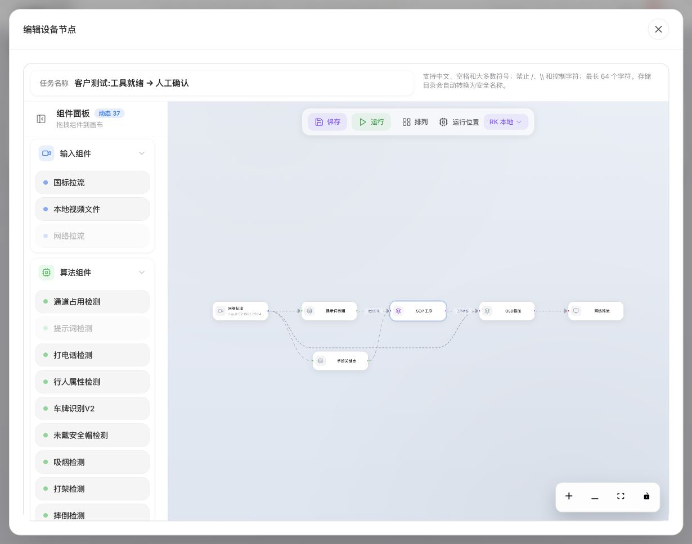

# 方案备份、迁移、维护与现场交付

[English](../../en/sop/maintenance.md) · [手册首页](index.md)

本章供工艺负责人、实施人员和管理员使用。目标是让方案可以重复部署、修改可追溯、故障可恢复，而不是只在当前浏览器窗口中演示一次。

## 1. 建立现场方案记录

每套投入使用的方案至少保留：

| 内容 | 应记录什么 |
|---|---|
| 工位 | 名称、实际位置、摄像头视角 |
| 任务 | 易区分的任务名称与设备 |
| 方案 | 名称、保存版本、工序结构 |
| 素材 | 教学原片、独立验证原片、示范范围 |
| 目标 | 名称、参考用途、容易混淆的物件 |
| 区域 | 工具区、备料区等用途及实际边界 |
| 完成要求 | 自动、人工核对、手部、时间与顺序 |
| 验证 | 预期、实际、问题和适用范围 |
| 负责人 | 谁批准、谁配置、谁运行、谁维护 |
| 备份 | 方案包、录像、导出日期和对应版本 |

方案名称不是唯一证据。核对版本、录像和现场视角，才能知道某次结果是否适用于当前方案。

## 2. 保存前检查

1. 没有未完成的目标框、动作草图或冲突选择。
2. 每步名称与操作要点已由现场人员读懂。
3. 目标参考与人工补框采用状态明确。
4. 区域实际绑定正确。
5. 左右手、组合、持续时间、时限和人工确认方式正确。
6. 总范围与各阶段范围一致且可解释。
7. 已区分通过、未通过、未测试和不确定。
8. 确认本次修改影响哪些其他步骤。

不要把“导出成功”“窗口关闭”“扫描结束”当作保存任务成功。

## 3. 正确保存与重开

1. 工序编辑器点“完成”。
2. SOP 节点窗口仍显示时点“确定/确认”。
3. 回到外层任务流程图，点击“保存”。
4. 等待明确结果，失败时保持窗口。
5. 退出后重新打开同一个任务。
6. 核对本次改变的每一项，而不只看方案名称。
7. 再核对相邻、共享和依赖步骤，防止改错范围。
8. 需要时重新验证后再运行。

### 重开检查表

- [ ] 目标名称与参考数。
- [ ] 待采用内容是否已按计划处理。
- [ ] 全局区域形状与每条绑定。
- [ ] 手部能力及方向。
- [ ] 条件数量、组合和完成方式。
- [ ] 时间单位、时限和阶段顺序。
- [ ] 阶段独立范围和示范范围。
- [ ] 操作要点和示范可播放。
- [ ] 方案版本与复验状态。

## 4. 导出方案包

### 4.1 操作

1. 打开要备份的工序方案。
2. 核对当前草稿是否就是要导出的内容。
3. 点击方案栏的“导出方案”。
4. 等待下载结束，保留原下载文件。
5. 在备份记录中写明任务、方案、日期和对应版本。
6. 不手工改包内文件来“修复”导入问题。

### 4.2 包里有什么

当前方案包使用 **.sopbundle** 文件，基于校验清单封装。根据实际方案内容包含工序定义、可移植的插件组合、绑定资料、检测参考图片和工序/区域引用的素材。

它不是整台盒子的全盘备份。摄像头地址、账号密码、现场运行状态、历史扫描/复验记录以及未引用的其他素材不能仅靠此包推定已备份。

### 4.3 容量边界

当前方案包素材总量限制为 64 MiB，单个方案素材上限 32 MiB，检测参考图片上限 8 MiB；图片目标和清单还有数量限制。它们是方案导出/导入边界，不应被当作所有上传或录制入口都相同的限制。

超限时，按明确提示减少非必要素材、缩短示范或拆分工位；不要直接删除仍被工序使用的资料。重要原录像应另外保留。

## 5. 在另一工位导入

### 5.1 导入前

- 先备份目标工位当前方案。
- 确认目标设备具备所需物件、手部、空间或顺序能力。
- 确认摄像头来源、安装方向和网络。
- 准备本地认证信息；不会从另一个工位照搬密码。
- 安排验证窗口，不在未结束的生产件中随意替换配置。

### 5.2 操作

1. 打开目标工位的工序编辑器。
2. 点击“导入方案”，选择原方案包或支持的 ZIP 包。
3. 等待校验；损坏、不完整或能力不匹配时，按提示停止处理。
4. 阅读替换范围确认。完整方案导入可能替换当前草稿中的工序和插件组合；核对本地摄像头配置的保留方式。
5. 明确确认后，等待素材处理完成。
6. 需要重新绑定来源时，进入检测设置选择本地来源。
7. 检查每个目标参考、区域、手部方向和规则。
8. 在本工位重新验证。
9. 完成并保存任务，再重新打开核对。
10. 在受控条件下运行，检查操作员页面。

### 5.3 模型或能力不同

若界面提供明确的本地适配选项，先读清它保留什么、哪些数字阈值需要重验。适配后的旧验证或推荐不能继续当作当前结果。

未提供适配、能力无法确认或明确不支持时，不应跳过校验强行应用。保留原文件，让实施人员处理兼容性。

## 6. 哪些变化需要重验

| 现场变化 | 至少重验 |
|---|---|
| 相机移动、镜像、翻转 | 全部区域、空间方向、左右手及依赖步骤 |
| 物件外观、包装、颜色变化 | 对应目标正常/反例及所有引用步骤 |
| 新增相似工具 | 混淆、重复框和计数 |
| 更换手套、人员姿态或位置 | 手部可见性、左右、操作范围 |
| 改目标门槛/参考 | 漏检、误检、重复、计数与独立录像 |
| 改共享区域 | 所有引用该区域的工序 |
| 改持续时间/中断/时限 | 正常速度、停顿、错误操作和断流 |
| 改分组/顺序 | 两种组内顺序及缺步/反序 |
| 更新算法/运行组件/设备 | 能力一致性、保存重开、代表场景与恢复 |
| 只改文字 | 操作员理解、工位屏显示和示范一致性 |

不要因为原视频还能播放，就免除更新后的业务验证。

## 7. 历史记录保留

扫描结果和方案复验记录持续保留，便于回看。历史只属于它自己的任务、版本、素材和范围，不能自动证明最新草稿通过。

查记录时：

1. 先识别当前任务与保存版本。
2. 进入识别标注记录或验证记录。
3. 按复验时间选记录。
4. 核对是否采样、是否提交人工标注、是否有可查看片段。
5. 将缺采样、不完整、未核对和已核对分开解释。
6. 记录错误提示和时间，不能用空目录推断“全部正常”。

刷新记录和加载更多是读取操作，不是重新识别，也不表示已恢复缺失文件。

## 8. 空间不足

1. 先停止继续添加大型素材的操作，保留当前草稿与错误提示。
2. 确定受影响的是上传、录制、扫描、复验还是录像证据。
3. 管理员检查可用空间及需要保留的历史。
4. 按现场保留政策先备份，再使用设备明确提供的管理功能整理。
5. 不直接删除仍被任务引用的录像、参考或区域资料。
6. 处理后重新检查原操作是否成功，不立刻新建重复扫描。
7. 确认报警请求与录像证据分别恢复。

不要通过清空所有任务来“释放空间”。历史追溯责任需要由现场确定。

## 9. 发生故障时怎样提交有效信息

| 信息 | 如何获取 |
|---|---|
| 时间与工位 | 发生问题时的实际时间、工位名 |
| 任务与方案 | 当前任务名、方案名、版本 |
| 所在步骤 | 当前阶段和操作名称 |
| 操作路径 | 从哪个按钮进入，点击/拖动了什么 |
| 预期 | 本应新增、替换、保存或推进什么 |
| 实际 | 页面具体提示、是否灰色、结果是否变化 |
| 画面 | 保留上下文的截图，不只截一个绿色框 |
| 证据范围 | 视频文件及起终点，是否独立录像 |
| 恢复尝试 | 是否刷新、重试、撤销或重新打开 |
| 影响 | 是否有生产件、确认结果未知或证据缺失 |

操作说明中不应包含密码。向外部支持发送资料前按本单位规则检查账户、个人画面及生产信息。

## 10. 新工位的交付验收流程

### 第一步：基础可用性

连接、视频、播放、定位、缩略图、画框、区域、滚动、按钮与窄屏布局可正常使用。

### 第二步：识别

单目标、多角度、缺件、相似物、重复框、数量、手套与遮挡的实际表现已记录。先识别，再判断工序。

### 第三步：工序逻辑

各步条件、时间、空间、阶段依赖与任意顺序通过正反例核对。人工确认对象正确，不能确认错工位或错件。

### 第四步：持久化与恢复

保存重开一致；导出/导入边界明确；网络慢、状态未知、断流、空间不足和异常处理有可操作路径。

### 第五步：操作员独立使用

让实际操作员仅按手册和页面完成一个真实流程。记录卡住的位置和需要解释的词。由配置人员代替操作，不算完成这项检查。

### 第六步：交接

保留版本、来源、样本、预期/实际结果、未解决问题、备份及责任人。未通过项目不能只凭页面已配完整就签为通过。

## 11. 可填写的验收记录

| 检查项目 | 预期 | 实际 | 结论/问题 | 责任人 |
|---|---|---|---|---|
| 教学录像播放与定位 | 开中尾正常，缩略图可用 |  |  |  |
| 单物件识别 | 正确位置和数量，反例不误过 |  |  |  |
| 区域约束 | 内外与边界符合要求 |  |  |  |
| 手部及左右 | 本人方向正确，遮挡不误判动作 |  |  |  |
| 顺序/任意组 | 正序、反序、缺步均符合预期 |  |  |  |
| 人工确认 | 当前件、当前步骤、回执正确 |  |  |  |
| 保存重开 | 内容一致 |  |  |  |
| 异常与恢复 | 不丢配置、不误通过、可追溯 |  |  |  |
| 操作员独立完成 | 无额外口头指导 |  |  |  |
| 备份与交接 | 文件、版本、责任明确 |  |  |  |

**相关：[操作员工位手册](operator-guide.md) · [故障排查](troubleshooting.md) · [按钮参考](control-reference.md)。**

*配图素材署名见[示例素材与截图来源](reference.md#7-示例素材与截图来源)。*
