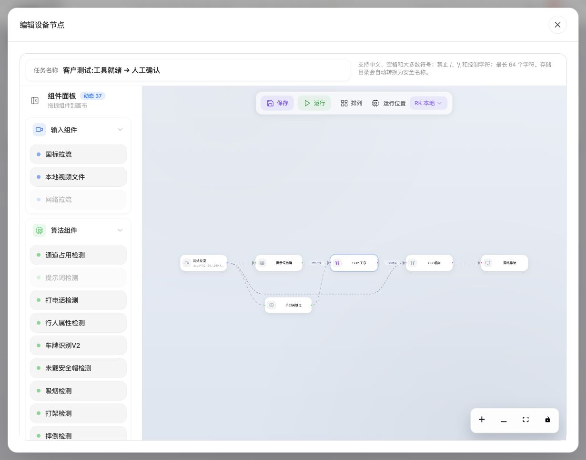
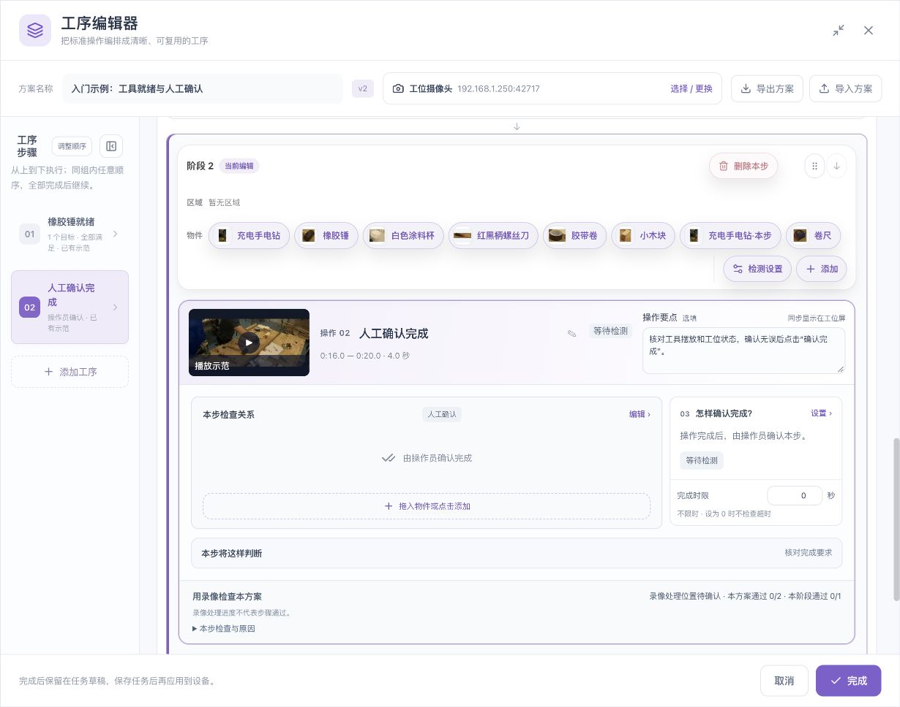

# 操作员工位使用手册

[English](../../en/sop/operator-guide.md) · [手册首页](index.md)

本章供现场操作员和班组长使用。配置与验证应由负责人员先完成；操作员使用的是已保存、已启动任务的当前工序。启动任务和开始一件产品是两个动作。

## 1. 每班开始前

1. 核对工位、产品、任务名称和当前使用方案。
2. 检查摄像头方向与工位实际一致，镜头没有被移走或挡住。
3. 清理会混淆判断的多余相似工具；不要移除工艺要求的物件。
4. 确认视频正常更新，状态已经同步。
5. 阅读本班需要执行的工序说明，遇到含义不明的名称先请工艺负责人澄清。
6. 核对异常由谁处理，返工与中止由谁决定。
7. 若安装、镜像、工具外观或流程已经变化，先报告并重新验证，不直接沿用旧验收结论。

## 2. 从任务进入工位

图示为配置人员启动任务前的外层入口，不是正在生产的合格结果图。

1. 配置人员完成工序编排，依次完成、确认并保存任务。
2. 在外层任务编辑器或任务管理入口启动所需任务。
3. 回到任务卡片，进入对应的“工位运行”。
4. 有多个工位时，选择当前实际操作的工位。
5. 看清工位名称、当前状态、当前操作和已验证步骤数。

任务停止或实例尚未启动时，工位页面可能没有可操作的当前件。不要反复点人工确认来尝试启动后台任务。

## 3. 页面各区域应该看什么

| 区域 | 位置与内容 | 操作员要确认什么 |
|---|---|---|
| 工位标题 | 运行面板顶部 | 没有选错工位 |
| 视频状态 | 顶部连接提示附近 | 正常、连接中、停滞或异常 |
| 状态同步 | 视频状态旁 | 当前状态是否可信 |
| 本件状态 | 面板上部 | 等待、执行、暂停、异常、结束等 |
| 已验证步骤 | 本件摘要 | 是完成步骤数，不是视频播放进度 |
| 当前操作 | 面板主区域 | 名称、操作要点和完成要求 |
| 工序示范 | 当前操作的示范入口 | 回看本步标准动作 |
| 当前检测项 | 当前操作下方 | 哪个物件/区域/数量尚未满足 |
| 阶段/工序列表 | 运行进度区域 | 当前步骤及同组未完成项 |
| 本件详情 | 可展开详情 | 异常原因及运行编号，便于反馈 |
| 操作按钮 | 状态允许时显示 | 对当前件执行开始、确认、暂停等动作 |
| 异常/证据 | 面板下方相关区域 | 报警提交与录像可用是否分别明确 |

视频可播放与工序状态已同步是不同信息。旧画面或旧状态不能作为当前件的确认依据。

## 4. 开始本件

### 前提

当前任务已运行，当前工位可用，页面显示“等待工件”或上一件已经明确结束/中止，并且状态已经同步。

### 操作

1. 清楚区分上一件和当前件。
2. 按现场工艺把当前件放到正确位置。
3. 点击 **开始本件**。
4. 等待状态进入执行中。
5. 核对第一道当前操作，按说明执行。

**预期结果：** 当前件获得自己的执行状态，第一阶段进入当前操作。上一件的绿色完成标记不能代替当前件执行。

如果按钮禁用，先看同步、连接、服务健康和正在提交的操作。不要连续点击或切换到另一工位“试一下”。

## 5. 执行自动检查步骤

以“橡胶锤就绪”为例：

1. 阅读当前操作与操作要点。
2. 将正确工具放在要求区域。
3. 保持正常作业状态，不用在镜头前反复晃动工具。
4. 查看该检测项是否满足、是否还在持续计时。
5. 条件和持续时间达到后，观察步骤是否已验证并推进。

如果始终未满足，先看当前项的具体原因：未检出、区域外、分数不足、数量不符或不可判断。不要仅看画面里“好像有工具”就认定软件卡住。

## 6. 执行视觉后人工核对步骤

系统先检查视觉要求，达到可核对状态后，操作员再检查实物。

1. 等待页面提示条件已稳定或待人工核对。
2. 对照本步操作要点检查实物。
3. 确认没有只完成可见位置、却遗漏实际质量要求。
4. 核对当前操作名称和所选步骤。
5. 点击 **核对现场并确认本步**。
6. 等待明确结果，再继续后续动作。

确认按钮未就绪时，说明前置检测或状态尚未满足；不要把它当作可随时跳过检测的入口。

## 7. 执行纯人工确认步骤

图示为配置入口。现场操作时使用运行页面当前步骤的确认按钮。

1. 根据本步说明完成动作。
2. 核对实物、物料和质量要求。
3. 确认页面仍指向本工位、本件和本步骤。
4. 点击 **人工确认完成**。
5. 观察该步已验证或后续步骤出现。

若实际质量未满足，应按现场异常流程处理，不应因为按钮可点就确认。

## 8. 任意顺序组

同组各步可任意先后，但必须全部完成。

1. 查看“任意顺序 · 全部完成”和本组完成数。
2. 点击所需工序，阅读该步操作说明。
3. 完成并确认该步。
4. 选择本组其他未完成步骤继续。
5. 本组全部完成后，核对下一阶段。

选择一条工序只是查看/聚焦它，不会自动完成它。当前选择的已完成工序可能仍保留在视图中；需要时点“查看进行中工序”返回当前待办。

确认前始终读当前名称，避免在无序组中确认了另一项。

## 9. 工序示范的播放

| 控件 | 作用 | 使用注意 |
|---|---|---|
| 查看工序示范 | 读取本步的教学片段 | 核对本步名称和范围 |
| 播放/暂停 | 回看标准动作 | 不等于完成当前生产操作 |
| 进度条 | 查看片段具体动作 | 播放位置不应改业务规则 |
| 全屏/还原 | 放大或恢复观看 | 回到工位后重新看当前状态 |

示范无法读取时，不重新录制或覆盖配置来恢复。先保留当前件状态，让管理员检查素材、网络和任务版本。

## 10. 暂停与核对后恢复

### 暂停

操作需要临时停止时，按现场程序点击 **暂停**，等待“已暂停”。暂停软件流程不替代现场设备停机或机械安全程序。

### 核对后恢复

1. 核对现场实物位置和未完成动作。
2. 确认摄像头、检测来源和任务配置未发生未处理变化。
3. 阅读恢复提示。
4. 只有现场与流程状态一致时，确认恢复。
5. 观察重新执行的当前操作。

“检测来源或配置已变化”提示出现时，不强行继续当前件；按界面选择恢复原配置，或中止后按新配置重新开工。

## 11. 返工

返工用于回到指定步骤重新执行，不是把错误记录悄悄擦掉。

1. 由有权人员决定返工起点。
2. 点击 **返工**。
3. 在“从哪一步返工”选择实际要重做的步骤。
4. 填写具体原因，例如“杯子位置不符，重新摆放”。
5. 确认返工。
6. 检查被要求重做的步骤与后续依赖。
7. 按当前页面重新执行，不能沿用已失效的旧完成状态。

原因字段用于追溯，应写事实，不只写“测试”“错误”。当前原因输入长度上限为 300 字符，以页面校验为准。

## 12. 中止本件

当本件不能继续或必须重新开工时：

1. 先核对当前工位与工件。
2. 点击 **中止本件**。
3. 填写具体中止原因。
4. 确认中止，等待明确结果。
5. 按现场程序处置工件和相关记录。
6. 再次开始前确认新一件的状态。

中止与暂停不同。中止后不应假定可以从原位置无缝继续。

## 13. 完成本件

步骤完成数达到要求后，查看本件最终状态。页面在需要时提供 **完成本件**。

- 核对所有必需步骤已完成。
- 核对没有未处理异常或待人工核对项。
- 点击需要的结束动作，等待明确终态。
- 区分“本件结束”和“本件合规完成”；结束不必然表示合规。
- 记录现场要求的结果，再开始下一件。

## 14. 按钮功能与禁用原因

| 按钮 | 出现/可用的典型条件 | 常见禁用原因 |
|---|---|---|
| 开始本件 | 等待、上一件结束或中止后 | 未同步、请求中、服务异常 |
| 人工确认完成 | 当前执行中的可人工确认步骤 | 当前步不对、原确认待核对 |
| 核对现场并确认本步 | 视觉条件达到人工核对状态 | 检测尚未稳定 |
| 暂停 | 执行中 | 状态不可信或请求中 |
| 核对后恢复 | 已暂停或等待恢复核对 | 来源/配置变化未处理 |
| 返工 | 可恢复处理的当前件 | 来源变化、服务异常等 |
| 中止本件 | 当前件尚未结束 | 请求中、状态不可确认 |
| 完成本件 | 步骤完成并需明确结束 | 仍有未完成项 |
| 查看进行中工序 | 当前查看的不是待执行项 | 没有待执行步骤 |
| 重新核对状态 | 上次确认结果未知 | 设备未连接或正在回读 |
| 重试上次确认 | 回读后允许重试原请求 | 当前步骤已变化、仍无法确定或请求中 |

## 15. 网络慢或确认结果未知

1. 保留当前页面，不连点确认。
2. 看是否提示原请求已保留。
3. 点击 **重新核对状态**。
4. 如果该步已经变化，按当前结果继续，不再补发旧确认。
5. 只有界面允许、且确实仍需提交时，使用 **重试上次确认**。
6. 仍无法确定时，由管理员核对设备记录。

不要通过刷新后手工再点一个“新确认”来绕过未知状态。切换工位或工件后，更要重新核对确认对象。

## 16. 常见运行状态

| 状态 | 操作员应该做什么 |
|---|---|
| 等待工件 | 核对工位，按程序开始本件 |
| 执行中 | 按当前步骤操作 |
| 已暂停 | 核对现场后决定恢复 |
| 异常待处理 | 查看原因，请有权人员处理 |
| 等待恢复核对 | 先核对实物与流程状态 |
| 等待证据确认 | 等待可用证据，不据旧结果确认 |
| 本件结束 | 阅读实际结论，准备下一件 |
| 本件中止 | 按异常工件程序处理 |
| 状态未同步 | 暂不提交重复操作，恢复连接 |
| 画面停滞/连接异常 | 不能仅靠最后一帧判断当前现场 |

## 17. 报警与录像证据

报警“已提交”表示请求提交给相应能力，不保证录像文件已完整可用。分别检查报警状态、录像状态和证据是否能读取。

出现“部分证据”“录像异常”“结果待核对”时，保留事件、工位、时间和本件编号，交管理员处理。不要删除历史来让提示消失。

## 18. 下班与交接

- 记录未完成或异常工件。
- 按现场要求暂停/结束任务，不假定关闭网页等于停止后台任务。
- 保留需要追溯的录像与结果。
- 告知下一班相机、工具、流程或配置是否变化。
- 不在生产过程中随意替换教学视频、参考或共享区域。

**相关：[验证与保存](validation-and-operation.md) · [维护与交付](maintenance.md) · [按钮参考](control-reference.md)。**

*配图素材署名见[示例素材与截图来源](reference.md#7-示例素材与截图来源)。*
