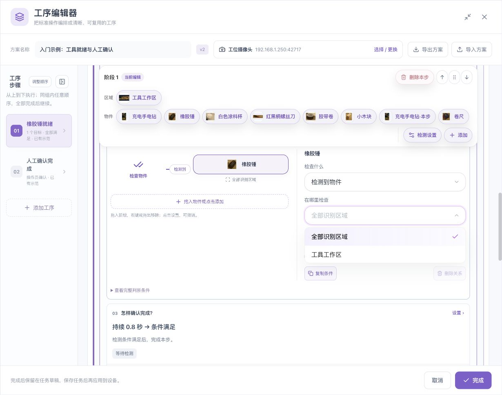
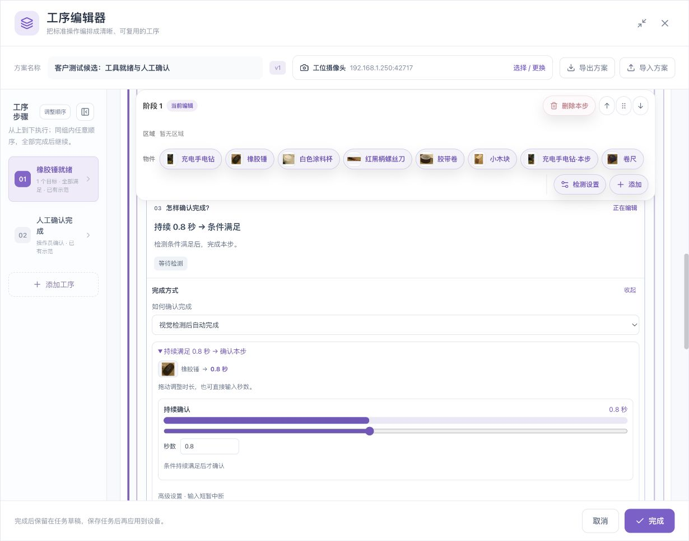

# 参数、单位、默认值与状态说明

[English](../../en/sop/parameters.md) · [手册首页](index.md)

本章帮助您判断“这个值控制什么、改大或改小会怎样、需要重新验证哪些内容”。参数不应靠反复试到变绿来决定。先定位识别、空间、时间或流程问题，再只改对应参数。

## 1. 参数分为五类

| 类别 | 解决的问题 | 常见字段 |
|---|---|---|
| 识别 | 画面中哪个候选可被认作目标 | 参考、检测门槛、最低置信度 |
| 数量与空间 | 几个、在哪、与谁形成什么位置关系 | 至少/最多、区域、关系类型、距离 |
| 时间 | 条件持续多久、允许等待多久 | 持续时间、输入中断容忍、完成时限 |
| 流程 | 多条件和多工序怎样组合 | 全部同时、任意、先后、阶段分组 |
| 证据范围 | 使用哪一段录像检查 | 总范围、阶段范围、示范范围、采样间隔 |

设置窗口里的可输入范围是界面允许值，不是推荐工艺值；设备还会校验能力与组合要求。下面给出的 0.8 秒等是示例，不是所有工位的统一标准。

## 2. 目标与参考

| 字段 | 含义 | 设置建议与影响 |
|---|---|---|
| 目标名称 | 业务物件身份 | 同一物件不同朝向仍用同一逻辑目标 |
| 主参考 | 目标的主要外观依据 | 选清晰、背景少的正常画面 |
| 补充角度 | 同一目标的另一常见外观 | 覆盖真实变化，检查是否增加误检 |
| 检测容量 | 可用查询位置的占用 | 一个逻辑目标可能占多个参考/别名位置 |
| 待采用数量 | 尚未显式采用的改进资料 | 与正式参考数分开核对 |
| 修改范围 | 仅本步或所有使用步骤 | 先读受影响步骤，再应用 |

**例子：** 一把锤有正面、侧面两个参考，仍然只是一种逻辑目标；现场只有一把锤时，不能因为参考数为 2 就要求数量为 2。

## 3. 三种“分数”不要混用

### 3.1 源检测门槛

位于目标/参考的识别设置中，决定检测来源保留什么候选。当前相应百分比输入界面允许 1–95。不同参考可以有各自门槛；读清当前选中的参考或目标。

### 3.2 本项最低置信度

位于步骤关系的“更多设置 → 识别设置”。目标 A 与目标 B 可能各有最低置信度，界面按 0–100% 显示。

这是当前条件对输入结果的要求。若来源已经在较高门槛下丢弃候选，仅降低当前条件的要求不能把丢失候选恢复出来。出现两层门槛冲突提示时，应分别核对来源与本项设置。

### 3.3 当前图片试检阈值

只用于当前试检条件。重新检测本帧得到的结果，不应被写成所有录像和所有工序已通过。当前试检百分比输入界面允许 1–95。

| 看到的数值 | 正确理解 | 不应解释成 |
|---|---|---|
| 候选最高分 | 某参考在某画面的候选线索 | 整个目标准确率 |
| 本次参考门槛 | 对应参考的接受要求 | 所有参考共用一个结论 |
| 人工补框命中 1/2 | 两个标注实例中匹配到一个 | 整帧或整段已完全正确 |
| 算法检出 1 个框 | 保留一个检测结果 | 必然命中指定人工框 |
| 生成图片 100% | 计划结果图已生成 | SOP 通过 100% |

修改后要同时检查真目标、相似物、空背景和重复框。无法稳定区分时，先改善拍摄或参考，不持续降低门槛。

## 4. 数量：至少与最多

| 工艺要求 | 至少 | 最多 | 说明 |
|---|---:|---:|---|
| 恰好 1 件 | 1 | 1 | 多一件或少一件都不符合 |
| 恰好 2 件 | 2 | 2 | 先确认两件清楚分开 |
| 允许 1–3 件 | 1 | 3 | 属于允许区间，不是恰好 1 件 |
| 不允许检出 | 0 | 0 | 与物理离开不同，建议保留人工核对 |

当前数量输入上限为 10000，这只是输入边界，不代表系统能在所有画面可靠数到该数量。填写非负整数，至少不能大于最多。内置手部等目标可能不提供物件计数选项。

重复框、物件重叠、区域边界不明确、实物身份不明会影响数量可信性。不要通过放宽数量来掩盖这些问题。

## 5. 区域字段

| 选择 | 实际作用 | 使用前核对 |
|---|---|---|
| 全画面 | 按完整画面判断 | 周围工位是否会干扰 |
| 全部识别区域 | 按已配置的识别区域覆盖 | 区域是否完整，是否包含不该计入的位置 |
| 具名区域 | 绑定该条检查到指定区域 | 关系图下方显示正确名称 |
| 目标 A 区域 | 限制关系的一端 | 不等于自动限制另一端 |
| 目标 B 区域 | 限制参照端 | 手和物件不同区域时分别设置 |
| 操作范围 | 覆盖完整动作过程 | 不能只覆盖起点或终点 |
| 起始区/到达区 | 顺序动作的两个位置 | 区域应能表达真实变化 |

区域不是“只对框内图像运行算法”的同义词。它可以用于结果筛选或规则判断；判断范围正确不等于其他画面绝不会产生检测。

## 6. 空间关系与距离

### 6.1 关系方向

“目标 A 在 B 左侧”与“B 在 A 左侧”不同。替换目标时，重新核对 A、B、关系方向及双方区域。画面方向与镜像发生变化后，必须重验。

### 6.2 手与物件距离范围

手部靠近/可见远离的距离控件随物件尺寸归一化。当前直观滑杆为 10%–100%，步进 5%。这里的百分比不是识别分数，也不是厘米、力或接触压力。

范围更宽，可能更容易将“在附近但未操作”的手计入；范围太窄，正常位置波动可能无法满足。应使用实际正常动作和旁边经过的反例验证。

### 6.3 高级空间参数

高级关系阈值的界面范围为 0–16，边界容差为 0.001–1。不同关系含义不同，通常保留生成值，先用图示关系和实物验证。不要把统一数值套到所有关系，也不要将边界不明确直接视为满足。

## 7. 持续时间

**用途：** 条件必须稳定满足多久，才算当前要求成立。

- 秒数输入支持 0.001–3600 秒。
- 示例 0.8 秒表示稳定保持，不表示抽取 0.8 秒录像。
- 滑杆是便于快速调整的控件；需要精确值时用秒数输入。
- 当前组件的滑杆不是“每格固定相同秒数”；以显示秒数为准。
- 明确不满足的正常画面，不应因为之前满足过就继续累积成连续通过。

对于“全部同时满足”，要保持的是整个组合，而不是每件物料分别在不同时刻出现一次。

## 8. 输入中断容忍

**用途：** 暂时没有可信输入时允许等待的时间，与明确观察到错误不同。常见生成配置为 0.5 秒，实际以加载值和具体模板为准。普通输入界面范围为 0.001–60 秒；连续观察模板可能有更严格限制。

**不要这样用：** 手部反复漏检，就把间隔调得极大直到流程通过。这样不能证明动作连续可见，也不能修复底层识别。

修改前先回答：这段间隔里是没有新输入，还是有清楚画面显示条件不满足？两者不能混为一谈。

## 9. 完成时限与顺序最长用时

| 字段 | 用途 | 当前界面边界 | 0 的含义 |
|---|---|---|---|
| 完成时限 | 本步可花的最长时间 | 0–86400 秒 | 不检查本步超时 |
| 顺序最长用时 | 一组有序条件完成的最长时间 | 0.001–3600 秒 | 不应使用 0 代替无限 |
| 持续满足 | 条件保持时长 | 0.001–3600 秒 | 不接受 0 作为普通稳定时长 |
| 输入中断容忍 | 可信输入暂缺的等待限制 | 0.001–60 秒，模板可能更严 | 不等于本步不限时 |

示例：工具需要保持 0.8 秒，操作应在 20 秒内完成，分别写入持续时间和本步时限。不能把两个字段互换。

## 10. 选段与采样

1. 起点、终点必须处于对应录像内，起点早于终点。
2. 总范围用于目标扫描/方案验证；阶段范围只属于本阶段。
3. 阶段范围可以重叠，不要求自动切成互不重叠的分段。
4. 总方案验证应覆盖参与的阶段范围；越界时按提示处理。
5. 改选段后，旧结果不会自动变成新范围的验证结论。
6. 采样间隔用“每多少帧取一张”表达；不要直接当成秒数。实际时间间隔取决于视频帧率。

**示例：** 每 30 帧取一张，对 15 帧/秒视频约为每 2 秒一张；对 30 帧/秒视频约为每 1 秒一张。应核对结果实际时间，不用这个换算替代界面结果。

## 11. 完成方式

| 方式 | 系统负责 | 操作员负责 |
|---|---|---|
| 视觉后自动 | 检查视觉规则、时间和流程 | 按现场要求处理异常 |
| 视觉＋人工核对 | 先达到可核对状态 | 检查实物质量并确认当前步骤 |
| 人工确认 | 提供说明、示范和确认入口 | 根据工艺要求判断并确认 |

人工核对适合无法单凭相机证明的要求。不要将其当成“视觉失败时随便点过”的按钮。

## 12. 状态不是参数

| 状态/提示 | 含义 | 下一步 |
|---|---|---|
| 未核对 | 尚未有明确人工判断 | 看原图，标正例/负例/不清楚 |
| 已保存，尚未采用 | 标注保存与参考采用是两步 | 明确采用，再复验 |
| 当前结果来自修改前配置 | 配置和证据已不一致 | 按提示重验，不引用旧结果 |
| 等待人工核对 | 自动观察后仍需人员确认 | 核对实物和当前步骤 |
| 数量无法确认/身份不明 | 检测不能可靠确定实例 | 分开物件、改善视角或核对结果 |
| 区域边界不明确 | 当前目标位置无法可靠归入 | 调整实物位置/区域并复验 |
| 状态未同步 | 设备状态尚不可信 | 恢复连接并回读，暂不重复确认 |
| 记录无采样 | 该次记录没有对应标注图片 | 不能据此声称已完成识别复核 |

## 13. 参数修改的标准流程

1. 写下具体问题和原值。
2. 确认问题属于哪一类，不同时改多类参数。
3. 选择一段能复现问题的录像，保留原结果。
4. 修改一个明确有依据的设置。
5. 同时复查正常、错误和独立录像。
6. 记录修改原因、范围、版本及结果。
7. 保存后重新打开核对，再应用到现场流程。

**相关：[场景配置实训](scenario-labs.md) · [按钮参考](control-reference.md) · [故障排查](troubleshooting.md)。**

*配图素材署名见[示例素材与截图来源](reference.md#7-示例素材与截图来源)。*
