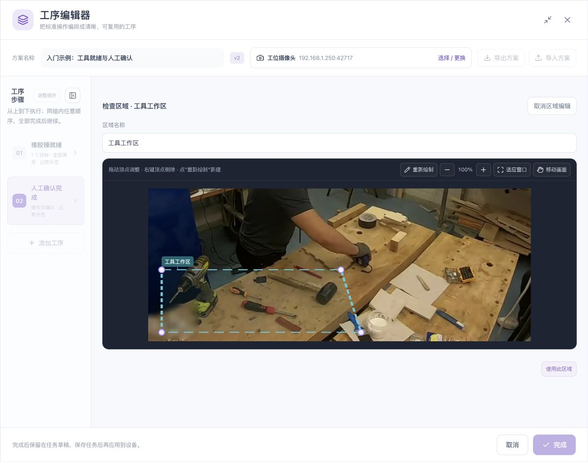

# 实施准备与工序需求整理

[English](../../en/sop/preparation.md) · [手册首页](index.md)

本章用于正式配置前的准备。完成后，您应当得到一份明确的工序表、一段可用的教学录像、可区分的物件清单，以及需要人工核对的质量要求。这样进入编辑器后，每次操作都有明确目的。

## 1. 谁来准备，谁来使用

| 角色 | 配置前需要提供什么 | 配置后需要核对什么 |
|---|---|---|
| 工艺负责人 | 正确操作顺序、允许的变化、必须检查的质量要求 | 系统规则是否表达真实工艺，哪些质量要求仍由人核对 |
| 配置人员 | 摄像头、录像、目标和区域命名 | 每条规则的对象、范围、时间、组合和完成方式 |
| 现场操作员 | 一次正常操作，以及常见的错误操作 | 工位屏的名称、示范、提示和确认入口是否易懂 |
| 实施/管理员 | 设备可连接、所需识别能力、存储、备份和运行权限 | 保存重开、任务运行、异常处理、版本及记录可追溯性 |

一人可以兼任多个角色，但不要省略核对责任。配置人员理解页面，不等于操作员理解工艺提示。

## 2. 第一次打开前的检查

### 2.1 设备和浏览器

1. 完成[设备开箱与快速上手](../device-onboarding.md)，确认计算机能访问设备管理地址。
2. 使用现场确定的设备地址登录。截图里的局域网地址只是示例。
3. 核对设备在线状态；先解决持续断线，再配置工序。
4. 确认将要编辑的任务名称，避免同时打开多个相同名称的任务。
5. 选取足够的浏览器窗口空间。需要时最大化工序编辑器或折叠左侧步骤栏。
6. 若出现浏览器证书提示，由现场管理员按设备安全要求处理。

**预期结果：** 页面能稳定读取设备状态，任务卡片和编辑入口可见。此时不必启动任务。

### 2.2 摄像头

| 检查项 | 可接受的准备状态 | 需要先处理的情况 |
|---|---|---|
| 安装位置 | 固定，能看到关键工具与动作 | 头戴移动画面却配置了固定工作区 |
| 拍摄方向 | 与正常作业方向一致 | 镜像或翻转后仍沿用旧左右手设置 |
| 工作区大小 | 关键物件占有足够画面 | 工具只在远处占很少像素 |
| 遮挡 | 常规握持时关键外观仍可见 | 操作员身体长期挡住目标 |
| 光照 | 关键位置没有持续强反光或过暗 | 金属表面反光使轮廓不稳定 |
| 周边干扰 | 相邻工位与本工位有清楚界线 | 多个人和多把相似工具混在同一区域 |

固定区域跟随画面坐标。相机移动后，原区域可能仍画在屏幕上，但已经不对应真实工位。

### 2.3 功能准备

只检查物件的流程先使用物件识别。需要手与物件配合时，再增加手部识别。左右手必须在实际安装方向下核对。

不要仅根据“存在插件名称”推断整个工序能力已可用。应检查编辑器中相应目标、条件和验证入口是否可用，并完成实际录像验证。

## 3. 把现场语言整理成工序表

先写动作，再写系统能观察到的依据。例如“取锤完成”可能包含“手靠近、锤开始移动、锤到指定区、操作者确认”；单独看到手靠近并不能证明取锤已经完成。

推荐每行只写一个可明确完成的工作单元：

| 项目 | 需要填写的内容 | 例子 |
|---|---|---|
| 工序名称 | 操作员能理解的动作或状态 | 工具就绪 |
| 前提 | 开始本步前必须完成什么 | 新一轮工件已经准备 |
| 检查物件 | 必须出现或计数的物件 | 橡胶锤 |
| 检查位置 | 当前工位的哪个位置 | 工具工作区 |
| 手部要求 | 不关心手、任意手或指定手 | 本步不检查手 |
| 时间要求 | 保持多久，是否有限时 | 连续就绪 0.8 秒；本步暂不限时 |
| 组合关系 | 同时、任选、先后或独立工序 | 该物件就绪 |
| 完成方式 | 自动、视觉后人工核对或人工确认 | 视觉检测后自动完成 |
| 人工质量要求 | 画面不能证明的内容 | 下一步由人核对工具与工位 |
| 验证反例 | 应当不能完成的情况 | 橡胶锤缺失或放在区域外 |

**不要把无法观察的质量要求改写成一个容易通过的位置条件。** 例如“电钻在螺丝旁”不等于扭矩合格，“杯子进入区域”不等于杯中液量合格。

## 4. 确定阶段与步骤之间的依赖

先回答三个问题：

1. B 是否必须在 A 完成后才能开始？
2. A 与 B 是否可以任意顺序完成，但都不可缺少？
3. A 与 B 是否必须在同一时刻成立？

| 回答 | 编排方法 | 验证时要特别检查 |
|---|---|---|
| B 必须在 A 后 | 放在先后执行的不同阶段 | 反序操作不能被当成正确顺序 |
| A、B 可任意先后且都要完成 | 放入同一任意顺序阶段 | 两种顺序都应可完成；缺少一步不能完成整组 |
| A、B 必须同时成立 | 在同一步内使用全部同时满足 | 不能把分开出现的条件相加 |
| A、B 是可替代选择 | 同一步内任意一项满足 | 每个选项确实是工艺允许的替代项 |

录像里两段时间重叠，不意味着两道工序可以互相替代；两段时间不重叠，也不必然意味着工艺要求严格顺序。编排依据是工艺依赖。

## 5. 准备教学录像

### 5.1 录像应该包含哪些内容

建议从操作前的稳定工位开始，拍到正常操作和结束状态。关键过程不要刚好落在片头、片尾或相机转动期间。

1. 先让工位保持短暂稳定，方便选取清楚的目标参考。
2. 按正常速度执行，不必为了系统刻意极慢操作。
3. 保留真实的手部进入、物件移动和手部离开过程。
4. 不要在关键动作中切镜头或拼接成不连续画面。
5. 结束后保留能看清物件最终位置的画面。
6. 再录另一次操作，作为独立验证录像。

### 5.2 上传后先做完整性检查

| 操作 | 应看到什么 | 未达到时怎么办 |
|---|---|---|
| 播放片头 | 正确工位和方向 | 核对选错文件、镜像或视频来源 |
| 定位中间 | 画面随时间更新 | 等待加载，仍异常则查看媒体提示 |
| 定位片尾 | 有真实结束画面 | 检查原片是否完整 |
| 查看时间轴 | 显示真实缩略图 | 不要用静态参考图正常来推断缩略图已就绪 |
| 拖动播放头 | 预览位置改变 | 区分播放头与起终点手柄，见[界面说明](workspace-reference.md) |
| 核对时长 | 与上传/录制片段一致 | 检查是否正在看旧素材或另一操作的示范 |

**本节完成标志：** 您能说出目标清楚出现的时间、动作开始与结束时间，以及一段物件确实不在位或操作未完成的画面。

## 6. 准备目标清单

### 6.1 名称应如何写

推荐“用途或外观＋物件名称”，例如“橡胶锤”“白色涂料杯”。同一逻辑目标可以有多个参考角度；不要用“正面锤”“侧面锤”把同一把锤误建为两种必须同时出现的物件。

对于相似物件，应能清楚说明区别。若画面分辨率下本身无法区分，不应依赖更长名称解决视觉混淆。

### 6.2 参考选择表

| 参考内容 | 为什么需要 | 需要同时检查的反例 |
|---|---|---|
| 正常摆放的清楚正面 | 建立主要外观 | 背景相似形状 |
| 正常侧面或旋转姿态 | 覆盖常见朝向 | 相似工具 |
| 正常握持状态 | 检查手遮挡下是否仍可识别 | 只有手、没有工具 |
| 常见远近位置 | 检查真实大小变化 | 很小或模糊到不可判断的目标 |

增加参考后，应验证它是否改善真实漏检，同时没有增加误检和重复框。参考越多并不自动越稳定。

## 7. 准备区域清单

区域名称应描述用途，例如“工具区”“备料区”“装配区”，并由工艺人员确认边界。

- 同一工位可以有多个区域。
- 区域可以重叠，但必须明确重叠时规则的含义。
- 起始区、到达区应能反映真正的状态变化。
- 覆盖操作过程的区域要包含移动途中，不应只包住两个端点。
- 画好全局区域后，还要逐条把条件绑定到需要的区域。

## 8. 准备验证样本

| 类别 | 最小应包含的内容 | 判断原则 |
|---|---|---|
| 正常操作 | 一次清楚、完整的标准流程 | 检查正确动作能完成 |
| 缺件 | 拿走一件必需物件 | 不能仅因其他物件存在就通过 |
| 放错位置 | 同一物件移到区域外 | 检查区域确实生效 |
| 数量错误 | 少一件或多一件 | 先排除重复框 |
| 顺序错误 | 反过来执行一项要求 | 检查顺序是否被错误放宽 |
| 手部反例 | 只靠近不离开、遮挡、多人 | 不把漏检当动作完成 |
| 独立录像 | 另一次真实操作 | 检查是否只对原示教片有效 |
| 输入异常 | 断流、停帧或不可判断画面 | 不确定不能被当成完成 |

这些是样本设计要求，不是本手册已经测得的通过结果。现场应保留录像、配置版本、预期和实际结果。

## 9. 配置前确认表

- [ ] 已确认任务和工位，避免编辑错对象。
- [ ] 能正常播放、定位完整录像。
- [ ] 工序名称和完成标准已写清。
- [ ] 自动检查与人工质量核对的分工已确定。
- [ ] 物件名称、参考内容和区域用途已整理。
- [ ] 已明确先后、任意顺序、同时与替代关系。
- [ ] 关键过程的手与物件都能看清。
- [ ] 已准备正常、反例和独立录像。
- [ ] 已确定谁核对结果、谁保存、谁负责运行与维护。

**继续：[认识编辑器及每个操作入口](workspace-reference.md) → [完成第一个示例](quickstart.md)。**

*配图素材署名见[示例素材与截图来源](reference.md#7-示例素材与截图来源)。*
