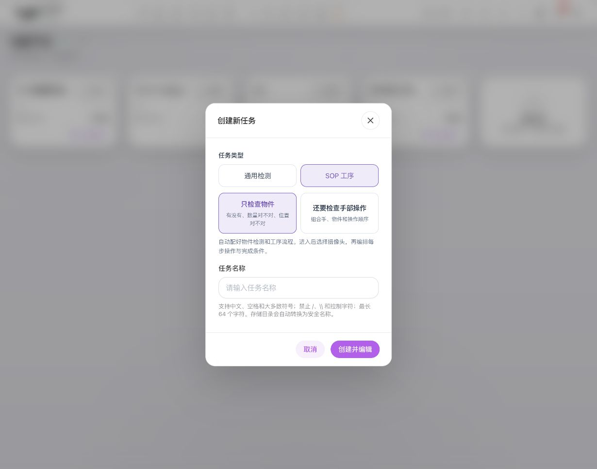
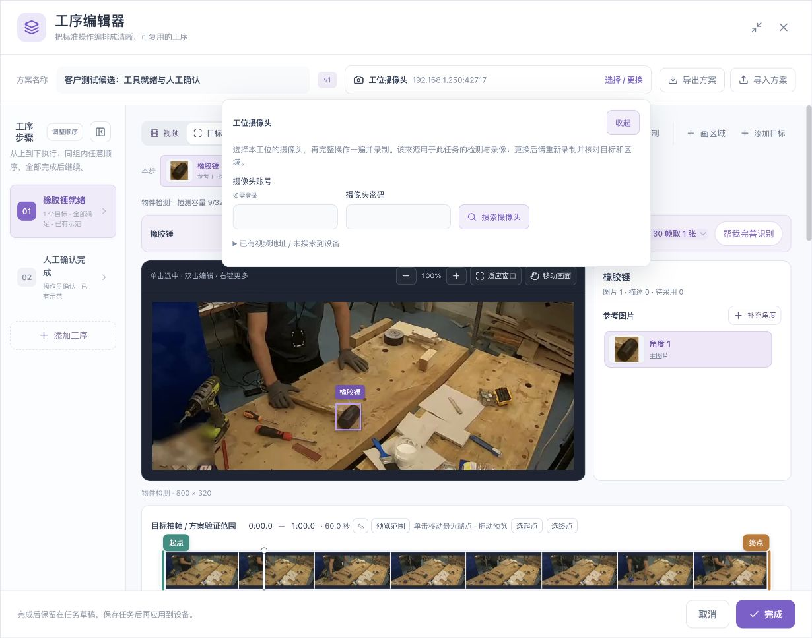
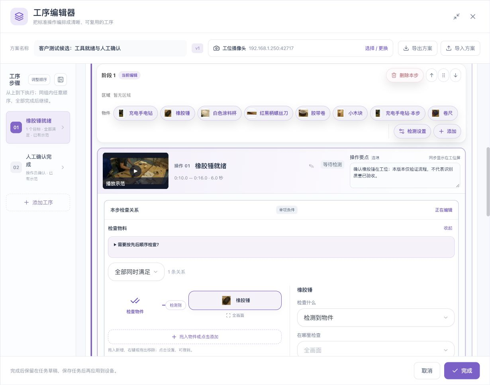
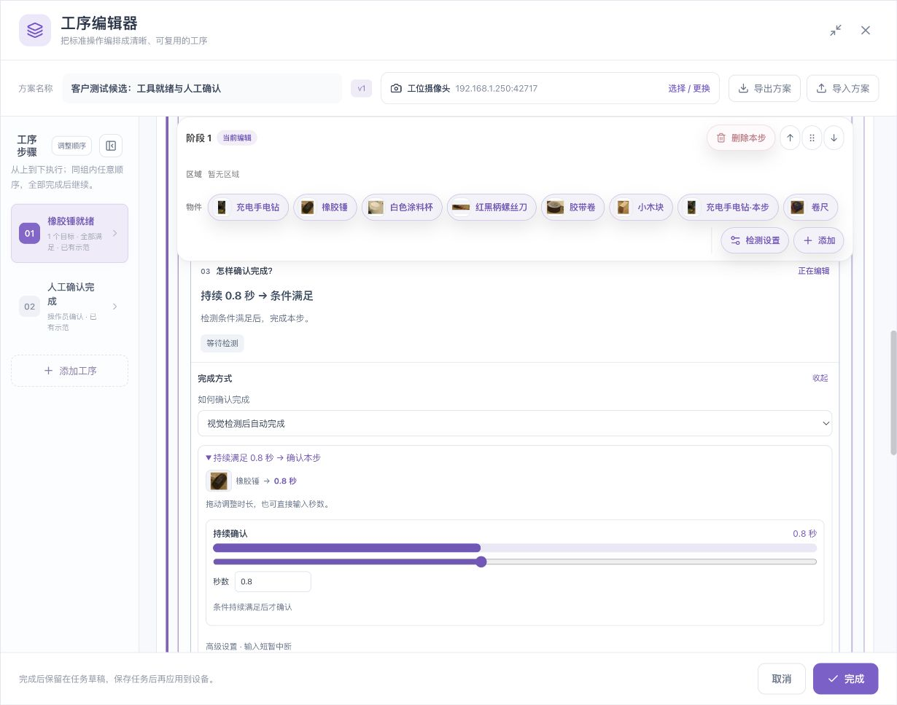
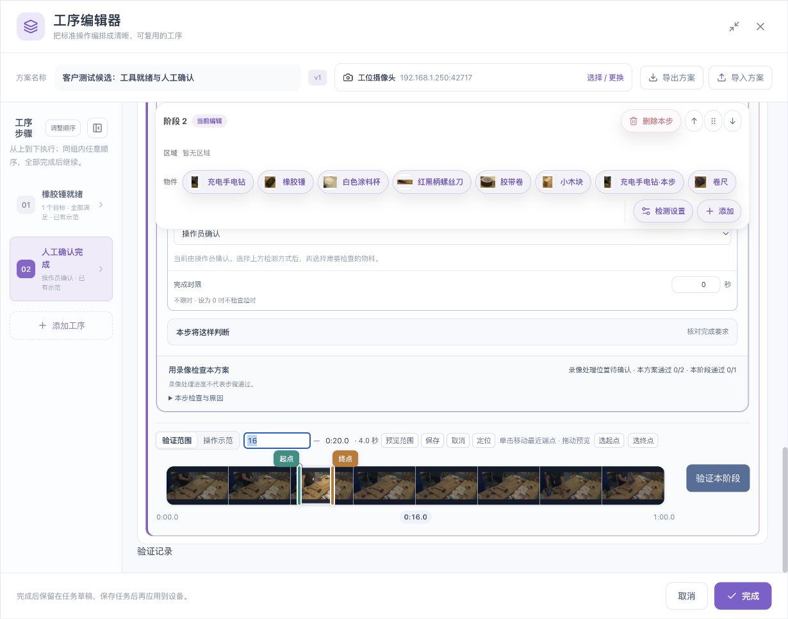
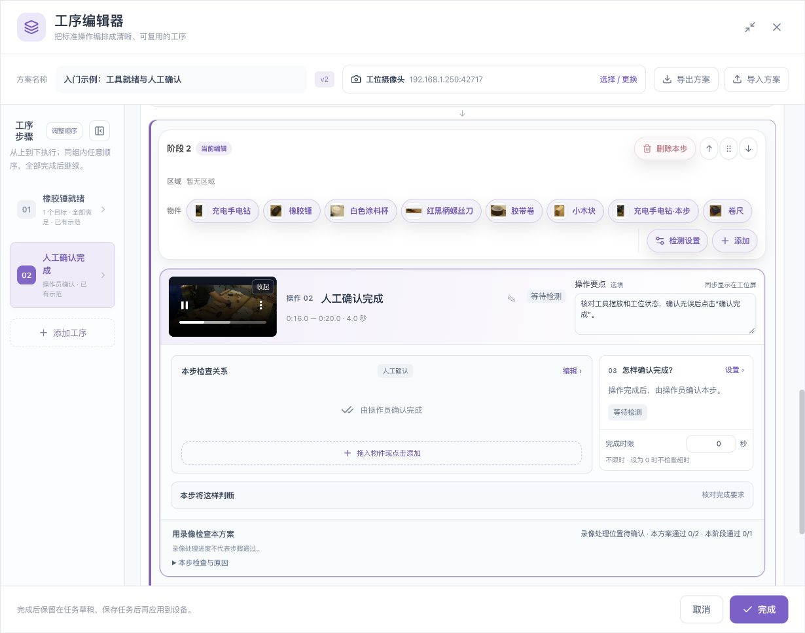
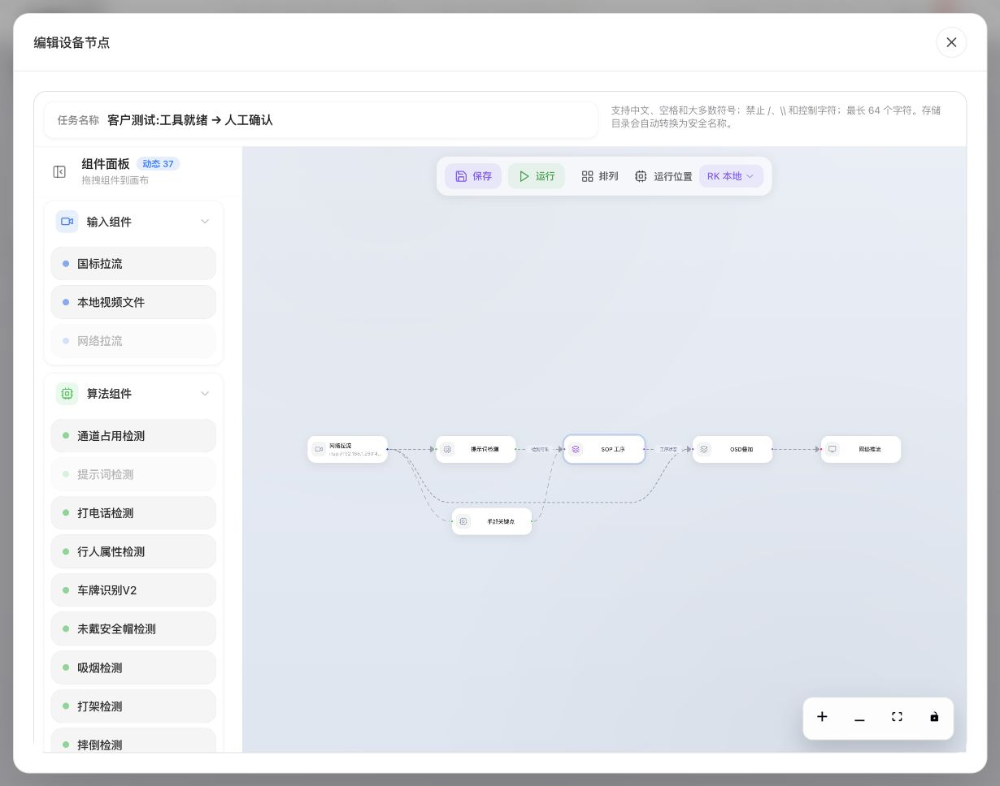

# 入门：跑通“工具就绪 → 人工确认”

[English](../../en/sop/quickstart.md) · [返回手册首页](index.md)

本章只建立一个可理解的两步流程。先让系统检查一把橡胶锤，再让操作员确认。**先确认目标识别没有问题，再继续阶段和方案验证。** 手部动作与多目标检查放在后续章节。

## 1. 准备工位和录像

1. 固定摄像头，让工具工作区占画面主要部分。
2. 确认橡胶锤在正常使用位置能够清楚看见，轮廓没有被手、反光或其他工具长期挡住。
3. 准备一段包含完整操作的短录像：开始时展示工位，执行操作，最后保留完成后的画面。
4. 最好再准备另一段独立拍摄的录像，用于检查方案是否只适用于第一段示教视频。
5. 摄像头画面与录像应使用同一个机位、朝向和相近光照。重新移动摄像头后，重新核对区域与目标参考。

| 本例设置 | 建议初值 | 为什么这样开始 |
|---|---|---|
| 检查目标 | 仅橡胶锤 | 先掌握一个物件的选取与验证 |
| 手部检查 | 暂不启用 | 避免把物件和手部问题混在一起 |
| 阶段顺序 | 先工具就绪，再人工确认 | 后一步依赖前一步 |
| 目标就绪持续时间 | 0.8 秒，仅为示例 | 避免只出现一个瞬间就结束本步 |
| 完成时限 | 0，暂不限时 | 先跑通正常路径，再增加超时要求 |

**检查点：** 您能在录像中指出橡胶锤在哪里、什么时候清晰出现，以及什么时候应由操作员确认。

## 2. 登录并创建 SOP 任务

1. 在浏览器中打开设备管理地址并登录。
2. 等待页面显示设备已连接。首次连接设备请先完成[设备开箱与快速上手](../device-onboarding.md)。
3. 点击顶部 **添加任务**。
4. 在任务类型中选择 **SOP 工序**。
5. 选择 **只检查物件**。它适合零件、工具是否出现、数量或位置检查。
6. 填写容易辨认的任务名称，例如“工具就绪与人工确认”。
7. 点击 **创建并编辑**，进入任务编辑流程，再进入 **编辑工序**。

*图 2：入门流程选择“只检查物件”。如果工艺需要手靠近、离开或移动，参阅手部专章。*

任务名称、方案名称和工位名称可以不同：任务名称用于管理任务，方案名称用于辨认工艺，工位名称用于现场显示。建议保持语义一致，不要全部使用“测试”“新建方案”这类难以辨认的名称。

## 3. 认识工序编辑器

| 区域 | 怎么用 |
|---|---|
| 顶部方案栏 | 修改方案名称，选择摄像头，导入或导出方案 |
| 左侧工序列表 | 选择当前步骤、调整顺序、组成任意顺序组或新增工序 |
| 视频/目标切换 | “视频”用于播放与定位；“目标”用于查看当前目标与参考图片 |
| 上方时间轴 | 选择目标抽帧及整套方案验证的范围 |
| 工序卡片 | 查看或修改名称、示范片段、操作要点、检查关系与完成方式 |
| 阶段下方时间轴 | 设置该阶段自己的验证范围与操作示范片段 |
| 底部完成 | 将编辑结果放回任务草稿；随后仍需保存任务 |

空间不足时，可收起左侧列表，或使用窗口右上角的最大化。收起后仍可通过编号选择工序。常规滚轮用于滚动页面；缩放画布时按住界面提示的修饰键，或使用画面上方的加减按钮。

## 4. 选择摄像头

1. 点击方案栏里的 **选择 / 更换**。
2. 优先选择当前工位已配置的摄像头。
3. 搜索摄像头需要认证时，填写**摄像头的账号和密码**。它们不一定与盒子网页登录账号相同。
4. 已有视频地址但未搜索到设备时，展开对应入口，由管理员核对地址与网络。
5. 选定后，检查方案栏是否显示正确的摄像头。

**预期结果：** 摄像头来源属于当前工位，后续录制来自该来源。

更换摄像头后，应重新录制或核对目标、区域、左右手方向和验证录像。旧机位画出的区域不能直接视为新机位仍然正确。

## 5. 录制或上传一次完整流程

### 5.1 使用已有录像

1. 点击 **上传**。
2. 选择设备界面支持的视频文件。
3. 等待上传、处理和画面读取结束。
4. 播放视频，检查开头、中段和结尾是否正常，时间轴是否有真实缩略图。
5. 暂停在橡胶锤清楚可见的一帧。

### 5.2 录制现场

1. 先选好摄像头。
2. 点击 **录制**。
3. 页面已有示教视频时，阅读重新录制的确认提示。
4. 确认需要替换后再开始，完整执行一次工序，结束时停止。
5. 等待录像就绪，再播放检查。

重新录制完整流程会替换该方案的示范视频，包括独立分步素材，并重置各步起止时间；已有目标、参考、全局区域和规则按提示保留。取消录制保留原草稿。不要为了“再看一次画面”而重新录制，使用播放器即可。

**检查点：** 原片能够正常播放；能定位到橡胶锤的清晰画面；摄像头与录像没有选错。

## 6. 建立橡胶锤目标

1. 在 **视频** 页暂停到清楚的一帧。
2. 点击 **添加目标**。
3. 在图中框住橡胶锤。尽量贴合物件轮廓，避免将手、大片桌面、相邻工具一起作为主要内容。
4. 输入名称“橡胶锤”，按界面提示确认。
5. 转到 **目标** 页，检查参考图片是否确实是橡胶锤。
6. 如正常操作中会有明显角度变化，点击 **补充角度**，从另一帧为同一个目标增加参考。不要把每个角度都新建成一个不同物件。

一把橡胶锤可以有多张参考，物件数量仍是一把。每张参考可能占用检测容量；应保留有代表性的角度，而不是重复加入几乎一样的图片。

## 7. 先检查识别效果

1. 在上方时间轴选择要检查的录像范围。
2. 调整“每多少帧取一张”的采样间隔。间隔小会得到更多检查画面，也需要更多处理和核对时间。
3. 点击 **帮我完善识别**；范围变化后，按钮可能提示按所选范围重新检查。
4. 在检测结果图中查看：橡胶锤出现的画面是否正确框出，没有出现的画面是否误检，同一把工具是否出现重复框。
5. 对漏检画面进行人工核对与补框，按[识别章节](video-and-recognition.md)完成试检、采用和复验。
6. 不要仅看第一帧成功就认为整段录像已通过。检查正常角度、物件移动、手靠近、遮挡及空场景。

**继续条件：** 正常清晰的目标画面能被可靠识别；漏检、误检和重复框已有明确处理结果。仍有明显错误时，停留在本步骤，不要靠放宽工序规则掩盖识别问题。

## 8. 配置第一步“橡胶锤就绪”

1. 在工序列表选中第一步，修改名称为“橡胶锤就绪”。
2. 在操作要点中填写现场人员能理解的短句，例如“确认橡胶锤在工具工作区内，清晰可见并持续满足要求”。
3. 展开 **本步检查关系 → 编辑**。
4. 添加橡胶锤；在 **检查什么** 中选择 **检测到物件**。
5. 在 **在哪里检查** 中选择全画面、全部识别区域或已画出的指定区域。
6. 打开 **怎样确认完成 → 设置**，选择 **视觉检测后自动完成**。
7. 将持续确认设为本例的 **0.8 秒**；根据真实工艺重新决定时长。
8. 检查关系图、完成方式和区域是否与要求一致。

如果需要人再核对一次，选择 **视觉检测＋人工核对**。它表示视觉条件满足后，仍需操作员确认；不要把它与纯人工步骤混淆。

## 9. 配置第二步“人工确认完成”

1. 添加第二步，并放在第一步之后。
2. 输入名称“人工确认完成”。
3. 填写操作要点，例如“核对工位和工具摆放，确认无误后点击确认完成”。
4. 打开完成方式，选择 **操作员确认**。
5. 保持两步为依次执行；本例不把它们组成任意顺序组。

**预期结果：** 第一阶段完成后才进入人工确认步骤。未轮到此步、结果未知或旧画面失效时，不应借助旧确认按钮跳过流程。

## 10. 给每个阶段选择自己的片段

1. 找到阶段下方的 **验证范围**。
2. 第一阶段选取橡胶锤清楚可见的片段，本例为 **10–16 秒**。
3. 第二阶段选取人工确认对应的片段，本例为 **16–20 秒**。
4. 点击显示的起点或终点可直接输入秒数或“分:秒”；使用保存、取消或定位按钮。
5. 需要时拖动端点，并核对顶部时间读数。
6. 点击本步的 **播放示范**，确认播放的是该步对应片段。

每个阶段的时间段独立，允许有交集。对同一原片做完整方案验证时，各阶段待验证范围应被总体验证范围覆盖。总体范围缩小时，先处理页面指出的冲突，不要假定系统会静默截断所有阶段。

## 11. 先验证阶段，再验证方案

1. 点击 **验证阶段 1**，观看当前片段，检查橡胶锤对应的条件与完成结果。
2. 如果结果不符，展开本步检查与原因，回到相应的目标、区域或时间设置。
3. 第一阶段正确后，再检查第二阶段的人工确认入口、步骤顺序和确认结果。
4. 最后使用 **验证本方案** 检查整套编排，核对全部步骤和最终状态。
5. 再加入一段独立拍摄的录像复核，检查方案是否适用于正常变化。

阶段验证只说明该阶段在相应片段中的表现；不会自动证明整套方案通过。录像读到末尾、处理了多少帧，也不是步骤通过的比例。具体结果与人工确认操作见[验证章节](validation-and-operation.md)。

## 12. 完成、保存、重新打开核对

1. 在工序编辑器点击 **完成**，回到任务草稿。
2. 如果仍在节点配置窗口，点击 **确定**，将节点配置交回任务编辑器。
3. 在外层任务编辑器点击 **保存**。
4. 等待保存结果，不要因为网络慢就连续重复点击。
5. 重新打开任务，检查步骤名称、物件、区域、时间、完成方式和示范视频仍然正确。
6. 确认任务保存成功后，再按现场安排启动并进入 **工位运行**。

**完成**只保留到草稿，**保存**才将任务配置交给设备；**运行**是独立操作。关闭或取消未保存的编辑，应按提示决定是否保留，不要假设所有浏览器草稿已经成为设备上的正式方案。

## 13. 本章结束前逐项核对

- [ ] 能正常播放原视频与两个示范片段。
- [ ] 橡胶锤只有一个逻辑目标；参考角度与物件数量没有混淆。
- [ ] 已检查漏检、误检、重复框和常见遮挡。
- [ ] 第一步条件和完成方式正确，第二步明确由人工确认。
- [ ] 两步按顺序执行。
- [ ] 阶段片段与总体验证范围相容。
- [ ] 已分别核对阶段和方案结果，没有将进度当通过率。
- [ ] 保存后重新打开，配置与视频没有丢失。

**下一步：[视频、目标与识别 →](video-and-recognition.md)**
