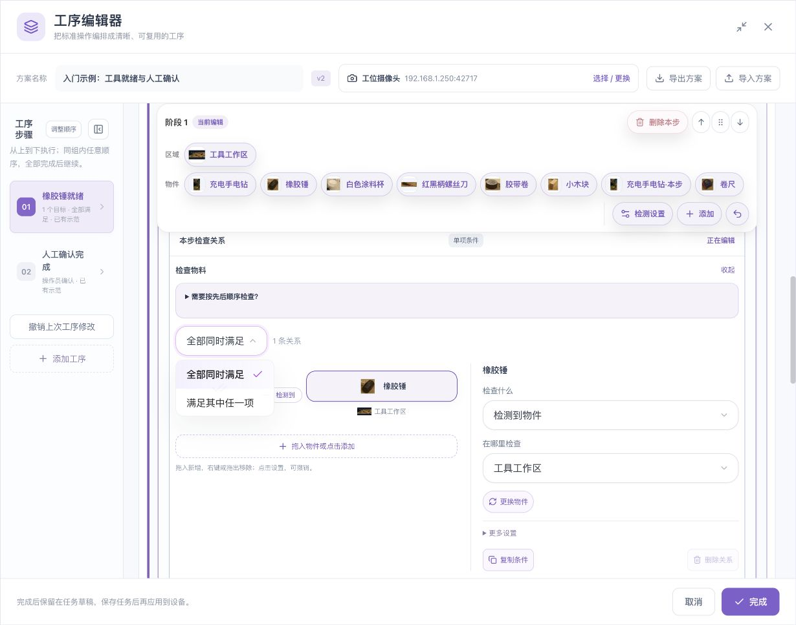
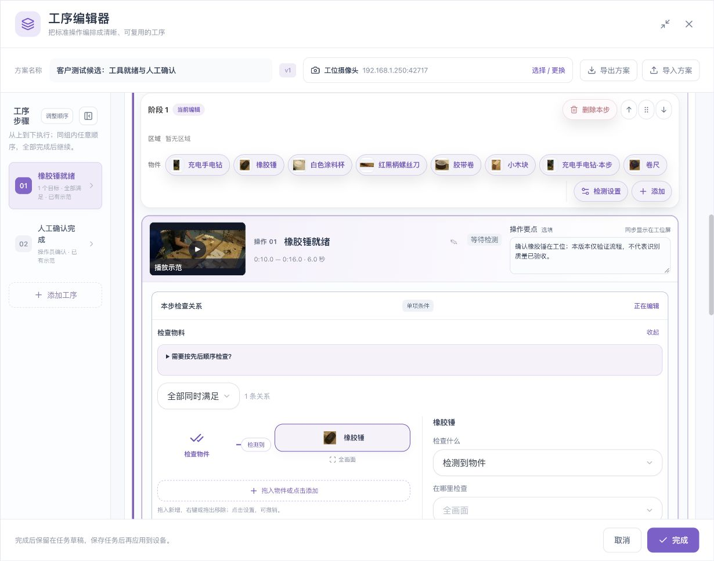
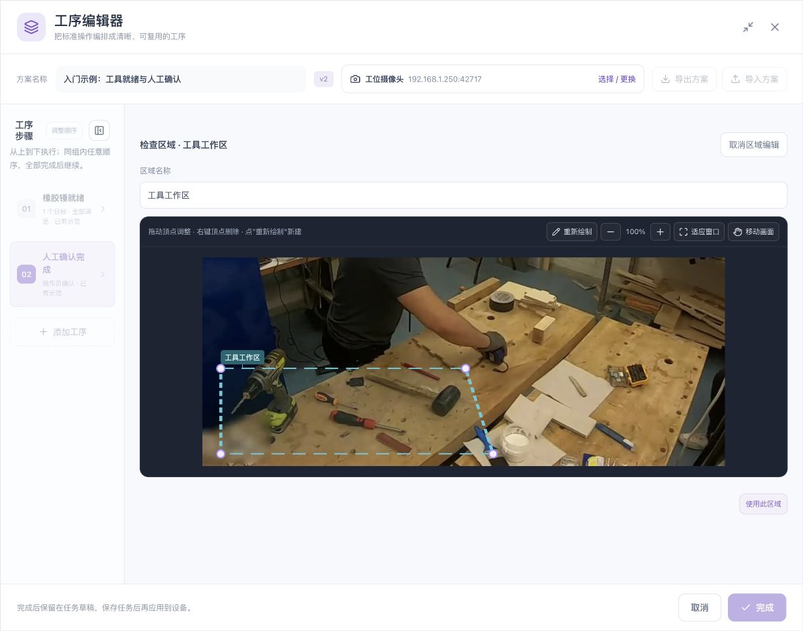
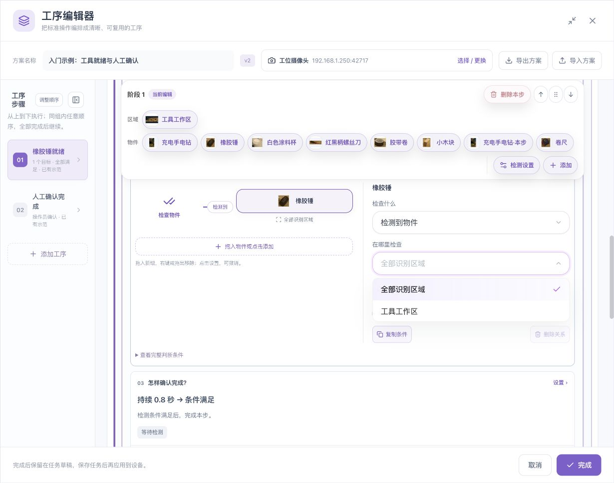
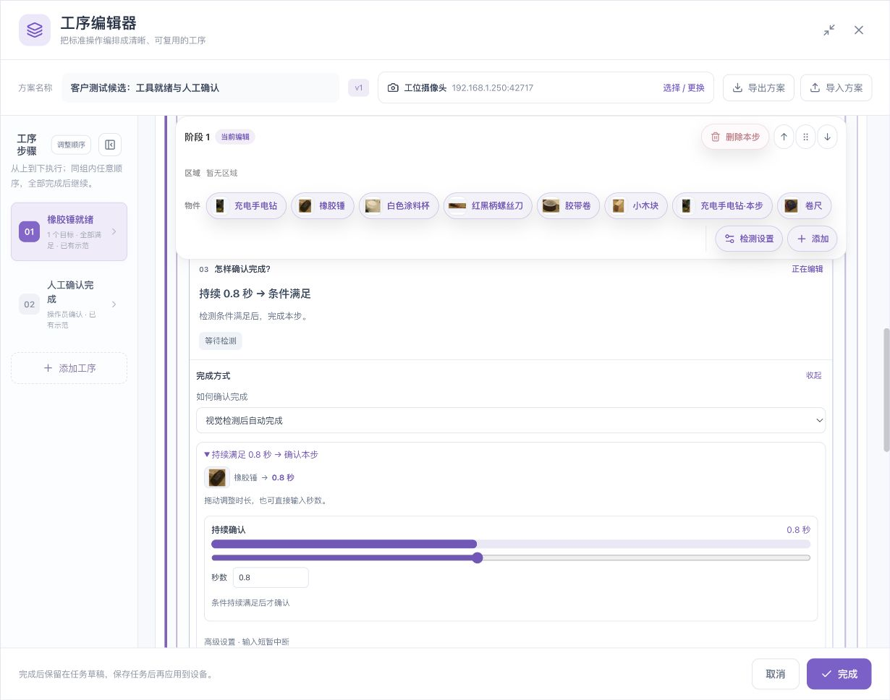
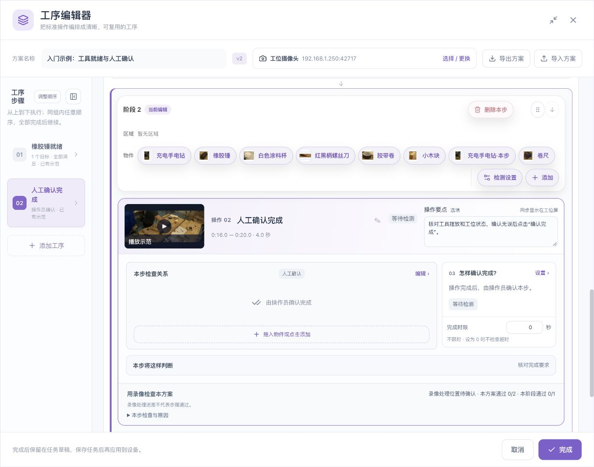
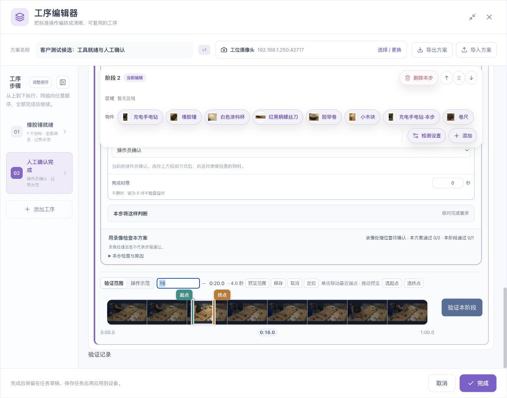
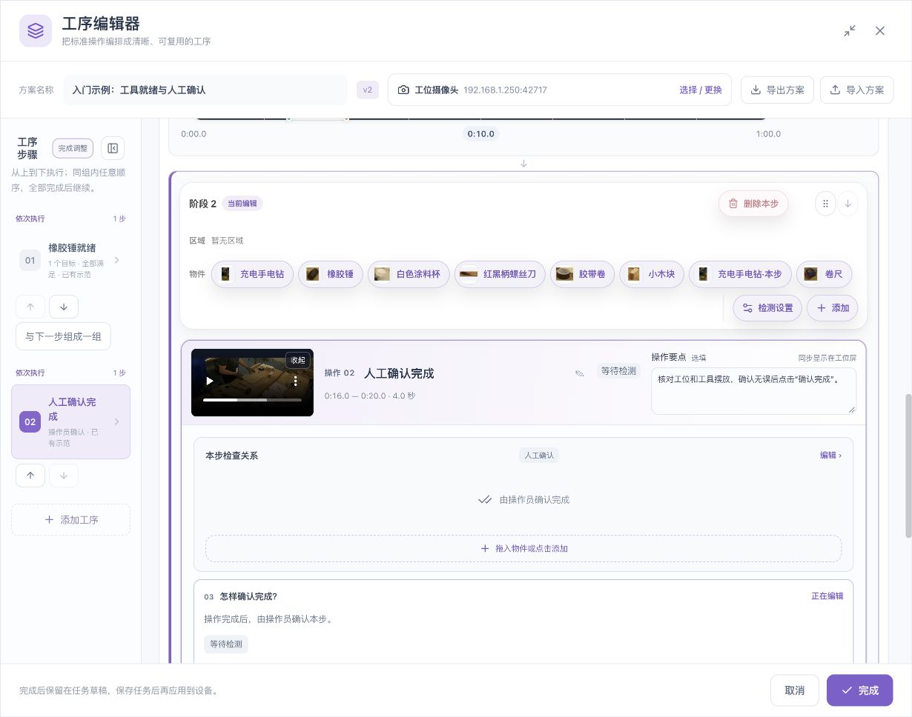

# 检查规则、全局区域与时间关系

[English](../../en/sop/rules-and-regions.md) · [使用说明首页](index.md)

先用一句现场语言说明“这一阶段怎样才算完成”，再把它拆成物件、区域、数量、时间和完成方式。不要从高级参数开始。

## 1. 工序、阶段和条件的关系

- 一道工序描述一个有明确目的的动作，例如“工具就绪”。
- 一个阶段可以包含一道工序，也可以包含多道可任意顺序完成的工序。
- 各阶段从上到下执行；同组内要求全部完成后才进入下一阶段。
- 一道工序内部又可以包含多项检测条件。

“同一阶段的工序可任意顺序完成”与“同一步的条件全部同时满足”不同。前者允许各工序分别完成；后者要求条件在同一时刻组合成立。

| 现场要求 | 应选择 |
|---|---|
| 锤、螺丝刀、杯子都摆好 | 多物件“全部同时满足” |
| 两种合格工具任选一种 | “任意一项满足” |
| 先靠近，再离开 | 步骤内的“按先后顺序” |
| 工具准备与标签检查互不依赖，均须完成 | 同一阶段的任意顺序工序 |
| 前一步完成后才能开始后一步 | 不同阶段顺序执行 |

## 2. 配置物件检查

1. 打开本步“检查关系 → 编辑”。
2. 选择一个物件。
3. 选择要检查的要求，例如检测到、数量或支持的空间关系。
4. 核对物件对应区域。
5. 需要多项时，继续添加，并核对组合方式。
6. 回到预览图，逐条读出条件，确认与现场要求一致。

参考图片用于“识别它是谁”；检查条件用于“决定本步要它满足什么”。添加参考图片不会自动创建一条工序要求。

### 数量要求

数量是符合本条目标、分数和区域等要求的检测实例数量。配置“恰好几个”“至少几个”等要求后，实际放置对应数量和错误数量分别验证。

同一物件的重复框可能造成错误计数；应先处理重复检测。相似物件错误分类同样会影响数量判断。

## 3. 只检查指定区域

### 3.1 在画面中创建全局区域

1. 在清晰、方向正确的视频画面中点击“画区域”。
2. 沿工作区边界依次设置顶点。
3. 闭合区域，检查它覆盖的是需要检查的平面。
4. 命名，例如“工具工作区”“备料工作区”。
5. 确认并核对覆盖位置。

区域应根据工位用途命名。避免“区域1”“区域2”难以区分。边界不要贴着物件正常活动的极限位置，以免轻微画面波动导致进出状态反复切换。

### 3.2 创建区域后还要绑定条件

在本条物件的区域入口选择“工具工作区”。也可以把工具栏的区域拖到支持的区域位置；操作细节见[工具栏与拖拽](toolbar-and-drag.md)。

| 区域选择 | 意义 |
|---|---|
| 全画面 | 按整个画面判断 |
| 全部识别区域 | 使用当前配置的识别区域范围；请核对区域是否完整 |
| 某个具名区域 | 仅按该条指定区域判断 |

**“画了区域”与“本条检查绑定了区域”不是同一件事。** 检查关系图下方的区域文字，不能仅凭主画面存在虚线区域就推断所有条件已受限制。

全局区域是可被多步复用的区域定义，不代表所有步骤都要同时使用所有区域。更改共享区域后，检查所有引用它的工序并重新验证。

### 3.3 区域的正反例

- 目标在区域内，且清晰可见。
- 同一目标在区域外。
- 目标跨边界、贴边、部分遮挡。
- 多件同类物件分别位于区域内外。
- 两个区域重叠时，核对实际规则，而不是假设它们自动互斥。

相机位置、镜像或分辨率变化后应重新核对区域。区域外不满足不代表没有检测到目标，也不代表算法停止处理整个画面。

## 4. 空间关系

空间检查用于判断两个可见目标的位置关系。常见用途包括放入区域、位于另一物件左侧或右侧、靠近或远离。以当前界面可选项和设备能力为准。

配置时依次核对：

1. 谁是被检查目标；
2. 谁是参照目标或区域；
3. 双方是否来自支持的画面来源；
4. 位置方向是否与实际相机一致；
5. 边界、距离或包含要求是否符合现场容差。

“手靠近杯子”只证明画面中的位置关系，不直接证明抓握、接触、施力或完成了加工。手与物件必须被可靠识别；画面中没找到手，不能自动解释为手已远离。

能力暂不可用或正在确认时，保留现有配置并查看提示。不要把只读或灰色状态当成规则已经生效。

## 5. 同时、任选和先后

### 全部同时满足

适用于必须在同一时刻同时存在的条件。若要求持续0.8秒，必须按组合规则持续满足；不能把相隔几秒的独立出现直接相加。

### 任意一项满足

适用于等价选择，例如任意一种合格容器。使用前确认现场允许任选；不要用它代替必须同时检查的多个零件。

### 按先后顺序

适用于靠近→离开、起点→终点等过程。核对每一项的目标、区域、持续时间和顺序。后项通常需要在前项完成后出现符合要求的变化，不能仅凭录像起始时它已经成立就推断过程发生。

手部顺序模板见[手部动作](hand-operations.md)。若同时存在步骤顺序与步骤内顺序，先单独验证各层，再验证组合。

## 6. 完成方式与时长

| 完成方式 | 适合场景 | 核对重点 |
|---|---|---|
| 检测满足后自动完成 | 可由视觉明确判断的准备状态 | 条件、持续时间、误检 |
| 条件满足后人工核对 | 视觉能提供依据，仍需人工质量检查 | 条件先满足，操作员再确认 |
| 人工确认 | 当前动作需要人判断 | 操作说明清楚，确认对象是当前工序 |

- **持续时间**：过滤瞬间出现或短暂抖动，不等于录像片段时长。
- **完成时限**：允许完成本步的最长时间；0表示不检查超时，以界面提示为准。
- **顺序过程的时限或允许间隔**：约束过程，不能与本步持续时间混为一谈。
- **输入中断**：缺少可靠画面不是满足条件；检查相关状态和原因。

先跑通正常流程，再增加时限，能更容易判断问题来自视觉条件还是时间约束。

## 7. 阶段选段与总范围的关系

每个阶段保留自己的选段。阶段可以有交集，例如手部准备与物件到位在录像中存在时间重叠；不应强制阶段片段首尾相接。

对同一源录像做本方案验证时，总范围应覆盖参与验证的阶段范围。缩小总范围后如果出现越界提示，应选择扩大总范围、调整相应阶段，或明确只验证相关阶段。不能静默裁切后把原计划当成已完整验证。

示范视频用于培训；验证范围用于验证。使用阶段“验证范围”时，检查提示是否同步更新该阶段示范；需要独立教学片段时切换到“操作示范”，并核对播放器显示。不要假设修改一个阶段会修改其他阶段。

## 8. 任意顺序组与排序

进入左侧“调整顺序”，按实际依赖关系组织阶段。同阶段工序可任意顺序完成，但仍需全部完成；不同阶段保持顺序。

不要为了减少点击把有前后依赖的工序放进任意顺序组。调整后重新核对步骤名称、组别、时间范围及验证结果。

**下一章：[工具栏、拖拽与撤销 →](toolbar-and-drag.md)**
