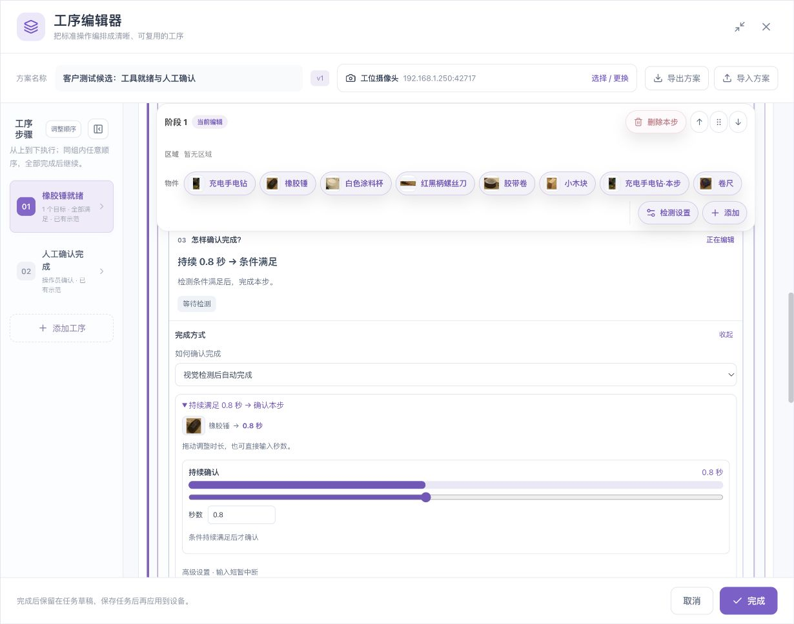
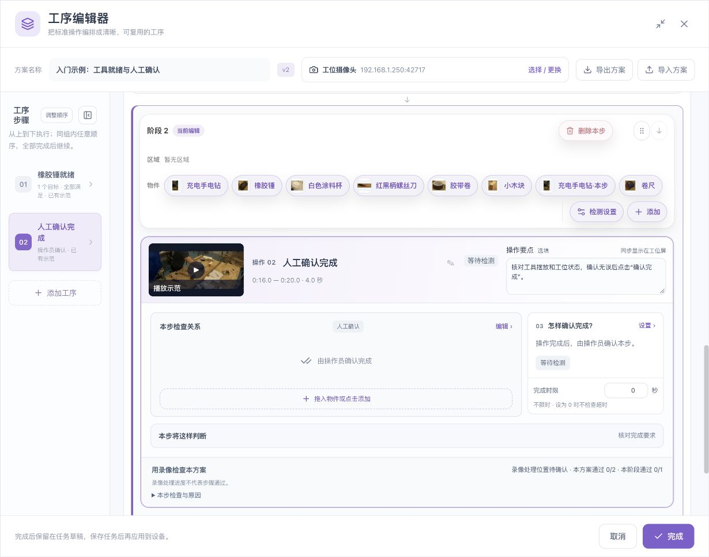
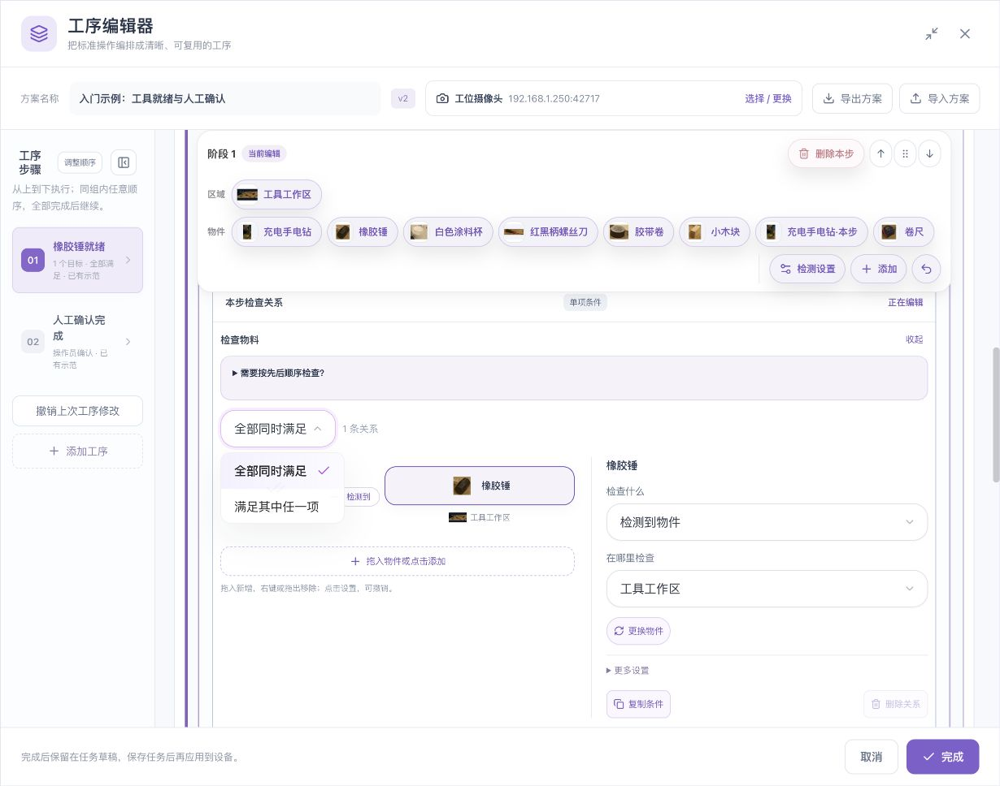
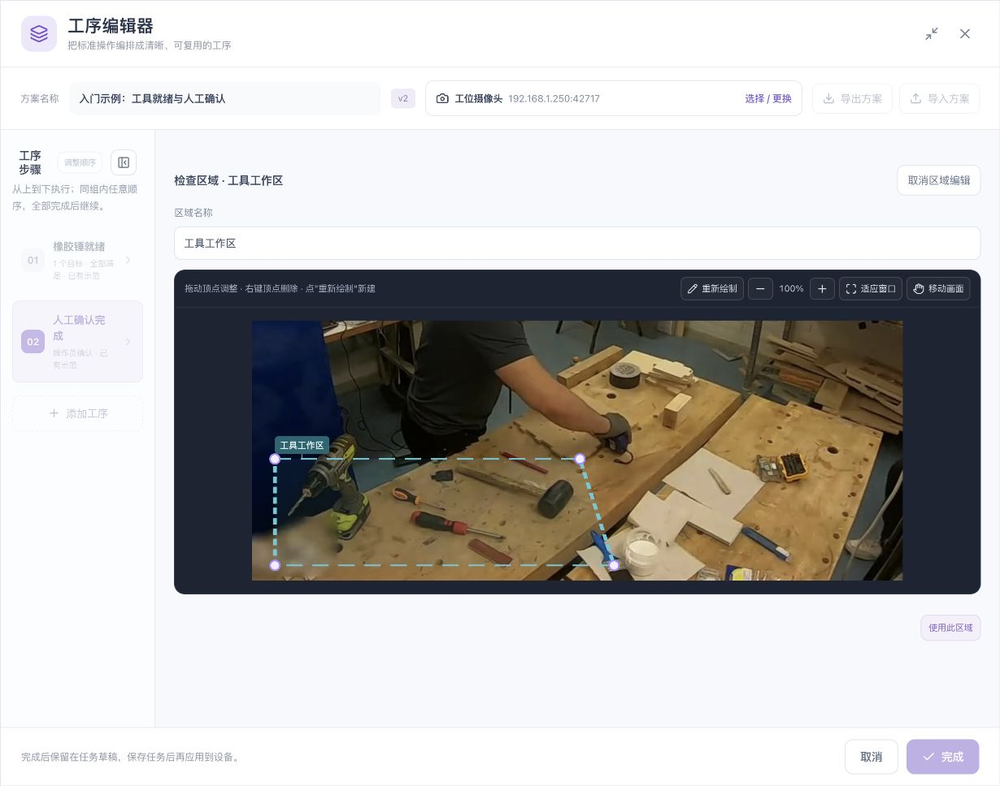
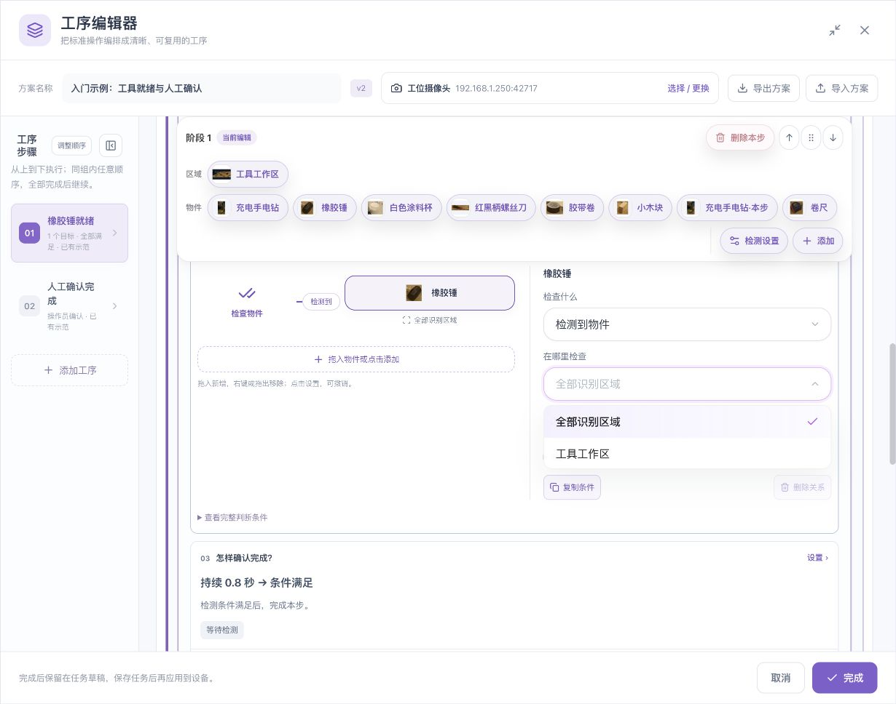
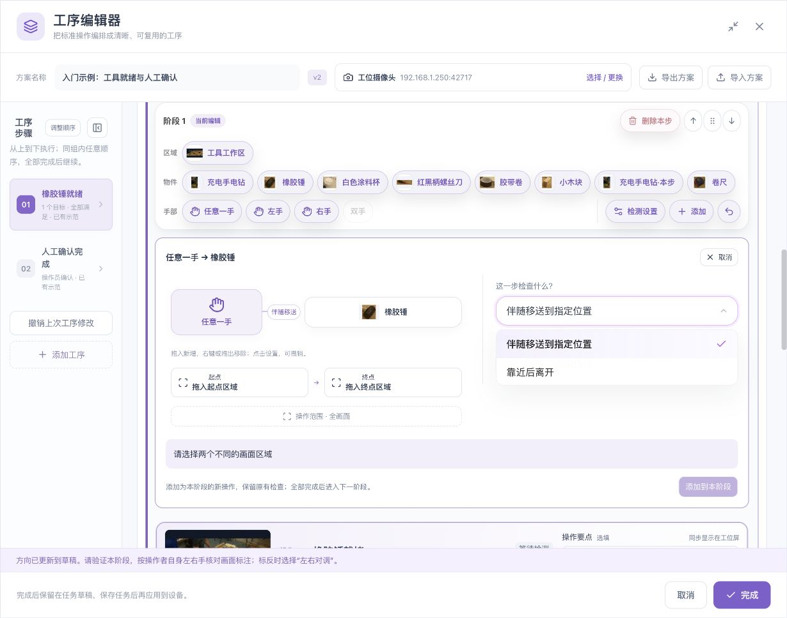
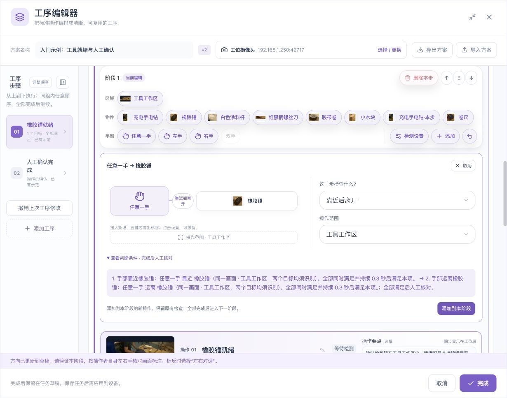
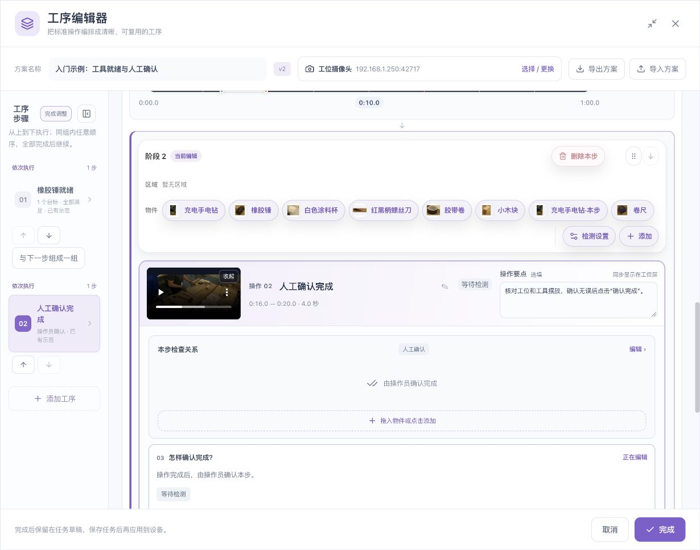

# 六类典型场景的完整配置实训

[English](../../en/sop/scenario-labs.md) · [手册首页](index.md)

本章把控件串成完整工作任务。先完成实训 A，再按工艺需要选择其他实训。所有结果表都表示**应该怎样验证**，不是声称本手册已经替您的工位完成了验收。

[下载配套工作台录像](../../assets/sop/workbench-60s.mp4)。它用于入门的工具就绪示例。数量变化、移送和不同顺序等进阶操作需要另拍对应录像；原片没有发生的动作不能靠改规则“造出”结果。

## 实训 A：橡胶锤就绪 → 人工确认

### A1. 目的与成品

建立两阶段最小流程：

| 阶段 | 操作名称 | 检查 | 完成 |
|---|---|---|---|
| 1 | 橡胶锤就绪 | 正确物件在工具区可见，保持 0.8 秒 | 视觉后自动 |
| 2 | 核对工位并确认 | 操作员核对工具和工位 | 人工确认 |

示例第一阶段范围 10–16 秒，第二阶段 16–20 秒。先核对自己的实际录像；这些不是固定工艺时间。

### A2. 准备素材

1. 新建 SOP 工序，选择只检查物件。
2. 选择工位摄像头。
3. 上传示例录像或录制自己的工作台。
4. 播放片头、中间、片尾。
5. 确认时间轴显示真实缩略图。

### A3. 建立一个目标

1. 暂停到锤清楚可见的画面。
2. 点击添加目标，框住锤的可见主体，少带背景。
3. 命名“橡胶锤”，确认加入。
4. 到目标模式核对参考图。
5. 正常姿态发生变化时补充角度，不新建第二个同名业务目标。
6. 使用识别完善检查锤所在位置、相邻工具和没有锤的画面。

**退出条件：** 正常清楚画面的目标与实际物件对应。若仍存在关键漏检或重复框，留在目标模块处理，不先调顺序。

### A4. 配置第一步

1. 将操作名称写为“橡胶锤就绪”。
2. 操作要点写为“把橡胶锤放入工具区，保持就绪”。
3. 打开本步检查关系，选择橡胶锤。
4. 选择检测到物件。
5. 需要限制工位时，画工具区并把本项绑定该区。
6. 完成方式选视觉检测后自动完成。
7. 持续时间设为 0.8 秒，本步时限先为 0。
8. 读回关系图，确认没有额外工具或手部要求。

### A5. 配置第二步

1. 添加独立的下一工序，不与第一步组成任意顺序。
2. 名称写为“核对工位并确认”。
3. 完成方式选择人工确认。
4. 要点写明要核对的实际内容，例如工具齐备、工位无遗留异物。
5. 选择对应示范片段。
6. 核对先工具就绪，再人工确认。

### A6. 设置并验证范围

1. 第一阶段用 10–16 秒解释工具就绪。
2. 第二阶段用 16–20 秒解释人工核对操作。
3. 总范围覆盖两个阶段。
4. 先验证第一阶段，检查条件与持续时间。
5. 再验证整套方案的阶段组织。
6. 人员确认必须在运行交互中实际核对，不能用录像像素代替。

| 测试 | 预期 |
|---|---|
| 锤正常就位并稳定 | 第一步具备完成条件 |
| 锤缺失或区域外 | 第一步不能只因背景相似就完成 |
| 第一步后尚未人工确认 | 不应把第二步自动当成人员已确认 |
| 操作员核对当前件后确认 | 确认对象和推进正确 |

### A7. 保存与重开

完成 → 节点确认（若仍打开）→ 任务保存。重新打开核对两步顺序、目标、区域、时长和选段。再按[工位手册](operator-guide.md)测试实际确认。

## 实训 B：三件工具必须同时备齐

### B1. 适用要求

橡胶锤、充电电钻和涂料杯必须在同一时刻准备好。这是一个工序内的多项条件，不是三个可替代选项。

### B2. 配置表

| 项 | 设置 |
|---|---|
| 操作名称 | 三件工具备齐 |
| 条件 | 锤检测到；电钻检测到；杯检测到 |
| 组合 | 全部同时满足 |
| 区域 | 各工具所在的有效工作区 |
| 完成 | 示例保持 0.8 秒后自动，或视觉后人工核对 |
| 说明 | 明确三件工具的名称与摆放要求 |

### B3. 操作步骤

1. 给三种物件分别建立清楚参考并完成单目标识别复核。
2. 打开本步检查关系。
3. 点击添加关系物件；处于折叠预览时先展开，再打开选择器。
4. 勾选三种目标并确认。
5. 选择全部同时满足。
6. 分别检查每条目标的区域与最低分数。
7. 配置持续时间及完成方式。
8. 回到图示，读出三项要求。
9. 选包含三件均就绪的片段验证，再拍缺少一件的反例。

| 测试 | 预期 |
|---|---|
| 三件同时清楚可见 | 可满足组合 |
| 只出现其中两件 | 不满足 |
| 三件分别出现但从未同时出现 | 不能相加算全部备齐 |
| 同一把电钻重复两个框 | 不能当作多件工具已备齐 |

## 实训 C：只检查工具区，区域外不计入

### C1. 要求

同类工具可能出现在邻桌，只检查本工位工具区内的目标。

### C2. 配置

1. 在正确机位画面中画“工具工作区”。
2. 闭合并命名，核对边界没有误包邻桌。
3. 打开该工具的条件。
4. 在物件范围中选择工具工作区。
5. 回到关系图核对该名称。
6. 将其他工具或手部条件分别绑定它们所需的区域。
7. 选择包含区域内、区域外和边界位置的录像验证。

### C3. 边界测试

| 实物位置 | 应核对 |
|---|---|
| 完全在工具区内 | 名称、位置和计数正确 |
| 完全在工具区外 | 不应满足本区要求 |
| 横跨边界 | 不要把不明确归属当成稳定就位 |
| 区内一件、区外一件 | 数量要求使用正确范围 |
| 两区域重叠 | 核对两条规则实际含义，不能假定自动互斥 |

画区域不会让所有工序自动只看该区域。区域外仍有算法框，不一定是错误；应看它是否错误地影响本条条件。

## 实训 D：手靠近工具后再离开

### D1. 前提

工具识别已可用；所需手在关键过程可见；需要指定左右时已按本人左右核对。

### D2. 配置步骤

1. 检测设置中添加手部识别。
2. 不需要左右限定时使用任意一手。
3. 在工具栏先点手，再点橡胶锤。
4. 选择靠近后离开。
5. 操作范围覆盖手和锤的完整动作区。
6. 查看生成条件，核对先靠近、后可见远离。
7. 核对持续时间及允许过程时间。
8. 需要实际质量核对时保留人工核对。
9. 添加到本阶段，检查这是新操作还是替换当前条件。
10. 若和原操作组成同阶段任意顺序组，确认工艺是否允许；不允许则重新组织阶段。
11. 用完整真实动作录像验证。

| 录像 | 预期 |
|---|---|
| 有效靠近，再有效远离 | 按顺序核对 |
| 一直远离，从未靠近 | 不能跳过第一项 |
| 靠近后保持不动 | 不能把后续远离当成已发生 |
| 手被遮挡或出画 | 不能当成可见远离 |
| 相邻人员伸手 | 不能未经核对就认作指定操作员 |

该模板不证明锤击次数、力度或装配质量；这些需要明确可用的检查能力或人工核对。

## 实训 E：两项准备可任意顺序，但都必须完成

### E1. 要求

“工具就绪”和“标签核对”可以任意先后，全部完成后才能进入“最终确认”。

### E2. 阶段组织

| 阶段 | 内容 | 规则 |
|---|---|---|
| 1 | 工具就绪、标签核对 | 同组任意顺序，全部完成 |
| 2 | 最终确认 | 必须在阶段 1 完成后 |

### E3. 操作

1. 将两项准备分别建立为独立工序。
2. 各自配置目标/人工核对，不合并成一条任选条件。
3. 在调整顺序中把两项准备组织到同一任意顺序阶段。
4. 最终确认保留在下一阶段。
5. 分别设置自己的示范和验证范围。
6. 两个范围可以重叠；总范围应覆盖参与阶段。
7. 验证组内两种顺序、遗漏一步和过早最终确认。

| 操作顺序 | 预期 |
|---|---|
| 工具 → 标签 → 最终确认 | 可按规则完成 |
| 标签 → 工具 → 最终确认 | 同样可按规则完成 |
| 只做工具 → 最终确认 | 组内未完成，不应直接推进 |
| 工具和标签分时完成 | 可在同组逐步完成，不要求两者同一时刻成立 |

如果工艺实际规定先贴标签才能摆放工具，则不适用任意顺序，应拆成有依赖的阶段。

## 实训 F：从起始区移送物件到到达区，放稳后手离开

### F1. 适用前提

设备提供对应移送/连续观察模板；一个物理物件在关键路径可区分且可持续观察；手、物件与目的区画面清楚。仅两张端点照片不能证明完整移动过程。

### F2. 区域规划

- 起始区：物件动作开始的位置。
- 到达区：物件应放稳的位置。
- 操作范围：包括起点、路径和终点。
- 区域不要使初始物件同时满足起点和终点，失去有效变化。

### F3. 配置步骤

1. 先完成单物件、单手识别和左右核对。
2. 画起始区与到达区，检查形状。
3. 先选操作手，再选物件。
4. 选择支持的伴随移送模板。
5. 点起始槽位选择起始区，点到达槽位选择到达区。
6. 点操作范围，选择能覆盖完整过程的工位区域。
7. 查看判断条件，读回起始、移动中、到达、手离开。
8. 核对中途持续靠近、物件到达后保留等要求。
9. 根据真实节拍设置时间，不通过超大中断容忍掩盖遮挡。
10. 添加到阶段并重新检查实际生成规则。
11. 验证正常、半途离手、错放区域、遮挡、同类多物件等反例。

### F4. 验证矩阵

| 情况 | 应重点核对 |
|---|---|
| 正常连续移送并放稳 | 起点、过程、终点和离手都成立 |
| 直接在终点开始录像 | 不能倒推曾经从起点移来 |
| 中途把物件放下，手独自到终点 | 不能仅凭手到位完成 |
| 原物件出画，另一相似物到终点 | 不能无证据认作同一实物 |
| 到达后物件又离开 | 检查保留要求是否被正确约束 |
| 起始区与到达区重叠 | 不应以缺少真实变化的配置冒充移送 |
| 戴手套或短暂遮挡 | 以真实能力和不确定状态处理，不自动判成功 |

## 7. 每个实训的共同收尾

1. 保存当前配置前，逐项读回目标、区域、顺序、时长和完成方式。
2. 用另一段真实录次复验。
3. 完成并保存，关闭后重开核对。
4. 在实际工位测试当前操作、示范、人工确认和下一件。
5. 保留正常和反例结果，不只保存成功截图。
6. 把未通过问题写清，不把未测试能力当成已商用验收。

**相关：[参数说明](parameters.md) · [手部专章](hand-operations.md) · [维护与交付](maintenance.md)。**

*配图素材署名见[示例素材与截图来源](reference.md#7-示例素材与截图来源)。*
