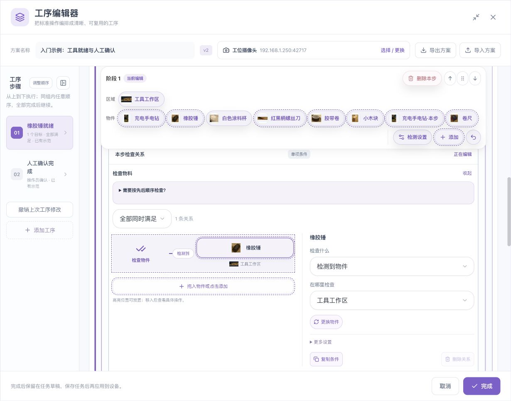
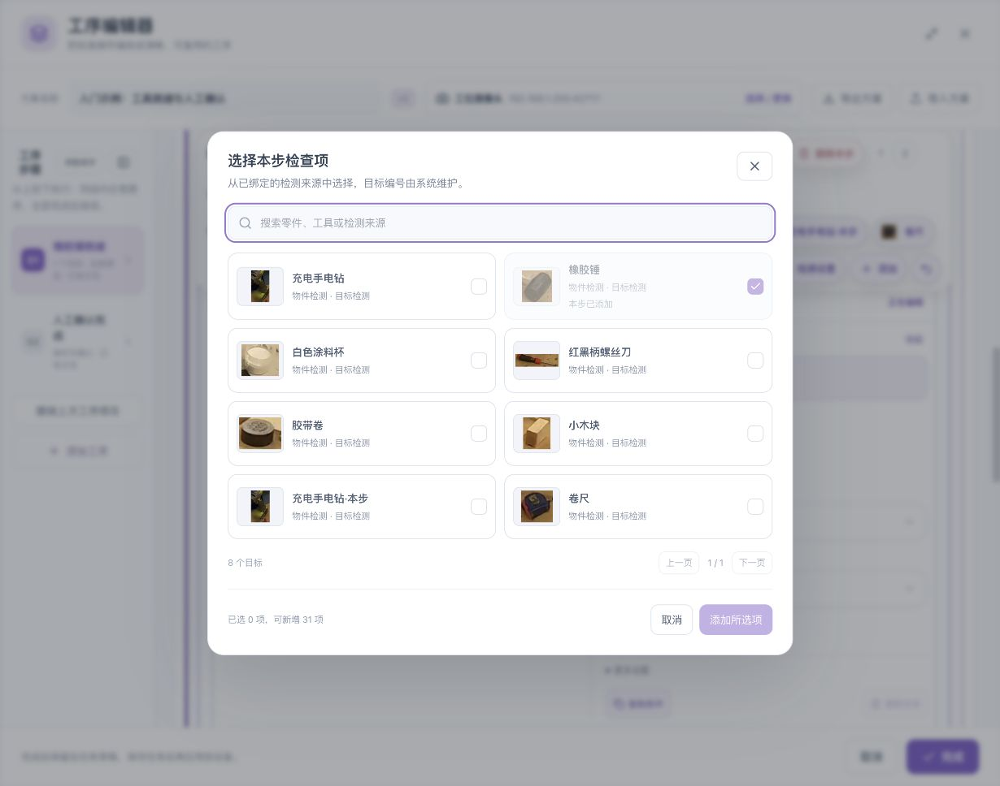
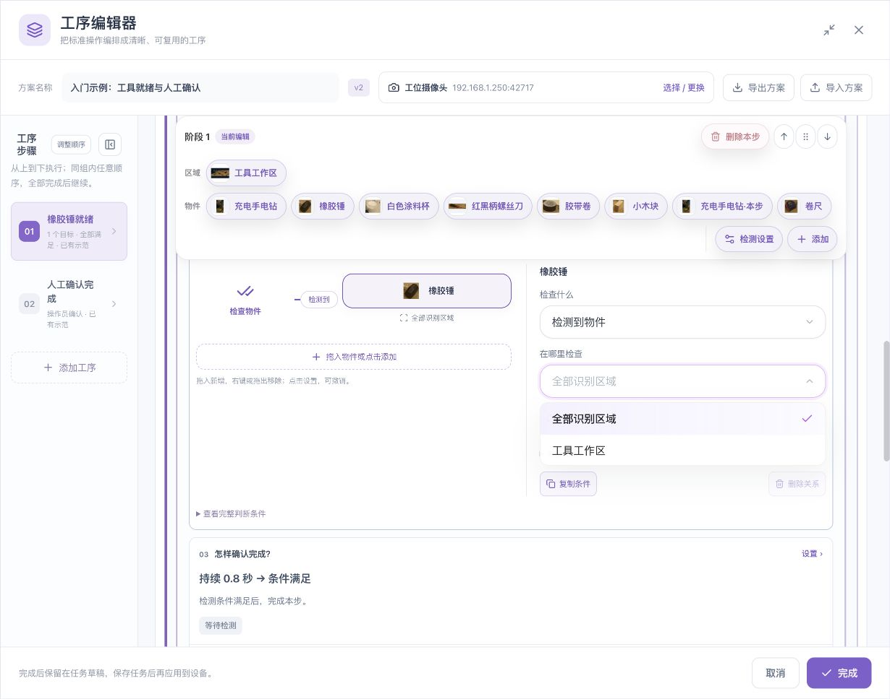
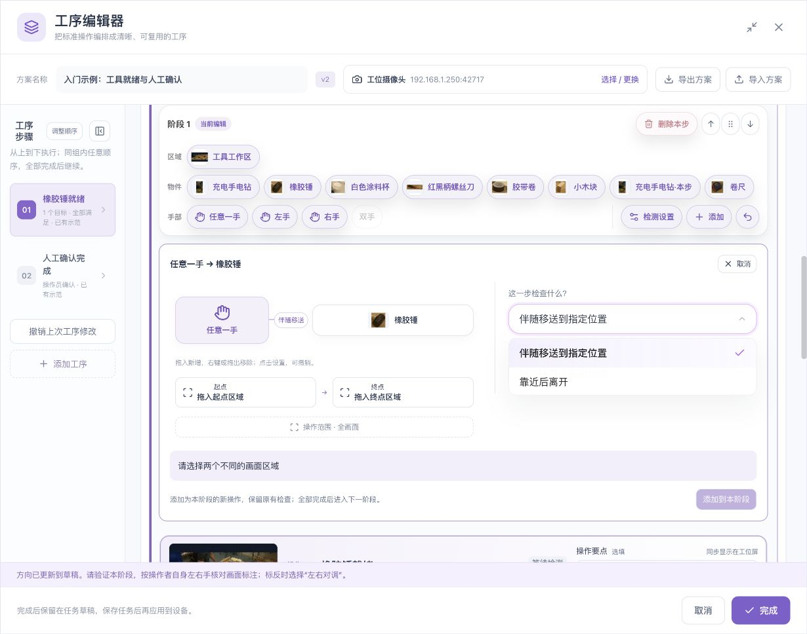

# 工具栏、拖拽与撤销

[English](../../en/sop/toolbar-and-drag.md) · [使用说明首页](index.md)

阶段上方的工具栏汇集区域、物件和手部入口。**先看拖动时的提示，再看松手后的实际结果。** 高亮只说明当前位置可以接收，新增的条件或操作才是修改结果。

## 1. 工具栏每一行做什么

| 工具 | 点击 | 拖动 |
|---|---|---|
| 区域 | 查看或编辑共享区域 | 放到支持的区域位置，改变相应检查范围 |
| 物件 | 选择对象或打开添加相关要求的入口 | 新增物件检查，或替换兼容位置的目标 |
| 任意一手、左手、右手 | 选择手部，并关联物件配置动作 | 放到兼容关系图位置，按提示新增或更换手部条件 |
| 检测设置 | 打开工位共用设置 | 不用于拖动 |
| 添加 | 打开本阶段添加入口 | 只按实际高亮和提示使用 |
| 撤销 | 恢复最近一次支持撤销的修改 | 不用于拖动 |

手部入口不可用时，先在“检测设置”增加相应能力，再核对左右手方向。区域和物件名称是用户资料，改变页面语言不会自动改写这些名称。

## 2. 正确的拖拽动作

1. 在当前阶段找到要使用的物件或区域。
2. 按住该卡片并移动。
3. 观察可接收位置的边框、底色和操作提示。
4. 把指针移到预期位置，读清“新增”“替换”或“绑定区域”等含义。
5. 松开鼠标。
6. 检查关系图、条件数量、目标名称和区域文字。
7. 如与预期不符，立即撤销并使用点击入口重新设置。

*此图展示拖动中的可接收反馈。是否添加成功，必须看松手后的条件或操作是否出现。*

不要只靠鼠标光标判断；不同系统的拖动光标可能不同。以页面高亮、动作提示和最终条件为准。没有接收提示的位置不应强行放置。

## 3. 新增一个物件检查

### 拖动入口

把工具栏物件拖到关系图底部“拖入物件或点击添加”的新增位置。松手后应出现该物件的独立检查关系，并保留原有检查。

### 点击入口

1. 点击关系图底部“拖入物件或点击添加”。如果当前检查关系处于折叠预览，第一次点击会先展开编辑区域。
2. 在展开的编辑区域再次点击“添加关系物件”或相应的添加位置，打开目标选择器。
3. 勾选要增加的物件并确认选择。
4. 回到关系图，核对新条件和组合方式。

| 想做什么 | 不要混淆 |
|---|---|
| 增加另一件需要检查的工具 | 应新增检查，不是替换已有目标 |
| 给同一物件补充拍摄角度 | 应到目标资料补参考，不是新增检查 |
| 需要两件同类物料 | 应检查数量，不是重复添加相同条件 |

目标已使用、能力不支持或达到容量上限时，相应选择可能不可用。先看提示，不要重复拖动同一对象。

## 4. 更换已有目标

把新物件拖到兼容的已有目标卡片上，先读替换提示。替换会改变这条检查的对象，不应被当成新增一条要求。

松手后逐项核对：

- 目标名称和缩略图；
- 检查类型，例如检测到、数量或空间关系；
- 区域是否仍符合新物件用途；
- 该条件的分数、数量等设置是否需要重新核对；
- 另一端物件或手部是否正确。

也可以点选关系图中的目标，再使用“更换物件”“更换目标”等明确入口。更换后重新验证相关步骤。

## 5. 给检查绑定区域

1. 从工具栏选择一个已命名区域。
2. 拖向目标或手部下方的区域位置。
3. 只有对应范围出现接收提示时才放开。
4. 检查区域文字是否更新。
5. 用区域内、区域外和边界画面验证。

把区域拖到某个物件的区域位置，表示修改该物件检查范围，不是移动视频画面的区域形状。要改区域形状，应打开全局区域编辑。

一个操作对象关联多个物件时，修改其共用范围可能同步影响多条关系；先读页面提示，再检查所有关联物件。

## 6. 拖入手部与手部动作

手与物件的入口用于创建可见位置关系或动作模板，不能仅凭把手放到物件卡片上，就认为已经配置“抓起”“拧紧”等物理动作。

最容易理解的点击路径：

1. 选择“任意一手”，或者已校准的左手、右手。
2. 选择相关物件，例如橡胶锤。
3. 选择“靠近后离开”或支持的移送模板。
4. 设置操作区域及需要的起点、终点。
5. 展开判断条件，核对每一项。
6. 点击“添加到本阶段”。
7. 检查本阶段新增了什么操作、原有检查是否仍保留。
8. 验证该阶段，并按操作者本人左右手核对画面标注。

添加到同一阶段的操作可能与原操作构成任意顺序组；若业务要求先后依赖，应重新组织阶段，不能只检查动作模板内部顺序。

## 7. 移除和撤销

关系图内的移除入口只用于移除对应检查。不要把移除检查误认为从整个方案删除目标资料。

- 使用右键菜单或明确的删除入口前，读清要移除的是单条关系、整个操作对象组还是工序。
- 部分关系图支持拖出移除；必须出现明确移除提示后再松手。
- 发生误操作，使用当前页面的撤销按钮，再核对关系图和条件数量。
- 撤销覆盖的是页面支持的最近修改，不是无限历史版本回退。
- 已经完成保存、关闭页面或进行其他修改后，不应假定旧撤销仍有效。

## 8. 工序排序与拖拽不同

| 操作 | 拖动的位置 | 影响 |
|---|---|---|
| 排序阶段 | 阶段标题旁的拖动柄 | 改变阶段先后 |
| 排序组内工序 | 工序标题旁的拖动柄 | 改变组内显示顺序，不把任意顺序自动变成顺序要求 |
| 拖入物件 | 工具栏物件卡片 | 新增或更换检测要求 |
| 拖动时间轴端点 | 起点、终点手柄 | 改变录像选段 |
| 移动画面 | 画面“移动画面”模式 | 改变查看位置，不改目标或区域坐标 |

对工序排序也可使用上下、前后移动按钮；拖动柄提供的方向键操作以页面提示为准。

## 9. 拖动没有生效时

1. 看是否已出现真实新条件，而不是仅有高亮。
2. 检查当前阶段、只读状态、设备能力、重复目标和容量。
3. 先取消尚未提交的动作模板或弹窗。
4. 尝试同一位置的点击添加或更换入口。
5. 检查点击操作是否能生成正确结果。
6. 保留原配置，记录来源物件、目标位置和页面提示，交给管理员排查。

不要反复拖动导致重复操作，也不要为解决拖动问题重录录像或清除已有任务。

**下一章：[验证、保存与工位运行 →](validation-and-operation.md)**

*配图中的示例录像及参考画面来源：[木箱装配数据集与 CC BY 4.0 署名说明](reference.md#7-示例素材与截图来源)。*
