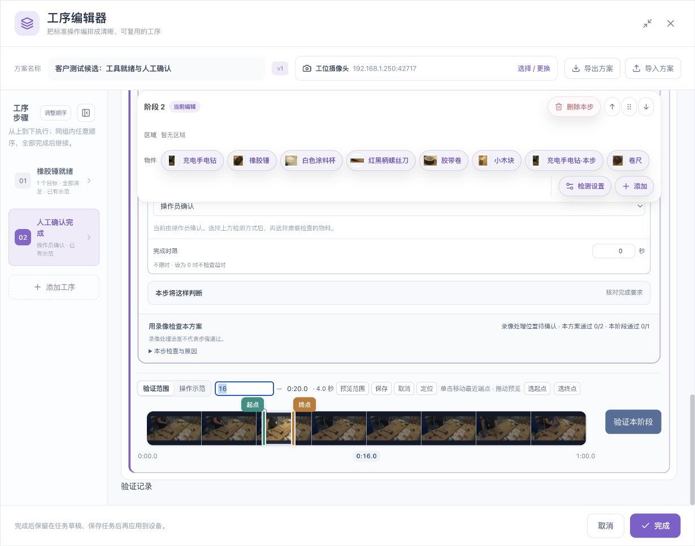
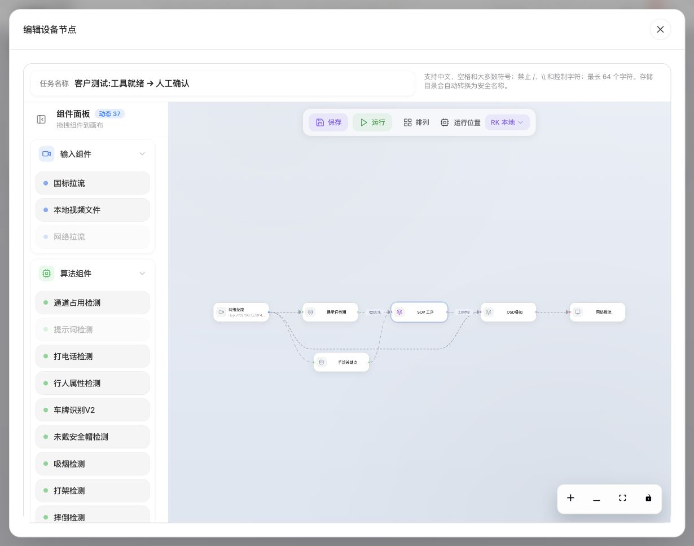

# 验证、保存与工位运行

[English](../../en/sop/validation-and-operation.md) · [使用说明首页](index.md)

按“目标识别 → 单阶段 → 本方案 → 独立录像 → 保存后现场运行”的顺序验收。每一步正确后再推进，问题会更容易定位。

## 1. 验证前核对

- 录像可播放，时间轴可定位。
- 当前目标、参考图和检测来源正确。
- 各条件的区域、组合、持续时间和人工确认方式正确。
- 总范围与阶段范围匹配。
- 没有未处理的配置错误或不可用目标。
- 现场镜头方向与配置一致；使用左右手时已核对本人左右。

## 2. 先验目标，再验阶段

先在识别结果中确认该目标确实被检出。若原图有锤但检测框没有，先处理识别，不要调整工序顺序掩盖问题。

在阶段下方点击“验证阶段”，核对：

1. 验证对应的是哪个阶段、哪段录像；
2. 当前检查到了哪些物件或动作；
3. 未满足原因指向哪条条件；
4. 是否需要持续满足或等待后续动作；
5. 是否已满足检测、仍等待人工核对；
6. 是否存在输入中断、目标不明确等状态。

操作员确认步骤不能只靠录像像素证明“人员已经确认”。在实际交互中检查确认对象、时机及后续阶段是否正确。

## 3. 再验本方案

点击上方“验证本方案”，观察阶段先后、组内完成情况和最终状态。独立阶段成功后，仍要检查它们组合时有没有缺失依赖、错误分组或未完成步骤。

### 正确解读结果

| 页面信息 | 说明 | 不能据此推断 |
|---|---|---|
| 已处理多少帧、录像处理位置 | 录像处理进度 | 对应比例的工序已通过 |
| 本步条件满足 | 当前检测要求成立 | 整套方案都完成 |
| 等待人工核对 | 视觉条件与人工确认尚有后续动作 | 系统卡住或自动漏过 |
| 阶段通过 | 对应阶段在本次证据中完成 | 其他阶段或独立录像也通过 |
| 本方案完成 | 本次方案执行达到终态 | 换镜头、换班次仍无需验收 |
| 输入中断或画面不足 | 当前没有足够可靠证据 | 物件不存在、手已离开或本步通过 |

结果应结合“本步检查与原因”、时间点和叠加画面查看。不要只截取一个绿色框作为整套方案验收依据。

## 4. 检查错误路径

正常录像之外，至少准备：

- 缺少一个必需物件；
- 物件放错区域；
- 数量少一个或多一个；
- 手未靠近、靠近后未离开；
- 先后顺序颠倒；
- 超过完成时限；
- 遮挡、模糊、断流或短暂缺帧；
- 任意顺序组内有一步没完成。

预期错误应产生明确的等待、未满足、异常或人工核对结果，而不是自动通过。按现场质量要求决定是否允许继续。

## 5. 使用独立录像

点击“补充验证录像”等相应入口，选择另一次真实拍摄的录像。使用相同工位、不同操作次数，逐步覆盖正常位置波动、速度、光照和人员差异。

教学录像用于建立参考；独立录像用于检查是否只对原片有效。重新使用同一片段不算独立验证。

单独记录每次验证使用的方案版本、录像、范围和结果。识别或规则变化后，检查结果是否已被标记为需要重新验证。

## 6. 保存的三个层级

1. **工序编辑器“完成”**：把本次编排返回任务草稿。
2. **节点配置“确认”**：若仍显示该窗口，将节点配置返回外层编辑器。
3. **任务编辑器“保存”**：持久保存任务，并等待明确结果。

运行是另一个动作。不要把“完成”当成已启动设备，也不要看到浏览器草稿就认为现场已应用。

### 保存后复核

重新打开任务，检查：

- 目标和参考数量；
- 区域形状与绑定；
- 物件、手部及其来源；
- 完成方式、时长、先后和分组；
- 各阶段独立时间范围；
- 示范视频与操作要点；
- 当前方案版本和需要复验的提示。

网络慢时先等待结果，不要连续多次提交。出现保存失败时保留窗口和错误信息，核对设备连接后再按提示处理。

## 7. 进入工位运行

保存并启动任务后，从任务卡片进入“工位运行”。操作员应依照当前工序说明完成动作，再按页面要求确认。

- 检查当前步骤名称和操作要点。
- 播放示范时核对片段对应本步。
- 视觉条件未满足时查看原因，不要靠重复确认跳过。
- 需要人工核对时，先检查实物，再确认当前步骤。
- 发生异常时按现场流程处理，保留相关记录。
- 新一轮流程开始前核对复位方式，不应把前一轮完成状态当成当前产品已完成。

具体启动、停止和复位权限由现场管理规则决定。对运行方案的修改应重新保存、核对与复验。

## 8. 历史记录与存储

扫描结果与方案复验记录持续保留，便于回看和追溯。空间不足时按提示整理；不要把清空任务、删除视频或重新录制当成日常刷新方法。

整理前核对记录所属任务、方案版本和是否仍需追溯；按现场保留政策备份，再使用明确的整理入口。不同录像、旧方案和当前版本的结果不要混为一项统计。

## 9. 一次交付应留下什么

| 内容 | 记录建议 |
|---|---|
| 工位与视角 | 摄像头、固定位置、照明、有效工作区 |
| 方案 | 名称、版本、工序顺序、人工确认要求 |
| 目标 | 参考内容与代表性变化 |
| 验证 | 正例、负例、独立录像、使用范围、结论 |
| 操作人员 | 能按说明独立完成，不依赖口头补充 |
| 维护 | 哪些变化需要重新验证、谁负责处理异常 |

本章流程用于形成可追溯验收依据。需要可靠现场观察与验证，不能仅凭配置窗口完整就判定适合生产。

**下一章：[故障排查 →](troubleshooting.md)**

*配图中的示例录像及参考画面来源：[木箱装配数据集与 CC BY 4.0 署名说明](reference.md#7-示例素材与截图来源)。*
