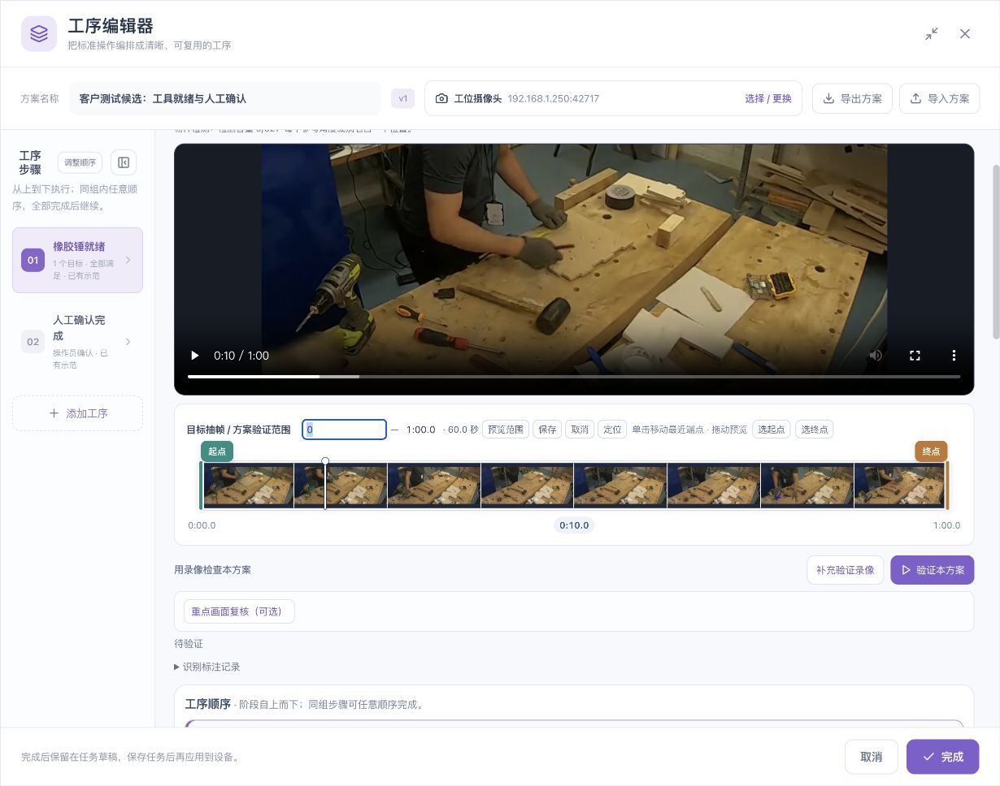

# 视频、目标与识别完善

[English](../../en/sop/video-and-recognition.md) · [使用说明首页](index.md)

先让系统看对物件，再让系统判断工序。参考图、人工补框、试检、采用和录像复验是不同动作；本章逐项说明它们的作用。

## 1. 视频是教学和复验的依据

固定机位、稳定照明、足够清晰的物件，是后续配置的基础。先用一段短录像完成单目标，再增加目标、手部和顺序条件。

### 录制或上传后要检查什么

1. 确认摄像头与实际工位一致。
2. 播放开头、中间、结尾，核对是否黑屏、停帧、方向错误或画面缺失。
3. 检查时间轴缩略图已加载，拖动后主画面能定位。
4. 找到物件清晰出现和确实不出现的片段。
5. 把严重遮挡、模糊、反光等画面与正常画面区分开。

*视频应能正常播放和定位。静态参考画面能显示，不代表时间轴缩略图已准备好。*

重新录制完整流程会替换当前示范素材并重置有关选段。请先阅读替换提示；只想回看时使用播放或定位，不要重新录制。

## 2. 分清三种时间范围

| 范围 | 用于什么 | 如何检查 |
|---|---|---|
| 目标抽帧 / 方案验证范围 | 从录像中抽样检查目标，并用所选范围复核方案 | 核对上方时间轴显示的起终点 |
| 阶段的验证范围 | 单独复核本阶段 | 核对该阶段下方时间轴 |
| 操作示范 | 给操作人员播放本步对应动作 | 点击本步“播放示范”，核对实际开始与停止位置 |

### 调整时间的方法

- 在时间轴上拖动起点或终点，放开后核对显示值。
- 点击显示的时间，输入秒数或“分:秒”；保存后可定位到该画面。
- “选起点”“选终点”用于把当前预览位置设为对应端点；灰色时先定位有效视频画面。
- “预览范围”用于播放所选区间。
- “恢复完整录像”把总范围恢复为整段原片。

拖动预览不应被理解为自动修改所有阶段。每个阶段有自己的选段；阶段范围可以重叠。上下级范围的关系见[规则与区域](rules-and-regions.md)。

**调整总范围后，应按界面提示重新扫描。** 已显示的扫描图片可能来自之前的选段；检查结果的时间、范围和当前目标是否一致。

## 3. 添加一个逻辑目标

1. 在“视频”中暂停到清晰画面。
2. 点击“添加目标”。
3. 框住物件的主要可见部分，尽量少带入手、桌面和相邻工具。
4. 使用现场能听懂的名称，例如“橡胶锤”。
5. 确认后切换到“目标”，检查参考图内容。

### 一个物件与多个参考角度

同一把锤的侧面、斜面和被正常握持的外观，可以作为同一个目标的多个参考角度。不要把“参考图数量”当成“物件数量”。

| 需要表达的意思 | 正确处理 |
|---|---|
| 同一把锤有不同朝向 | 在同一目标中补充角度 |
| 现场需要同时出现两把锤 | 配置实际数量要求，并检查数量识别 |
| 两种外形接近但用途不同的工具 | 使用可区分的目标名称和代表性参考 |
| 同一物件出现两个检测框 | 作为重复框排查，不算两件物料 |

参考角度和文字别名会占用相应检测容量；以页面容量显示为准。优先保留有代表性的参考，避免堆积大量近似图片。

### 好的参考图

- 物件清楚，主体占据框内主要部分。
- 覆盖真实使用中常见的方向、大小和握持方式。
- 不把主要特征完全遮住。
- 不把两件相邻工具合并为一个参考。
- 对容易混淆的物件，检查相似工具是否被误检。

## 4. 使用“帮我完善识别”

1. 选中要完善的目标。
2. 设定总抽帧范围和抽样间隔。
3. 点击“帮我完善识别”，等待扫描状态明确完成。
4. 按时间浏览结果，逐帧核对物件与检测框。
5. 优先处理正常清晰画面中的漏检、误检和重复框。
6. 再检查转动、遮挡、边缘位置和不同大小。

抽样间隔越小，生成图片越多，扫描和人工复核时间也越长。先验代表片段，再验完整录像，能够更快定位问题。片段成功只说明对应片段，不能替代整段结论。

## 5. 人工补框的完整流程

### 第一步：确认原图中真的有目标

看原图判断物件，不要仅凭低分候选框判断。模糊到无法确认时，记录“看不清”，不要为了补全统计硬画框。

### 第二步：补框并保存

进入“有目标补框”等相应入口，在原图上圈出漏掉的物件。同一帧有多个实例时分别框选。框尽量贴合可见物件，不要包入大块背景。

如果起点位于已有框内，请先确认当前是新增框模式，而不是选中、移动或调整旧框模式。检查提示文字和光标；仍不能绘制时停止该次修改，保留原框并按[故障排查](troubleshooting.md)处理。

### 第三步：重新检测当前图片

本帧补框可作为当前试检的临时参考。检查算法是否在相应位置真正检出；人工紫色框本身不是算法检测成功。

关注：

- 已补几个人工框；
- 算法检出几个框；
- 命中了几个已补框；
- 未命中的框是否因为位置、大小、候选分数或筛选要求而未匹配。

**“算法检出 1 个框”与“人工补框命中 1/1”含义不同。** 检出的框可能位于别处；应结合原图检查。

### 第四步：采用补框

“已保存，尚未采用”说明补框仍未进入方案参考库。根据页面的采用入口明确采用，检查待采用数量、参考数量和容量状态是否更新。

不要因为容量没有变化就重复补同一框。先核对它是否仍为未采用状态、是否被判为重复参考，以及本次采用是否成功。

### 第五步：重新复验录像

采用后的参考需要重新扫描所选片段，并复查相邻帧和独立录像。单帧临时试检成功，不证明整段稳定，也不证明实际运行已使用已保存方案。

## 6. 分数与阈值怎样理解

候选分数是识别线索，不是“这套 SOP 的准确率”。不同参考的分数与门槛应分别核对，不能把一个参考的最高分直接套给另一个参考。

调整前先确认：

1. 候选是否框住正确物件；
2. 是否存在相似物误检；
3. 条件中是否另有更严格的置信度、数量或区域要求；
4. 修改是否影响其他使用该目标的步骤；
5. 修改后是否重新检查正例与负例。

不要把阈值一路调低直到所有帧变绿。这样可能把桌面、手、相邻工具也当成目标。正常画面长期漏检时，优先改善参考、拍摄条件或反馈检测能力问题。

## 7. 复核用例

| 用例 | 要观察的结果 |
|---|---|
| 目标正常清晰出现 | 框位置正确，数量符合实际 |
| 目标完全移走 | 不在背景或相似物上继续检出 |
| 同一目标多个参考 | 不应把同一实例重复计数 |
| 两件同类物件 | 不应漏掉一件或把两件合为一件 |
| 手经过目标旁边 | 不应仅凭手或袖子误检 |
| 正常短暂遮挡 | 状态符合已配置的时间要求 |
| 镜头移动或光照变化 | 重新确认参考与区域适用性 |

完成后继续[规则、区域与时间](rules-and-regions.md)。手部场景另见[手部动作](hand-operations.md)。

*配图中的示例录像及参考画面来源：[木箱装配数据集与 CC BY 4.0 署名说明](reference.md#7-示例素材与截图来源)。*
