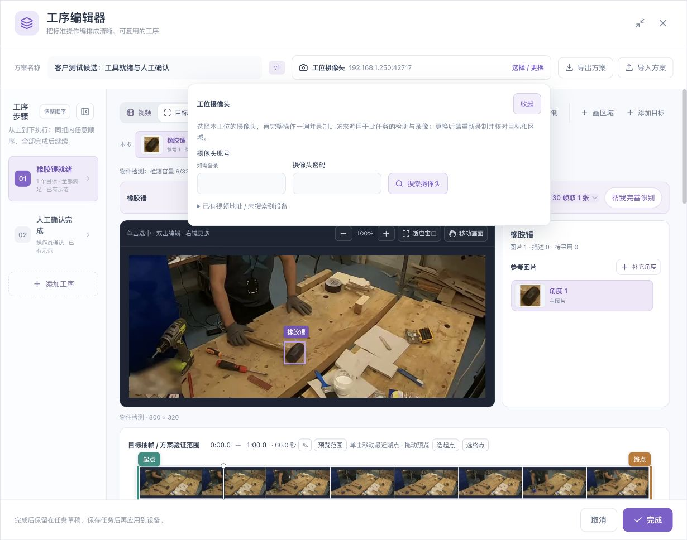
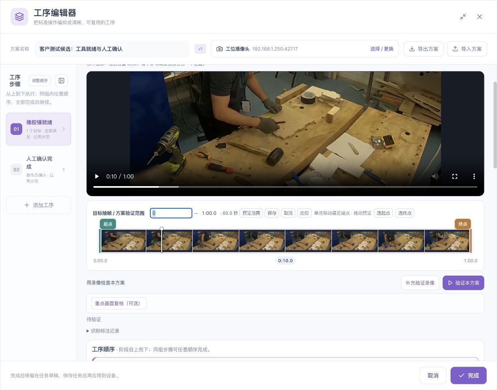
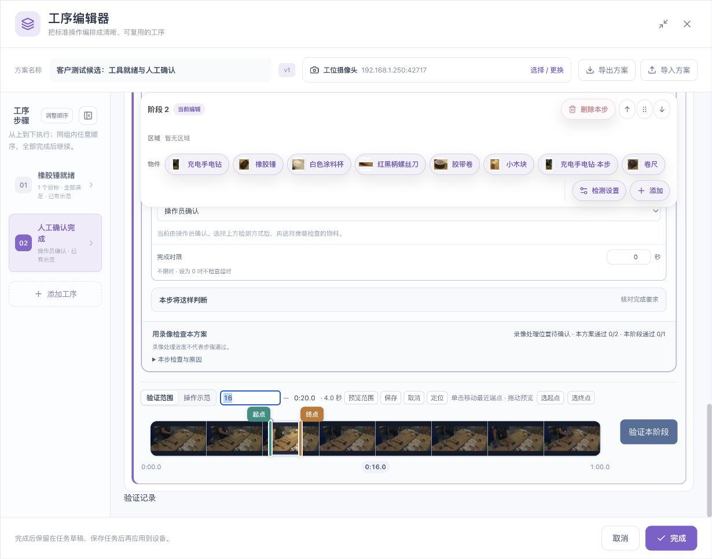
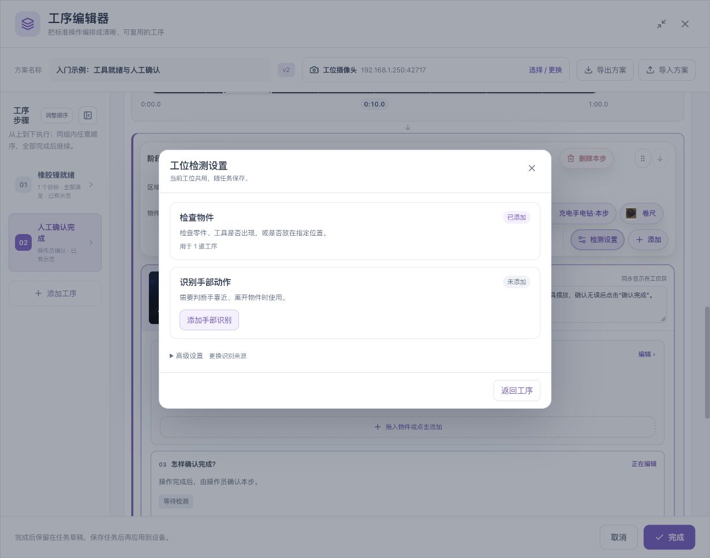
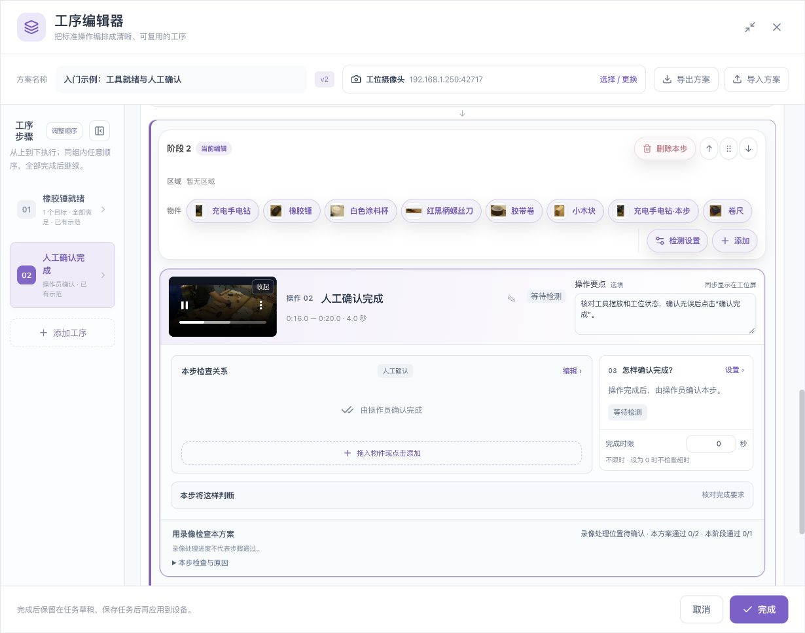
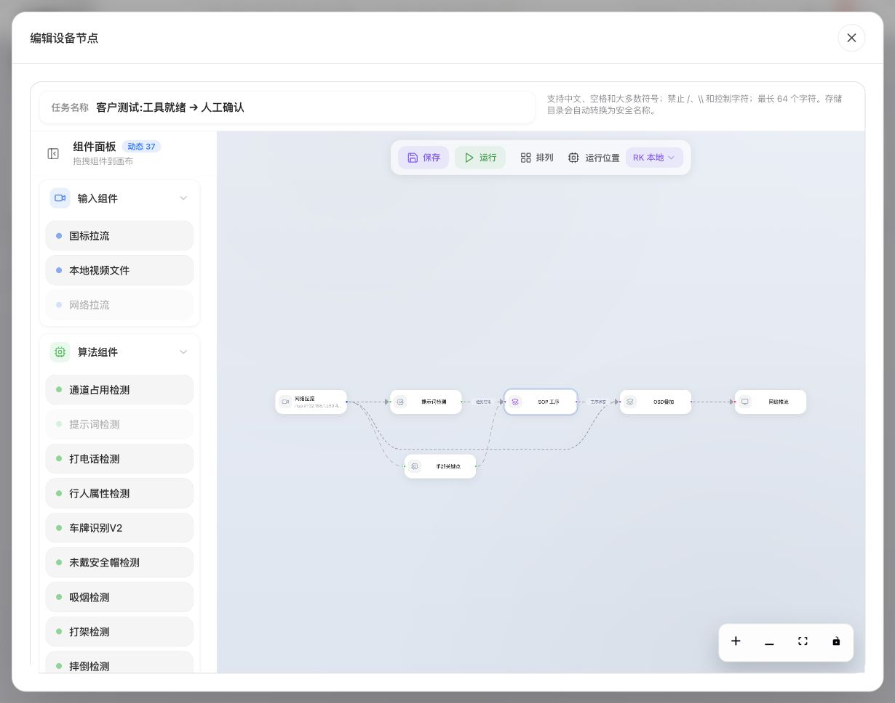

# 编辑器界面与控件操作详解

[English](../../en/sop/workspace-reference.md) · [手册首页](index.md)

本章按界面位置说明“在哪里操作、影响什么、操作后看哪里”。同一窗口中的视频、目标、工序和验证是相互关联的工作区；它们不是互不相关的页面。

## 1. 界面总览

| 区域 | 主要内容 | 操作后核对 |
|---|---|---|
| 标题栏 | 最大化、恢复窗口、关闭 | 关闭前是否仍有未保存草稿 |
| 方案栏 | 方案名称、版本、摄像头、导入导出 | 当前任务和工位是否正确 |
| 左侧步骤栏 | 工序编号、名称、简要要求、顺序 | 当前选择的是哪一步 |
| 视频/目标切换 | 教学视频或目标资料 | 当前模式是否符合本次操作 |
| 视频工作区 | 播放、暂停、定位、区域与目标绘制 | 当前时间、方向和真实画面 |
| 目标工作区 | 参考角度、待采用、检测容量 | 当前逻辑目标和所选参考 |
| 总时间轴 | 目标扫描和方案验证范围 | 起点、终点、范围是否变化 |
| 阶段工具栏 | 可用物件、区域、手和添加入口 | 新操作要放到哪个阶段 |
| 操作卡片 | 名称、示范、操作要点、状态 | 操作员将看到什么 |
| 检查与完成卡片 | 条件、区域、组合、时长、完成方式 | 实际规则是否符合工艺 |
| 阶段时间轴 | 本阶段的验证/示范选段 | 没有误改其他阶段 |
| 底部栏 | 提示、取消、完成 | 完成后仍需保存任务 |

## 2. 方案名称、版本与摄像头

### 2.1 名称

点击方案名称输入框修改。建议使用“工位或产品＋流程用途”，如“装配台 A：工具准备”。不要用版本号作为唯一名称；版本由系统记录时，仍应核对页面实际显示值。

名称是业务资料。切换界面语言不会自动把它翻成另一种语言。

### 2.2 摄像头选择

1. 点击方案栏的“选择 / 更换”。
2. 选择本工位摄像头。
3. 有认证要求时填写摄像头自己的账号信息。
4. 返回方案栏检查来源。
5. 核对新来源的教学画面、目标、区域和左右手方向。

设备网页登录账号与摄像头账号可能不同。无法连接时，应先核对来源和网络，不要在多个步骤中反复更换相同来源。

## 3. 左侧步骤栏

| 操作 | 方法 | 含义 |
|---|---|---|
| 选择工序 | 点击编号或工序卡片 | 中间定位到对应工序 |
| 折叠步骤栏 | 点击步骤栏顶部折叠按钮 | 给视频和规则更多空间，保留编号导航 |
| 展开步骤栏 | 点击折叠后的展开按钮 | 恢复名称和摘要 |
| 增加工序 | 点击“添加工序”或加号 | 添加新的工作单元，随后编辑名称和规则 |
| 调整顺序 | 使用“调整顺序”、移动按钮或拖动柄 | 修改阶段/组内位置 |
| 撤销 | 使用页面明确提供的撤销入口 | 撤回支持的最近修改，再核对结果 |

步骤栏的编号帮助定位，名称表达业务动作。仅改显示位置，不代表已经改变某个条件内部的先后逻辑。

## 4. 视频与目标模式

### 4.1 视频模式

用于播放教学素材、选取参考时刻、画全局区域和添加目标。先定位清楚画面，再绘制。

### 4.2 目标模式

用于查看当前目标的参考和识别完善。进入后先看目标名称、参考数量和待采用数量。

**常见误解：** 在视频中看到物件，不等于已经建立目标；建立目标，也不等于每个工序都已经配置该目标。

### 4.3 参考角度选择

点击参考角度卡片后，核对主画面与当前参考是否对应。补充角度用于同一目标的另一种外观，不会表达现场同时需要两件该物件。

“待采用”属于尚未进入正式参考的改进内容。请按[识别完善](video-and-recognition.md)完成试检、采用和录像复验。

## 5. 画面查看、滚动、缩放与移动

| 目的 | 使用什么 | 不会自动改变什么 |
|---|---|---|
| 上下浏览编辑器 | 普通滚轮/页面滚动 | 不应被当成改框或改规则 |
| 放大细节 | 画面加减按钮或界面提示的修饰键 | 不会提高原视频清晰度 |
| 恢复适合大小 | “适应窗口” | 不会改目标原始坐标 |
| 查看放大画面的另一处 | “移动画面” | 不会移动工件本身 |
| 新增目标框 | 添加目标或人工补框模式 | 不应移动旧框 |
| 修改已有框 | 先选中，再使用明确的编辑状态 | 不应被当作新增目标 |

画框前先看模式提示。指针起点落在旧框内部时，尤其要区分“新增框”与“调整旧框”。

窗口变窄时，先最大化、折叠步骤栏或收起不需要的设置。不要靠把网页缩得非常小来解决所有空间问题。

## 6. 时间轴的三个可操作对象

1. **播放头**：当前查看位置。
2. **起点手柄**：选段开始位置。
3. **终点手柄**：选段结束位置。

### 6.1 只想预览某个时刻

拖动播放头或按页面说明定位。操作后检查主画面和当前时间，不要只看缩略条。避免误抓起点/终点手柄。

### 6.2 想改变范围

1. 先确认这是总范围还是某个阶段的范围。
2. 拖动对应端点，或点击起点/终点显示值进行编辑。
3. 核对两个端点和显示时长。
4. 点击“预览范围”，检查实际开始和停止位置。
5. 如果用于抽帧，按提示重新扫描；如果用于阶段验证，重新验证该阶段。

“单击移动最近端点”表示一次点击可能改变范围，不是单纯播放定位。只想回看时优先使用拖动预览和明确的播放控制。

### 6.3 选起点与选终点

先把视频定位到所需位置，再点“选起点”或“选终点”。灰色时先确认视频已加载并有有效位置。不要把灰色按钮当成已经设置成功。

### 6.4 独立阶段

每个阶段保留自己的时间范围，可以与其他阶段重叠。阶段时间轴上的“验证范围”和“操作示范”用于不同目的，切换后核对当前显示值。

## 7. 阶段工具栏

### 7.1 先确认作用范围

阶段工具栏列出可用区域、物件和手部入口。选择一个工具，不一定立即改变当前规则；有时会进入动作配置，最后仍需点击“添加到本阶段”。

### 7.2 先点谁，再点谁

- 建立手与物件配合：先选手，再选物件。
- 物件就绪或位置要求：选择物件，再按页面给出的操作方式配置。
- 绑定区域：将区域放到对应区域位置，或点区域槽位选择。
- 编辑已有关系：点关系图中的对应对象或关系入口。

### 7.3 检测设置与步骤规则

“检测设置”管理工位共用能力和左右手方向。步骤内的“检查关系”“完成方式”管理当前工序的业务要求。添加手部来源，不会自动把每步变成手部工序。

完整拖入、新增、替换、移除和撤销操作见[工具栏与拖拽](toolbar-and-drag.md)。

## 8. 操作卡片

### 8.1 工序名称

使用能指挥动作的名称，例如“摆好工具”“核对备料”“确认完成”。名称旁的编辑入口用于改名称，不是配置视觉规则。

### 8.2 播放示范

点击视频缩略图的播放入口。核对本步时间文字与播放器实际范围。示范是给人看的教学内容，不能用它的缩略图代替识别参考。

### 8.3 操作要点

直接输入操作员需要知道的物料、位置、动作和质量检查要求。建议写成短句：“杯子放入备料区；核对容器无破损后确认。”

不要在操作要点中填写开发日志、阈值试验记录或与操作员无关的技术说明。页面提示此说明会同步显示在工位屏时，保存前请按实际操作员的阅读习惯检查。

### 8.4 状态

“等待检测”“待验证”“需核对”等反映当前状态，不是编辑字段。看到提示后应查看对应原因，不要通过改名称消除状态。

## 9. 关系图与设置区

1. 从“本步检查关系 → 编辑”进入。
2. 点选要修改的关系或对象。
3. 在相应设置中核对对象、条件类型、区域和参数。
4. 修改后回到关系图，逐条读出实际要求。
5. 多项条件时核对组合；带顺序时再核对每个阶段的变化。
6. 配置完成方式和持续时间。

图上“全部识别区域”等小字属于实际条件范围的重要信息，不是装饰。它与上方工具栏存在某个区域卡片的含义不同。

## 10. 完成、取消、关闭和保存

| 按钮或动作 | 作用 | 接下来应该做什么 |
|---|---|---|
| 完成 | 将工序编辑内容带回任务草稿 | 若节点窗口仍在则确认，再保存任务 |
| 取消 | 退出当前编辑；有修改时按提示处理 | 确认是否要放弃本次修改 |
| 关闭 | 关闭当前窗口 | 先核对未保存内容 |
| 节点确认 | 返回外层任务编辑 | 点击任务保存 |
| 任务保存 | 持久保存任务 | 等待结果，再重新打开核对 |
| 任务运行 | 使用保存后的任务运行 | 进入工位运行，核对当前步骤 |

保存后必须核对任务和版本。浏览器草稿、已保存任务、正在运行任务是三个状态，不要仅凭窗口关闭推断现场已应用。

## 11. 修改影响范围速查

| 修改 | 至少要重新核对 |
|---|---|
| 更换摄像头/画面方向 | 参考、区域、左右手、所有受影响步骤 |
| 改目标参考或识别门槛 | 所有使用该目标的条件及正反例 |
| 改共享区域 | 所有引用该区域的步骤 |
| 改手部左右设置 | 所有指定左/右手的动作 |
| 改某步条件、时长或完成方式 | 该步及依赖它的后续流程 |
| 改阶段分组或顺序 | 整套流程 |
| 改选段 | 对应层级的扫描/验证，示范范围 |
| 只改操作说明 | 工位屏阅读和示范是否一致 |

**继续：[参数与状态详解](parameters.md) · [完整场景配置实训](scenario-labs.md)。**

*配图素材署名见[示例素材与截图来源](reference.md#7-示例素材与截图来源)。*
